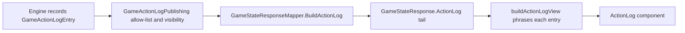
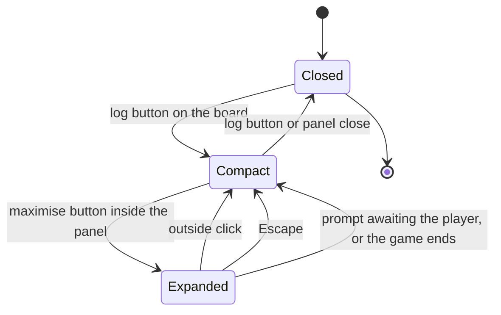

# Action log: the game's record, on screen and filtered

## Goal

The board's log button opens a panel that reads like a game record: every summon, support, attack, phase change and
prompt answer, in order, phrased for the player looking at it. The engine already kept an action log
([`GameActionLogEntry`](server/Models/Game/GameActionLogEntry.cs:3)); this documents the contract that turns it into a
player-facing feed, and the layout budget that keeps it from colliding with the support chain.

## The projection

The audit trail and the panel are the same list, read differently:

- **The log stays the single source of truth.** Entries are append-only and never rewritten; `EffectNotices` and
  `AnimationEvents` are projections of the same record, not separate streams.
- **Publication is an allow-list.** [`GameActionLogPublishing`](server/Models/Game/GameActionLogPublishing.cs:1) names
  the `ActionType` values that reach a client. Engine diagnostics - a skipped mandatory effect carrying a raw instance
  id, a presentation acknowledgement, a phase-automation budget exhaustion - stay in the audit trail. A new entry is
  private until it is listed, which is the safe default for something that is also an information boundary.
- **The tail is bounded.** `MaxPublishedEntries` (120) entries, oldest first, each carrying `Sequence` = its index in
  the full log. The client re-reads the whole tail on every push, so the response cannot grow with the game; the
  sequence means truncation cannot reorder or duplicate anything.
- **The client phrases; the server only supplies the data.** [`buildActionLogView`](client/src/views/game/utils/functions/helpers/index.ts:1)
  builds the sentence from `ActionType` plus the card the entry names, through `game.actionLog.*` keys. The server's
  `Message` is a development aid, not a shipping path: it is the audit sentence, so it may name players by id, it is
  published as null whenever it matches an identifier (`GameStateResponseMapper.SanitizePublishedMessage`), and the
  client only shows it in a development build. An unphrased type renders a neutral line in production, which is
  visible rather than wrong - and the contract check below means it should never happen.
- **The client contract is enforced, not remembered.** `client/src/views/game/actionLog.contract.json` lists the
  published action types. A server test (`GameActionLogPublishingContractTests`) fails when `GameActionLogPublishing`
  and the file disagree, and the client fails `tsc -b` when a contract type has no wording template. Adding a
  published type therefore requires its client wording in the same change.
- **The engine's own phase plumbing is grouped.** Starting a turn walks the server through several transitions at
  once, so consecutive `turn_started` / `phase_started` entries collapse into one `Turn Start` row whose detail line
  lists the phases walked (`Main Phase · Draw Phase · Refresh Phase`). A lone transition - the one a player caused by
  declaring an attack, for instance - keeps its own row, so nothing a player did is swallowed. The merge is a view
  concern: the audit trail still holds every transition.

## Visibility

An entry carries `Visibility`:

| Value | Meaning |
|---|---|
| `Public` | Both players may read it. The default, because most entries describe a board change both players watched. |
| `OwnerOnly` | Only the player in `PlayerId` may read it, and it is never shown to a player it cannot be attributed to. |

The concrete case is a support card being set. The card lands face down and is only flipped on activation
([`RevealActivatedSupportCard`](server/Engine/Services/InMemoryGameInstanceRegistry.cs:1883)), so the `support_set`
entry is `Public` but deliberately names no card: the opponent sees that a support was set, never which one.
`AddActionLogEntry` refuses an `OwnerOnly` entry without a player, because that entry could never be shown to anyone.

`LogBoardAction` in the registry writes the metadata keys the mapper lifts (`cardInstanceId`, `cardDefinitionId`,
`displayName`, `targetInstanceId`, `targetDisplayName`, `phase`, `turnNumber`), so the client never parses `Message`.

## Layout budget

The two right-hand panels share one vertical budget, declared once in
[`contants.ts`](client/src/views/game/utils/contants.ts:20):

- The support chain owns the top-right corner and its list is capped at five single-line rows
  (`SUPPORT_CHAIN_LIST_MAX_HEIGHT_REM`), after which the list scrolls with `overscroll-contain`. The heading, count and
  LIFO note stay outside the scrolling area, and the list only takes pointer events while it is actually scrollable -
  otherwise the bubble stays click-through for the board underneath.
- The compact action log starts below `SUPPORT_CHAIN_PANEL_MAX_HEIGHT_REM` (`ACTION_LOG_COMPACT_TOP_REM`) and runs to
  the bottom of the viewport, with its own scroll. Because the offset is derived from the chain's budget rather than
  guessed, a long chain can never overlap the log.
- The five-row budget is a pixel cap, not a row count: a row grows when a support has targets or a negate note, so five
  heavy rows may still scroll. The invariant is a bounded height, which is what the log depends on.

Neither panel resizes the board. Both are overlays beside a centred `max-w-[1050px]` board, because the attack-link
geometry and the card flights are measured anchors; moving the board to make room is the failure mode documented in
[`plans/board-animation-anchor-baseline.md`](plans/board-animation-anchor-baseline.md:1).

## Panel behaviour

[`ActionLog`](client/src/views/game/components/ActionLog.tsx:1) is self-contained: it reads `isActionLogOpen` and
`isActionLogExpanded` from `gameUIStore` itself and returns nothing while closed, so mounting it is enough and the view
never threads panel callbacks through. Only `gameState`, `authUserId`, `cardById` and `isConnected` are passed in - the
game it is reading and whether the hub is live.

- The board's button only opens and closes. Expanding is a decision about the panel, taken inside the panel.
- Clicking outside the expanded panel collapses it back to compact; the log stays open. The listener is a
  capture-phase `pointerdown` and also a `keydown` for Escape, so a board handler that stops propagation cannot trap
  the reader in the expanded panel.
- The expanded panel drops back to compact on its own when a prompt starts waiting on this player or the game produces
  an outcome, so the log can never sit over something that needs an answer. For the same reason the maximise button is
  disabled while such a prompt is outstanding.
- The list follows the newest entry only while the reader is already at the bottom, so rereading the start of a turn is
  not undone by the next push.

## Post-game review

The result overlay is a gate, not the end of the page. Its `Review board` action dismisses it, leaving the finished
position readable and the action log openable; a `Return to main page` control then sits at the top-left, where the
overlay's own button used to be. The sidebar drops the undo control as soon as an outcome exists, because there is
nothing left to take back, and the log button stays available - reading the record is the point of reviewing.

The dismissal belongs to the result it dismissed: any state without an outcome resets it, so finishing a second game
in the same session opens on that game's own overlay instead of a bare board. The dismissal lives in
`gameUIStore` alongside the log-panel flags, not in the overlay, because the corner button that replaces it is
rendered by the view.

## Coverage

- Server: [`GameStateResponseMapperActionLogTests`](server/tests/ProjectHiddenVillage.Server.Tests/GameStateResponseMapperActionLogTests.cs:1)
  covers ordering, absolute sequences, the publication allow-list, owner-only filtering, metadata lifting, the
  owner-only-without-a-player guard, and the rule that an audit message carrying a hyphenated or compact identifier is
  published as null. The registry tests assert that a summon names its card and that a set support does not, and the
  interrupt test pins its exact sentence and the card metadata. The two support-activation failures are covered by the
  boundary scrub rather than by a producer assertion, because their only reachable path needs a whole resolution
  chain to fail mid-replay.
- Contract: `GameActionLogPublishingContractTests` fails when the allow-list and `actionLog.contract.json` disagree,
  and the client's `tsc -b` fails when a contract type has no wording template.
- Client: the repo has no client unit-test runner, so helper behaviour is covered through the panel's e2e spec
  ([`e2e/gameview.multiplayer.action-log.spec.ts`](e2e/gameview.multiplayer.action-log.spec.ts:1)) rather than by
  adding a runner just for it. That spec opens the log from the sidebar, asserts a real summon produced a
  `card_summoned` entry, asserts the board's geometry is unchanged while the panel is docked, then expands, clicks
  outside to return to compact with the log still open, and closes it. The support-chain suite still passes unchanged,
  which is what pins the bounded bubble.
- The set-support no-leak rule is asserted in the registry test (no `displayName` / `cardDefinitionId` in the entry),
  not in the browser: a browser assertion could only prove the rendered text, while the invariant belongs to the log.

## Open items

- A six-entry support chain scrolling inside its bubble is not asserted in the browser yet: the fixture would need six
  activatable supports in one window. `shouldSupportChainScroll` and the five-row budget cover it in code.
- A long game cannot show its opening: the tail is capped at 120 entries. If the panel must show the whole game, the
  follow-up is a paged hub fetch rather than a bigger push.
- `leader_ability_used` cannot yet say "recovered chakra" in the client, because `effectType` is not lifted into the
  response; the entry falls back to generic ability wording.
- Attack entries name the defender only as far as `targetDisplayName`; a negated or interrupted attack currently reads
  through its own entry rather than being linked to the attack it answered.
