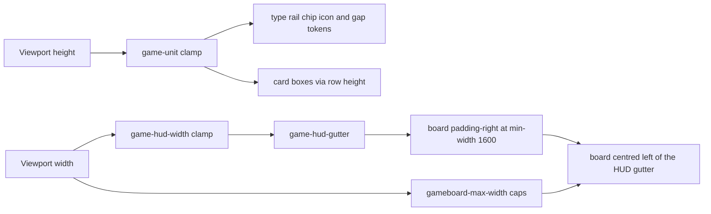

# Adaptive Gameboard for Large Screens

Goal: on viewports larger than the board's current design size, stop the board from shrinking into the middle of the
screen and stop the labels from staying at laptop pixel sizes. The board should claim the available width (up to a
sane cap), keep a reserved right-hand gutter for the docked HUD, and grow its typography and card chrome together
with the cards themselves.

Status: implemented. Section 8 records what shipped, where the implementation differs from this sketch, and what was
deliberately left alone.

## 1. What the board did before this change

| Element | Current value | Where |
| --- | --- | --- |
| Board width cap | `1050px` | [`GAMEBOARD_MAX_WIDTH_CLASS`](client/src/views/game/utils/contants.ts:20) |
| Board column template | `lg:grid-cols-[1.1fr_1.7fr_1.1fr]` | [`GAMEBOARD_COLUMNS_CLASS`](client/src/views/game/utils/contants.ts:21) |
| Shell inner width | `max-w-7xl` (1280px) | [`PageShell`](client/src/components/layout/PageShell.tsx:33) |
| Board row split | `0.6fr / 6.1fr / 1.85fr` over `100dvh` | [`GameView`](client/src/views/game/GameView.tsx:353) |
| Zone half split | `1fr 1fr auto 1fr 1fr` | [`GameZones`](client/src/views/game/components/GameZones.tsx:272) |
| Resource rail cap | `208px` | [`index.css`](client/src/index.css:78) |
| Sidebar rail | `1.5rem` | [`GameZones`](client/src/views/game/components/GameZones.tsx:268) |
| HUD panel width | `252px` | [`HUD_PANEL_WIDTH_CLASS`](client/src/views/game/utils/contants.ts:38) |
| In-card / HUD type | fixed `8px` to `12px` | 20+ `text-[Npx]` utilities |

Two consequences fall out of that table:

1. **Width is capped, height is not.** A card is `row height x 0.722`, so a taller window grows the art, but the board
   stays 1050px wide and the extra horizontal room becomes empty margin.
2. **Type is fixed.** Because the art grows and the labels do not, the same 10px label that reads fine in a 120px card
   on a 720p window is proportionally tiny in a 240px card on a 1440p window. Text gets *harder* to read exactly on the
   screens that have the most room.

The board is also height-bound, so uniform zoom is not a fix: scaling the whole board up while it already fills the
viewport height would only push it off-screen. The fix has to (a) spend extra width and (b) grow type relative to the
height-derived card boxes.

## 2. Sizing contract

One unit token drives everything that should grow with the cards, and one gutter token reserves room for the HUD.

Proposed tokens (values are tuning knobs, confirmed by the large-screen spec):

| Token | Base | Formula | 1080p | 1440p | 2160p (4K 100%) |
| --- | --- | --- | --- | --- | --- |
| `--game-unit` | `1px` | `clamp(1px, 0.1111dvh, 2.4px)` | `1.2px` | `1.6px` | `2.4px` |
| `--game-font-2xs` | `8px` | `8 * unit` | `9.6px` | `12.8px` | `19.2px` |
| `--game-font-xs` | `9px` | `9 * unit` | `10.8px` | `14.4px` | `21.6px` |
| `--game-font-sm` | `10px` | `10 * unit` | `12px` | `16px` | `24px` |
| `--game-font-md` | `11px` | `11 * unit` | `13.2px` | `17.6px` | `26.4px` |
| `--game-font-lg` | `12px` | `12 * unit` | `14.4px` | `19.2px` | `28.8px` |
| `--game-icon-sm` | `10px` | `10 * unit` | `12px` | `16px` | `24px` |
| `--game-gap` | `4px` | `4 * unit` | `4.8px` | `6.4px` | `9.6px` |
| board-scope `--resource-rail-max-width` | `208px` | `208 * unit` | `250px` | `333px` | `499px` |
| `--game-sidebar-rail-width` | `24px` | `24 * unit` | `29px` | `38px` | `58px` |
| `--game-hud-width` | `252px` | `clamp(252px, 14vw + 20px, 560px)` | `290px` | `380px` | `560px` |
| `--game-hud-gutter` | `0` | `hud width + 24px`, only at `min-width: 1600px` | `314px` | `404px` | `584px` |
| `--gameboard-max-width` | `1050px` | tier caps `1400 / 1600 / 1900 / 3000px` at `1600 / 1920 / 2560 / 3200`, each trimmed by `min(..., 1417 * unit)` | `1600px` | `1900px` | `3000px` |

The clamp floor of `1px` is deliberate: every viewport at or below 900px tall keeps today's exact pixel values, so the
1280x720 Playwright viewport reproduces the current board byte for byte. Growth starts above 900px tall and runs
proportional to the window height until the `2.4px` cap, which only bites above 2160px tall.

The height guard on the width cap is the same rule read the other way round: `1417 * unit` allows 2268px at a 1440-tall
window, so a 3440x1440 ultrawide cannot stretch the play area to its full 2914px just because it is wide, while a
2160-tall window allows 3400px and the `3000px` tier is what applies.

### 2.1 How far does this reach on a 4K monitor

The CSS viewport a 4K panel reports depends on the OS scale factor, and each case lands on a different rung:

| Display | CSS viewport | Unit | Type (`sm` HUD/label) | Board | Board share of width |
| --- | --- | --- | --- | --- | --- |
| 4K at 200% | 1920x1080 | `1.2` | `12px` | `1600px` | `83%` |
| 4K at 150% | 2560x1440 | `1.6` | `16px` | `1900px` | `74%` |
| 4K at 100% | 3840x2160 | `2.4` | `24px` | `3000px` | `78%` |
| ultrawide 3440x1440 | 3440x1440 | `1.6` | `16px` | `2268px` | `66%` |

So yes, it escalates through 4K at every OS scale, and a 3840-wide window is filled to roughly 78 percent by the
board. It still does not stretch to the full 3840px: cards are height-bound, so a full-width board would spread a
260px card across a 2.4m-wide play area and read as emptier than the 1050px version does today. The two knobs are the
top tier cap (`3000px` at `min-width: 3200px`) and the unit cap (`2.4px`, reached at a 2160-tall window).

## 3. Layout changes

- **Board width.** `GAMEBOARD_MAX_WIDTH_CLASS` becomes `max-w-[var(--gameboard-max-width)]`; the caps live in CSS.
- **Full-bleed shell.** `GameView` passes `fullBleed` to [`PageShell`](client/src/components/layout/PageShell.tsx:33)
  so the `max-w-7xl` wrapper stops clipping a board wider than 1280px. The board keeps `mx-auto`.
- **HUD gutter.** Above `min-width: 1600px` the board wrapper gets `padding-right: var(--game-hud-gutter)`. The board
  then centres in the space left of the gutter, so the docked chat, action log and support chain always clear it
  instead of relying on a measured guess. Below 1600px the current behaviour is untouched (chat hides behind the
  sidebar button, see [`useHasRoomForChatColumn`](client/src/views/game/hooks/GameView/useHasRoomForChatColumn.ts:37)).
- **Board columns.** `GAMEBOARD_COLUMNS_CLASS` was `1.1fr 1.7fr 1.1fr` but the only child spans all columns, so the
  template is vestigial. Keep a single-column template for the panel and move real spacing into the zone grid.
- **Zone grid.** `--resource-rail-max-width` is overridden on `[data-game-board]` with the scaled value, so pile,
  deck, chakra and leader frames grow together with the row height they already follow. The sidebar rail becomes
  `var(--game-sidebar-rail-width)` and its buttons and glyphs use `--game-icon-sm`.

## 4. Typography changes

Replace fixed pixel utilities with length tokens, surface by surface:

- **Inside cards:** [`LeaderCard`](client/src/components/ui/cards/LeaderCard.tsx:19),
  [`CardOverlayBadge`](client/src/components/ui/cards/CardOverlayBadge.tsx:12),
  [`CardStatusBadgeRail`](client/src/views/game/components/CardStatusBadgeRail.tsx:179),
  [`NonLeaderCardOverlay`](client/src/views/game/components/NonLeaderCardOverlay.tsx:13),
  [`PlayPileZone`](client/src/components/ui/game/PlayPileZone.tsx:23),
  [`ResourceChakraGrid`](client/src/components/ui/game/ResourceChakraGrid.tsx:41) and the resource lane cards.
- **Board chrome:** [`GameHandRow`](client/src/views/game/components/GameHandRow.tsx:77),
  [`SidebarButtons`](client/src/views/game/components/SidebarButtons.tsx:19),
  [`GamePhaseActionRow`](client/src/views/game/components/GamePhaseActionRow.tsx:77),
  [`GamePhaseIndicator`](client/src/views/game/components/GamePhaseIndicator.tsx:1), [`GameClockBadge`](client/src/views/game/components/GameClockBadge.tsx:61).
- **HUD:** [`ActionLog`](client/src/views/game/components/ActionLog.tsx:150), [`GameChatPanel`](client/src/views/game/components/GameChatPanel.tsx:145),
  [`SupportChainBubble`](client/src/views/game/components/SupportChainBubble.tsx:53), [`MatchModifierBadge`](client/src/views/game/components/MatchModifierBadge.tsx:35),
  plus the top banners that sit over the board (`EffectNoticeBanner`, `RedoWaitingBanner`, `PromptSelectionBanner`).
- **Fixed chip widths** that would clip scaled text: `w-[4.25rem]` action chips in
  [`NonLeaderCardOverlay`](client/src/views/game/components/NonLeaderCardOverlay.tsx:136) and
  [`LeaderCard`](client/src/components/ui/cards/LeaderCard.tsx:151) become `calc(68 * var(--game-unit))`.
- **HUD vertical budget:** the action log's `top`/`bottom` and minimum height are rem constants that mirror the
  support chain's maximum height ([`contants.ts`](client/src/views/game/utils/contants.ts:32)). They become CSS custom
  properties derived from `--game-unit` (with and without the docked chat) so the log keeps starting below the chain
  and ending above the chat.

Dialogs and overlays that already use rem text (`GamePromptOverlay`, `GameOverOverlay`, forfeit/redo/close dialogs) are
left alone: they are already comfortable and their widths are viewport-relative.

## 5. Art and preload

Rendered card widths grow past today's hints, so the browser must be told:

- [`CARD_SIZES`](client/src/components/ui/cards/constants/index.ts:27): raise `leader` toward `400px`, `battlefieldCard`
  toward `240px`, `supportSlot` toward `130px`, `handCard` toward `170px` at the large breakpoint. The ladder already
  tops out at 900px, which covers these at 2x DPR.
- [`cardPreloadService`](client/src/services/cardPreloadService.ts:10) mirrors the widest board surface; update the 290px
  figure and the comment that cites the 1050px cap.
- Update the comments that state the board is capped at 1050px in
  [`contants.ts`](client/src/views/game/utils/contants.ts:20), [`CARD_SIZES`](client/src/components/ui/cards/constants/index.ts:25)
  and [`gameview.multiplayer.chat.spec.ts`](e2e/gameview.multiplayer.chat.spec.ts:15).

## 6. Regression surface

- [`gameview.chakra-scaling.spec.ts`](e2e/gameview.chakra-scaling.spec.ts:19) hardcodes the chakra column at 137px. Once
  the rail scales, derive the bound from the measured rail width instead (`rail width x 0.66`).
- [`gameview.multiplayer.chat.spec.ts`](e2e/gameview.multiplayer.chat.spec.ts:24) asserts the chat docks on a wide
  viewport and hides at the default one; both must still hold with the gutter rule.
- [`gameview.card-art-fidelity.spec.ts`](e2e/gameview.card-art-fidelity.spec.ts:19) asserts the leader resolves a source
  at least as wide as its box (and 2x on a 2x screen) - recheck after the `sizes` change.
- [`gameview.attack-link-geometry.spec.ts`](e2e/gameview.attack-link-geometry.spec.ts:1) and the board animation specs
  rely on measured rectangles; the attack link's fixed pixel gaps and `110px` side bend should scale with
  `--game-unit` so the arrow keeps its weight relative to the cards.
- New spec `e2e/gameview.large-screen-layout.spec.ts`: at 1280x720, 1920x1080 and 2560x1440 assert (a) the board uses
  a growing share of the viewport width, (b) the board's right edge stays left of the HUD panels, (c) a known in-card
  label's computed font-size grows above the 1280 value, (d) no horizontal document scroll, and (e) the 1280x720 box
  matches today's values so small screens are provably unchanged.

## 7. Risks

- **Vertical overflow of scaled type.** Chips with fixed text must be verified at the 1.6 cap; the cap exists to keep
  a label from outgrowing the frame it belongs to.
- **`getComputedStyle` on custom properties.** Reading `--game-hud-width` from TypeScript returns the token stream
  unless the property is registered. Register it with `@property` (`syntax: '<length>'`) so the docking hook can read a
  resolved length, and keep the current constant as the fallback.
- **E2E viewport assumptions.** Several specs rely on the default 1280x720 viewport, which the clamp floor keeps
  identical; any spec that changes its own viewport must be re-measured rather than re-guessed.

## 8. What shipped

**Contract** ([`index.css`](client/src/index.css:541)) - `--game-unit: clamp(1px, 0.1111dvh, 2.4px)` on a new
`[data-game-surface]` wrapper, plus `--game-font-2xs` to `--game-font-xl`, `--game-icon-xs/sm/md`, `--game-gap`,
`--game-chip-width`, `--game-rail-width`, `--game-sidebar-rail-width`, `--game-hud-width` (registered with
`@property` so the docking hook can read a resolved length), `--game-hud-gutter`, the support-chain and action-log
vertical budget, and the board's width ladder with the `1417 x unit` guard.

**Width** - [`GAMEBOARD_MAX_WIDTH_CLASS`](client/src/views/game/utils/contants.ts:24) is now
`max-w-[var(--gameboard-max-width)]`; [`GameView`](client/src/views/game/GameView.tsx:332) renders inside
`[data-game-surface]`, which reserves `padding-right: var(--game-hud-gutter)` above 1600px, and passes `fullBleed` to
[`PageShell`](client/src/components/layout/PageShell.tsx:33) so the 1280px `max-w-7xl` no longer clips the board.

**Type and chrome** - in-card labels, chips, badges, status icons, pile labels, hand footer, phase row, clock, HUD
panels, banners and the sidebar's icon buttons are all length tokens now; the sidebar glyphs scale with their boxes
through `[&_svg]` utilities and the fixed `Select`/`Selected` chip width is `--game-chip-width`.

**Art** - [`CARD_SIZES`](client/src/components/ui/cards/constants/index.ts:27) gained a `1600px` step for every board
surface, and [`cardPreloadService`](client/src/services/cardPreloadService.ts:10) resolves the same unit factor from
the window height so a laptop still warms the small rung and a 4K window warms the master.

**Coverage** - [`gameview.large-screen-layout.spec.ts`](e2e/gameview.large-screen-layout.spec.ts:1) pins the four rungs
(1280x720 -> 1050px/10px, 1920x1080 -> 1600px/12px, 2560x1440 -> 1900px/16px, 3840x2160 -> 3000px/24px), asserts the
board stops short of the docked HUD and that the document never scrolls sideways;
[`gameview.chakra-scaling.spec.ts`](e2e/gameview.chakra-scaling.spec.ts:18) now measures the rail instead of assuming
137px, and asserts the rail itself grows with the window.

### Deviations from the sketch

1. The gutter lives on `[data-game-surface]` rather than on the shell wrapper, so the board centres in the space the
   HUD leaves instead of in the viewport. That is what makes the HUD clearance structural rather than measured.
2. The HUD panel's width is viewport-driven (`clamp(252px, 14vw + 20px, 560px)`) while its type is height-driven, so
   the two ladders have separate knobs; at any 16:9 size they keep the same text-to-width ratio.
3. The attack link's pixel offsets (`4.5px` stroke, `7.5px` target clearance, `110px` sweep bend, the `-7px`/`-8px`
   outline insets) were left unscaled on purpose: the arrow and the outline it starts outside are measured together,
   and scaling one without the other would push the arrow inside its own outline. Varying them is a follow-up that
   needs the geometry spec re-baselined; the spec passes unchanged today.

### Left alone

Dialogs and the game-over overlay keep their rem type and viewport-relative widths, which already read well. The
`GAMEBOARD_COLUMNS_CLASS` template stays as it was: the board's only child spans every column, so it has no effect
either way.
