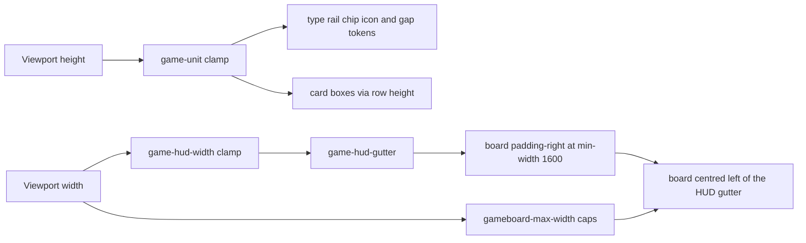

# Adaptive Gameboard for Large Screens

Goal: on viewports larger than the board's current design size, stop the board from shrinking into the middle of the
screen and stop the labels from staying at laptop pixel sizes. The board should claim the available width (up to a
sane cap), keep a reserved right-hand gutter for the docked HUD, and grow its typography and card chrome together
with the cards themselves.

Status: implemented. Section 8 records what shipped, where the implementation differs from this sketch, and what was
deliberately left alone.

## 1. What the board did before this change

| Element | Current value | Where |
| --- | --- | --- |
| Board width cap | `1050px` | [`GAMEBOARD_MAX_WIDTH_CLASS`](client/src/views/game/utils/contants.ts:20) |
| Board column template | `lg:grid-cols-[1.1fr_1.7fr_1.1fr]` | [`GAMEBOARD_COLUMNS_CLASS`](client/src/views/game/utils/contants.ts:21) |
| Shell inner width | `max-w-7xl` (1280px) | [`PageShell`](client/src/components/layout/PageShell.tsx:33) |
| Board row split | `0.6fr / 6.1fr / 1.85fr` over `100dvh` | [`GameView`](client/src/views/game/GameView.tsx:353) |
| Zone half split | `1fr 1fr auto 1fr 1fr` | [`GameZones`](client/src/views/game/components/GameZones.tsx:272) |
| Resource rail cap | `208px` | [`index.css`](client/src/index.css:78) |
| Sidebar rail | `1.5rem` | [`GameZones`](client/src/views/game/components/GameZones.tsx:268) |
| HUD panel width | `252px` | [`HUD_PANEL_WIDTH_CLASS`](client/src/views/game/utils/contants.ts:38) |
| In-card / HUD type | fixed `8px` to `12px` | 20+ `text-[Npx]` utilities |

Two consequences fall out of that table:

1. **Width is capped, height is not.** A card is `row height x 0.722`, so a taller window grows the art, but the board
   stays 1050px wide and the extra horizontal room becomes empty margin.
2. **Type is fixed.** Because the art grows and the labels do not, the same 10px label that reads fine in a 120px card
   on a 720p window is proportionally tiny in a 240px card on a 1440p window. Text gets *harder* to read exactly on the
   screens that have the most room.

The board is also height-bound, so uniform zoom is not a fix: scaling the whole board up while it already fills the
viewport height would only push it off-screen. The fix has to (a) spend extra width and (b) grow type relative to the
height-derived card boxes.

## 2. Sizing contract

One unit token drives everything that should grow with the cards, and one gutter token reserves room for the HUD.

Shipped tokens (confirmed by the large-screen spec):

| Token | Base | Formula | 1080p | 1440p | 2160p (4K 100%) |
| --- | --- | --- | --- | --- | --- |
| `--game-unit` | `1px` | `clamp(1px, 100dvh / 720, 3px)` | `1.5px` | `2px` | `3px` |
| `--game-font-2xs` | `8px` | `8 * unit` | `12px` | `16px` | `24px` |
| `--game-font-xs` | `9px` | `9 * unit` | `13.5px` | `18px` | `27px` |
| `--game-font-sm` | `10px` | `10 * unit` | `15px` | `20px` | `30px` |
| `--game-font-md` | `11px` | `11 * unit` | `16.5px` | `22px` | `33px` |
| `--game-font-lg` | `12px` | `12 * unit` | `18px` | `24px` | `36px` |
| `--game-font-xl` | `14px` | `14 * unit` | `21px` | `28px` | `42px` |
| `--game-icon-sm` | `10px` | `10 * unit` | `15px` | `20px` | `30px` |
| `--game-gap` | `4px` | `4 * unit` | `6px` | `8px` | `12px` |
| board-scope `--resource-rail-max-width` | `208px` | `208 * unit` | `312px` | `416px` | `624px` |
| `--game-sidebar-rail-width` | `24px` | `24 * unit` | `36px` | `48px` | `72px` |
| `--game-hud-width` | `252px` | `clamp(252px, 14vw + 20px, 480px)` | `289px` | `378px` | `480px` |
| `--game-hud-gutter` | `0` | `hud width + 24px`, only at `min-width: 1600px` | `313px` | `402px` | `504px` |
| `--gameboard-max-width` | `1050px` | tier caps `1400 / 1600 / 1900 / 3000px` at `1600 / 1920 / 2560 / 3200`, each trimmed by `min(..., 1417 * unit)` | cap | cap | cap |

The unit's **reference is 720px tall, not the middle of the range**: it is `1px` at the smallest window the board is
designed for and exactly proportional above it. That matters more than it looks. The card frames are row-height
driven, so a unit that grows slower than the window makes the labels *smaller relative to their card* on a big screen
than on a laptop. The first cut used a 900px reference with a 2.4x cap, which is why 4K still read as tiny text: the
cards had tripled while the labels had only grown 2.4x. At a window 720px tall or shorter the floor keeps the board
exactly as it was, so the 1280x720 Playwright viewport is byte-identical.

Above 1600px wide the surface reserves the HUD's column **symmetrically** -
`padding-inline: min(gutter, (100vw - 1050px) / 2)` - and the board centres in what is left. The `min()` is what keeps
the reservation from eating into the board's base width: at the breakpoint itself it takes only half of the slack the
window already has beyond 1050px, so crossing 1600px grows the board instead of snapping it narrower than the pixel
before. The caps only take over where the window is wider than `2 x gutter + cap`, which on a 16:9 desktop means
effectively not at all: the reservation is what sets the width at 1080p, 1440p and 4K.

The height guard on the width cap is the same rule read the other way round: `1417 * unit` allows 2834px at a 1440-tall
window, so a 3440x1440 ultrawide cannot stretch the play area wider than its rows justify, while a 2160-tall window
allows 4251px and the reservation is what applies.

### 2.1 How far does this reach on a 4K monitor

The CSS viewport a 4K panel reports depends on the OS scale factor, and each case lands on a different rung:

| Display | CSS viewport | Unit | Type (`sm` HUD/label) | Board | Board share of width |
| --- | --- | --- | --- | --- | --- |
| 4K at 200% | 1920x1080 | `1.5` | `15px` | `1294px` | `67%` |
| 4K at 150% | 2560x1440 | `2` | `20px` | `1755px` | `69%` |
| 4K at 100% | 3840x2160 | `3` | `30px` | `2832px` | `74%` |

So yes, it escalates through 4K at every OS scale: the board grows from 1050px to 2832px on a 3840-wide window (74
percent) and keeps about 500px of clear margin on both sides for the HUD, while a 10px label becomes 30px because the
card it sits in became three times as tall. The knobs, in order of effect, are the unit's reference height (720px,
which sets how *fast* the chrome grows), the reserved gutter (which sets the width), and the `3000px` tier cap.

## 3. Layout changes

- **Board width.** `GAMEBOARD_MAX_WIDTH_CLASS` becomes `max-w-[var(--gameboard-max-width)]`; the caps live in CSS.
- **Full-bleed shell.** `GameView` passes `fullBleed` to [`PageShell`](client/src/components/layout/PageShell.tsx:33)
  so the `max-w-7xl` wrapper stops clipping a board wider than 1280px. The board keeps `mx-auto`.
- **HUD gutter.** Above `min-width: 1600px` the surface gets `padding-inline: min(gutter, (100vw - 1050px) / 2)`. The
  reservation is symmetric so the board stays centred with a real margin on both sides instead of hugging the left
  edge, and it can never shrink the board below its 1050px base. The docked chat, action log and support chain live in
  the right-hand margin; the measured check in
  [`useHasRoomForChatColumn`](client/src/views/game/hooks/GameView/useHasRoomForChatColumn.ts:37) still decides
  whether the strip has room, which is what keeps it behind the sidebar button on narrower windows.
- **Board columns.** `GAMEBOARD_COLUMNS_CLASS` was `1.1fr 1.7fr 1.1fr` but the only child spans all columns, so the
  template is vestigial. Keep a single-column template for the panel and move real spacing into the zone grid.
- **Zone grid.** `--resource-rail-max-width` is overridden on `[data-game-board]` with the scaled value, so pile,
  deck, chakra and leader frames grow together with the row height they already follow. The sidebar rail becomes
  `var(--game-sidebar-rail-width)` and its buttons and glyphs use `--game-icon-sm`.

## 4. Typography changes

Replace fixed pixel utilities with length tokens, surface by surface:

- **Inside cards:** [`LeaderCard`](client/src/components/ui/cards/LeaderCard.tsx:19),
  [`CardOverlayBadge`](client/src/components/ui/cards/CardOverlayBadge.tsx:12),
  [`CardStatusBadgeRail`](client/src/views/game/components/CardStatusBadgeRail.tsx:179),
  [`NonLeaderCardOverlay`](client/src/views/game/components/NonLeaderCardOverlay.tsx:13),
  [`PlayPileZone`](client/src/components/ui/game/PlayPileZone.tsx:23),
  [`ResourceChakraGrid`](client/src/components/ui/game/ResourceChakraGrid.tsx:41) and the resource lane cards.
- **Board chrome:** [`GameHandRow`](client/src/views/game/components/GameHandRow.tsx:77),
  [`SidebarButtons`](client/src/views/game/components/SidebarButtons.tsx:19),
  [`GamePhaseActionRow`](client/src/views/game/components/GamePhaseActionRow.tsx:77),
  [`GamePhaseIndicator`](client/src/views/game/components/GamePhaseIndicator.tsx:1), [`GameClockBadge`](client/src/views/game/components/GameClockBadge.tsx:61).
- **HUD:** [`ActionLog`](client/src/views/game/components/ActionLog.tsx:150), [`GameChatPanel`](client/src/views/game/components/GameChatPanel.tsx:145),
  [`SupportChainBubble`](client/src/views/game/components/SupportChainBubble.tsx:53), [`MatchModifierBadge`](client/src/views/game/components/MatchModifierBadge.tsx:35),
  plus the top banners that sit over the board (`EffectNoticeBanner`, `RedoWaitingBanner`, `PromptSelectionBanner`).
- **Fixed chip widths** that would clip scaled text: `w-[4.25rem]` action chips in
  [`NonLeaderCardOverlay`](client/src/views/game/components/NonLeaderCardOverlay.tsx:136) and
  [`LeaderCard`](client/src/components/ui/cards/LeaderCard.tsx:151) become `calc(68 * var(--game-unit))`.
- **HUD vertical budget:** the action log's `top`/`bottom` and minimum height are rem constants that mirror the
  support chain's maximum height ([`contants.ts`](client/src/views/game/utils/contants.ts:32)). They become CSS custom
  properties derived from `--game-unit` (with and without the docked chat) so the log keeps starting below the chain
  and ending above the chat.

Dialogs and overlays that already use rem text (`GamePromptOverlay`, `GameOverOverlay`, forfeit/redo/close dialogs) are
left alone: they are already comfortable and their widths are viewport-relative.

## 5. Art and preload

Rendered card widths grow past today's hints, so the browser must be told:

- [`CARD_SIZES`](client/src/components/ui/cards/constants/index.ts:27): raise `leader` toward `400px`, `battlefieldCard`
  toward `240px`, `supportSlot` toward `130px`, `handCard` toward `170px` at the large breakpoint. The ladder already
  tops out at 900px, which covers these at 2x DPR.
- [`cardPreloadService`](client/src/services/cardPreloadService.ts:10) mirrors the widest board surface; update the 290px
  figure and the comment that cites the 1050px cap.
- Update the comments that state the board is capped at 1050px in
  [`contants.ts`](client/src/views/game/utils/contants.ts:20), [`CARD_SIZES`](client/src/components/ui/cards/constants/index.ts:25)
  and [`gameview.multiplayer.chat.spec.ts`](e2e/gameview.multiplayer.chat.spec.ts:15).

## 6. Regression surface

- [`gameview.chakra-scaling.spec.ts`](e2e/gameview.chakra-scaling.spec.ts:19) hardcodes the chakra column at 137px. Once
  the rail scales, derive the bound from the measured rail width instead (`rail width x 0.66`).
- [`gameview.multiplayer.chat.spec.ts`](e2e/gameview.multiplayer.chat.spec.ts:24) asserts the chat docks on a wide
  viewport and hides at the default one; both must still hold with the gutter rule.
- [`gameview.card-art-fidelity.spec.ts`](e2e/gameview.card-art-fidelity.spec.ts:19) asserts the leader resolves a source
  at least as wide as its box (and 2x on a 2x screen) - recheck after the `sizes` change.
- [`gameview.attack-link-geometry.spec.ts`](e2e/gameview.attack-link-geometry.spec.ts:1) and the board animation specs
  rely on measured rectangles; the attack link's fixed pixel gaps and `110px` side bend should scale with
  `--game-unit` so the arrow keeps its weight relative to the cards.
- New spec `e2e/gameview.large-screen-layout.spec.ts`: at 1280x720, 1920x1080 and 2560x1440 assert (a) the board uses
  a growing share of the viewport width, (b) the board's right edge stays left of the HUD panels, (c) a known in-card
  label's computed font-size grows above the 1280 value, (d) no horizontal document scroll, and (e) the 1280x720 box
  matches today's values so small screens are provably unchanged.

## 7. Risks

- **Vertical overflow of scaled type.** Chips with fixed text must be verified at the 1.6 cap; the cap exists to keep
  a label from outgrowing the frame it belongs to.
- **`getComputedStyle` on custom properties.** Reading `--game-hud-width` from TypeScript returns the token stream
  unless the property is registered. Register it with `@property` (`syntax: '<length>'`) so the docking hook can read a
  resolved length, and keep the current constant as the fallback.
- **E2E viewport assumptions.** Several specs rely on the default 1280x720 viewport, which the clamp floor keeps
  identical; any spec that changes its own viewport must be re-measured rather than re-guessed.

## 8. What shipped

**Contract** ([`index.css`](client/src/index.css:541)) - `--game-unit: clamp(1px, 100dvh / 720, 3px)` on a new
`[data-game-surface]` wrapper, plus `--game-font-2xs` to `--game-font-xl`, `--game-icon-xs/sm/md`, `--game-gap`,
`--game-chip-width`, `--game-rail-width`, `--game-sidebar-rail-width`, `--game-hud-width` (registered with
`@property` so the docking hook can read a resolved length), `--game-hud-gutter`, the support-chain and action-log
vertical budget, and the board's width ladder with the `1417 x unit` guard.

**Width** - [`GAMEBOARD_MAX_WIDTH_CLASS`](client/src/views/game/utils/contants.ts:24) is now
`max-w-[var(--gameboard-max-width)]`; [`GameView`](client/src/views/game/GameView.tsx:332) renders inside
`[data-game-surface]`, which reserves the HUD's column symmetrically above 1600px
(`padding-inline: min(var(--game-hud-gutter), calc((100vw - 1050px) / 2))`), and passes `fullBleed` to
[`PageShell`](client/src/components/layout/PageShell.tsx:33) so the 1280px `max-w-7xl` no longer clips the board.
The board therefore stays centred with a real margin on both sides, and the HUD panels sit in the right-hand one.

**Type and chrome** - in-card labels, chips, badges, status icons, pile labels, hand footer, phase row, clock, HUD
panels, banners and the sidebar's icon buttons are all length tokens now; the sidebar glyphs scale with their boxes
through `[&_svg]` utilities and the fixed `Select`/`Selected` chip width is `--game-chip-width`.

**Art** - [`CARD_SIZES`](client/src/components/ui/cards/constants/index.ts:27) gained a `1600px` step for every board
surface, and [`cardPreloadService`](client/src/services/cardPreloadService.ts:10) resolves the same unit factor from
the window height so a laptop still warms the small rung and a 4K window warms the master.

**Coverage** - [`gameview.large-screen-layout.spec.ts`](e2e/gameview.large-screen-layout.spec.ts:1) pins the rungs
(1280x720 -> 1050px/10px, 1600x900 -> 1050px/12.5px at the breakpoint itself, 1920x1080 -> 1294px/15px,
2560x1440 -> 1755px/20px, 3840x2160 -> 2832px/30px), asserts the board has equal margins on both sides at every rung,
stops short of the docked HUD, keeps the leader, pile and hand cards at the art's `200/277` ratio, and never scrolls
sideways; [`gameview.chakra-scaling.spec.ts`](e2e/gameview.chakra-scaling.spec.ts:18) now measures the rail instead of
assuming 137px, and asserts the rail itself grows with the window.

### Deviations from the sketch

1. The reservation is symmetric and lives on `[data-game-surface]` rather than being a right-hand padding on the shell
   wrapper: a right-only gutter pushed the board hard against the left edge, leaving all the slack behind the panels.
   Matching it on the left keeps the play area centred, and the strip still has its own margin on the right.
2. The reservation is capped at half the slack beyond 1050px, so the breakpoint never makes the board narrower than it
   was at 1599px - it grows into the reservation instead.
3. The HUD panel's width is viewport-driven (`clamp(252px, 14vw + 20px, 480px)`) while its type is height-driven, so
   the two ladders have separate knobs; at any 16:9 size they keep the same text-to-width ratio.
4. The unit's reference height is 720px, not 900px: a slower ladder than the row-height growth is exactly what made
   the first cut's 4K labels read as tiny inside cards that had tripled. The rail and pile cards were also losing
   their aspect ratio at 1080p and 4K for the same reason (the height-driven frame was width-clamped by a rail that
   grew too slowly), which the 720px reference fixes - the spec now asserts `200/277` on the leader, a pile card and a
   hand card at every rung.
5. The attack link's pixel offsets (`4.5px` stroke, `7.5px` target clearance, `110px` sweep bend, the `-7px`/`-8px`
   outline insets) were left unscaled on purpose: the arrow and the outline it starts outside are measured together,
   and scaling one without the other would push the arrow inside its own outline. Varying them is a follow-up that
   needs the geometry spec re-baselined; the spec passes unchanged today.

### Left alone

The `GAMEBOARD_COLUMNS_CLASS` template stays as it was: the board's only child spans every column, so it has no effect
either way. Dialogs were left on rem type in this pass; section 9 takes them up.

## 9. Follow-up: legibility on very large viewports and card containment

Two reports survive the first pass: "the text is still tiny on a big display" and "the lower leader (and maybe other
cards) is not shown in full". Measurements from a 3840x2160 probe (empty board, so leaders, piles, chakra and hand are
populated):

| Surface | Box at 4K | Ratio | Verdict |
| --- | --- | --- | --- |
| leader (top) | 510 x 706 | 0.722 | correct, but sits in a shrink-to-fit frame |
| leader (bottom) | card 510 wide inside a 624-wide frame | 0.722 | same card, different frame: mismatched inset and clipping |
| pile card | 251 x 348 | 0.722 | fixed by the 720px unit |
| hand card | 326 x 451 | 0.722 | correct, but *taller than the battlefield cards* |
| battlefield card | `h-full w-full` via flex | stretches to the flex share | **never ratio-locked** |
| prompt dialog | title 18px, panel `max-w-sm` | - | still laptop-sized |

Three distinct causes, not one:

1. **Card containment is inconsistent.** [`BattleFieldRow`](client/src/views/game/components/BattleFieldRow.tsx:75)
   gives its cards `h-full w-full`, which overrides `PlayCard`'s aspect ratio and stretches them to the flex share -
   fine at 720p where the numbers coincide, visibly wrong at 4K. The bottom leader's frame
   ([`GameZones`](client/src/views/game/components/GameZones.tsx:344)) is a block that stretches to the rail width,
   while the top one is a shrink-to-fit flex item, so the two halves inset and clip differently. Every slot frame also
   carries `overflow-hidden`, which crops a rested card's `rotate-[5deg]` and any attack outline.
2. **Vertical budget favours the hand.** The board grid is `0.6fr / 6.1fr / 1.85fr` over the viewport height, so 29% of
   a 4K window goes to the two hand bands: the hand cards measure 451px tall while the battlefield cards you actually
   read are 348px. The art's own text is part of the image and only grows with the card, so this is the one lever that
   makes *card text* bigger on a big screen.
3. **Overlays never joined the ladder.** Every dialog (starting-player prompt, mulligan, game over, forfeit, redo
   consent, card list, card preview) still uses rem sizes and rem widths, so at 4K the most looked-at text on screen is
   the only text still at laptop size.

### 9.1 Planned changes

- **One leader slot for both halves.** Extract the rail cell into a single `LeaderSlot` used by the top and bottom
  halves: same inset, same justification, frame `h-full w-fit max-w-full overflow-visible`, card `h-full w-auto`.
  Placeholder frames keep their border when there is no card.
- **Battlefield cards are ratio-locked.** `h-full w-auto max-w-full shrink-0` in [`BattleFieldRow`](client/src/views/game/components/BattleFieldRow.tsx:75),
  centred in their slot, matching the support/leader/hand model.
- **Clip the art, not the frame.** Slot and leader frames become `overflow-visible`; the rounded clip moves to the
  image layer (which already carries `rounded-*`), so a rested tilt, hover ring, attack outline and status rail are
  never cut.
- **Keep the band proportions fixed.** The three board bands stay on `0.6fr / 6.1fr / 1.85fr`, i.e. 7% / 71% / 22% of
  the window at every size. A first attempt capped the two hand bands at twice their 720p height so the zone panel
  could take 80% at 2160p; it made the hand zones look shrunken on a 4K screen next to a laptop, which is the
  inconsistency the ladder exists to remove, so it was reverted. Cards still grow with the window height, and the
  labels grow with them.
- **A type boost for chrome outside the cards.** `--game-type-boost` (1 at <=1600px wide, 1.15 at 1920, 1.25 at 3200)
  multiplies the HUD panel, dialog and banner font tokens only - never the in-card chips, whose widths are derived
  from the unit and would start clipping.
- **Dialogs scale with the unit.** `GamePromptOverlay`, `GameOverOverlay`, `ForfeitConfirmDialog`,
  `RedoConsentDialog`, `CloseTableConfirmDialog`, `CardListOverlay` and `CardPreviewCard` take their width, padding,
  title and body sizes from the same tokens, so the starting-player question is as readable as the board behind it.
- **Card preview as the reading surface.** The preview panel grows with the unit (instead of `min(92vw, 22rem)`), so a
  card can always be inspected at 2-3x board size - the practical way to read art text that cannot be enlarged on the
  board itself.

## 10. What shipped in the follow-up

**Containment** - [`BattleFieldRow`](client/src/views/game/components/BattleFieldRow.tsx:75) cards are
`h-[min(100%,calc((100cqw-4*var(--game-gap))/3.7))] w-auto max-w-full shrink-0` inside an inline-size container, so
the flex share no longer overrides the art ratio and five ratio-locked cards cannot spill into the resource rail (the
`3.7` factor is five card widths plus their gaps expressed in card heights). Both leader slots now share one shell
(`flex items-stretch`, identical `8 x unit` inset, `justify-end` / `justify-start`) around a `w-fit max-w-full
max-h-[calc(288*var(--game-unit))]` frame with `overflow-visible`; the rounded corners moved onto the image, so a
rested leader's `rotate-[5deg]` and the attack outline are no longer clipped. The resource rail widened from `208` to
`224` units so the leader's 208-unit card plus its insets fit, and the `288`-unit height cap keeps the card from being
width-clamped when a half grows taller than four equal rows.

**Vertical budget** - left as the fractional split it always was (`0.6fr / 6.1fr / 1.85fr`). A
`50u / 1fr / 156u` version with the hand bands capped at `2u` did give the zone panel ~80% of a 2160p window, but it
made the hand zones proportionally smaller at 4K than on a laptop, so it was reverted; the spec now pins the hand
zone's share of the window (17-24%) at every rung so it cannot drift again.

**Chrome type** - `--game-type-boost` is `1` up to 1600px wide, `1.15` from 1920 and `1.25` from 3200, and only the
`--game-chrome-font-*` family multiplies by it; in-card tokens stay exactly proportional so chips cannot clip.
Action log, chat, support chain, modifier badge and the three top banners moved to the chrome family, and the dialogs
(starting-player prompt, game over, forfeit, redo consent, close table) plus the card preview now take their width,
padding, gap and type from `--game-dialog-*` / `--game-chrome-font-*`. The preview panel is unit-scaled up to the
master's native 900px, which is the practical way to read art text the board cannot enlarge.

**Verified** - client `typecheck`, `lint` and `build` clean, and the full `gameview*` suite passes end to end: **71 of
71**. (Earlier runs had one rematch case time out from its reservation/grace polls while the rest of the file passed;
that case passes in the final green run, and the dialog type was also raised from the label scale to the body scale -
`--game-chrome-font-xl`, i.e. 14px at unit 1 - so no dialog text got smaller than it was before.)

## 12. App-screen scaling for the auth views

The login view has the same problem the board had, for a different reason: it is entirely rem-based (`text-xs`,
`max-w-*`, `p-*`), so on a 4K window the panel renders as a laptop-sized card in the middle of the screen.

- [`PageShell`](client/src/components/layout/PageShell.tsx:5) gained an opt-in `scaleToViewport` prop. While such a
  shell is mounted it sets `data-surface="app"` on `<html>` and removes it on unmount, so the scale is scoped to the
  auth screens and never leaks into the game view's px-token ladder or the admin screens.
- [`index.css`](client/src/index.css:157) then applies
  `html[data-surface='app'] { font-size: clamp(16px, calc(0.55vw + 8.8px), 28px) }`: 16px at 1280 and below (so no
  laptop, tablet or phone layout moves), ~19px at 1920, ~23px at 2560 and capped at 28px from ~3480 upwards. Because
  every size on those pages is rem-based, type, paddings and the panel's `max-w-*` grow together.
- [`app-large-screen-scaling.spec.ts`](e2e/app-large-screen-scaling.spec.ts:1) pins it: the root font is 16 at
  1280x720, grows past 1.2x at 2560x1440 and keeps growing at 3840x2160 without passing the cap, the login panel's
  control width follows it, and no rung introduces a horizontal scroll. The phone specs still pass untouched.

## 11. Card surface parity audit

Answer to "are the big views using different components": **no**. Every board surface is the same component tree at
720p and at 4K - `PlayCard` -> `CardImage` -> `LeaderCard` / `NonLeaderCardOverlay`. What differs is the class strings
those components are handed, and one of them is genuinely broken:

- **Rounded corners.** [`LEADER_CARD_IMAGE_CLASS`](client/src/views/game/utils/contants.ts:31) was built as
  `` `${CARD_ART_IMAGE_CLASS} rounded-lg` ``, and `CARD_ART_IMAGE_CLASS` already contains `rounded-none`. That is a raw
  string concatenation, not a `twMerge`, so which radius wins depends on the order Tailwind emits the two utilities -
  not on the order they appear in the class list. The leader frame no longer clips, so the leader (and only the
  leader) can end up with square corners. The battlefield/support frames still clip, which is why they look right.
- **Hover affordances.** The leader's action chips and preview eye live in a `group-hover` layer inside `PlayCard`.
  Nothing in the sizing work should hide them, so this needs measuring rather than guessing: the frame is now `w-fit`
  with `overflow-visible`, and a fit-content box around a height-driven aspect card is exactly the kind of layout that
  can resolve to a different box than the card and leave the pointer outside the `group`.
- **Text touching borders** is card art, not markup: the printed text, name bar and stat strip are part of the image.
  It only looks tighter when the frame crops the art (`object-cover` on a box that is not 200/277), so the same audit
  checks the rendered image box against the card box; if they differ, the card is being cropped, not re-laid-out.

### 11.1 Shipped

- **One radius, scaled.** `--game-radius-card` (`12 x unit`) is the only card corner: leader, battlefield, support
  slot, pile and hand frames all take it, and every board image is `rounded-[inherit]`, so a card rounds exactly once
  and the corner grows with the card (12px at 720p, 36px at 2160p). `CardImage`'s own default is now
  `rounded-[var(--game-radius-card,12px)]`, which is still 12px outside the game surface.
- **No rim on the leader.** With a card, the leader frame is `border-transparent bg-transparent` and `overflow-visible`
  (the card itself now clips its image and carries the radius), so nothing paints around the card and a rested tilt or
  attack outline is not cut.
- **Hover layer intact.** Measured after `hover()` at both rungs: the preview affordance fades to opacity 1 and its box
  scales with the unit (20px at 1280x720 -> 60px at 3840x2160).
- **Damage chip keeps its shape.** The leader and non-leader damage chips carried a fixed `w-4` (16px) against a
  unit-scaled height, so on a 4K board they were 16px wide and 72px tall - the squashed indicator in the report. The
  width is `16 x unit` now, so the chip keeps the same aspect at every rung.
- **Chip padding scales.** The phase row's action chips used a fixed `px-1.5`, and the card action chips `px-1`/`py-0.5`
  around type that is 3x bigger at 4K, which is why labels looked like they touched the borders. Both are unit
  multiples now (6u horizontal, 2u vertical), and the phase row's gaps follow `--game-gap`.
- **Icon glyphs scale with their boxes.** Lucide icons take a `size` *prop*, so they stayed 9-12px inside chips that
  had grown three times: status chips (9u), the leader/non-leader/pile preview eyes (10u), the leader recovery flame
  (10u), the action log's collapse control and the chat's send button (9u inside a 16u box), the game-over close (11u)
  and the unread chat dot (6u) all scale now, via `[&_svg]` utilities on the buttons that own them.
- **Status tooltips read at any size.** The tooltip is portalled to `document.body`, i.e. *outside*
  `[data-game-surface]`, so none of the board's custom properties resolve there: its `text-[length:var(--game-font-sm)]`
  silently fell back to the body's 16px no matter how large the card got. Its width, gap, type, padding and radius are
  now computed from the board's resolved `--game-unit` at hover time and applied inline (176u wide, 10u type), which
  works from a portal - a 4K tooltip is 528px wide with 30px type instead of 176px holding 16px.
- **The status rail clears the life badge.** [`LeaderCard`](client/src/components/ui/cards/LeaderCard.tsx:106) parked
  the rail at a fixed `bottom-8 right-1` while the life badge is a `24 x unit` square in the same corner, so at 4K the
  rail sat inside it - the "effect badge overlaps the life HUD" report. The rail, its chip gap and the non-leader rail
  and tribute-label offsets are unit multiples now, so the badge stays above the HUD at every size.

Parity measured with a borderless probe at 1280x720 and 3840x2160 (card box, radius, image box, hover):

| Surface | 720p box | 720p radius | 2160p box | 2160p radius | image fills card |
| --- | --- | --- | --- | --- | --- |
| leader | 157.6 x 218.3 | 12px | 509.7 x 706 | 36px | yes (within 2px) |
| battlefield | 79 x 109.4 | 12px | 255.6 x 354 | 36px | yes |
| pile | 78.1 x 108.1 | 12px | 251.2 x 348 | 36px | yes |
| support slot | 72.8 x 100.8 | 12px | 240 x 332.5 | 36px | n/a (empty slot) |

`gameview.large-screen-layout.spec.ts` now asserts all of the above at every rung - corner size equals
`12 x unit`, the leader image radius equals its card's, the art fills the card within 2px, and the hover control is
present and sized - so a fixed-pixel corner or a competing `rounded-*` utility fails the suite instead of reaching a
screenshot.

### 11.2 Original plan record

- Split the leader's image class from the shared one: keep `LEADER_CARD_IMAGE_CLASS` as the un-rounded
  `CARD_ART_IMAGE_CLASS` for the clipped battlefield/support frames, and give [`buildLeaderCardProps`](client/src/views/game/utils/functions/gameState/gameZoneFunctions.ts:283)
  its own `rounded-lg object-cover` class for the leader, whose frame no longer clips.
- Audit the leader frame/box relationship at 3840x2160 and make the hover target the card itself: either keep the frame
  `w-fit` only if the measured frame equals the card, or put the hover layer on the frame that the pointer actually
  traverses.
- Add a parity probe to [`gameview.large-screen-layout.spec.ts`](e2e/gameview.large-screen-layout.spec.ts:1): at
  1280x720 and 3840x2160, for a leader, a support slot, a battlefield card and a pile card record `border-radius`,
  `overflow`, card box, image box, and whether the image box matches the card box (no cover-cropping). Then `hover()`
  a leader and assert its action chip / preview button is visible at both rungs.
- Keep the 720p numbers as the reference: where a computed style differs between the two rungs beyond the unit scale,
  the 720p value is the intended one - that is the "second image" the report is comparing against.

### 9.2 Verification

- A populated-board probe (summon at least one battlefield card and one support card) at 1280x720, 1920x1080 and
  3840x2160 that records every card surface's box, ratio and the frame/image boxes of both leaders, plus whether any
  ancestor clips them (`scrollWidth`/`scrollHeight` against `clientWidth`/`clientHeight`).
- [`gameview.large-screen-layout.spec.ts`](e2e/gameview.large-screen-layout.spec.ts:1) extended to assert: both leaders
  identical in size and ratio; battlefield and support cards at `200/277`; no card clipped by its frame; the prompt
  dialog's title grows with the unit; HUD body text at least 18px at 1920 wide and 24px at 3200 wide; and the 1280x720
  rung unchanged.
- Screenshots at 3840x2160 with a populated board kept with the plan for visual review, since this is a look-and-feel
  change rather than a pure geometry one.
