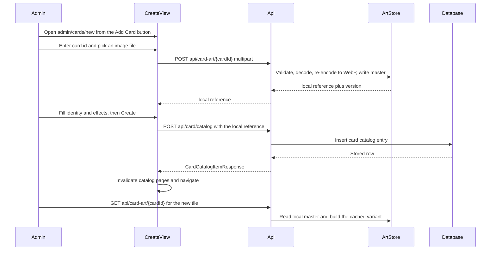

# Plan: admin Add Card flow with image upload

Goal: give the card admin a button and a screen that creates a brand new card in the database, backed by a
secured create endpoint and a new image-upload capability, while reusing the existing update screen's
identity-free editor components.

## Decisions already taken

- Uploaded art lives on server disk under a server-owned directory. `CardCatalogEntry.Image` stores a local
  reference of the shape `local:card-art/<cardId>.<ext>`; remote http(s) URLs keep working exactly as today.
- Upload is its own admin-only endpoint, so the create request body stays JSON.
- The create form also accepts an external image URL as the alternative to a file upload.

## What exists today

- Edit flow: [`CardAdminView`](client/src/views/admin/CardAdminView.tsx:16) → [`CardAdminDetailPane`](client/src/views/admin/components/detail/CardAdminDetailPane.tsx:22) → [`useCardAdminEffectEditorModel`](client/src/views/admin/model/useCardAdminEffectEditorModel.ts:293), which PATCHes [`/api/card/catalog/{cardId}/effects`](server/Api/Controllers/CardController.cs:77) through [`updateCardCatalogEffects`](client/src/services/api/cardCatalogApi.ts:101).
- The editor covers `type`, `color`, `power`, `damage`, `life`/`health`, `description`, `supportEffect`,
  `cannotBeNormalSummoned`, `conditions`, `effects`. Card identity (`id`, `displayName`, `name`, `originalId`,
  `mainAlternate`, `attribute`, `traits`, `image`) is display-only in [`CardAdminSelectedCardSummary`](client/src/views/admin/components/detail/CardAdminSelectedCardSummary.tsx:34) and in [`CardMappingService.ToNewEntry`](server/Api/Services/Card/CardMappingService.cs:303), which only the seed path uses.
- Art is remote-only: [`CardArtService.ResolveAsync`](server/Api/Services/CardArt/CardArtService.cs:35) reads `entry.Image`, requires an absolute http(s) URL via `TryParseSourceUrl`, then caches WebP variants keyed by card id, width and version. `ICardArtService` is unchanged by this plan.
- Authorization for admin writes is the [`CardCatalogAdmin`](server/Api/Auth/AuthorizationPolicies.cs:5) policy, requiring an authenticated user with the `card_catalog_admin: true` claim.
- No `IFormFile` or multipart handling exists anywhere in the server, so upload plumbing is net-new.
- Routing is React Router v7 Data Mode with `createBrowserRouter` and lazy routes ([`routes.tsx`](client/src/app/routes.tsx:8)). The admin route has no loader or action; admin data flows through TanStack Query. The new route follows that same idiom rather than introducing a route `action`, so the create mutation can seed and invalidate the same query cache the edit mutation does.

## Backend design

### 1. Art source contract

New helper `CardArtSourceReference` (server/Api/Services/CardArt):

- `LocalPrefix = "local:"`.
- `IsLocal(reference)` and `TryResolveLocalPath(reference, artRoot, out fullPath)`.
- The resolved path must stay inside the art root after normalization; `local:../../appsettings.json` and any
  absolute path escape must be rejected. This is the one security-critical rule of the whole feature and gets a
  unit test.

### 2. Upload storage

Extend [`CardArtOptions`](server/Api/Services/CardArt/CardArtOptions.cs:3):

- `UploadDirectory` default `card-art-uploads`
- `MaxUploadBytes` default 10 MB
- `AllowedUploadContentTypes`: `image/png`, `image/jpeg`, `image/webp`
- `MaxUploadPixels` to cap decompression bombs

New `ICardArtWriteService` + `CardArtWriteService`:

- `StoreUploadAsync(cardId, stream, contentType, ct) → ErrorOr<CardArtUploadResult>` where the result carries the
  `local:` reference and a version token.
- Validate the card id is a safe path segment, enforce the byte limit while streaming (same shape as
  `CardArtService.ReadWithLimitAsync`), decode with ImageSharp to reject non-images and oversized pixel counts,
  then re-encode the stored master to WebP through [`CardArtImageProcessor.ResizeToWebpAsync`](server/Api/Services/CardArt/CardArtImageProcessor.cs:9). Re-encoding means a stored master is always a validated, metadata-stripped WebP regardless of what the client sent.
- Write temp file then `File.Move(overwrite: true)`, under a per-card lock.
- Delete the card's cached variants so the next read regenerates them.
- `DeleteUploadAsync(cardId)` for the clear-art action.
- The per-card semaphore map currently lives as a `private static` field in [`CardArtService`](server/Api/Services/CardArt/CardArtService.cs:13); extract it into a shared lock helper so upload and variant generation cannot race over the same card.

### 3. Read path

[`CardArtService.ResolveAsync`](server/Api/Services/CardArt/CardArtService.cs:35) gains one branch before the URL parse: if the stored reference is local, read the stored master from disk and feed the existing variant
generation. Cache file naming, ETag and `IsImmutable` semantics are untouched, and the version keeps defaulting to
`UpdatedAtUtc` milliseconds. [`CardArtController.GetCardArt`](server/Api/Controllers/CardArtController.cs:22) stays `[AllowAnonymous]`: reading art is public, writing art is admin-only.

### 4. Endpoints

| Endpoint | Auth | Purpose |
| --- | --- | --- |
| `POST /api/card-art/{cardId}` multipart | `CardCatalogAdmin` | Store an uploaded master, return the `local:` reference |
| `DELETE /api/card-art/{cardId}` | `CardCatalogAdmin` | Delete a stored master plus its cached variants |
| `POST /api/card/catalog` JSON | `CardCatalogAdmin` | Create the card row and return `CardCatalogItemResponse` |

`GET /api/card-art/{cardId}` remains anonymous and unchanged. The upload action needs `[RequestSizeLimit]` and
maps invalid type, oversized body and decode failures to 400/413; authorization failures already return the
JSON 401/403 bodies configured in [`Program.cs`](server/Program.cs:305).

### 5. Create request

`CreateCardRequest` in [`CardCatalogRequests.cs`](server/Models/Api/CardCatalogRequests.cs:185) with identity
fields (`CardId`, `DisplayName`, `Name`, `OriginalId`, `MainAlternate`, `Attribute`, `Traits`, `Image`) plus the
same editable fields the PATCH request already carries. Response is the existing `CardCatalogItemResponse`, so
the client reuses one shape.

`CreateCardRequestValidator` (new file; [`GameRequestValidators.cs`](server/Api/Validation/GameRequestValidators.cs:173) is already over 1000 lines):

- `CardId` required, max 64, no path separators or colon, so it is safe in both the art path and the URL segment.
- Identity max lengths mirror the EF columns in [`CardCatalogEntryConfiguration`](server/Data/Configurations/Catalog/CardCatalogEntryConfiguration.cs:14) (`CardId` 64, `DisplayName` 256, `OriginalId` 64, `Attribute` 128) so over-long input is a 400 rather than a 500.
- Type and color must parse when supplied; power/damage/life/health non-negative; `Life` only with `Leader`, `Health` not with `Leader`, never both.
- Effects may be empty (a brand new card can have none) but when present each needs non-empty `Id`, `EffectType`, `Timing` and `DurationMode`, and ids must be unique, mirroring the checks in `parseEditorPayload`.
- `Image` nullable; when present it must be a valid http(s) URL or a `local:` reference.

### 6. Create service

`ICardMappingService.CreateCardAsync` in [`CardMappingService`](server/Api/Services/Card/CardMappingService.cs:12):

- Trim and validate the card id, then do a **case-insensitive** duplicate lookup. The unique index on `CardId` is
  case-sensitive, so `BM-001` versus `bm-001` has to be caught in code. Return an `Error.Conflict` so
  [`ProblemFromErrors`](server/Api/Controllers/ApiControllerBase.cs:8) maps it to 409.
- Build a `Card`/`LeaderCard`/`CharacterCard` from the request and reuse [`ToNewEntry`](server/Api/Services/Card/CardMappingService.cs:303) so create and seed share one Jsonb serialization path.
- Reuse `TryParsePatchCardType`, `TryParsePatchCardColor` and `NormalizeLifeAndHealthByType` so life/health rules match the update flow exactly.
- Reject a `local:` image reference whose embedded card id differs from the card being created, so one card cannot point at another card's file.
- `CreatedAtUtc`/`UpdatedAtUtc` set to now; `DbUpdateException` maps to `Error.Failure`.

## Frontend design

### Reuse strategy for the update screen

The existing editor is the source of truth for effects editing and must not be forked:

- Extract the identity-free editor body (summary, description, support effect, conditions section, effects section) out of [`CardAdminDetailEditor`](client/src/views/admin/components/detail/CardAdminDetailPane.tsx:36) into a shared `CardAdminEffectEditorBody` that takes the draft, its setters and a `mode`. [`CardAdminDetailPane`](client/src/views/admin/components/detail/CardAdminDetailPane.tsx:22) becomes the edit wrapper.
- Extract the portalled sticky footer and unsaved-changes pill into `CardAdminEditorFooter` with `submitLabel`, `disabled` and `isDirty` props, so the create screen gets the same affordance with a Create label.
- Split [`useCardAdminEffectEditorModel`](client/src/views/admin/model/useCardAdminEffectEditorModel.ts:293): move draft state, setters, `parseEditorPayload`, reset and `isDirty` into `useCardAdminEffectDraft`, and keep `save` as the edit screen's composition. The create screen composes the same draft hook with a create submit, so validation messages, duplicate-effect-id detection and branch-target checks are shared verbatim.
- Extend [`CardAdminSelectedCardSummary`](client/src/views/admin/components/detail/CardAdminSelectedCardSummary.tsx:34) with optional identity props so card id and display name become editable in create mode; no fork.
- Reuse `createDefaultEffect`, `normalizeEffectId`, the option constants and [`CardAdminToggleSwitch`](client/src/views/admin/components/controls/CardAdminToggleSwitch.tsx:1) unchanged.

### New pieces

- [`client/src/app/routes.tsx`](client/src/app/routes.tsx:64): lazy route `/admin/cards/new` returning `CardAdminCreateView`, loader-free like its neighbour.
- `CardAdminCreateView`: same `PageShell` + `Panel` shell as [`CardAdminView`](client/src/views/admin/CardAdminView.tsx:128), identity panel plus the shared editor body, back link to `/admin/cards`.
- `CardAdminIdentityPanel`: card id, display name, names list, original id, main alternate toggle, attribute, traits; image section with a file input (`accept="image/png,image/jpeg,image/webp"`), an external URL field, and a live preview.
- Preview nuance: [`CardImage`](client/src/components/ui/cards/CardImage.tsx:33) derives its source from `cardArtUrl(card.id, …)`, which only resolves once the card exists. In create mode preview from `URL.createObjectURL(file)` or the typed URL, and revoke the object URL on change and unmount.
- Upload ordering: an upload needs a card id in the path, so the flow is enter card id → upload → hold the returned `local:` reference in the draft → submit it as `Image` on create. A card that is never created would leave an orphan file, so the form calls `DELETE /api/card-art/{cardId}` on cancel or unmount, and a periodic orphan sweep is left as a documented follow-up rather than built now.

### Client data layer

- [`client/src/services/api/cardCatalogApi.ts`](client/src/services/api/cardCatalogApi.ts:101) gains `createCardCatalogEntry`, which seeds the by-id cache from the response like the update call does.
- New `cardArtApi.ts` next to [`cardArt.ts`](client/src/services/api/cardArt.ts:1) for `uploadCardArt` and `deleteCardArt`. The shared axios instance sets `Content-Type: application/json` ([`httpClient.ts`](client/src/services/api/httpClient.ts:6)), so the multipart call must override it with `multipart/form-data` and let the browser set the boundary.
- [`cardQueries.ts`](client/src/services/queries/cardQueries.ts:198) gains `useCreateCardCatalogEntryMutation` invalidating `['cards', 'catalog-infinite']`, and a new `cardArtQueries.ts` holds `useUploadCardArtMutation`.

### Entry point and copy

- Add Card button in the [`CardAdminView`](client/src/views/admin/CardAdminView.tsx:166) header, linking to the new route.
- New i18n keys in [`en.json`](client/src/i18n/en.json:367): `admin.view.addCard`, a `admin.create.*` group for identity, image, uploading, upload failure, duplicate id, created and create-failed, plus `admin.validation.*` additions.

## Flow



## Verification

- Server unit tests: create validator rules, duplicate id conflict, local reference path traversal rejection.
- e2e `admin.card-create.spec.ts` following the dev-bypass pattern of [`admin.card-editor.spec.ts`](e2e/admin.card-editor.spec.ts:22): seed the admin session, upload a fixture PNG through the real file input, create the card, assert it appears in the catalogue, assert `/api/card-art/{id}` returns 200, and assert an unauthenticated or non-admin request to both write endpoints is refused.
- Manual: typecheck and build for the client, and confirm the editor behaviour of `/admin/cards` is unchanged after the extraction.

## Risks and notes

- Case-sensitive unique index versus case-insensitive duplicate check is the most likely source of a 500 if missed.
- `CardCatalogEntry.Image` is capped at 1024 characters; local references are far shorter, so the existing limit still holds.
- A newly created card with no art makes `ResolveAsync` return null, which already renders the [`CardImage`](client/src/components/ui/cards/CardImage.tsx:105) placeholder. That is the accepted default, not a bug.
- The `ClientDev` CORS policy already allows any header and method, so multipart works in development; a deployed configuration needs the same check.
- Final step of the work: record the local art contract and the upload endpoint in the backend patterns of [`.clinerules/01-architecture.md`](.clinerules/01-architecture.md:75), since that file is the project's architecture memory.

## Follow-ups delivered

These were the open items at the end of the first pass; all four are now built.

### `/api/card/seed` is admin-only

It writes into the same catalogue table as the authoring endpoints, so it is held to the same claim as they are
rather than being left open because it predates them. Nothing in the repository called it - `scripts/generate-seed-catalog.py` rewrites the manifest file, not the API - so no tooling had to change. [`server/README.md`](server/README.md:89) now says so.

### Art can be replaced on an existing card

- `PUT /api/card/catalog/{cardId}/image` (admin-only) takes `UpdateCardImageRequest(string? Image)`; an empty value clears the art. The art master itself is still uploaded through `POST /api/card-art/{cardId}` - this endpoint only points the card at it.
- [`UpdateCardImageByCardId`](server/Api/Services/Card/CardMappingService.cs:395) moves `UpdatedAtUtc`, which is what the response's image version is derived from. Without that move every client would keep painting the previous image from its cache for as long as the version matched.
- Ownership is checked against the **stored** card id, not the one in the route: the replacement request cannot see the card id it will be applied to, so that rule lives in the service rather than in the validator.
- The edit screen gained a [`CardAdminCardArtSection`](client/src/views/admin/components/detail/CardAdminCardArtSection.tsx:14), and both screens now share one presentational [`CardAdminArtPicker`](client/src/views/admin/components/detail/CardAdminArtPicker.tsx:32). Removing art clears the reference *first* and deletes the master second, so a failure between the two leaves a card with no art rather than a card pointing at a file that is gone. (That section applied art immediately at the time; it now stages it - see below.)

### Orphaned uploads are swept

- [`CardArtOrphanSweeper`](server/Api/Services/CardArt/CardArtOrphanSweeper.cs:10) collects a stored master that no card references and that has not been touched for `CardArt:OrphanGraceMinutes` (default 60). The grace window is what protects the upload of a create request that has not landed yet.
- It also collects cached variants whose card id no longer exists.
- Sweeps are triggered by writes and rate-limited by `CardArt:OrphanSweepIntervalMinutes` (default 60) using a process-wide timestamp, rather than by a timer: this codebase has no hosted service yet and an idle server has no orphans to collect. A multi-instance deployment would need a real scheduler, which the interface documents.
- The decision rules are a pure [`CardArtOrphanPolicy`](server/Api/Services/CardArt/CardArtOrphanPolicy.cs:9), because a deletion rule that is only exercised through a filesystem and a database is a deletion rule nobody can trust.

The sweep cannot throw: a failed sweep logs and returns, so housekeeping never takes a write down with it.

### A bug the tests found, after those follow-ups

Writing the first real test of [`CardArtService`](server/Api/Services/CardArt/CardArtService.cs) against temp
directories turned up something none of the unit tests could have: the upload wrote its master to
`<uploadRoot>/<cardId>.webp` while every reader resolved the reference
`local:card-art/<cardId>.webp` to `<uploadRoot>/card-art/<cardId>.webp`. Uploaded art could therefore never be
found - the upload succeeded, the row pointed at a file nothing could resolve, and `/api/card-art/{id}` fell
through to the placeholder. The orphan sweep looked in the reader's location too, so it could not have collected
those files either.

Both sides now go through `CardArtSourceReference.BuildMasterPath`, which includes the folder segment the
reference contract implies. The lesson is recorded in the architecture rules: a master's path is derived from its
reference, never assembled by hand.

### The duplicate, removed

A request at or above `CardArtOptions.ResolveMasterWidth()` is now answered with the stored master itself rather
than with a `__w600__v<version>` cache file derived from it. That derivation never rescaled anything - the master
is capped at exactly that width - so it cost a duplicate file plus a second q85 pass over the only bytes a
browser sees at 600. `ResolveMasterWidth` moved onto the options so the write path and the read path share one
definition of where the cap is.

### The unbounded leak, closed

The version in a variant's file name is the card's updated timestamp, so any card edit - including an effects
patch that never touches art - minted a new set of variant names, and the old ones were never read again and
never removed: the cache grew with (cards edited × widths viewed), forever. The sweep is now version-aware and
collects a variant whose version is an older parseable timestamp than the card's current one, while deliberately
keeping a newer or unparseable version so a client pinned to a version the server does not recognise cannot cause
a generate/delete loop. Variants of deleted cards and unreferenced masters still wait out `OrphanGraceMinutes`.

One residual, bounded and self-healing: a variant sitting at a card's *live* version for a width that is now
served from the master is kept, because the sweep cannot tell which widths a card serves from its master without
knowing its art source. Those files are wiped by the card's next upload and superseded by its next edit.

### Art is staged until the card is saved

The replacement section above, as first built, sent art the moment it was touched: picking a file uploaded it and
pointed the card at it in the same breath, and a pasted URL did the same on a click. That made an upload *a save* -
browsing for the right file, or pasting a URL to check it, changed a card that is already in the catalogue. Art is
now a draft like the effects are.

- [`useCardAdminArtDraft`](client/src/views/admin/model/useCardAdminArtDraft.ts:33) holds exactly one pending
  change: a picked file (previewed from an object URL, revoked on replace and unmount), a typed URL, or a removal.
  It sends nothing; `commit` is the only request path.
- [`CardAdminDetailPane`](client/src/views/admin/components/detail/CardAdminDetailPane.tsx:29) owns that draft next
  to the effects model, so the floating save button - and the "unsaved changes" pill - count both. The save runs
  the effects patch **first**, and only a card that passed validation gets its staged art committed. That ordering
  is the point: a rejected card must not leave a freshly uploaded master behind on the server.
- `commit` uploads a staged file (which needs a card id, so this is the moment it happens), then `PUT`s the image
  reference. A removal still clears the reference first and deletes the master second, best effort.
- The section reports what is staged with its own line, offers a **Discard** for it, and Removes art as an
  intention rather than an action. The create screen keeps uploading on pick, because there the card does not exist
  yet and a master can only be stored under a card id that has been chosen - its reference rides the create request.

### A hole the follow-up tests found

`local:` alone, `local:card-art/`, `local:card-art/nested/N-001.webp` and `local:other/N-001.webp` all passed a
prefix-only check. [`IsWellFormedLocalReference`](server/Api/Services/CardArt/CardArtSourceReference.cs:56) now pins the exact shape the server writes, and the replacement validator uses it. The create path was already safe
because it compares against the reference it would have built, but it was safe by accident rather than by rule.

### Choosing the art: clipboard, file or address

Art could only arrive as a file the author had already downloaded. [`CardAdminArtSourceDialog`](client/src/views/admin/components/detail/CardAdminArtSourceDialog.tsx:33) now offers
the ways a browser can hand over an image, all of them landing on the same `onSelectFile` the file picker used:

- **Paste.** The paste area takes the focus the moment the dialog opens, so Ctrl+V works with no click and without
  a page-wide listener that would also have hijacked pastes aimed at the catalogue search. Chromium's copy of an
  image is a nameless `image/png`, so a file without a name gets one - otherwise the staged line would read
  "Staged: .". The clipboard's text flavour is used too: pasting an image *address* fills the URL field instead,
  because that is the one path where the bytes are never touched.
- **File or drop.** The `#card-admin-art-file` input stays where the e2e spec drives it, now inside the dialog,
  plus a drop target for an image dragged out of another page. A Safari copy of an image can arrive as a flavour no
  browser decodes, so the file path has to stay a first-class way in rather than a fallback.

The dialog measures what it was given and refuses what would be stored wrong, before any request:

- **Narrower than 600 px** (`CARD_ART_MIN_SOURCE_WIDTH`, mirroring `CardArtOptions.ResolveMasterWidth`) is blocked.
  Nothing is ever upscaled, so a 400 px image is stored 400 px wide and shows soft at the 600 px preview size - and
  the clipboard makes that easy to do by accident: a copy of an image on a `srcset` page is the variant the browser
  chose, not the full-size file, and a screenshot is screen resolution.
- **Over 10 MB** (`CARD_ART_MAX_UPLOAD_BYTES`) is blocked for the same reason: the server's byte cap would refuse
  the upload anyway, so saying it at choose time is better than at save time.
- A bitmap nothing can decode is blocked too, which is what a non-image file now hits on the create screen instead
  of a round trip to the server's content-type check.

Both constants mirror server configuration, so they move with it. Given a bitmap at least as wide as the master,
paste is quality-neutral: the upload decodes once and writes WebP q85 exactly as it does for a picked file.

### The editor warns before it loses a draft

The pane is keyed by card id, and that key is what makes a draft disappear silently: selecting another card
unmounts it, navigating to the create screen unmounts it, and reloading the tab takes it with everything else.

[`CardAdminDetailPane`](client/src/views/admin/components/detail/CardAdminDetailPane.tsx:14) now reports whether its draft has anything in it
(effects *and* staged art, since the same save would flush both), and [`CardAdminView`](client/src/views/admin/CardAdminView.tsx:16) is the only thing that acts on
that:

- Another tile in the rail opens [`CardAdminUnsavedChangesDialog`](client/src/views/admin/components/detail/CardAdminUnsavedChangesDialog.tsx:23) instead of switching, and only the dialog
  discards.
- `useBlocker` holds a router navigation - the Add Card link included - until the dialog says to proceed.
- `useBeforeUnload` covers what the router cannot see: a reload or a closed tab gets the browser's own prompt.

The dialog offers the three honest answers: **Keep Editing** (the default and the focused button), **Save &
Continue**, and **Discard Changes**. Save is why the dialog is rendered by the *pane* rather than by the screen -
the pane is the only thing that can save - so the screen only says that an exit is pending and what the answer was.
A save the server refuses therefore keeps the author on the card, draft intact and the error readable, instead of
letting the exit through on a failed write. Two smaller holes were closed with it: while the draft is dirty the
selected card is resolved from everything loaded rather than from the filtered list, and the clear-selection effect
stands down, so a search keystroke cannot throw the draft away. Both of those only hold *while dirty* - a clean
editor still empties when its card is filtered out.

### A cold start reverted every upload

The seeder ran on every Development start and rewrote **every column** of every card that appears in a seeded
deck from `test-data/seed-profiles.json` — `Image` included. So the uploaded art a card pointed at
(`local:card-art/N-00X.webp`) was replaced by the catalogue URL at the next boot, and the master on disk became an
orphan the sweep would eventually collect.

Nothing was wrong with the art pipeline. The ten masters were still on disk
(`server/card-art-uploads/card-art/N-001.webp` … `N-010.webp`); the database was the only thing that had forgotten
them, and one statement put the references back:

```sql
UPDATE card_catalog_entries
SET "Image" = 'local:card-art/' || "CardId" || '.webp',
    "UpdatedAtUtc" = now()
WHERE "CardId" IN (…);
```

That is what `PUT /api/card/catalog/{cardId}/image` does, including the version bump that makes every client drop
the cached URL art. It was run before any art write could trigger a sweep over masters that were, at that moment,
unreferenced.

What changed:

- `DevelopmentDeckSeeder` is **create-only**. It inserts a card that is missing and never touches one that exists:
  no timestamp heuristic, no "looks untouched" rule. Authoring and seeding write the same table, so the seed file
  cannot be allowed to write there once a card exists.
- `PHV_RESEED_OVERWRITES_EXISTING=true` is the deliberate override for a regenerated manifest — the only path that
  writes over stored content — and the startup log says so when it is on.
- `DevelopmentDeckSeederTests` pins all three: the manifest still seeds a missing card, stored rows survive a
  re-seed (both the edited kind and the one still carrying the seeded timestamps), and the override replaces them.

The lesson has the same shape as the master-path bug: two writers of one table need an explicit ownership rule, and
"the manifest always wins" is a rule that eats the author's work.

### Scaling the catalogue: the lookup and the rail

Two things did not scale with the catalogue, and both were measured rather than guessed. The seeder was excluded
deliberately: it creates only what is missing, and its input is a fixture file rather than the catalogue.

**The lookup.** Every card lookup is written as `upper("CardId") = @id` — the art endpoint, `by-ids`, the create
duplicate check, the update and delete lookups — and a plain index on `CardId` cannot serve an expression. So each
was a sequential scan, and the art endpoint ran one per image request against a table whose rows are wide with
`jsonb` effect specs. `EXPLAIN (ANALYZE, BUFFERS)` on the dev database:

| query | before | after |
| --- | --- | --- |
| art lookup (`Image`, `UpdatedAtUtc` by id) | `Seq Scan`, `Rows Removed by Filter: 36`, 20 shared buffers | `Index Scan using IX_card_catalog_entries_CardId_upper`, 2 |
| `by-ids` (`IN` list) | `Seq Scan`, 20 shared buffers | `Bitmap Index Scan` on the same index, 3 |

The index is `upper("CardId") INCLUDE ("Image","UpdatedAtUtc")`, hand-written in the `AddCardCatalogIndexes`
migration because EF cannot express it, and deliberately absent from the model snapshot. The `INCLUDE` is the point:
the art lookup needs exactly those two columns, so it never touches the heap — which is where the `jsonb` lives. It
also turns case-insensitive uniqueness into a database invariant instead of the `AnyAsync` race in the create path.
The other route — dropping `upper()` so the plain unique index works — was rejected: nothing enforces canonical case
on write, so a lowercase id would miss `=` and turn a clean 409 into a unique-violation 500.

**The rail.** The listing returned whole cards — every effect spec deserialised — and the admin filtered them in the
browser, over whatever pages it had scrolled. At a few thousand cards the search simply stops finding things. Now:

- `CardCatalogListItemResponse` is six fields projected in SQL; the editor's card comes from `by-ids` on selection
  (`useCardCatalogByIdsQuery`). That also removed the workaround that pinned the selected card while a draft was
  dirty: a card no longer has to be on a loaded page to be edited.
- `search`, `types` and `colors` are query parameters applied in SQL; the type and colour menus come from the fixed
  enum domain instead of from loaded data; the search box is debounced before it becomes a query key.
- The listing's total describes the filtered set, and duplicates across pages are collapsed with a `Map` instead of
  `findIndex` inside `filter`.
- Card mutations seed the shared card-item cache from what the write returned, so the detail read never answers
  with the pre-edit card.

One deliberate simplification against the plan: `withTotal` was dropped. The count is one query over an indexed,
projected set, and keeping `PagedResponse` non-nullable kept the client contract unchanged — it is now a
measurement, not an assumption, if it ever needs revisiting.

Deferred, each with its trigger: keyset paging (~10k rows), a `pg_trgm` index for substring search (measure at
~10k — the lean query may never need it), an in-memory card cache, sharded art directories (~100k files), a
scheduled paginated sweep once it exceeds ~1 s, and an upload queue for bulk imports.
