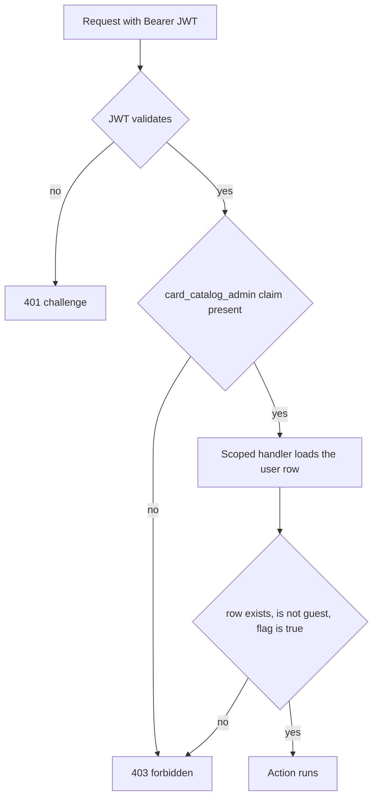

# Admin authorization checked against the database, and Fly removed

Two changes that belong together because the first one makes the second one's leftovers visible: the
`CardCatalogAdmin` policy currently trusts a claim minted at login, and the repo still carries Fly deployment
artifacts that describe a host we no longer use.

## Why now

- [`AuthTokenService.CreateToken()`](../../server/Api/Services/Auth/AuthTokenService.cs:18) stamps
  `card_catalog_admin` once, at login, and the policy only ever looks at that claim
  ([`Program.cs`](../../server/Program.cs:410)). [`appsettings.json`](../../server/appsettings.json:19) sets
  `AccessTokenLifetimeMinutes` to `43200` - thirty days. Revoking an admin, deleting the row, or a stray token in
  somebody's localStorage all keep full catalogue write access until the token ages out.
- The claim is the only authority the server consults, so the database's `users.is_card_catalog_admin` is
  effectively write-only from the API's point of view. Nothing reads it back after login.
- `DevelopmentAuthenticationHandler` ([`DevelopmentAuthenticationHandler.cs`](../../server/Api/Auth/DevelopmentAuthenticationHandler.cs:24))
  hands the admin claim to *any* unauthenticated caller, which is exactly the same trust bug with no credential at
  all. Production is safe today only because compose and the Dockerfile both pin `Production`; nothing fails closed
  if that pin is ever lost.
- Fly is dead weight: [`fly.toml`](../../fly.toml:1), [`client/fly.toml`](../../client/fly.toml:1) (which still bakes
  `VITE_API_BASE_URL` to `https://dawn-meadowstone-955.fly.dev`), and two stale comments.

## Target behaviour



The claim stays as a cheap first rejection; the database is the second, authoritative one. A request whose claim is
valid but whose row is not an admin is **denied**, not upgraded. Any database failure denies as well - the policy
never grants on an error path.

## Phase 0 - server state before any code ships

These are the database and auth-material adjustments. None of them need a new image.

1. **Rotate the JWT signing key.** It was pasted into a chat transcript.
   ```bash
   ssh root@167.233.251.253
   cd /opt/phv
   openssl rand -hex 32          # paste into JWT_KEY in .env
   docker compose up -d          # recreates api; every existing token becomes invalid
   ```
   Do it through the normal deploy drain ([`.github/workflows/deploy.yml`](../../.github/workflows/deploy.yml:78))
   because the API restart ends in-memory games either way.

2. **Rotate the Postgres password.** The container only reads `POSTGRES_PASSWORD` when it initialises the volume,
   so changing `.env` alone does nothing:
   ```bash
   docker compose exec postgres psql -U phv -d project_hidden_village \
     -c "ALTER USER phv WITH PASSWORD '<new-password>';"
   # then update POSTGRES_PASSWORD in .env and:
   docker compose up -d
   ```

3. **Turn the bootstrap off.** `.env` currently has `ADMIN_BOOTSTRAP_ENABLED=true`.
   [`AdminBootstrapSeeder.PromoteAsync()`](../../server/Data/Seeding/Bootstrap/AdminBootstrapSeeder.cs:44)
   re-promotes that email on every boot, so any later revocation is silently undone at the next restart - which is
   precisely the operation Phase 1 is meant to make meaningful.
   ```bash
   # .env
   ADMIN_BOOTSTRAP_ENABLED=false
   docker compose up -d
   ```

4. **Verify what the container actually got.** Never paste this output where others can see it.
   ```bash
   docker inspect phv-api-1 --format '{{range .Config.Env}}{{println .}}{{end}}' \
     | grep -E 'ASPNETCORE|PHV_INCLUDE'
   ```
   Expect `ASPNETCORE_ENVIRONMENT=Production` and no `PHV_INCLUDE_TEST_SEED_PROFILES`.

## Phase 1 - the database is the authority

### 1a. One capability resolver

New `server/Api/Services/Auth/IActorCapabilityResolver.cs` + `ActorCapabilityResolver.cs` (scoped, injected with
`ApplicationDbContext`):

```csharp
Task<bool> IsCardCatalogAdminAsync(Guid userId, CancellationToken cancellationToken = default);
```

It returns `true` only when a `users` row exists, `IsGuest` is false, and `IsCardCatalogAdmin` is true. `AsNoTracking`,
`Select` of the single flag, no entity materialisation. This is the one place that reads the column, so the policy and
`DeckController` cannot drift.

Cost is one indexed primary-key lookup per admin request. Admin traffic is a handful of requests per session, so no
caching layer is warranted; a cache would only reintroduce the staleness this change exists to remove.

### 1b. Requirement and handler

New `server/Api/Auth/CardCatalogAdminRequirement.cs` (empty marker requirement) and
`CardCatalogAdminAuthorizationHandler.cs` (`AuthorizationHandler<CardCatalogAdminRequirement>`, scoped):

- resolve the caller id from `ClaimTypes.NameIdentifier`, falling back to `JwtRegisteredClaimNames.Sub` - the same
  pair every controller already parses ([`DeckController`](../../server/Api/Controllers/DeckController.cs:146),
  [`UserController`](../../server/Api/Controllers/UserController.cs:108));
- no id -> do not succeed;
- call the resolver; succeed only when it returns `true`;
- log a single warning on the deny path so a demoted-but-still-logged-in admin is visible in the logs.

### 1c. Wire the policy

In [`Program.cs`](../../server/Program.cs:408):

- keep `RequireAuthenticatedUser()` and `RequireClaim(...)`;
- add `policy.Requirements.Add(new CardCatalogAdminRequirement())`;
- register `builder.Services.AddScoped<IAuthorizationHandler, CardCatalogAdminAuthorizationHandler>()` and the
  resolver beside the other scoped services.

No controller attribute changes. Every endpoint already decorated with
`[Authorize(Policy = AuthorizationPolicies.CardCatalogAdmin)]` - `CardController`, `CardArtController`,
`DeckRulesetController`, `MaintenanceController`, `POST /api/deck/public` - becomes database-verified by this alone.

### 1d. The one endpoint that bypasses the policy

[`DeckController.UpdateDeck()`](../../server/Api/Controllers/DeckController.cs:59) and `DeleteDeck()` are plain
`[Authorize]`, and the action computes `isAdmin` from the raw claim
([`DeckController.IsCardCatalogAdmin()`](../../server/Api/Controllers/DeckController.cs:152)) before handing it to
[`DeckService`](../../server/Api/Services/Deck/DeckService.cs:211). Replace that with the resolver so the owner-or-admin
branch uses the same database truth. The actions become `async` there; behaviour for non-admins is unchanged.

### 1e. Development bypass fails closed

[`DevelopmentAuthenticationHandler`](../../server/Api/Auth/DevelopmentAuthenticationHandler.cs:22) should only
authenticate when `PHV_ALLOW_DEVELOPMENT_BYPASS` is explicitly `true` (Development *and* the variable); otherwise it
returns `AuthenticateResult.NoResult()`, which the JWT challenge turns into 401. Consequences:

- `npm run dev` and [`scripts/e2e-start-server.sh`](../../scripts/e2e-start-server.sh:24) set the variable, so the
  local workflows keep working;
- a compose file that accidentally says `Development` grants anonymous catalogue write access only if somebody also
  set the opt-in;
- the bypass identity still resolves to a seeded user row, so the Phase 1 database check passes for it in Development
  instead of being an exception carved into the handler.

## Phase 2 - tests

New `server/tests/ProjectHiddenVillage.Server.Tests/CardCatalogAdminAuthorizationTests.cs`, using the same
`UseInMemoryDatabase` pattern as [`AdminBootstrapSeederTests`](../../server/tests/ProjectHiddenVillage.Server.Tests/AdminBootstrapSeederTests.cs:166):

| Case | Expectation |
|---|---|
| claim + row with `IsCardCatalogAdmin = true` | succeeds |
| claim + row with `IsCardCatalogAdmin = false` | fails (the demotion case) |
| claim + no row at all | fails (the deleted-account case) |
| claim + guest row with the flag set | fails |
| no claim | policy short-circuits before the handler; assert the policy fails |
| claim but no `NameIdentifier`/`sub` | fails |
| resolver called with a random id | returns false |

Plus a `DeckController`-level test for `UpdateDeck` calling through with the resolver's answer, and a
`DevelopmentAuthenticationHandler` test asserting `NoResult()` when the opt-in is absent.

Regression runs:

- `dotnet test server/tests/ProjectHiddenVillage.Server.Tests`
- `e2e/admin.route-guard.spec.ts` - proves a tampered `isCardCatalogAdmin` in localStorage still cannot render admin
  screens, now with the server agreeing;
- one admin write spec (`e2e/admin.card-create.spec.ts` or `e2e/admin.deck-ruleset-editor.spec.ts`) with a real login
  session, because that path now includes a database read.

## Phase 3 - Fly removal

Nothing in the build or deploy pipeline depends on Fly; these are config artifacts and prose.

1. Delete [`fly.toml`](../../fly.toml:1) (API app `dawn-meadowstone-955`, `[env]` block, volume mount, TCP check).
2. Delete [`client/fly.toml`](../../client/fly.toml:1) (web app `proud-summit-765`, and the dead
   `VITE_API_BASE_URL = https://dawn-meadowstone-955.fly.dev` build argument).
3. Rewrite the header comment in [`client/Dockerfile`](../../client/Dockerfile:2) - the API is not "a separate Fly
   app"; it is the compose service in `docker-compose.yml`.
4. Rewrite the card-art comment in [`Dockerfile`](../../Dockerfile:26) - "Fly volume" becomes the compose volume at
   `/data`. The `ENV` values stay: they are correct for that mount.
5. Leave the two historical notes in
   [`plans/small-box-deployment-tuning.md`](../../plans/small-box-deployment-tuning.md:169) alone, or mark them
   superseded in one line. They are the record of why Fly was abandoned; deleting them loses the reasoning, not just
   the config.
6. Verify with `grep -rniE 'fly\.io|fly\.toml|flyctl|dawn-meadowstone|proud-summit' --exclude-dir=node_modules .`
   Expect only the historical plan note.

`.github/workflows/publish-images.yml` needs no edit: the client image gets `VITE_API_BASE_URL` from
[`env.API_BASE_URL`](../../.github/workflows/publish-images.yml:19), not from `client/fly.toml`.

## Order of work

1. Phase 0 first - the exposed key is the live risk, and the bootstrap flag undermines Phase 1.
2. Phase 1 code and Phase 2 tests together; the policy change without tests is unverifiable.
3. Phase 3 last, as its own commit, so a review of the authorization change is not buried under file deletions.

## Explicitly out of scope for this pass

- Shortening `AccessTokenLifetimeMinutes` or adding a separate admin token lifetime. Worth doing; it is a policy
  choice about how often admins re-authenticate, not a database check.
- `[Authorize]` on the `api/test/**` endpoints, and restricting
  [`UserController.GetUsers()`](../../server/Api/Controllers/UserController.cs:155) to admins. Both are real gaps and
  both are independent of the database check.
- An audit log of admin mutations.

## Status

Implemented, with one server-side step still open.

- **Phase 1-2:** `ActorCapabilityResolver`, `CardCatalogAdminRequirement` and `CardCatalogAdminAuthorizationHandler`
  are wired into the `CardCatalogAdmin` policy; `DeckController` asks the resolver instead of reading the claim; the
  development bypass needs `PHV_ALLOW_DEVELOPMENT_BYPASS=true` and both dev entry points set it.
- **Server tests:** 1051 passed, including twelve new cases in `CardCatalogAdminAuthorizationTests`.
- **e2e:** `e2e/admin.route-guard.spec.ts` and `e2e/admin.card-create.spec.ts` -> 7 passed.
- **Phase 3:** `fly.toml` and `client/fly.toml` are deleted, the two stale comments are rewritten, and a repository
  grep finds no remaining Fly reference except the historical rationale in
  [`small-box-deployment-tuning.md`](small-box-deployment-tuning.md:169) and this document.
- **Phase 0 is still open:** rotating `JWT_KEY` and `POSTGRES_PASSWORD` and turning `ADMIN_BOOTSTRAP_ENABLED` off are
  edits to `/opt/phv/.env` on the box, which no commit can make.
