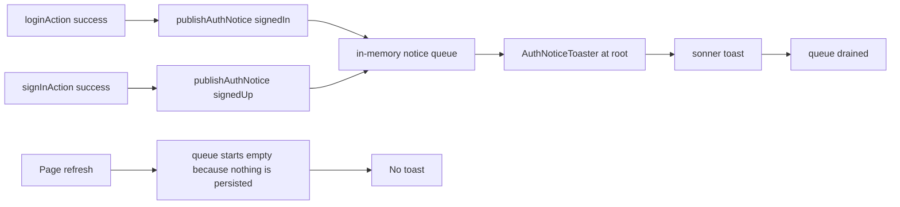

# Auth notices as events, not as observed state

## Problem

A page refresh re-showed "Logged in as <name>" for an already-signed-in user. The session itself was correct: it
was restored from `localStorage`, and no login request ran. The bug was in how the toast was triggered.

[`LoginView`](../client/src/views/login/LoginView.tsx:218) announced a login whenever `authUsername` was present
and `lastAuthToastUsername.current` did not yet match it. That ref is component-lifetime state, so a reload reset
it to `null`, and the effect interpreted the restored session as a fresh login. The same mechanism affected the
sign-up toast: [`loginLoader`](../client/src/views/login/handlers/loginRouteHandlers.ts:14) derived
`signupSuccess` from `?signup=success`, and [`hasShownSignupToast`](../client/src/views/login/LoginView.tsx:209)
was also a ref, so reloading that URL re-showed "Account created successfully".

The root cause is the same in both cases: a transient event was derived from durable state. This plan replaces the
inference with explicit events published at the moment they happen.

## Decisions

- Exactly two events produce an auth toast: **signed in** and **signed up**. Both are registered-account events.
- **A guest start produces no auth toast.** `Logged in as` is untrue for a guest, and the guest already receives the
  game/match toast for the action that minted them.
- Notices are **memory-only and one-shot**. Never persisted, never mirrored into a URL, never guarded by a ref.

## Design

### 1. A one-shot notice queue

New [`client/src/state/authNotices.ts`](../client/src/state/authNotices.ts):

- `TAuthNoticeKind = 'signedIn' | 'signedUp'`.
- `IAuthNotice = { id: number; kind: TAuthNoticeKind; username: string }`.
- `useAuthNoticeStore` (zustand): `notices: IAuthNotice[]`, `publish(kind, username)`, `drain(): IAuthNotice[]`.
- `publishAuthNotice(kind, username)` helper for callers outside React (route actions).
- `drain` removes and returns everything atomically, so a React StrictMode double effect cannot show a notice twice
  or drop one, and a queue (rather than a single slot) keeps two rapid events from overwriting each other.

### 2. Producers are the places that acquire a session

- [`loginAction`](../client/src/views/login/handlers/loginRouteHandlers.ts:22): after `persistAuthSession`, call
  `publishAuthNotice('signedIn', authUser.username)`.
- [`signInAction`](../client/src/views/login/handlers/signInRouteHandlers.ts:20): after `persistAuthSession`, call
  `publishAuthNotice('signedUp', authUser.username)`.
- [`ensurePlayerIdentity`](../client/src/state/guestSession.ts:12): unchanged. Deliberately silent.

Route actions run in the browser in this SPA, so publishing from them is a plain store write and does not need
React context.

### 3. One consumer at the root

New [`client/src/components/feedback/AuthNoticeToaster.tsx`](../client/src/components/feedback/AuthNoticeToaster.tsx),
mounted once in [`main.tsx`](../client/src/main.tsx:14) beside `PresenceProvider` and inside `ErrorBoundary`
(already inside the i18n import). Its effect drains the queue and renders one toast per notice:

- `signedIn` → info toast, `t('auth.toasts.loggedInAs', { username })`, id `auth-login-status`.
- `signedUp` → success toast, `t('auth.toasts.accountCreated')`, id `auth-signup-status`.

Because it sits above the router, it sees notices published by actions without depending on any particular route
being mounted.

### 4. Removal of the inference machinery

- [`LoginView`](../client/src/views/login/LoginView.tsx:104): drop `hasShownSignupToast`, `lastAuthToastUsername`,
  the two effects at lines 209-230, and the `useLoaderData`/`ILoginLoaderData` imports and usage. Keep
  `actionData?.login?.user` for `authUser` and the modal-closing effect, which are request-scoped and already
  correct.
- [`loginLoader`](../client/src/views/login/handlers/loginRouteHandlers.ts:14) keeps existing but returns `null`:
  keeping the route's loader preserves its hydrate-fallback behaviour, and the `signup` query parameter stops being
  read. `ILoginLoaderData` becomes `null`.
- [`signInAction`](../client/src/views/login/handlers/signInRouteHandlers.ts:67) redirects to `/` instead of
  `/?signup=success`. Old links carrying the parameter become harmless.

### 5. Flow

## Edge cases considered

- **Reload after login:** the module-level store starts empty; no notice, no toast. This is the fix.
- **Reload before the toast painted:** the notice is lost. Accepted: a toast is cosmetic, and the alternative
  (persisting it) reintroduces exactly the bug being removed.
- **Action then redirect (sign-up):** the store is module-level, so the notice survives the SPA navigation from
  `/sign-in` to `/`.
- **React StrictMode:** `drain` is atomic; the second effect run gets an empty array.
- **Login while the modal is open:** the modal-closing effect is independent of the toast; both run from the same
  action data.
- **Guest start:** no notice, so a refresh after guest play shows nothing either.
- **Session expiry:** still evaluated by `readAuthSession` at load as before; no notice is implied by an expired
  session because none exists to restore.
- **Other tabs:** notices are per-tab, matching the session store, which is also not cross-tab synchronised.

## Shipped behaviour

- A registered login publishes `signedIn`; the toast reads "Logged in as <name>" and appears once.
- A sign-up publishes `signedUp`; the toast reads "Account created successfully.", the redirect target is `/`, and
  no `signup` parameter is written or read any more.
- A guest start publishes nothing. The game/match toast from the action that needed the identity remains the only
  feedback.
- A reload, a bookmarked URL, or a back/forward navigation publishes nothing, because the queue is memory-only.
- `LoginView` no longer observes the session to infer an event: the two refs, both toast effects, and the loader
  data dependency are gone.

## Verification

- `e2e/auth.session-toast.spec.ts` (new, hermetic: mocked API, presence socket aborted):
  1. Submitting the login modal shows "Logged in as E2E Player" with a count of exactly 1, and exactly one
     `/api/user/login` request is made.
  2. Reloading keeps `#displayName` populated from the restored session, makes no new login request, and shows no
     auth toast 750 ms after mount.
  3. Sign-up shows "Account created successfully." once, lands on `/` with no `signup` parameter, and shows no
     toast after a reload.
- Regression run: `e2e/login.deck-import.spec.ts` (1/1) and `e2e/matchmaking.quickmatch.spec.ts` (3/3).
- `npm run typecheck` and `npm run lint` in `client` are clean. No server change was made, so the server suite was
  not re-run.

## Files touched

| File | Change |
|---|---|
| `client/src/state/authNotices.ts` | New notice queue and publisher helper |
| `client/src/components/feedback/AuthNoticeToaster.tsx` | New root-level consumer |
| `client/src/main.tsx` | Mount the consumer once |
| `client/src/views/login/handlers/loginRouteHandlers.ts` | Publish on success; loader returns null |
| `client/src/views/login/handlers/signInRouteHandlers.ts` | Publish on success; redirect to `/` |
| `client/src/views/login/LoginView.tsx` | Remove the two toast refs, their effects, and loader usage |
| `client/src/views/login/types/routeHandlers.ts` | `ILoginLoaderData` becomes `null` |
| `e2e/auth.session-toast.spec.ts` | New coverage for login, refresh, sign-up |
