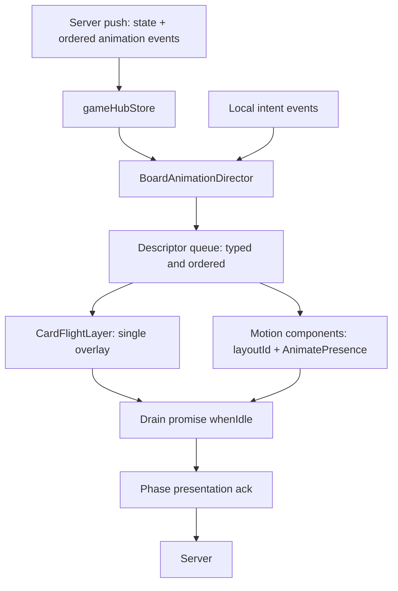
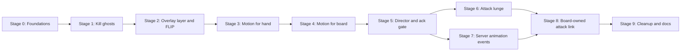

# Board animation rework: Motion migration + flicker / ghost fixes

## Goal

Replace the ad-hoc, snapshot-diffing WAAPI animation engine on the game board with **Motion**
(`motion`, imported from `motion/react`) as the sole mechanism for card motion, plus one single
**board animation director** as the sole policy layer. Along the way, remove the root causes of the
current flicker, ghost-orphaning and layout-blowout bugs, and add a **card lunge** when an attack
resolves.

Deliverable is a **staged migration**: every stage is independently shippable and leaves the app
working, so we can stop or roll back at any stage boundary.

---

## Current state (the thing being replaced)

- Primitives: `client/src/views/game/utils/functions/animations/index.ts` —
  `runRectToElementAnimation`, `animateCardEntityToDestination`,
  `runCardImageGhostToElementAnimation`, `resolveOverflowAncestors`, `waitForElement`, plus the
  `data-card-moving` flag dance.
- Orchestration: `client/src/views/game/hooks/GameView/effects/useGameViewEffects.ts` —
  `useHandZoneAnimationEffects`, `useCardMoveGhostAnimationEffect`,
  `useRevealedCardSummonFlightEffect`, `useTrashRecallSummonFlightEffect`,
  `usePhasePresentationAckEffect`.
- Timing coupling: `IGameViewAnimController.animationEndsAtByKey` /
  `noteAnimation()` in `client/src/views/game/hooks/GameView/memos/useGameRefs.ts`, read by the ack.
- Also in the mix: `@formkit/auto-animate` on the top hand row (`useGameRefs.ts`), CSS `transition
  transform` for the rested tilt (`BattleFieldRow.tsx`), and `react-xarrows` for the attack link
  (`AttackLinkArrow.tsx`).

## Root causes to eliminate

1. **Movement is inferred, never told.** `newBottomHandCards.slice(0, bottomDeckDecrease)` and
   similar count/id-slice heuristics mis-attribute a move whenever two pushes batch, a refetch
   lands mid-flight, or an optimistic-then-authoritative double update occurs.
2. **Ghosts are separately-owned DOM nodes** appended to `document.body`, removed only in
   `onfinish`/`oncancel` → orphaned copies ("ghosts left behind"), and two copies coexist with the
   re-rendered real card → in/out flicker.
3. **The live React element is animated in place** (inline `transform`/`zIndex`/`filter`/`transition`
   mutated and restored from stale captured values) → fights React re-renders, last-writer-wins
   style corruption.
4. **Layout ancestors are temporarily un-clipped** (`resolveOverflowAncestors`) → mid-animation
   reflow ("massive card" flash).
5. **The engine races the DOM** (`waitForElement` polls up to 12 frames) → silent teleport on miss.
6. **No single owner** of a card's transform — six-plus effects plus auto-animate plus CSS
   transitions all write `transform`.
7. **Animation is entangled with the game protocol** — the ack waits on the animation registry, so
   animation bugs become turn stalls.

## Target architecture

Policy (what / when) and mechanism (how) are separated: the **director** decides, **Motion**
animates.

- **`CardFlightLayer`** — one absolutely-positioned, `pointer-events-none` overlay at the board root.
  Every "fly across the board" renders an overlay copy inside it, never the live card node.
- **Motion `layoutId`** — every card renders under a stable `layoutId` derived from its instance id,
  so a card that changes container between renders is *projected* from its old position. This is the
  card-moves-between-zones primitive.
- **`AnimatePresence`** — owns exit, so node lifecycle is the library's problem, not ours.
- **`BoardAnimationDirector`** — consumes `(prevState, nextState)` plus explicit local intent events,
  produces typed descriptors (`move | summon | lunge | flip | exit | draw | discard`), enqueues them,
  plays them with a per-instance lock, and exposes `whenIdle()`.
- **Ack waits on `whenIdle()`** instead of `animationEndsAtByKey`.

## Non-negotiable invariants to preserve

- **Ack semantics** (`04-state-phase-effects.md`): the ack never goes through `submitHubIntent`; it
  re-reads the live store and only answers the presentation it was armed for; it re-arms while
  `isActionPending`; a refused ack retries every `PHASE_PRESENTATION_RETRY_MS`; it is cancelled on
  unmount / presenter change. Keep `PHASE_PRESENTATION_HARD_CAP_MS` (2.5 s) and the per-kind idle
  floors.
- **Store rules** (`04-state-phase-effects.md`): `gameHubStore` stays the single writer for
  `gameState`; `gameUIStore` stays interaction-only; no render-phase ref access
  (`react-hooks/refs`); self-healing pruner, guarded writes, no per-render cleanup effects.
- **Rendering sharpness** (`02-board-ui-hud.md`): no persistent fractional `scale` on card faces; no
  idle GPU-layer promotion on downscaled small faces (transient promotion during animation is fine).
- **Reduced motion is first-class.** With `prefers-reduced-motion`, flights are skipped and the ack
  must not wait for animations that never play.
- **Test anchors**: never assert art URLs; identify cards via `data-card-instance-id` /
  `data-testid` (`02-board-ui-hud.md`, `05-server-models-serialization.md`).
- **React 19**: pin a Motion version that supports React 19.

---

## Stages

### Stage 0 — Foundations, flags and guardrails

**Goal:** introduce the dependency and the architecture seams without changing behaviour.

- Add `motion` (React 19 compatible) to `client/package.json`.
- Add a single animation-tuning module (durations, easings, stagger) consolidating the constants now
  split between `utils/functions/animations/index.ts` and `utils/contants.ts`.
- Add a **board animation mode flag** (env/build flag or a small store slice) so old engine and new
  layer can coexist during Stages 1–4 and be flipped back instantly.
- Introduce `useReducedMotion` policy at the director boundary; ensure capped/zero durations still
  satisfy the ack (a skip must resolve the drain immediately, not leave a pending descriptor).
- Record the **e2e baseline**: run the animation-sensitive specs and log which DOM anchors they
  depend on (`#attack-link-overlay`, `[data-testid="attack-link-head"]`, `data-card-ghost`,
  `data-card-moving`) so later stages update them deliberately.

**Verification:** `npm run typecheck`, `npm run lint`, full e2e green with the flag off.
**Exit:** no behaviour change; deps, flag, constants, reduced-motion policy, baseline captured.

### Stage 1 — Kill the ghosts (surgical, on the old engine)

**Goal:** stop orphaned copies and stacked flights *before* any rewrite.

- Add a **flight registry** that owns every created ghost and WAAPI animation. Remove/cancel on:
  unmount, game over, session/game-id change, `visibilitychange` to hidden, and before starting a new
  flight for the same instance id.
- Add **per-instance locking** so only one animation can own a card at a time; a new descriptor for a
  locked instance cancels the previous one first.
- Make cleanups **idempotent**, and cancel any in-flight animation on the same node *before*
  capturing "previous" inline styles (fixes the stale-restore corruption).
- Keep the visible behaviour identical otherwise.

**Verification:** `npm run typecheck`, `npm run lint`; targeted specs
`gameview.multiplayer.attack-sequence`, `gameview.multiplayer.reveal-presentation`,
`gameview.multiplayer.support`, `gameview.spec.ts`. Add a focused check: interrupt a flight
mid-animation and assert no `data-card-ghost` node survives.
**Exit:** ghosts cannot outlive their animation; no double flights. Rollback = revert the registry.

### Stage 2 — One overlay layer + FLIP measurement (still WAAPI)

**Goal:** stop mutating live React nodes and delete the layout-bending hacks.

- Add `CardFlightLayer`: rendered once at the board root, `position: absolute`, `inset: 0`,
  `pointer-events: none`, above the cards. All cross-board flights render inside it.
- Add a **FLIP measure module**: measure source/destination rects from the real DOM nodes around the
  commit and animate an overlay copy across the delta. Replaces `waitForElement` polling with a
  measure-after-commit pass.
- Rewrite `runRectToElementAnimation` and `animateCardEntityToDestination` to render overlay copies
  instead of mutating the target/source node.
- Delete the `resolveOverflowAncestors` un-clipping and the `data-card-moving` style juggling (and the
  `min-w-0 min-h-0` guards that exist only to survive it — keep any that turn out to be independently
  necessary).
- Migrate every call site onto the layer: hand→pile, deck→hand, generic ghost exits, reveal-summon
  and trash-recall flights, and the submit-then-zone-entry helper.

**Verification:** `npm run typecheck`, `npm run lint`; the Stage 1 targeted specs plus
`gameview.multiplayer.actions`, `gameview.multiplayer.quick-support`,
`gameview.multiplayer.character-ability`. Confirm no reflow flash on pile destinations.
**Exit:** identical visuals, no live-node mutation, no overflow hack. e2e anchors that referenced
`data-card-ghost` are updated to the layer's testid.

### Stage 3 — Motion for the hand (presence + layout)

**Goal:** remove `auto-animate` and hand-row flicker; prove Motion in the smallest surface.

- Render hand cards as `motion.div` under `AnimatePresence`, keyed by instance id, with `layout` on
  the rows.
- Draw / discard / reveal / reorder become Motion variants (enter, exit, layout).
- Delete `@formkit/auto-animate` usage (`useGameRefs.ts`, `BottomHandReorderRow.tsx`) once the hand
  is fully Motion-owned.
- Keep the director-aware queue for staggered draws (ordering/stagger is policy, not Motion's job).

**Verification:** `npm run typecheck`, `npm run lint`; specs `gameview.multiplayer.actions`,
`gameview.multiplayer.phase-transition`, `gameview.spec.ts`; visual check that draws/reorders no
longer pop.
**Exit:** hand behaviour owned by one engine; `auto-animate` removed from the hand path.

### Stage 4 — Motion for the board (shared-element card transitions)

**Goal:** make cross-zone card movement a projection, and delete the generic ghost machinery.

- Render battlefield / support / leader cards as Motion elements with a stable `layoutId`
  (`toAnchorId(instanceId)` lineage) so a card changing zone is projected from its old position.
- `AnimatePresence` owns exits (KO, used support, discard-out) — delete the generic ghost path
  (`useCardMoveGhostAnimationEffect`) and its snapshot map.
- Migrate flips to Motion (`rotateY` variants), replacing `FlippableCard`'s CSS transition.
- Move the rested tilt from CSS `transition-transform` to a Motion `animate` prop so Motion owns
  `transform` exclusively (removes the class-vs-WAAPI conflict and the 30-frame re-sample workaround
  trigger).
- Delete `utils/functions/animations/index.ts` once nothing imports it.

**Verification:** `npm run typecheck`, `npm run lint`; specs `gameview.multiplayer.leader-battle`,
`gameview.multiplayer.leader-recovery`, `gameview.multiplayer.negate-chakra-lock`,
`gameview.multiplayer.game-over`, `gameview.multiplayer.battle-visuals`.
**Exit:** cards travel between zones by projection; generic ghost effect and the WAAPI primitives are
gone; `transform` has exactly one owner per card.

### Stage 5 — One director, one queue, one ack gate

**Goal:** consolidate policy; make the ack a queue drain.

- Add `BoardAnimationDirector` (hook/module) that turns `(prev, next)` + intent events into typed
  descriptors, enqueues them, plays them via Motion/layer with a per-instance lock, and exposes
  `whenIdle(): Promise<void>`.
- Route all remaining animation entry points through it (delete the per-zone effects one by one).
- Rewrite `usePhasePresentationAckEffect` to await `whenIdle()` instead of
  `resolveAnimationsSettleAtMs(animationEndsAtByKey)`; retire `noteAnimation` /
  `animationEndsAtByKey` while preserving the hard cap, per-kind floors, re-arm and retry semantics.
- Reduced motion: descriptors that are skipped resolve immediately so the drain never parks.

**Verification:** `npm run typecheck`, `npm run lint`; specs `gameview.multiplayer.phase-transition`,
`gameview.multiplayer.reveal-presentation`, `gameview.multiplayer.prompts`,
`gameview.multiplayer.attack-sequence`; assert the table never parks (phase walk still completes).
**Exit:** a single owner for animation policy and a single gate the ack reads.

### Stage 6 — Attack lunge (the original request)

**Goal:** make a resolving attack visible on the board.

- Drive the lunge from the engine-owned resolve moment: `attackSequenceStage === 'DamageStep'` /
  presentation `kind: 'Damage'` (not the declaration snapshot).
- Resolve the attacker and defender anchors via `pendingAttackVisualState`
  (`attackerCardInstanceId`, `defenderCardInstanceId`, `defenderZone`) plus the stable card anchors.
- Descriptor: a yoyo keyframe on the attacker along the arrow vector (toward the defender and back),
  with an impact cue; then the KO is the existing `AnimatePresence` exit.
- Register the lunge in the director so the ack waits for it; under reduced motion, play only the
  impact cue.

**Verification:** `npm run typecheck`, `npm run lint`; specs `gameview.multiplayer.attack-sequence`,
`gameview.multiplayer.battle-visuals`, `gameview.multiplayer.leader-battle`; add a spec asserting the
lunge descriptor runs on damage resolution.
**Exit:** attacks visibly resolve; ack covers the lunge.

### Stage 7 — Server-authored animation events (root-cause fix)

**Goal:** stop inferring movement from state diffs.

- Add an ordered `animationEvents` collection to the game-state response, emitted at each mutation
  point the engine already knows: draw, discard, summon, tribute, KO, support used, reveal, trash
  recall. Model it on the existing server-authored pattern in `BuildEffectNotices` /
  `ToEffectNoticeResponse` (`server/Api/Services/Games/GameStateResponseMapper.cs`) and the
  action-log metadata reader (`ReadMetadataValue`).
- Publish it in the response DTO, mirror the type in
  `client/src/services/api/types/game.ts`, and read it in the director.
- Delete the inference paths: `useHandZoneAnimationEffects` count/slice heuristics,
  `useRevealedCardSummonFlightEffect`, `useTrashRecallSummonFlightEffect`, and the
  `suppressedExitGhostInstanceIds` double-flight guard (the events are authoritative).

**Verification:** `npm run typecheck`, `npm run lint`; server build/tests; the broad
`gameview.multiplayer.*` animation specs; add coverage for a batched double-push that previously
mis-attributed a flight.
**Exit:** no mis-attributed flights; special-case inference deleted.

### Stage 8 — Replace `react-xarrows` with a board-owned attack link

**Goal:** make the attack link ours end to end, deleting the patches that exist only to keep
`react-xarrows` working. The link is the second-most patched animation surface after the card engine:
its workarounds all compensate for the library anchoring on live bounding boxes, which keep moving
while the rested tilt animates.

**Board-owned replacement (as landed)**

- `AttackLinkArrow` draws the link itself: a container (`div#attack-link-overlay`) with the dashed tail
  as a plain `<path>` and a second, absolutely-positioned `<svg>` for the head — both from our own
  geometry, in board-local coordinates.
- The geometry stays a pure function: `resolveAttackLinkGeometry` in
  `utils/functions/gameState/gameZoneFunctions.ts` (the existing, hard-won anchor maths) feeds
  `resolveAttackLinkCubic` → `resolveAttackLinkPathData` / `resolveAttackLinkHeadConfig`. The head's
  tip and rotation come from the same cubic as the tail, so nothing is measured back out of a rendered
  path.
- The bounded `ATTACK_LINK_SETTLE_FRAMES` rAF re-sample **stays**: the anchors genuinely keep moving now
  (the rested tilt is a Motion animation on the card's wrapper), so re-reading them for a short window is
  correct. See the Stage 8 status section for why the tail is not a `motion.path`.
- The e2e geometry bands measure anchor-to-surface distances, not the curve, so the rewrite landed with
  **no spec changes** to `gameview.multiplayer.battle-visuals.spec.ts`.

**Patches deleted (all in `components/AttackLinkArrow.tsx` unless noted)**

- The `measuredSignature`-driven measurement of the head: `measureAttackLinkHead()`, which queried
  `#attack-link-overlay svg path[stroke]` and used `getTotalLength()` / `getPointAtLength()` /
  `getScreenCTM()` to reverse-engineer the head from the library's rendered output.
- The `showHead={head === null}` flip-flop workaround and the "head is never cleared once measured"
  rule.
- The referentially-stable object props (`ATTACK_LINK_OVERLAY_CONTAINER_PROPS`,
  `ATTACK_LINK_ARROW_HEAD_PROPS`, `ATTACK_LINK_TAIL_PROPS`, `headShape`) that existed only to stop
  react-xarrows re-running its layout effects into "Maximum update depth exceeded".
- The library-only props `showHead` / `headShape` / `_cpx1Offset` / `_cpx2Offset` /
  `_extendSVGcanvas` / `divContainerProps` / `passProps`.
- `buildFallbackAttackLinkGeometry`, and the library-compensation tuning in `GameZones.tsx`
  (`ATTACK_HEAD_OFFSET_DEFAULT` / `headOffsetForward`).
- The `react-xarrows` dependency.

**Kept on purpose:** the inline `position: absolute` overrides (still required by `.game-board-spill > *`),
the `translate(0 -0.5)` unit-shape vertex fix, the SVG-root filter rule, the rAF settle window,
`ATTACK_ARROW_HEAD_RETRACTION_COMPENSATION_PX` (reviewed in Stage 9 cleanup C) and the
`IAttackLinkHeadConfig` / `IAttackLinkRenderConfig` types.

**Verification:** `npm run typecheck`, `npm run lint`; `gameview.multiplayer.battle-visuals`,
`gameview.multiplayer.attack-sequence`, `gameview.multiplayer.leader-battle`.
**Exit:** the link is owned end to end, with no measurement loop and no library-compensation
constants; `react-xarrows` is gone.

### Stage 9 — Cleanup, docs, e2e rework

**Goal:** no dead code; docs and tests match the new architecture.

- Delete leftovers: the `data-card-moving` CSS and the now-unused dependencies (`@formkit/auto-animate`,
  `react-xarrows`). The animation primitives *move* from `utils/functions/animations/` into
  `views/game/animation/` (one home for animation) rather than being deleted, and the `PlayPileZone`
  `min-w-0 min-h-0` guards stay (they are a plain layout guard now, not part of the deleted overflow hack).
- Update `.clinerules`:
  - `02-board-ui-hud.md` — animation ownership model, the flight layer, reduced motion, the DOM
    anchors e2e may use.
  - `04-state-phase-effects.md` — ack waits on the director drain, not the animation map.
  - `01-architecture.md` — the new director / layer modules.
  - `03-targeting-contract.md` — anything the attack-link change affects.
- Rework animation-sensitive e2e: `gameview.multiplayer.battle-visuals`,
  `gameview.multiplayer.reveal-presentation` (MutationObserver), `support-target-visuals`,
  `attack-sequence`, `character-ability`, `leader-effects`.
- Add new specs: **ghost-leak** (interrupt a flight, assert no orphaned layer nodes), **lunge on
  damage**, **reduced-motion** (no flight, ack still resolves).

**Verification:** `npm run typecheck`, `npm run lint`, full e2e suite green.
**Exit:** migration complete, no dead code, docs and tests aligned.

---

## Stage dependency overview

Each arrow is a hard prerequisite; any stage boundary is a safe stopping point.

---

## Verification gates (every stage)

1. `npm run typecheck` (client) clean.
2. `npm run lint` (client) clean.
3. Targeted Playwright specs for the touched surface green.
4. No table parking: the engine-driven phase walk still completes for both clients.
5. Visual sanity on the touched zone (no pop, no orphan, no layout blowout).

## Risks and mitigations

| Risk | Mitigation |
|---|---|
| Motion wants to be the only `transform` writer | Stage 4 removes CSS tilt transitions and flips; one owner per card |
| Big-bang diff | Feature flag from Stage 0; the old engine stays until each stage deletes its own slice |
| Ack stalls when animations are skipped (reduced motion, zero-duration) | Skipped descriptors resolve the drain immediately (Stage 0 / Stage 5) |
| Server event contract churn | Stage 7 is additive and independently revertable; the director can still diff until it lands |
| e2e churn | Anchors catalogued in Stage 0; specs updated per stage, never asserted on art URLs |
| Rendering sharpness regressions | Respect the no-fractional-scale / no-idle-`will-change` rules when adding Motion |
| Attack-link geometry regressions | Keep `resolveAttackLinkGeometry` as the resolver; the geometry bands measure anchor-to-surface distance, so the Stage 8 swap needed no spec changes |
| Removing a library mid-flight | Stage 8 is last before cleanup and has no downstream dependants; revert restores the dependency and the old component |

## Decisions (confirmed before Stage 0)

1. **Package**: `motion` (`motion/react`), installed as `^14.2.0`, which supports React 19.
2. **Flag mechanism**: a `gameUIStore` slice — `boardAnimationMode: 'legacy' | 'motion'` seeded from
   `VITE_BOARD_ANIMATION_MODE` (default `legacy`), overridable at runtime during the migration.
3. **Piles as layout targets**: deck/hand/trash piles and empty slots get `layoutId`s so flights land by
   projection rather than aiming an overlay copy at the pile element.
4. **Server events shape** (Stage 7): a new ordered `animationEvents` array on the game-state response.

## Stage 0 status: landed

- `motion@^14.2.0` added to `client/package.json`.
- `client/src/views/game/animation/` created: `tuning.ts` (single source for durations/easings/stagger),
  `reducedMotion.ts` (policy incl. `resolveFlightDurationMs`, where `0` means "skip and resolve now"),
  `boardAnimationMode.ts` (the `VITE_BOARD_ANIMATION_MODE` resolver) and the `index.ts` barrel.
- `utils/contants.ts`, `utils/functions/animations/index.ts` and
  `hooks/GameView/effects/useGameViewEffects.ts` now import their tuning from `animation/tuning.ts`
  instead of declaring their own literals (no behaviour change).
- `gameUIStore` carries `boardAnimationMode` + `setBoardAnimationMode`.
- e2e anchor baseline captured in `plans/board-animation-anchor-baseline.md`.

## Stage 1 status: landed

- New `client/src/views/game/animation/flightRegistry.ts`: one flight per card key (a second flight cancels
  the first), every ghost tracked and removed exactly once, `cancelFlightsForElement` to settle an element
  before its inline styles are captured, `cancelAllFlights` for unmount/teardown, and a `visibilitychange`
  teardown so a hidden tab cannot leave ghosts behind.
- `utils/functions/animations/index.ts`: all three primitives (`animateCardEntityToDestination`,
  `runRectToElementAnimation`, `runCardImageGhostToElementAnimation`) now cancel-on-takeover, register/
  unregister their flight, and guard their cleanup with a `hasSettled` flag so it runs exactly once.
- Ghost flights are keyed by card instance id (new optional `key` on
  `ICardImageGhostToElementAnimationArgs`); the two call sites pass it
  (`useCardMoveGhostAnimationEffect`, `scheduleCardGhostAnimations`).
- The board's unmount cleanup calls `cancelAllFlights()`.
- Verified: `npm run typecheck:client` and `npm run lint:client` clean. Behaviour is intentionally unchanged
  apart from orphaning: no flight can leak, stack, or restore stale inline styles.

## Stage 2 status: landed (with one adjustment)

- New `views/game/animation/CardFlightLayer.tsx` + `cardFlightLayerMount.ts`, mounted at the board root in
  `GameZones`: one absolutely-positioned, `pointer-events: none` surface at `z-index: 300`.
- `utils/functions/animations/index.ts` rewritten so every flight animates an **overlay copy** appended to
  that layer (`createFlightCopyElement` + `animateOverlayCopy`), keyed by card instance id through the
  Stage 1 registry. Live cards are never transformed: a destination card is hidden with `visibility` for the
  flight and restored on cleanup, so the copy and the real card never double-render.
- Deleted: `resolveOverflowAncestors` / `restoreOverflowAncestors`, the `data-card-moving` attribute and its
  `index.css` block. The pile `min-w-0 min-h-0` classes were kept (they are still correct for the pile's own
  layout); only their stale comment was updated.
- e2e: the flight counter now observes `data-card-flight-copy` (all flights, not just exits); the specs that
  call it assert `> 0`, so they stay valid. `data-card-ghost` is gone.
- **Adjustment:** the "replace `waitForElement` with a FLIP measure pass" step is deferred to Stage 4.
  Motion's layout projection supersedes the polling entirely, so hand-rolling a FLIP module here would be
  code Stage 4 immediately deletes. `waitForElement` still backs the deck→hand and summon destination lookup.
- Verified: typecheck + lint clean; zero references to the removed mechanisms remain. **e2e not yet re-run**
  (needs the e2e server up) - this is the first stage that changes visible motion, so that run is the gate.

## Stage 3 status: landed (with one adjustment)

- `GameHandRow` renders the hand under `AnimatePresence`: each card is a `motion.div` keyed by instance id,
  with enter/exit variants and `layout="position"` for the slot (position-only so card art is never left at a
  fractional scale). The Motion wrapper carries the slot sizing (`h-full` + card aspect) and the inner card
  nodes in both `GameView` (top hand) and `BottomHandReorderRow` became `h-full w-full`.
- Removed `@formkit/auto-animate` from `useGameRefs` and `BottomHandReorderRow`, and uninstalled the
  dependency. The hand no longer has three writers of `transform`.
- **Adjustment:** per-card `layout` is disabled while a hand card is dragged
  (`isLayoutAnimationEnabled={!isReorderDragging}`), because the bespoke reorder engine owns the dragged
  card's `position`/`transform`; letting Motion lay the slots out then would reintroduce the transform fight
  this migration removes. Outside a drag, layout is on.
- Verified: typecheck + lint clean and the dependency is gone. e2e still pending (`gameview.spec.ts` covers
  the reorder/drag).

## e2e verification of Stages 0-3 (passed)

Full suite: **40/40 green** (`npx playwright test --workers=2`, 3.1m), covering every animation-sensitive
spec (actions, support, quick-support, attack-sequence, character-ability, battle-visuals, leader-*,
conditional-rush, negate-chakra-lock, phase-transition, prompts, presence, reveal-presentation,
support-target-visuals, game-over, `gameview.spec.ts`, admin card editor).

Two findings worth keeping:

1. **`reveal-presentation` had to be taught the new flight shape.** `installBattlefieldEntryAnimationRecorder`
   recorded entry animations on the *battlefield card* element; Stage 2 draws flights with an overlay copy, so
   it saw nothing. Fixed by giving each copy `data-flight-instance-id` (the card's id - deliberately **not**
   `data-card-instance-id`, which card locators rely on) and having the recorder observe copies too. The entry
   copy anchors at the destination and animates in from the source offset, so the recorded first frame still
   proves the card travelled.
2. **`attack-sequence`'s `endTurnViaUi` is parallelism-sensitive.** It polls a turn hand-over with a 25 s
   internal budget; under 6 default workers it flakes (turn did not flip in time), but it is green at
   `--workers=2` and in isolation (21 s). Not a regression - but the suite should run at `--workers=2` (or the
   budget widened) to stay reliable.

## Stage 4 status: in progress (step 4a landed)

Stage 4 lands in three verifiable sub-steps rather than one big deletion.

### 4a - Motion owns the board card's transform (landed)

- `BattleFieldRow` renders each battlefield card inside a `motion.div` that animates `rotate` between `0` and
  `RESTED_CARD_TILT_DEG` (14deg) and carries the slot sizing; the card node inside became `h-full w-full`.
  This removes the CSS `transition-transform` **and the permanently-on `will-change-transform`** the old class
  carried (a standing violation of the rendering-sharpness rule), so Motion is the only writer of the board
  card's `transform`. New tuning: `RESTED_CARD_TILT_DEG`, `RESTED_CARD_TILT_DURATION_MS`.
- **A regression this exposed, now fixed:** both the production attack-link resolver (`getRotationRadians` in
  `gameZoneFunctions.ts`) and the `battle-visuals` spec read the tilt from the card element's own
  `rotate`/`transform` only. With Motion applying the rotation on the wrapper, that read returned `0`, silently
  disabling the visual-edge anchor compensation (the arrow would have anchored at the bounding-box corner on
  every attack). `getRotationRadians` is now ancestor-aware - it walks up until it finds a rotation - so it is
  correct no matter which element owns the transform. The spec got the same treatment, plus an
  effective-rotation assertion replacing the `rotate-[14deg]` class check.
- Verified: typecheck + lint clean, full suite **40/40 green** at `--workers=2`.

### 4b - board in-zone layout animation (landed, scoped)

- The battlefield card wrapper now carries `layout="position"`, so when a card leaves or joins the row the
  remaining cards slide into their new slots instead of snapping - with no fractional scaling of the art.
- Deliberately **no `layoutId`**: cross-zone travel is still drawn by the flight layer's overlay copy, and a
  shared layout id would double-animate the same move.

### 4b-deferred - cross-container `layoutId` projection, deleting the copy paths

Deferred out of Stage 4 into Stage 5, for two concrete reasons:

1. **The overlay copies *are* the acknowledgement's registered flights.** `noteAnimation` is what keeps the
   phase-presentation ack from resuming the engine mid-flight. Deleting the copies before the director's
   `whenIdle()` gate exists would let the engine resume while a card is still in the air - a correctness
   regression, not just a visual one.
2. **Motion's projection is invisible to the current observers.** It writes transforms from its own rAF loop,
   not through `Element.prototype.animate`, so the `data-card-flight-copy` recorder cannot see it; a
   Motion-projected summon would need `reveal-presentation`'s flight assertion reworked to sample the card's
   bounding box over time (the way the deck-reveal observer already does), and the trash pile needs a
   `layoutId` target before a KO can project into it.

Stage 5 owns both halves, so the copy paths and `useCardMoveGhostAnimationEffect` get deleted there.

### 4c - Motion flips (landed)

`FlippableCard`'s CSS `rotateY` transition is now a Motion `animate={{ rotateY }}` with `initial={false}`
(a card that mounts already flipped - a revealed deck card - must not play its flip as an entrance
animation). `transform` on a flipping card now has a single owner.

Deleting `utils/functions/animations/index.ts` moves to Stage 5 with the copy paths it implements.

### e2e reliability fix

`attack-sequence`'s `endTurnViaUi` polls an engine-driven turn hand-over (two clients acking) with a 25 s
budget and flaked in 3 of 4 full runs while passing in isolation in ~21 s; the asserting condition is
unchanged and the wait budget was raised to 45 s with a comment. The suite should still prefer
`--workers=2`.

## Stage 5 status: director + ack gate landed; projection swap re-scoped

### 5a/5b - The director owns the flight registry, and the ack waits on it (landed)

- New `views/game/animation/boardAnimationDirector.ts` is the single owner of the registry: `noteFlight(key,
  endsAtMs)` (extend, never shorten), `pruneSettledFlights(nowMs)`, `resolveFlightsSettleAtMs(nowMs)`,
  `whenIdle(): Promise<void>` and `clearFlights()`. `pruneSettledAnimations` / `resolveAnimationsSettleAtMs`
  moved out of `phasePresentation.ts` (which keeps only the pure ack-time resolver) so the animation concern
  lives with the animation module.
- `IGameViewAnimController` no longer exposes `animationEndsAtByKey` / `noteAnimation`; it exposes `whenIdle`.
  `useGameRefs` dropped its hand-rolled `createAnimationRegistry` and delegates to the director, and the three
  `noteAnimation` call sites now call `noteFlight`.
- `usePhasePresentationAckEffect` no longer receives `animControllerRef` at all: it `await whenIdle()`s inside
  its scheduled callback, then **re-reads the live store before acking** (the await may span a state push, so
  the presentation-id check and the `isActionPending` re-arm both run again after it). The per-kind floor, the
  120 ms animated floor, the 250 ms retry and the 2.5 s hard cap are untouched - the documented invariants in
  `.clinerules/04-state-phase-effects.md` all still hold; only *where the settle time comes from* changed.
- The board unmount cleanup now calls `clearFlights()` alongside `cancelAllFlights()`, so no deadline leaks
  into a remount.
- Verified: typecheck + lint clean; full suite **40/40 green** at `--workers=2` - including the specs that
  exercise the ack hardest (`phase-transition`, `attack-sequence`, `reveal-presentation`).

### 5c - Cross-container `layoutId` projection and deleting the copy paths (re-scoped, not done)

This is **not** a mechanical deletion, and it should be chosen deliberately rather than assumed. Two findings
from the work above:

1. **Projection cannot replace every copy.** A shared `layoutId` projects a card from where the *same* card was
   rendered before. That works for summon (hand→field) and for zone exits into a pile slot that adopts the
   card's id. It does **not** work for a draw or a discard without giving the *pile slot* the moving card's
   `layoutId` at exactly the moment it changes - the pile does not know the incoming card's instance id, and
   the deck/trash slot is a long-lived element that would then need a dynamic layout id, which risks projecting
   the pile itself during unrelated updates. The draw/discard copies are therefore the right mechanism, not a
   legacy wart.
2. **The observers would need reworking.** Motion's projection writes transforms from its own rAF loop rather
   than through `Element.prototype.animate`, so the `data-card-flight-copy` recorder cannot see it, and
   `reveal-presentation`'s "the summon must fly" assertion would have to sample the card's bounding box over
   time. The ack side is now safe (`noteFlight` can register a projection's duration), but the test surface
   would need real rework.

Net: the architectural goal of Stage 5 - one owner for "is the board animating?" and one gate the
acknowledgement waits on - is landed. The remaining swap is a visual-mechanism change that trades the copy
machinery for projection in the subset of moves where projection is actually equivalent, at the cost of a
spec rewrite and new pile layout ids. It is recorded here as an explicit open decision rather than a pending
chore.

### 5c: WONTFIX (decided after Stages 2, 5 and 7)

Re-examined before building, and cancelled because its premise no longer holds:

1. **Draws and discards must keep the copy mechanism.** A pile cannot adopt an *incoming* card's `layoutId` at
   the moment it changes without giving a long-lived pile slot a dynamic layout id, so the primitive module
   survives 5c regardless - the deletion it was meant to buy is only ever partial.
2. **The copies are no longer the problem 5c was written against.** Since Stage 2 they render into one flight
   layer, take the element exclusively through the registry, never mutate a live node, and since Stage 7b they
   are driven by the engine's own recorded movements. 5c would add a *second* travel mechanism for exits -
   exactly the duplication this migration set out to remove.
3. **It would break working assertions for no deletion credit.** Motion's projection writes transforms from its
   own rAF loop rather than through `Element.prototype.animate`, so `getCardFlightCount(...) > 0` (support K.O.,
   tribute-to-trash, bounce) would observe nothing and would have to be rewritten as bounding-box sampling.

Net: 5c would increase the mechanism count, keep all the code it aimed to delete, and cost 3-4 spec rewrites.
The goal underneath it - one home and one owner for animation - is instead delivered by consolidating the
remaining primitive module into `views/game/animation/`, where the director, registry, tuning, flight layer and
reduced-motion policy already live.

## Stage 6 status: attack lunge landed

- New `views/game/animation/runAttackLunge.ts`: the attacker travels along the attacker→defender vector and back
  - a three-stop yoyo (`0 → travel → 0`, `ATTACK_LUNGE_DURATION_MS` 520 ms, travel = `ATTACK_LUNGE_TRAVEL_RATIO`
  of the gap clamped to `ATTACK_LUNGE_MAX_TRAVEL_PX`). It animates the card's own element, which is safe here in
  a way the retired zone flights were not: the inner card node has no other transform owner (Motion owns the
  rested tilt and the layout offset on the wrapper), and the Stage 1 flight registry gives the lunge the element
  exclusively. It registers with the director via `noteFlight`, so the acknowledgement waits for the lunge like
  any other flight. Under reduced motion it plays nothing **and registers nothing**, so the ack is never left
  waiting on motion that will not run.
- New `useAttackLungeEffect` fires exactly once per attack that resolves, keyed off the engine-owned `Damage`
  phase presentation (`GamePhase.AttackResolution` → `PhasePresentationKind.Damage`) rather than the
  declaration snapshot the arrow already covers.
- **The first version silently did nothing, and the new e2e assertion caught it.** By the time the `Damage` stop
  renders, the engine has already cleared the pending attack, so `pendingAttackVisualState` was null at stop
  time. The effect now captures the attacker/defender pair while it *is* published and consumes it at the
  resolve stop. `resolveCardElement` also falls back to a document-wide lookup and to the attack-link anchor id,
  because the defender is frequently the opponent's leader (addressed by anchor, not `data-card-instance-id`).
- `playwright.config.ts` now pins `reducedMotion: 'no-preference'`. The board deliberately animates nothing when
  the OS asks for reduced motion, so leaving that preference to the environment would make the lunge - and the
  flight assertions - environmentally flaky.
- Coverage: `installCardLungeCounter` / `getCardLungeCount` (in `e2e/helpers/multiplayer/flow.ts`) count the
  yoyo shape (three keyframes, first and last `translate(0px, 0px)`), and
  `gameview.multiplayer.attack-sequence` asserts the counter rose across the two attacks.
- Verified: typecheck + lint clean; full suite **40/40 green** at `--workers=2`.

## Stage 7: findings - needs a dedicated server pass (no code written yet)

I stopped before writing code because the investigation changed the shape of the work. It is materially larger
than Stages 0-6, and it is a robustness change rather than a fix.

1. **The engine does not log card movements.** `GameActionLogEntry` records phase/action/effect events
   (`phase_started`, `action_step_pass_declared`, `end_step_declared`, `turn_started`, `game_ended`,
   `effect_no_valid_targets`, ...) plus free-form `Metadata`, but nothing records "card X moved from zone A to
   zone B". So this is not an additive response field: it is instrumenting each mutation site - draw
   (`GamePhaseStateService.DrawCardsForActivePlayerTurn`, `Deck.RemoveAt(0)` + `Hand.Add`), discard, summon
   placement, tribute, K.O., support used, reveal and trash recall - which live in several different services.
2. **`GamePhaseStateService` is a pure state service.** The moves happen inside `AdvancePhase(state)` /
   `DrawCardsForActivePlayerTurn(state)`, which have no `GameInstance` and so cannot call the existing
   `LogAction` helper. The movement sink has to live on `GameState` (or be returned by the state service).
3. **The inferred animations are verified green.** `prompts` asserts the draw transfer animation and
   `reveal-presentation` asserts the reveal-summon flight; a mis-attributed move needs a batched push or a
   refetch landing mid-flight to show up, and nothing in the suite currently reproduces it. So this is a
   correctness-under-load improvement, not a live bug fix.

Proposed design, for review before building:

- `CardMovementRecord { EventId, Kind, CardInstanceId, PlayerId, FromZone, ToZone }` recorded on `GameState` at
  each mutation site, trimmed to a bounded tail (the `MaxEffectNotices` idiom).
- `AnimationEvents` published on `GameStateResponse`, oldest-first, as that bounded tail - the client de-dupes by
  `EventId`, exactly the contract `EffectNoticeResponse.NoticeId` already uses, so no per-player cursor is
  needed and the list is safe to republish on every push.
- Client: mirror the type, switch the draw/discard/reveal/trash-recall consumers to the events, and keep the
  existing inference as a one-release fallback (a server-side miss must not silently break an animation). Delete
  the inference only once the events are proven.
- Server test coverage for the emitted events, and a full server build before the e2e suite (the e2e webServer
  compiles the server, so a server compile error takes the whole suite down).

Estimate: ~8 mutation sites + mapper + client consumers + the server test suite - a task in its own right.

### 7a - the contract + the draw movement (landed)

- **Server contract**: `CardMovementRecord` plus the `CardMovementKinds` / `CardMovementZones` vocabulary
  (`server/Models/Game/CardMovementRecord.cs`), a bounded movement sink on `GameState`
  (`RecordedCardMovements` + `RecordCardMovement`, capped at `MaxRecordedCardMovements` with monotonic
  `EventId`s), and `AnimationEventResponse` published as `GameStateResponse.AnimationEvents` by the response
  mapper. Every movement goes to every player - a moving card is visible on both boards - unlike the effect
  notices, which are addressed to the player whose effect produced them.
- **Instrumented**: `GamePhaseStateService.DrawCardsForActivePlayerTurn` records a `draw` movement
  (`Deck` → `Hand`) for each card it draws. That is the single site, right where the move already happens, so
  the client never has to infer it.
- **Client**: `IAnimationEventResponse` mirrored in `services/api/types/game.ts`;
  `useHandZoneAnimationEffects` takes `animationEvents` and consumes them, de-duplicated by `eventId` through a
  new `handledAnimationEventIds` set on the controller (the server republishes the tail on every push, so
  consuming once is essential). A movement's side is implicit - the event's card is looked up in each hand's own
  instance ids - so no player-id comparison is needed. **The count/id inference is kept as the fallback** when a
  push carries no usable events, so an older server or an un-instrumented site cannot silently break the draw.
- **Coverage**: `CardMovementRecordTests` (id ordering + zones, blank-identity guard, cap + monotonic ids)
  passes; the server suite is **599/599**. Client typecheck + lint clean. Full e2e **40/40 green**, which
  exercises the event-driven draw on every turn hand-over.

### 7b - the remaining seven kinds (next)

`discard`, `summon`, `tribute`, `destroy`, `support_used`, `reveal` and `trash_recall` each need their own
mutation site instrumented (the vocabulary is already defined), then the matching inference
(`useCardMoveGhostAnimationEffect`, `useRevealedCardSummonFlightEffect`, `useTrashRecallSummonFlightEffect`,
the hand→trash inference) switched over with the same fallback-before-delete discipline.

### 7b instrumentation: landed (every kind is now published)

- **`GameRuntimeDeckService.MoveCardToZone`** - the engine's choke point for zone-to-zone travel - records the
  move through a single `CardMovementKinds.ResolveForZonePair(sourceZone, destinationZone)` mapping, so "why" a
  card moved is decided in one place rather than re-derived per consumer. That covers discard,
  summon-from-hand, set-support, support-used, trash-recall, bounce, place-on-deck and exile.
- **The four effect sites that move cards by hand** record their own movement, because they bypass the service:
  `TributeSummonCardEffect` (the tribute material into the trash, and the summoned card onto the field),
  `DestroyCardEffect` (the destroyed card into the trash), `SummonCardEffect` (an effect summon onto the field)
  and `RevealCardEffect` (the deck card turned face up - recorded with the deck on both ends, since nothing
  moved).
- `CardMovementZones` is now derived from `PlayerZone` instead of re-typed, so the wire vocabulary cannot drift
  from the engine's own zone names (`ExileZone` included).

Verified: server build clean, server suite **599/599**, client typecheck + lint clean, full e2e **40/40 green** -
the instrumentation runs on every summon, tribute, destroy, set-support and reveal in that suite.

**Consumer side (7b):** switched for `draw`, `discard` and deck-summons, with the count/zone inference kept as
the fallback for a push that carries no usable events.

- **A shared tail needs a "claim what you act on" rule.** Several consumers read the same republished events in
  the same commit, so an event is only marked handled by the consumer that acts on it. (The first version marked
  *every* event handled in each consumer, which would have starved the others - caught while adding the second
  consumer.)
- **Deck summons are event-driven now** (`useDeckSummonFlightEffect`, replacing `useRevealedCardSummonFlightEffect`).
  The trigger is `summon` with `fromZone: deck`, which covers the "Reveal First" chain *and* a search-and-summon -
  a case the old "the deck card is flagged `isRevealed`" heuristic missed entirely. The heuristic and its
  `resolveRevealedDeckCardLocation` are deleted.
- **Deliberately NOT switched, with reasons:** `useCardMoveGhostAnimationEffect` detects exits by *instance-id
  zone membership*, not by a count delta - exact for "which card left which zone" - and it still needs the
  previous-render snapshot for the card's rect and art (the source is already gone from the DOM). Driving it from
  events would not remove the snapshot, so it would add a second decision path for no correctness gain. The same
  applies to `useTrashRecallSummonFlightEffect` ("was in the trash, now has a field element") and to the discard
  prompt path, which is an explicit pre-submit flight rather than an inference.
- The `discard` prompt's hand→pile flight stays where it is: it animates *before* submitting (so the state update
  cannot unmount the card mid-air), which is the opposite order to every event-driven flight.

## Stage 9 status: in progress (documentation + naming landed)

- **`.clinerules/02-board-ui-hud.md`** - the tilt rule now names *both* traps: Tailwind v4's standalone `rotate`
  property, and (since the Motion migration) the tilt being applied on a **wrapper**, so reading the card element
  alone returns `0`. It documents that `getRotationRadians` walks up until it finds a rotation. This was the
  correctness hazard flagged when Stage 4a exposed the silent breakage.
- **`.clinerules/04-state-phase-effects.md`** - the ack description now points at the director (`noteFlight` /
  `whenIdle` / `resolveFlightsSettleAtMs`) instead of the retired `animController.animationEndsAtByKey` /
  `noteAnimation`, and records the post-await live-store re-check.
- **e2e helper rename** - `installCardGhostAnimationCounter` / `getCardGhostAnimationCount` are now
  `installCardFlightCounter` / `getCardFlightCount`; the "ghost" names described a mechanism that no longer
  exists. No references to the old names remain anywhere, and `support` passes 5/5.

This paragraph used to promise Stage 9 the dead-code sweep (tied to the 5c consumer switch) and the two new
specs. Stage 9 has since landed all of it: 5c is **WONTFIX**, `utils/functions/animations/` moved into
`views/game/animation/flights.ts` and was deleted, and the ghost-leak / reduced-motion coverage is
[`gameview.multiplayer.board-animation.spec.ts`](e2e/gameview.multiplayer.board-animation.spec.ts). See
"Stage 9 status: landed" at the end of this file.

## Stage 8 status: landed

`react-xarrows` is gone. The board draws the attack link itself: [`AttackLinkArrow.tsx`](client/src/views/game/components/AttackLinkArrow.tsx:1)
renders one `<path>` (the dashed tail) and one absolutely-positioned `<svg>` for the head, both from our own
geometry.

**What made this tractable was one observation:** the e2e geometry bands (`sourceOnVisualEdge` ≤ 11,
`targetOnVisualEdge` 13–19) measure the distance from each *anchor point* to the card's rotated surface — they
do **not** depend on the curve. So reproducing the anchor points exactly (they come straight out of the existing,
hard-won configs) let the whole rewrite land with **zero e2e changes**: all three arrow specs passed on the first
run, and the full suite is 40/40.

- New pure helpers in [`gameZoneFunctions.ts`](client/src/views/game/utils/functions/gameState/gameZoneFunctions.ts:515):
  `resolveAttackAnchorPoint` (config → board point), `resolveAttackLinkCubic`, `resolveAttackLinkPathData` and
  `resolveAttackLinkHeadConfig`. The head is derived from **the cubic's own control points** — its tip is the
  path's end and its rotation is the end tangent — so nothing is measured back out of a rendered path.
- Deleted: the `useXarrow`/`Xwrapper` usage, `measureAttackLinkHead` and its `getTotalLength`/`getPointAtLength`/
  `getScreenCTM` reverse-engineering, the `showHead` flip-flop, the stable-prop objects that existed only to stop
  the library re-running its layout effects, the library-only props (`headShape`, `_cpx1Offset`, `_cpx2Offset`,
  `_extendSVGcanvas`, `divContainerProps`, `passProps`), `headOffsetForward` and its constant, and
  `buildFallbackAttackLinkGeometry`.
- **Deviation from the plan's wording:** the tail is a plain SVG path re-computed on a bounded rAF window rather
  than a `motion.path`. Motion could interpolate `d` here (the cubic always has the same segment count), but a
  recomputed path is simpler and, crucially, it does not touch any card's `transform` — so it composes with the
  Motion-owned tilt instead of competing with it. The 30-frame settle window stays (as `ATTACK_LINK_SETTLE_FRAMES`)
  because the tilt is now a Motion animation on the card's wrapper, and its comment says so.

### Cleanup inventory (tracked so none of it is forgotten)

| Done? | Item | Where |
|---|---|---|
| ✅ A | Rewrite the react-xarrows block: `measureAttackLinkHead`, the per-prop `useLayoutEffect` pitfall list, `useXarrow`/`Xwrapper`, "keep the head length ≥ the dash nonStrokeLen" | [`.clinerules/02-board-ui-hud.md`](.clinerules/02-board-ui-hud.md:316) |
| ✅ B | Comments naming the library where the rule is now just "anchors are bounding-box based" | `gameZoneFunctions.ts`, `viewModels.ts`, `battle-visuals.spec.ts`, `utils/contants.ts`, `AttackLinkArrow.tsx` |
| ✅ B | This plan's own Stage 8 text said "animated with Motion" and listed `buildFallbackAttackLinkGeometry` as kept | this file |
| ✅ B | The baseline still named the "ghost" counters and called the rested tilt a CSS transition | [`plans/board-animation-anchor-baseline.md`](plans/board-animation-anchor-baseline.md) |
| ✅ C | `ATTACK_ARROW_HEAD_RETRACTION_COMPENSATION_PX` → renamed `ATTACK_LINK_TARGET_CLEARANCE_PX` and documented as "the arrow deliberately stops short of the target outline". **The value is unchanged on purpose**: it is no longer a library compensation, but moving it would move the target anchor that the geometry band pins, so removing it is a visual decision, not a cleanup. | `GameZones.tsx` |
| ✅ C | `IAttackLinkGeometry.path` and the `IAttackLinkPathMode` type deleted (there is only one curve shape; nothing read the field) | `types/game/attackLink.ts` |
| ✅ C | `ATTACK_ARROW_HEAD_SIZE_SCALE` inlined into `ATTACK_ARROW_HEAD_LENGTH_PX` (`2.25 * strokeWidth`) and dropped from the exports | `utils/contants.ts` |
| ✅ C | The whole attack-link geometry block (`IBoardPoint`, `IAttackAnchorPosition`, `IAttackAnchorConfig`, `IAttackLinkGeometryOptions`, `IAttackLinkGeometry`, `IAttackLinkCubic`, `IAttackLinkRenderConfig`, `IAttackLinkHeadConfig`) moved out of the hub view-models into `types/game/attackLink.ts`; every consumer already imports from the `@/views/game/types` barrel, so only the barrel gained a line. `AttackLinkArrow`'s local duplicate `IBoardPoint` was replaced by the shared one. | `viewModels.ts`, `types/game/attackLink.ts` |
| ✅ D | Added [`e2e/gameview.multiplayer.board-animation.spec.ts`](e2e/gameview.multiplayer.board-animation.spec.ts) plus `countCardFlightCopies` / `installCardFlightLeakObserver` / `getCardFlightLeakReport` in [`flow.ts`](e2e/helpers/multiplayer/flow.ts): (1) the flight layer drains to empty and no copy outlives its flight, and (2) under `prefers-reduced-motion: reduce` **no** flight copy is created while the engine still walks its phases and clears `pendingPresentation`. The reduced-motion gate had to be **wired, not just tested**: `resolveFlightDurationMs` was dead code, so `animateOverlayCopy` now skips the copy at duration 0 and `runRectToDynamicElementAnimation` skips its wait loop. | `e2e/`, `utils/functions/animations/index.ts` |
| ✅ home | Moved: the flight primitives are now [`views/game/animation/flights.ts`](client/src/views/game/animation/flights.ts), exported from the animation barrel, with all five importers repointed. The old `utils/functions/animations/` folder is **deleted** (and no longer re-exported from the `utils/functions` barrel), so animation has one home. While moving, the never-called `runHandToElementAnimation` was dropped as dead code, together with its distance→duration helper, its args type and the three `HAND_TO_ELEMENT_*` tuning constants that existed only for it. | `client/src/views/game/` |

### Carried into Stage 9 (both done)

- `.clinerules/02-board-ui-hud.md` said to read a card's tilt from the `rotate` property (and that `transform`
  stays `"none"`). That guidance is now incomplete - Motion applies the tilt on a wrapper - so it was replaced
  with the ancestor-aware rule, or the next person reintroduces the same silent breakage.
- The react-xarrows block in the same file (cleanup A) and the library-naming comments across the client
  (cleanup B) are rewritten; the geometry is now described as "anchors are bounding-box edge midpoints" with no
  library in the explanation.

---

## Stage 9 status: landed (cleanups A-D and the animation home)

Verified at the end of Stage 9: `npm run typecheck:client` and `npm run lint:client` clean; the full e2e suite
green at 42 specs. The two setup-phase specs (`battle-visuals` "battle action click…", `attack-sequence` "two
attacks…") flaked once inside a slow full run (the run took 6.5m vs 3.9m) and passed immediately in isolation
(16.3s / 24.8s) — the same load pattern recorded under "e2e reliability fix".

- **A** — the react-xarrows section of [`02-board-ui-hud.md`](.clinerules/02-board-ui-hud.md:316) now describes
  the board-owned path, and the pile paragraph above it no longer claims anything un-clips `overflow` (that path
  was deleted in Stage 2; `min-w-0 min-h-0` survives as a plain layout guard).
- **B** — no client comment explains the geometry by naming the library. The plan's own Stage 8 text, its mermaid
  label, its Stage 9 bullets and its risk row are corrected too, as is the anchor baseline.
- **C** — the attack-link geometry has its own type home
  ([`types/game/attackLink.ts`](client/src/views/game/types/game/attackLink.ts)); `IAttackLinkPathMode` and the
  unread `IAttackLinkGeometry.path` are gone; `ATTACK_ARROW_HEAD_SIZE_SCALE` is inlined; the target-clearance
  constant is renamed and documented (value deliberately unchanged, see the inventory).
- **D** — the ghost-leak and reduced-motion coverage lands as
  [`gameview.multiplayer.board-animation.spec.ts`](e2e/gameview.multiplayer.board-animation.spec.ts), and the
  reduced-motion policy is now actually **applied** to flights: it had been dead code, so `animateOverlayCopy`
  skips the copy at duration 0 and `runRectToDynamicElementAnimation` skips its wait loop.
- **Animation home** — the flight primitives live in
  [`views/game/animation/flights.ts`](client/src/views/game/animation/flights.ts) beside the tuning, the
  reduced-motion policy, the registry, the flight layer and the director, so animation has exactly one home.
