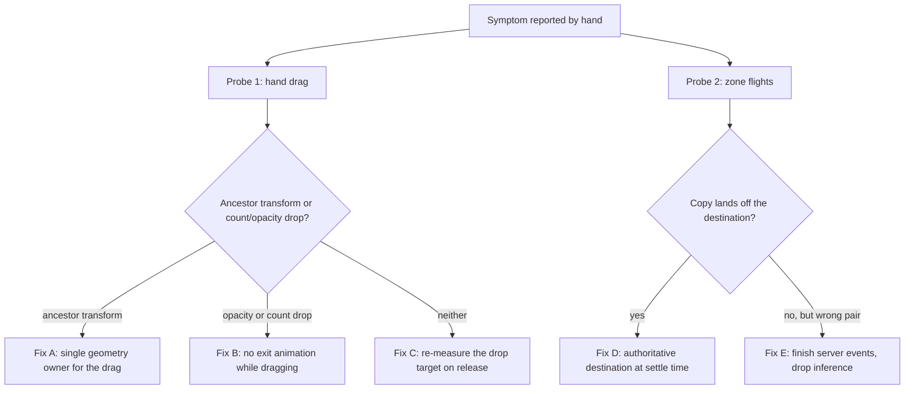

# Board position/animation diagnosis: protocol + expected evidence

Purpose: turn "the transitions don't match the cards' positions" and "hand reordering makes cards vanish
weirdly" into measured facts before we change any code. Four hypotheses, three probes, explicit verdict rules.
No application code is to be modified while running this.

Context for whoever runs it: the animation engine is an overlay-copy flight system (see
`views/game/animation/flights.ts`) and the hand reorder is a pre-Motion imperative drag (see
`hooks/useLongPressHandReorder.ts`). The full e2e suite is green, so both symptoms are visual-layer bugs, not
logic failures - which is why they need measurement rather than a code read.

## Hypotheses

- **H1 - transformed ancestor breaks the drag's `position: fixed` maths.** `activateDrag` sets
  `position: fixed` plus the *viewport* rect as `left/top` on the card node. A `position: fixed` element is
  positioned against the nearest ancestor with a `transform`/`filter`/`perspective`/`will-change`/`contain`,
  and its parent is a Motion slot that animates `scale` and carries `layout="position"`. If such an ancestor
  exists, the viewport-derived `left/top` are interpreted in that ancestor's space, so the card is drawn away
  from the pointer.
- **H2 - `AnimatePresence` exit fires mid-drag.** `GameHandRow` renders every card inside `AnimatePresence`
  with `exit={{ opacity: 0, scale: 0.9 }}`. Any transient absence of an instance id from the `cards` array
  while dragging plays a fade-out.
- **H3 - restore races Motion's layout projection.** At drop, `finalizeValidDrop` writes back the drag-start
  style snapshot and, in the same commit, `isReorderDragging` flips false and re-enables `layout="position"`
  on every card. Motion then measures a box that was just force-restored.
- **H4 - flight copies land on a stale destination rect.** A copy's end state is taken from the destination
  element's rect *at flight start*. Anything that moves the destination afterwards (Motion layout on the hand
  row or battlefield wrapper, a re-flowing support slot) means the copy lands where the card used to be.
  Related: `exit` flights pass `elementHiddenDuringFlight: null`, so the real source card stays visible while
  its copy travels - two cards on screen for the flight's duration.

## Probe 1 - hand drag: containing block + card census

Fixture: a started board, reached through the same multiplayer setup `e2e/gameview.spec.ts` uses, driving only
one page - there is no single-page started-board route, the app only serves `/game/:joinCode`. Drive the drag
exactly as `gameview.spec.ts` "allows long-press reordering in bottom hand" does: `mouse.move` to the card
centre, `mouse.down`, wait **360 ms** (long-press delay is 260 ms), `mouse.move` past the neighbour, wait
120 ms, then (later) `mouse.up`. Expect the first press to sometimes land on the slot wrapper instead of the
card; retry once and report it, because that failure is itself a finding (see RC3 in Results).

While the button is still down and after the move, evaluate in the page and report **raw values**:

1. Dragged element: `id` of the card, computed `position`, inline `style.left/top`, and
   `getBoundingClientRect()`.
2. Every ancestor from the card up to `document.body`: tag + truncated class, and computed `transform`,
   `filter`, `perspective`, `backdropFilter`, `willChange`, `contain`, `containerType`. Flag any value that is
   not `none`/`auto`.
3. `document.elementFromPoint(pointerX, pointerY)`: does it resolve to the dragged card or one of its
   descendants?
4. Hand census, sampled on ~20 consecutive animation frames: for each `[data-hand-instance-id]` inside the
   bottom hand row, record `opacity`, `visibility`, `getBoundingClientRect()` and whether the card's centre
   lies inside the row's rect. Also record the count of cards in the row.
5. After `mouse.up` + 200 ms: the census again, plus the resulting instance order.

**Verdict rules**

- H1 confirmed if **any** ancestor reports a non-`none` geometry-affecting value AND either (a)
  `rect.left/top` differs from the inline `left/top` by more than ~2 px, or (b) `elementFromPoint` does not
  resolve to the dragged card.
- H2 confirmed if the row's card count drops below the pre-drag count at any sampled frame, or any card shows
  `opacity < 1` while dragging.
- H3 confirmed if, in the ~5 frames after `mouse.up`, any card's rect jumps by more than ~half a card width
  from its final settled slot, or an `opacity < 1` frame appears after the drop.

## Probe 2 - zone flights: destination drift + double-card

Fixture: multiplayer, driving a deterministic flight. Two cases:

- **deck to hand**: the opening draw (reuse the opening walk from
  `e2e/gameview.multiplayer.board-animation.spec.ts`).
- **hand to field**: the summon already exercised by `e2e/gameview.multiplayer.actions.spec.ts:35`.

Instrument from the page before the movement:

1. Observe `[data-testid="card-flight-layer"]` for added/removed `[data-card-flight-copy]` nodes.
2. For each copy, on its **first** observed frame and on removal, record: the copy's rect, the copy's
   `data-flight-instance-id`, and - for that instance id - the rect + computed `visibility`/`opacity` of the
   element carrying it (`[data-hand-instance-id="..."]`, `[data-zone="character-field-card"]`, or
   `[data-testid="trash-pile-card"]`).
3. Keep sampling the destination element's rect at copy start, at copy removal, and at +100 ms and +300 ms
   after removal.
4. Note whether a flight copy ever appeared for the movement at all (a silently skipped flight is itself a
   finding).

**Verdict rules**

- H4 confirmed if the copy's final rect centre differs from the destination's rect centre at settle by more
  than ~4 px, or the destination's rect changes measurably between copy start and copy removal.
- Double-card confirmed if, for an `exit`-shaped movement (hand to trash, field to trash, discard), the source
  element was still present with normal `visibility`/`opacity` while its copy was alive.
- If the copy's final rect matches the destination at settle and the destination never moved, the flight
  mechanism is exonerated for that case and the mismatch must be in *which* pair the flight targets (see
  Probe 3).

## Probe 3 - optional: recorded events vs inference

Only needed if Probe 2 exonerates the rect mechanics. The hand consumer uses the server's `animationEvents`
when present and falls back to count/zone inference otherwise (see `useGameViewEffects.ts`, the hand-zone
effect). To tell them apart, log per flight: the card instance id, the movement kind that triggered it, and
whether that id appeared in the latest `animationEvents` payload. A flight whose id is absent from the payload
came from inference, i.e. from a guessed pair. This needs a temporary client log; treat it as a separate pass
and revert it afterwards.

## Running it

- Probes belong in a temporary spec under `e2e/` (Playwright's `testDir` is `./e2e`, `testMatch` is the default
  `*.spec.ts`). Run it by explicit path; the config starts its own servers.
- Report raw JSON, not summaries, plus a one-line verdict per hypothesis.
- **Do not modify application code while diagnosing.** Delete the temporary probe afterwards; the permanent
  regression specs are decided by the fix plan.
- Screenshots of the drag mid-flight and of a flight's last frame are worth attaching - they are the fastest
  human-readable evidence for the two symptoms.

## How the findings feed the plan

- Any confirmed H1/H2/H3 becomes a step in the hand-row fix; they are likely to be fixed together because one
  owner for the hand geometry covers all three.
- A confirmed H4 drives the flight fix (re-measure or project the destination at settle, and hide the source
  for exits).
- Only a probe that exonerates both the rect mechanics **and** the pair selection would justify revisiting the
  persistent-entity projection (Stage 5c), which stays the last resort on cost grounds.

---

# Results

Probe ran once (Probe 1 needed a retry because the first press landed on the Motion slot instead of the card).
The temporary probe spec was deleted afterwards; the suite is back to 42 specs.

## Verdicts

| Hypothesis | Verdict | Deciding measurement |
|---|---|---|
| H1 - transformed ancestor breaks the drag lift | **CONFIRMED** | The lifted card's inline `left/top` were `372 / 571.359`, but its `getBoundingClientRect()` was `left 1017.28, top 1137.41` - **+645.28 px right, +566.05 px down**, i.e. below a 720 px viewport. The containing block is the Motion slot: computed `transform: matrix(0.993515, 0, 0, 0.993515, 0, 0)` on the card's parent, `geometryAffecting: true`; every other ancestor is `none`. `document.elementFromPoint` at the pointer returned a *different* card's `img`, so the dragged card was not even under the cursor. |
| H2 - an exit fade fires mid-drag | **REFUTED** | Across all 20 sampled drag frames `rowCardCount` stayed `5` and every card reported `opacity: "1"` / `visibility: "visible"`. |
| H3 - the style restore races Motion's projection | **REFUTED** | The 6 frames after `mouse.up` show all five cards `position: "static"`, `opacity: "1"`, at settled rects `372 / 473.8 / 575.59 / 677.39 / 779.19` with no jump; `stuckFixedCount: 0`. |
| H4 - a copy lands on a stale destination rect | **CONFIRMED** (deck to hand only) | Drifts of **50.87 px**, **47.84 px** and **18.14 px** for exactly the copies whose destination moved mid-flight (`422.40 -> 371.51`, `521.15 -> 473.30`, `571.10 -> 552.91`). Every copy whose destination did not move landed within **0.02 px**. The hand-to-field summon showed **0 px** drift (destination rect identical at add, removal, +100 ms and +300 ms) - that path is exonerated. |
| Double-card on exits | **Not probed** | Both probed movements are `enter`-shaped; the destination reported `visibility: "hidden"` for the whole flight and `visible` by +100 ms. Exit-shaped movements (hand/field to trash) still need a probe. |

## Root causes

- **RC1 - `position: fixed` inside a transformed ancestor.** `activateDrag` lifts the card with
  `position: fixed` while its parent, the Motion slot, carries a `transform` (from the slot's `scale`
  animation and/or `layout`). That parent becomes the containing block, so the viewport-derived
  `left/top` are applied in the slot's coordinate space and the card is drawn hundreds of px away, often
  off-screen. This is the "hand cards vanish / move oddly" symptom, and it is intermittent because it
  depends on whether the slot's transform is present at that instant (a later drag frame, once the slot's
  transform cleared, put the same card at a correct `left ≈ 546.68`).
- **RC2 - the flight destination is captured, not tracked.** The copy's end is the destination's rect
  *at flight start*. A draw batch makes the hand row re-layout (the row is `justify-center`, so adding a
  card shifts every existing card by ≈ half a card width - measured 50.89 px against a 100.8 px card),
  and Motion animates that shift over 300 ms while the copies fly for 420 ms. The copies therefore land
  where the cards *were*.
- **RC3 - a press can land on the slot rather than the card.** The first probe attempt armed no drag
  because `pointerdown` hit the slot wrapper (`data-hand-instance-id: null`), so the hook's
  `contains(target)` guard early-returned. `gameview.spec.ts` masks this with a 3-attempt retry loop.

## Consequences for the plan

- RC1/RC2/RC3 are three independent defects, and none of them requires persistent card entities: the
  copy flight mechanism is exonerated wherever the destination is static (0.02 px), so the fix is to make
  the destination live, not to replace the mechanism.
- A persistent-entity projection would have removed RC2's *class* but not RC1 or RC3, at the cost
  already recorded for Stage 5c. It stays out of scope; see `plans/board-position-fixes.md`.
- NEW INVARIANT: never lift a card with `position: fixed` inside the board. Any ancestor `transform`,
  `filter`, `perspective`, `will-change` or `contain` silently becomes the containing block.
