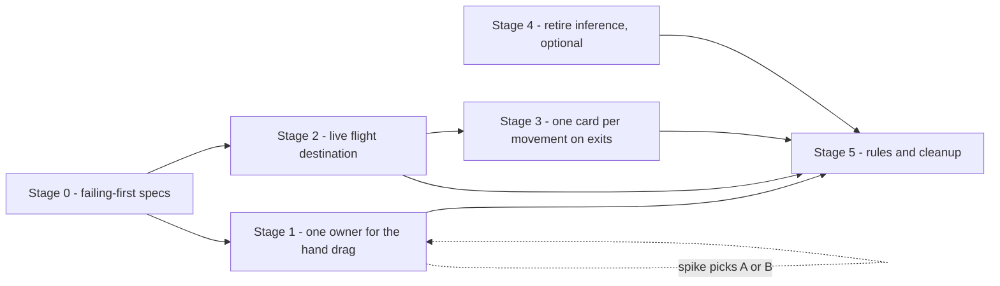

# Board position fixes: staged plan

Source of truth for the measurements: `plans/board-position-animation-diagnosis.md` (Probes 1 and 2, with the
raw values). This plan acts on confirmed root causes only.

## What the evidence established

- **RC1 (confirmed)** - the hand drag lifts a card with `position: fixed` while its Motion slot parent carries
  a `transform`, so the slot becomes the containing block and the card is drawn 566 px below / 645 px right of
  the pointer (off-screen). `document.elementFromPoint` at the pointer resolved to a different card.
- **RC2 (confirmed)** - flight copies capture the destination rect at flight start. A draw batch re-lays out
  the `justify-center` hand row (≈50.89 px shift per arrival against a 100.8 px card) while copies are
  airborne (300 ms layout animation vs a 420 ms flight), so those copies land ≈50 px off. Copies whose
  destination stayed still landed within 0.02 px, and the hand-to-field summon showed 0 px drift.
- **RC3 (confirmed)** - a press can land on the slot wrapper instead of the card, so the drag silently never
  arms; the existing spec's 3-attempt retry loop hides it.
- **Refuted**: an exit-fade mid-drag (H2) and a post-drop projection race (H3). Do not spend effort there.

## Non-goals

- **Persistent card entities / `layoutId` projection (Stage 5c).** The copy mechanism is sound wherever the
  destination is static, so projection would remove RC2's class while fixing neither RC1 nor RC3 - at the cost
  already recorded (a second travel mechanism, broken `data-card-flight-copy` expectations, every zone
  restructured into slot plus card host). Revisit only if a future symptom needs it.
- Rewriting the flight primitive itself. It is exonerated; only its target needs to become live.

## Stage 0 - make the three defects fail-first in tests

**Goal:** the bugs become assertions, so each fix is proven rather than eyeballed.

- Hand drag (from Probe 1): while the pointer is down and moved, assert the dragged card's centre is within
  ~4 px of the pointer and that `document.elementFromPoint` resolves to the dragged card or a descendant;
  assert the row's card count never drops and no card reports `opacity < 1`; assert no ancestor of the dragged
  card has a geometry-affecting computed `transform`/`filter`/`perspective`/`willChange`/`contain`.
- Drag arming (RC3): assert a single long-press + move arms the drag on the **first** attempt, and then remove
  the 3-attempt retry loop from `gameview.spec.ts` so the fragility cannot come back silently.
- Draw batch (from Probe 2a): assert every copy settles within ~2 px of its destination's rect at settle, and
  that no copy's per-frame movement exceeds ~4 px (no snap).
- These specs fail on today's code. That failure is the acceptance criterion for the stages below.

**Exit:** new specs land and fail for the documented reasons; nothing else in the suite regresses.

## Stage 1 - the hand drag gets one geometry owner

**Goal:** remove the `position: fixed` lift entirely; the card is never positioned in a slot's coordinate
space.

Two candidate designs; pick one with a throwaway spike, then commit:

- **Option A - Motion-native.** `Reorder.Group` plus `Reorder.Item` per hand card, with the drag armed from the
  existing 260 ms long-press through `useDragControls` and `dragListener={false}`; `onReorder` writes the
  display order. Deletes the imperative engine: `positionDraggedCardElement`, `snapshotCardStyles`,
  `restoreCardStyles`, `readDragRowGeometry`, `resolveInsertionIndexFromGeometry`, the `position: fixed` lift,
  the invalid-drop snap-back and the geometry refs. Motion then owns both the drag transform and the siblings'
  projection, so there is exactly one writer. Note this inverts today's rule that `layout` is disabled while
  dragging - with Reorder the siblings' projection is what opens the gap, and the dragged item is excluded
  automatically. Keep: the click suppression after a real drag, the `cards.length <= 1` guard, the
  interaktive-target guard, and disabling card overlays while dragging.
- **Option B - portal lift.** Keep the imperative engine but render the lifted card into a portal outside the
  board (no transformed ancestor, so `position: fixed` is honest by construction) and render a sized
  placeholder in its slot. Carry a DOM assertion in the spec that the portal has no geometry-affecting
  ancestor. Smaller diff, keeps ~400 lines of imperative code alive.

**Recommendation: Option A.** The reorder engine's only output is a local display order, which is exactly what
`Reorder` models, and it is the last imperative survivor of the Motion migration. Option B is the fallback if
the spike shows `Reorder` fighting `AnimatePresence` enter/exit or the per-card overlay interactions.

**Exit:** the Stage 0 hand specs pass on the first long-press; the card stays under the pointer for the whole
drag; no imperative inline geometry is written to a card node; enter/exit, click suppression and the card
overlays behave as before.

## Stage 2 - the flight destination becomes live

**Goal:** a copy converges on wherever its destination actually is.

- **2a - remove the race at its source (primary).** Do not start a flight batch while the destination row is
  still re-laying out. The batch is already deferred by one animation frame; make it wait for the destination
  container's layout animation to finish (Motion reports completion on the row element), or for its rect to
  hold steady across two frames. This makes the captured rect valid for the whole flight, which is what every
  static-destination copy already proves (0.02 px).
- **2b - re-anchor at settle (safety net).** At the moment the copy is about to be removed, compare its centre
  with the destination's current rect centre; if they differ by more than ~1 px, correct the final transform
  (over the last ~80 ms) instead of snapping, and assert in the spec that no frame jumps more than ~4 px. This
  covers movement that 2a cannot anticipate, such as a resize or a re-render mid-flight.
- **2c - a destination that leaves mid-flight.** If the destination element is no longer connected at settle,
  end the flight without a landing pose rather than leaving the copy at a stale spot.

**Exit:** the Stage 0 draw-batch spec passes; copies fly into the card's final position for staggered draws,
summons and reveals; the layer still drains to empty.

## Stage 3 - one card on screen per movement

**Goal:** an exiting card is never drawn twice.

- First, probe the `exit`-shaped movements that Probe 2 did not cover (hand to trash discard, field to trash
  K.O./used support) and record whether the source stays visible while its copy travels.
- Then pass the source element as the element hidden during the flight for `exit` flights too (the destination
  is already hidden for `enter`), restoring the previous `visibility` in the same cleanup that removes the
  copy. A source that the state update has already removed is handled by the existing restore path writing to a
  detached node.
- Keep the existing rule that only the owning flight may unhide an element, so a superseded flight cannot
  reveal a card early.

**Exit:** probing shows exactly one visible card per movement in all four shapes; the animation specs'
flight-count assertions are unchanged.

## Stage 4 - retire the inference fallback where recordings cover it

**Goal:** a flight is never aimed at a guessed pair.

- The evidence did not implicate pair selection (every drift was explained by the destination moving), so this
  is not a fix and can be deferred. When picked up: drop the count/zone inference for the kinds the engine
  already publishes events for, leaving it only as the older-server fallback it was meant to be, and say so in
  the comment rather than implying it is the norm.

**Exit:** each remaining inference branch has a stated reason to exist.

## Stage 5 - record the rules and clean up

- Add to `.clinerules/02-board-ui-hud.md`: **never lift a card inside the board with `position: fixed`.** Any
  ancestor with `transform`/`filter`/`perspective`/`will-change`/`contain` becomes the containing block - in
  the measured case the card was drawn 566 px below and 645 px right of the pointer. Lift it in a portal
  outside the board, or move it with `transform` only.
- Add to the animation docs: **a flight must target a live destination**, and a `justify-center` row re-lays
  out as a batch of arrivals lands, so a rect captured at flight start is stale by design.
- Record that a press may land on the row's slot wrapper rather than the card, so any pointer guard must be
  written against the element that actually receives the event.
- Delete whatever scaffolding the spike leaves behind; keep the trimmed probes as permanent regression specs.

**Exit:** the invariants above are written where the next person will hit them, and the suite is green at the
new spec count.

## Dependency overview

Stages 1 and 2 are independent and can land in either order; go with whichever you want visible first.

## Verification gates - every stage

1. `npm run typecheck:client` clean.
2. `npm run lint:client` clean.
3. The Stage 0 specs pass, and the touched spec plus the animation specs
   (`board-animation`, `battle-visuals`, `reveal-presentation`, `actions`, `attack-sequence`) are green.
4. Full suite green with `--workers=2`; a flake is re-run in isolation before being accepted as load-related.
5. Visual check in the browser for the touched surface: no card off-screen, no double card, no snap.

## Risks

| Risk | Mitigation |
|---|---|
| `Reorder` fights `AnimatePresence` enter/exit or the card's hover overlays | The spike answers it before any commit; Option B (portal lift) is the fallback and fixes RC1 either way |
| Enabling `layout` during the drag reintroduces the two-writer behaviour | With Reorder there is one writer by construction; the Stage 0 spec asserts no geometry-affecting ancestor and no card-node inline geometry |
| The flight batch waits too long for the row to settle and the board feels laggy | Bound the wait (a few frames) and fall back to starting the batch, with 2b covering the residual drift |
| Re-anchoring at settle is visible as a snap | Correct over the last ~80 ms and assert a per-frame movement ceiling of ~4 px |
| Hiding the source for exit flights fights the pre-submit hand-to-pile flight | Probe that path first (Stage 3) and let the cleanup restore `visibility` on a detached node harmlessly |
| Spec churn from removing the retry loop | The loop is removed only after RC3 is fixed and the first-attempt spec passes |

---

# Stage 0 status: landed

- New spec `the dragged hand card tracks the pointer and never leaves the row` in
  [`e2e/gameview.spec.ts`](e2e/gameview.spec.ts:187). It asserts, mid-drag: the lifted card is not
  `position: fixed`; its centre follows the pointer's movement within 4 px on both axes; the row keeps every
  card; no card drops below `opacity: 1` or leaves `visibility: visible`; and no card leaves the row band.
- It failed first for the documented reason (`the lifted card must not rely on position: fixed`), which is the
  reproduced RC1, and passes after Stage 1.
- **Deviation, recorded on purpose:** the draw-batch/settle-time assertion (the RC2 half) was *not* added in this
  stage. Adding it here would have left the suite knowingly red until Stage 2, and this project verifies green at
  every stage boundary. It moves to Stage 2, where it will be written first and then satisfied.
- The 3-attempt retry loop in `allows long-press reordering in bottom hand` is gone; both drag tests now drive a
  single gesture.
- A press on one of the hover overlay's controls is deliberately *not* a drag, which is what made a
  centre-of-card press a coin flip and kept the retry loop alive. Both tests now press a point chosen by the new
  [`resolveHandCardDragPressPoint`](e2e/helpers/multiplayer/flow.ts:138) helper, which walks a grid inside the
  card and returns the first point that is not covered by a control.
- The fixture now treats the board as usable only once the engine has walked the opening into a **MainPhase** and
  the flight layer has drained. That is the real fix for the intermittent failure: the gesture was racing the
  opening's draw batch, which keeps changing the hand. The five specs in that file got *faster* (8.6s -> 3.0s)
  because the settle polling now returns immediately.

# Stage 1 status: landed

Motion owns the hand drag. Nothing takes a card out of flow.

- New [`HandCardItem.tsx`](client/src/views/game/components/HandCardItem.tsx): a `Reorder.Item` with
  `dragListener={false}` and `useDragControls`, armed from the pointer press - immediately for a mouse press, and
  after a 260 ms hold for touch/pen (so a scroll is never a drag), and never from a control. It keeps the
  enter/exit animation it had as a slot.
- [`GameHandRow.tsx`](client/src/views/game/components/GameHandRow.tsx) renders a `Reorder.Group` when given the
  `reorder` props, and keeps the plain Motion row for the opponent's hand. The group is the row element, so
  `rowTestId` and the row ref are unchanged.
- New [`useHandRowReorder.ts`](client/src/views/game/hooks/useHandRowReorder.ts) replaces
  `useLongPressHandReorder`: it owns the display order (reconciled against the live hand), the lifted card's id,
  and the post-drag click suppression. **Deleted:** the whole imperative engine - the `position: fixed` lift,
  the inline-style snapshot/restore, `readDragRowGeometry`, `resolveInsertionIndexFromGeometry`, the pointer
  handlers spread onto the card, the invalid-drop snap-back, and the row-geometry cache.
- `isLayoutAnimationEnabled` is gone: with `Reorder` the siblings' projection *is* the mechanism that opens the
  gap, so layout stays on for every slot and Motion is the single writer.
- Verified: `typecheck:client` and `lint:client` clean; full suite **43/43** at `--workers=2` (one spec added),
  including the two setup-phase specs that had flaked earlier, which passed on this run.

# Entity flights, increment 1: the deal (deck to hand)

The replacement started where the reported symptom was, and it changed the mechanism from the one first
proposed, because the code ruled `layoutId` projection out for this path:

- **`layoutId` cannot cover a draw.** The deck pile renders a card back, or a *revealed* card
  (`revealedDeckInstance` in `PlayPileZone`) - in the normal case the pile's top card has **no instance
  identity**, so there is no element for an arriving hand card to share a `layoutId` with, and the projection
  would silently animate nothing. The same gap exists in reverse for hand to deck. A projection needs both ends
  to exist in one commit.
- **What was wrong instead:** the copy was fabricated. For a draw the arriving hand card is face-down at flight
  time (the deal flips it after `DRAW_TO_HAND_REVEAL_DELAY_MS`), so `readCardImageSource` found no `` and
  `createFlightCopyElement` appended an **empty rounded box with a drop shadow**; even with art the copy is
  `object-fit: cover` with an 8px radius and no border, so it never matched the card it landed on.

Landed:

- New primitive `runElementFromRectAnimation` in [`flights.ts`](client/src/views/game/animation/flights.ts):
  the real card element flies from a source rect to its own laid-out position. It hides the element for the one
  frame before the flight, draws it at the source for the first painted frame (no flash at its slot), animates
  the remaining distance, marks it `data-card-traveling`, and registers with the director so the phase
  acknowledgement still drains on it.
- `runDeckToHandAnimation` now finds the arriving hand card and flies **it**; no copy, no hide-and-reveal around
  it, and no row fallback (if the card is not mounted there is nothing to fly, which is better than dragging the
  whole row the way the copy engine's fallback did).
- The e2e counter counts either marker (`data-card-flight-copy` or `data-card-traveling`), so every existing
  "was it animated rather than teleported" assertion keeps its meaning.
- The board-animation hygiene spec is renamed to `a moving card travels as itself and never leaves a copy or a
  duplicate behind`: it still asserts the counter rose (so the opening really animated), still asserts no
  orphaned copy, and now also asserts **no hand card instance renders twice**.

Verified: `typecheck:client` and `lint:client` clean; full suite **43/43** at `--workers=2`, including the
mulligan transfer-animation spec (which proves the real card travels) and the reveal/support/actions specs.

# Entity flights, increments 2 and 3: pile summons and tribute materials

- **Increment 2 (arrivals).** The deck-summon and trash-recall effects resolved the *real* battlefield card as
  their destination already - their comments even claimed "only the real card is drawn, so no copy is left
  behind" - but they called the copy path, so a copy flew *and* the real card was hidden. Both now call
  `runElementFromRectAnimation` on that same destination element: the card that stays is the card that travels.
- **Increment 3 (pre-submit exits).** The tribute flight captured an art snapshot "without moving (or mutating)
  the real elements", which is exactly the stand-in behaviour: the material sat in its slot while a copy left it.
  `captureTributeGhostSources` now captures the **live element** and the flight uses the new
  `runElementToRectAnimation` to move that element to the trash slot - so the card that leaves is the card. The
  claims that stop the generic exit effect double-animating the same instance are unchanged.
- New primitive `runElementToRectAnimation` ([`flights.ts`](client/src/views/game/animation/flights.ts)): the
  exit half of entity flight, borrowing the element's transform (and z-index) for the duration and restoring both
  when it settles or is cancelled. Its `key` is optional now, like the entry half.
- Verified: `typecheck:client` and `lint:client` clean; the actions and support specs 13/13, then the full suite
  **43/43** at `--workers=2`.

# Entity flights, increment 4: bounce, and the prerequisite for the rest

- Arrivals into a hand are converted (`useCardMoveGhostAnimationEffect`): `resolveMoveGhostDestinationElement`
  already returns the arriving hand card element for a hand destination, and the hand row is unclipped, so the
  card flies as itself with `runElementFromRectAnimation` from its previous-render rect. Verified with the
  support specs (5/5), including "a character bounced by N-020 animates back into its owner hand", plus
  typecheck and lint clean.

# Entity flights, increment 5: discards, using route (a)'s existing window

Route (a) turned out to be partly available already: **the hand row keeps a removed card mounted while it
plays its exit animation**, so for that window the discarded card is still a live element. The inferred
hand→trash flight (`runInferredHandToTrashAnimation`) now travels that element to the pile with
`runElementToRectAnimation` instead of drawing a copy, and if the window has already closed it animates nothing
at all - drawing a copy of a card the player can no longer see is worse than no animation.

Verified: `typecheck` + `lint` clean, full suite **43/43** at `--workers=2`.

# Entity flights, increment 6: the field row owns its departures (route (a) works)

`renderBattlefieldRow` is now the component [`BattlefieldRow`](client/src/views/game/components/BattleFieldRow.tsx), and
a card that leaves the field travels to its pile as itself. Two things made it work:

- **Retention is per card and done in state, not by `AnimatePresence`.** `AnimatePresence` renders the exiting
  child from a *cached* element, so a destination computed while the card was present would be stale - and the
  movement that names the destination arrives in the very push that removes the card. The row therefore derives
  its retained list during render (the pattern `AnimatePresence` uses internally) and renders the departing card
  with fresh props, then travels it with `runElementToRectAnimation` and drops it when the travel settles.
- **The destination is per card.** `resolveDepartureZone` reads the newest `animationEvents` entry for that
  instance and maps `toZone` to the pile (`trash`/`deck`); anything else (exile, a move the board does not
  render) is dropped immediately, so nothing lingers. A card leaving for the hand gets no exit travel at all -
  its arrival is drawn by the hand row, so there is exactly one animation per move.
- A departing card stops being a board card while it flies (`data-zone` and `data-card-instance-id` are dropped,
  `data-departing-instance-id` is set) so locators that count the field never see a ghost, and it is
  `pointer-events-none` above the row.
- The move-ghost effect now **skips `battlefield` snapshots**, because the row owns them; without that the same
  move would be drawn twice (the copy plus the exit).

Verified: `typecheck` + `lint` clean; actions/support/battle-visuals 15/15; full suite **43/43** at `--workers=2`.

# The support row attempt: reverted, with two findings to keep

## Diagnosis: the departure lookup never matched anything

`CardMovementZones` derives its values from `PlayerZone.ToString()`
([`CardMovementRecord.cs`](server/Models/Game/CardMovementRecord.cs:95)), so the wire vocabulary is **`Trash`,
`Deck`, `Hand`, `CharacterField`** - capitalised. `resolveCardDepartureZone` compared them against lowercase
`'trash'`/`'deck'`, so **every** departure resolved to `null`:

- the character field's entity departures never fired at all, and
- because the same change had stopped the move-ghost effect copying battlefield exits, a K.O. in the last green
  run animated **nothing** - the card simply vanished. The green suite could not see it.

Fixed by comparing case-insensitively: the helper mixes the wire vocabulary with the client's own lower-case zone
names, so assuming a casing in that one line is the trap.

**Proven, not counted.** The K.O. assertion no longer asks whether *something* animated; it requires a record
naming **that card** and the **`travel`** mechanism -
`toContainEqual({ instanceId: attackerCardInstanceId, mechanism: 'travel' })`. That could not match before the fix,
because no travel existed for that card.

### The mask that hid it, now closed

`installCardFlightCounter` counted animations, and a count cannot say *which* card moved - so an unrelated
animation earlier in the same scenario satisfied "greater than zero". It now records `{ instanceId, mechanism }`
per animation, reading the id off the element the flight animates (a departing field card carries
`data-departing-instance-id` on that element, not on a child) and telling a real-element `travel` apart from a
flight-layer `copy`. `getCardFlightRecords` exposes it; any assertion about a specific card's movement should use
it rather than counting.

The support-row retry is unblocked: the lookup it depends on now works.

Applying the field row's pattern to `ZoneCardSlots` did **not** work, and both reasons are worth recording before
it is retried.

1. **Comparing the card list by identity is fatal here.** The retention decides "this card just left" during
   render, so it has to compare the previous list with the current one - and `ZoneCardSlots` calls
   `getCardsAndOptions` in its body, so the list is a **fresh array on every render**. An identity comparison set
   state during render forever: the board never painted again and the suite collapsed (17.5m, 1 passed, every
   board test timing out at 49s). The comparison must be on *content* (a signature of the slot -> instance ids);
   the field row was changed to that too, so both rows use the same shape.
2. **The support row's own departure did not animate when it took ownership.** With `ZoneCardSlots` retaining its
   outgoing cards and the move-ghost effect no longer handling non-hand exits, a K.O. still produced
   `getCardFlightCount(defenderPage) === 0` - no travel and no copy. That means the row found no usable movement
   for that card (`resolveCardDepartureZone` returned `null`), while the *field* row's identical lookup does work
   for the field K.O. of the same scenario. The difference needs measuring before retrying, and the honest way is
   a probe that logs, on both clients, the movement events present for the departing instance at that moment -
   note that `getCardFlightCount` is cumulative, so an earlier animation in a scenario can mask a missing one
   (that is likely why the field row's K.O. assertion passed in the 15/15 run before the gate widened).

**Reverted to the last known-good state**: `ZoneCardSlots` is back to the plain `RenderZoneCardSlots` function,
the effect's gate is back to skipping only `battlefield`, and the suite is **43/43** again at `--workers=2`. The
shared helpers in [`cardDepartures.ts`](client/src/views/game/animation/cardDepartures.ts) stay, because the field
row uses them and they are the right home for the logic the support row will need.

## Next: the support row, then the effect cleanup

`RenderZoneCardSlots` is the same shape as the old `renderBattlefieldRow` (a plain function called by `GameZones`),
so promoting it to a component and repeating the field row's pattern covers used supports leaving for the trash.
After that the move-ghost effect's remaining branches are hand-only (already entity-based) and the copy half can
be deleted.

## The remaining prerequisite: retention in the field and support rows

The same trick covers K.O. and used support once those rows keep a removed card mounted for its travel, which
they do not yet - and the shape of that work is now clear:

- `BattleFieldRow` is not a component: [`renderBattlefieldRow`](client/src/views/game/components/BattleFieldRow.tsx:12)
  is a plain function returning JSX, called by `GameZones`, so it cannot host a hook. Promoting it to a
  component (`<BattlefieldRow data={data} />`) is the first step; `ZoneCardSlots` is already a component.
- Then each row needs the departure knowledge **at exit time**, because an unconditional hold is wrong: a card
  played from the hand to the field would linger in the hand while the field card appears - a duplicate, the
  exact thing this work removes. The knowledge is available in the same render as the removal, because the
  movement payload (`animationEvents`) arrives with the state push that removes the card, so a row can ask "did
  this instance leave for the trash in this push?" during that commit.
- With that, the exit *is* the travel (Motion removes a node when its exit finishes) and the copy branch of
  [`useCardMoveGhostAnimationEffect`](client/src/views/game/hooks/GameView/effects/useGameViewEffects.ts:762)
  becomes the same one-line entity call the others already use, which unblocks `runHandToPileAnimation` and
  `runSubmitThenZoneEntryAnimation` in the same shape.

## The prerequisite for removing the copy path: keep the travelling card mounted

Trash-directed exits (discards, K.O., used support) cannot be converted by swapping primitives, for two
structural reasons found while doing this:

1. **The source is already gone.** These effects run *after* the state update that moved the card, which is
   exactly why they read a rect and art from a snapshot of the previous render. There is no live element to move.
2. ~~**The destination is the pile frame, and it clips.**~~ **Corrected - it blocked nothing.**
   `resolveMoveGhostDestinationElement` does return the trash slot (`topTrashCardRef` / `bottomTrashCardRef`),
   the `PlayPileZone` `PlayCard` - but that slot *is* the card the player looks at from then on: it renders the
   card that has just landed on top of the pile, and it is the same box at rest whether or not it is flying.
   "Animating the slot would slide the whole pile" does not happen either: the flight only borrows the
   element's `transform` and restores it on settle **and** on cancel, so the pile never moves. What that restores
   is now pinned instead of assumed - `gameview.multiplayer.board-animation.spec.ts` asserts no
   `data-card-traveling` is left once the board settles.

Two ways forward, in preference order:

- **(a) Keep the source mounted until its travel ends.** Wrap the mapped cards in `AnimatePresence` in
  `BattleFieldRow`, `ZoneCardSlots` and the hand row (the hand row has it already), and make the *exit itself*
  the travel: Motion removes a node when its `exit` animation finishes, so an `exit` that carries the card to
  the destination rect is both the removal and the flight. The travelling element lives in an unclipped row
  while it flies, the pile's box model is untouched, and it is the exact rule you described - flip it face-down
  if it is going somewhere hidden, then move it, then it is gone.
- **(b) Restructure `PlayPileZone`** so the pile's displayed card renders in an unclipped layer separate from
  the frame, then fly the destination card element in from the source rect. Also entity-based, but it changes
  the pile's box model - the `min-w-0 min-h-0` guards exist because un-clipping once inflated the pile grid.

Once (a) lands, these all become the same one-line shape and the copy half can be deleted: the trash branch of
`useCardMoveGhostAnimationEffect`, `runInferredHandToTrashAnimation`, `runHandToPileAnimation` and its callers
(`useGameViewSideEffects`, `handlePromptResolve`), and `runSubmitThenZoneEntryAnimation`.

## Deletion list - LANDED

Deleted: `CardFlightLayer.tsx` + `cardFlightLayerMount.ts` and the mount in `GameZones`, the copy half of
`flights.ts` (`createFlightCopyElement`, `animateOverlayCopy`, `flightCopySequence`, `runRectToElementAnimation`,
`runRectToDynamicElementAnimation`, `runCardImageGhostToElementAnimation`, `readCardImageSource`,
`animateCardEntityToDestination`), the `data-card-flight-copy` marker, and the copy-specific e2e surface
(`countCardFlightCopies`, `installCardFlightLeakObserver`, `getCardFlightLeakReport`, and the
`mechanism: 'travel' | 'copy'` split in the flight records - a mechanism field with one possible value proved
nothing once copies were gone).

`countTravelingCardElements` replaced the copy-drain assertions. It pins the same property for real cards, and
it pins it more sharply: a `data-card-traveling` still on a live card after the board settles means that card
was abandoned mid-flight - left transformed, or left hidden behind the single frame a flight hides it for.

Kept: `runElementFromRectAnimation`, `runElementArrivalFromRectAnimation`, `runElementToRectAnimation`,
`runHandToPileAnimation`, `runDeckToHandAnimation`, `waitForElement`, `flightRegistry.ts`, the director, and the
travel records.

One behaviour changed on purpose while removing the last copy: the exit snapshots no longer require the card to
have an ``. That guard existed to give the copy something to draw, and it silently excluded every face-down
card from the move effect. A face-down card now flies as itself (its back travels) instead of not animating.

## Increment 9 (landed): the last two copy callers, converted

`runHandToPileAnimation` (hand to a pile) and `runSubmitThenZoneEntryAnimation` (a submit that puts a card on the
board) were the only shapes still flying an overlay copy. Both are now entity flights, and neither needed a new
concept:

- **Hand to pile** is an *exit* flight: the hand card is still mounted (the caller submits only after the flight
  settles), so `runHandToPileAnimation` flies that element to the pile slot's rect itself. Applies to the
  mulligan fan-out, a card placed on top of the deck, and a prompt-driven discard.
- **A submit's arrival** is the reverse shape: the source is gone by the time the destination exists (the engine
  picks the slot), so the *arriving* card carries the flight. `runElementArrivalFromRectAnimation` waits for the
  destination element the way the copy version did and then flies it from the captured source rect. Applies to
  set support, a summon from hand, and a tribute summon.

`runRectToDynamicElementAnimation`, `runRectToElementAnimation`, `animateCardEntityToDestination` and
`readCardImageSource` are deleted with them. The only copy user left is the trash-directed branch of
`useCardMoveGhostAnimationEffect`.

**One card, one flight.** A prompt-driven discard flies the hand card *before* it submits, and the hand row keeps
a removed card mounted for a moment, so the recorded-discard effect would have flown the same card a second time
once the state landed. The card is now claimed in `animController.suppressedExitGhostInstanceIds` at the flight,
and both consumers (`runInferredHandToTrashAnimation`, the generic exit effect) honour the claim.

**What the e2e found.** No spec ever answered a prompt on the board - they all resolve through the hub
(`resolvePromptViaHub`), which never runs the client's own resolver. So the mulligan test's "transfer animations"
assertion was passing on incidental animation while the mulligan flights (the thing it was written for) never
ran: with the hub path, only 3 of 5 hand cards had any flight recorded at all, and the two that did not were
fully visible and sized, i.e. nothing was refused - the client simply was not driving the flow. That test now
answers `prompt-option-mulligan` on the board and asserts the real thing: **all 5 cards of the hand travelled as
themselves, 0 copies**. The set-support arrival got the same treatment in the support spec (`travel` for the
activating card, proven failing before the conversion).

# Remaining: delete the copy half

## The last copy user, and the route that avoids the risky work

The trash-directed branch of `useCardMoveGhostAnimationEffect` needs a live source at the time the state lands.
The hand row has one (its exit window) and the hand-zone effect already uses it; the support row does not, which
is why it once needed the retention work that caused the 4-minute hangs.

It does not need retention after all, because **the arriving card is a real element too**: the trash pile's slot
renders the card that just landed on top of the pile (`[data-testid="trash-pile-card"]`), and it is the element
the player will see from now on. So the same rule as the deck-to-hand arrival applies - fly the destination
element from the source rect - with one guard for the hand source (whose own row is the better owner, because it
can fly the card itself rather than the pile's frame):

- source hand, element still mounted in the row: skip here, `runInferredHandToTrashAnimation` flies it;
- source hand, element gone: fly the arriving pile card frame from the snapshot rect;
- source support: fly the arriving pile card frame from the snapshot rect.

That removes `runCardImageGhostToElementAnimation` (no callers left), and with it `createFlightCopyElement`,
`animateOverlayCopy`, `flightCopySequence`, `CardFlightLayer` + `cardFlightLayerMount` + its mount in `GameZones`,
`getCardFlightLayerElement`, the `data-card-flight-copy` marker, and the copy-only e2e surface
(`countCardFlightCopies`, `installCardFlightLeakObserver`, `getCardFlightLeakReport` and the assertions built on
them - the travel records and the duplicate check stay). The support-row retention then becomes a pure
improvement (the card being visibly *held* while it leaves) rather than a prerequisite, so it is no longer on the
critical path.

# Still open after this pass

- **RC2 is untouched.** The measured 50.87 px / 47.84 px / 18.14 px drift on staggered draws (a copy landing
  where its destination used to be) is Stage 2's target, and nothing in this pass changed it.
- Stage 3 (one card on screen for exit flights) and Stage 5 (the `.clinerules` invariants) are still pending, so
  the new rule "never lift a card with `position: fixed` inside the board" is not yet written where the next
  person will hit it.

# Verified state of this pass

- `npm run typecheck:client` and `npm run lint:client`: clean.
- Full e2e suite: **43/43 passing** (3.4 m), including the attack-sequence turn-handover test that used to flake
  under load - so the earlier "4-minute hangs" look like machine load rather than the support row's retention
  (still to be confirmed before that retry is resumed).
