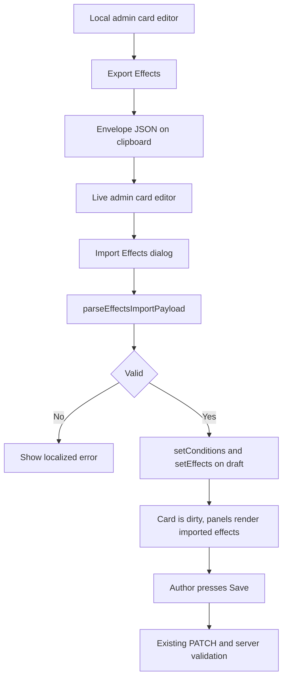

# Card Effects Import/Export

## Goal

Move a card's authored conditions and effects from a locally tested environment to the live admin UI
without re-clicking every panel. On the source environment the author copies a JSON payload to the
clipboard; on the target environment the author pastes it into an import dialog, the UI parses,
normalizes and validates it exactly like the Save path does, drops it into the editor draft, and the
author presses Save.

Scope: **conditions + effects only**. Import **replaces** every condition and effect on the target
card. Transfer happens **through the clipboard** (no files).

## Non-goals

- No server, API, DTO, validation or migration changes. The payload is a client-side authoring
  artifact; the existing `PATCH /api/cards/{cardId}/effects` request shape is untouched.
- No direct write to the server on import. Import only mutates the editor draft and marks it dirty, so
  the normal Save button, unsaved-changes guard and server validation still apply.
- Card identity and descriptive fields (description, supportEffect, type, color, power, damage, life,
  health, cannotBeNormalSummoned) are deliberately not transferred.
- No effect ID re-keying or append/merge mode.

## Payload contract

Envelope, versioned so a payload from a newer client is rejected instead of silently mangled:

```json
{
  "kind": "phv.card-effects",
  "version": 1,
  "exportedAt": "2026-11-22T13:45:00.000Z",
  "sourceCard": { "id": "E2E-CARD-1", "displayName": "Shisui" },
  "conditions": ["Rush"],
  "effects": [ { "id": "effect-1", "...": "..." } ]
}
```

The importer additionally accepts two hand-edited shapes for convenience:

- an object with `conditions` and/or `effects` (the envelope minus metadata),
- a bare array of effect objects (conditions default to `[]`).

Unknown keys are dropped, never carried into the draft, so a stale export cannot inject fields the
current editor does not own.

## Design

### 1. Reuse the existing normalizer and validator

[`toEditorDraft()`](client/src/views/admin/model/cardAdminEffectPayload.ts:37) already maps legacy
`revealPostConditionPredicate` / `revealPostConditionRestriction` into the current
`revealPostConditionRuleSet` shape per effect. Extract that per-effect mapping into an exported
`normalizeEffectForEditor(effect)` and call it from both `toEditorDraft` and the import parser. This is
a pure refactor with no behaviour change, but it guarantees an imported effect hydrates exactly like a
server-returned one, including exports produced before the rule-set migration.

[`parseEditorPayload()`](client/src/views/admin/model/cardAdminEffectPayload.ts:120) already enforces
required fields, duplicate effect IDs and on-success/on-failure branch target integrity. The import
parser builds a synthetic draft `{ ...EMPTY_DRAFT, conditions, effects }` and runs it through
`parseEditorPayload`, so import validation and Save validation can never drift apart.

### 2. New pure module for transfer

`client/src/views/admin/model/cardAdminEffectTransfer.ts`

- `CARD_EFFECTS_EXPORT_KIND`, `CARD_EFFECTS_EXPORT_VERSION`
- `buildEffectsExport({ cardId, displayName, conditions, effects }): string` - envelope plus pretty
  JSON (2-space indent) for readable clipboard output.
- `parseEffectsImportPayload(raw): IEffectsImportResult` returning either
  `{ ok: true, conditions, effects, sourceCard, warnings }` or `{ ok: false, message }` where
  `message` is already localized.

Parser steps, in order:

1. Empty/whitespace payload -> `admin.transfer.errors.empty`.
2. `JSON.parse` failure -> `admin.transfer.errors.invalidJson`.
3. Shape resolution across the three accepted forms; anything else -> `admin.transfer.errors.shape`.
4. Envelope `kind` present but different -> `admin.transfer.errors.kind`.
5. Envelope `version` greater than the current version -> `admin.transfer.errors.newerVersion`.
6. Per effect: start from a fresh [`createDefaultEffect()`](client/src/views/admin/utils/cardAdminDetailDefaultBuilders.ts:17)
   and overlay the known DTO keys from the payload, then run `normalizeEffectForEditor`. Missing
   newer fields therefore fall back to defaults, which keeps older exports importable.
7. A structure guard for the containers the panels dereference (`targetRules` object with `rules`
   array, `contextRules`, `passiveConsequences`, `keywordModifications`, `attributeModifications`,
   `chakraAdjustments`, `summonCardFlips`, `faceStateLocks`, `moveCardActions`, plus
   `passiveReevaluation` being either `null` or an object with a `triggerKinds` array). A violation
   fails with the effect's index and id named, instead of crashing a panel.
8. Conditions trimmed and de-duplicated.
9. `parseEditorPayload` on the synthetic draft. A null payload surfaces `errors.effects` plus any
   branch errors as one message.

Condition keywords are not checked against the server's keyword list at import time; Save surfaces
that from the existing server validation error toast.

### 3. Clipboard helper

`client/src/views/admin/utils/clipboard.ts`, exported from
[`client/src/views/admin/utils/index.ts`](client/src/views/admin/utils/index.ts:1):

`copyTextToClipboard(text): Promise<boolean>` uses `navigator.clipboard.writeText` when the API is
available and falls back to a temporary off-screen `textarea` plus `document.execCommand('copy')`
(otherwise a non-secure-context admin page cannot copy at all).

### 4. Draft state needs a conditions setter

[`useCardAdminEffectDraft()`](client/src/views/admin/model/useCardAdminEffectDraft.ts:22) exposes
`setEffects` but conditions can only be toggled one at a time. Add
`setConditions(value: string[])` (same shape as `setEffects`) and declare it on
[`ICardAdminEffectEditorFieldsModel`](client/src/views/admin/types/cardAdminDetailTypes.ts:142).

`isDirty` compares `draft` to `initialDraft` by JSON, so an import makes the card dirty automatically;
the detail pane's unsaved-changes guard and the create view's `hasUnsavedWork` both keep working.

### 5. Import dialog

`client/src/views/admin/components/detail/CardAdminEffectsImportDialog.tsx`, modelled on
[`DeckAdminImportDialog.tsx`](client/src/views/admin/components/deck/DeckAdminImportDialog.tsx:12):
`createPortal` overlay, `role="dialog"`, Escape and backdrop click close, `FormLabel` + `FormTextarea`
paste target, live parse in `useMemo`.

Contents:

- Explain that importing replaces all conditions and effects and nothing is written until Save.
- Paste textarea, `data-testid="admin-effects-import-payload"`.
- Success summary with effect and condition counts.
- Source card line when the envelope carries one; when its `id` differs from the card being edited,
  state plainly that only conditions and effects were imported.
- Error block (`role="alert"`) for parse and validation failures.
- Cancel plus a primary `admin.transfer.confirm` button disabled until parsing succeeds.

On confirm the body applies `setConditions(parsed.conditions)` and `setEffects(parsed.effects)`,
resets `collapsedEffects` to a fully collapsed set sized to the imported list, closes the dialog and
shows an info toast telling the author to review then save. No mutation call, no navigation.

### 6. Buttons and wiring

[`CardAdminEffectEditorBody`](client/src/views/admin/components/detail/CardAdminEffectEditorBody.tsx:12)
owns the dialog state and the handlers; the buttons live in the Effects section header beside Add
Effect, because they act on the effect list.

[`CardAdminEffectsSection`](client/src/views/admin/components/detailSections/CardAdminEffectsSection.tsx:121)
gains three props on
[`ICardAdminEffectsSectionProps`](client/src/views/admin/types/cardAdminDetailTypes.ts:100):
`onExportEffects`, `onImportEffects`, `canExportEffects`.

- Export uses the body's `card` prop for `sourceCard` identity, so it works unchanged in the create
  view where the id may still be empty.
- Export is disabled when the draft has no effects.
- Import is disabled while `isBusy`.
- Export success and failure both report through the existing
  `showAppSuccessToast` / `showAppInfoToast` helpers already used by
  [`CardAdminCreateView`](client/src/views/admin/CardAdminCreateView.tsx:35).

### 7. i18n

New `admin.transfer` block in [`client/src/i18n/en.json`](client/src/i18n/en.json:1047):
`export`, `import`, `exported`, `exportFailed`, `dialogTitle`, `dialogBody`, `label`, `placeholder`,
`summary`, `sourceCard`, `sourceCardUnknown`, `applied`, `confirm`, `cancel`, and an `errors` block
covering `empty`, `invalidJson`, `shape`, `kind`, `newerVersion`, `effectShape`, `validation`.

## Flow



## Files touched

- `client/src/views/admin/model/cardAdminEffectPayload.ts` - extract `normalizeEffectForEditor`
- `client/src/views/admin/model/cardAdminEffectTransfer.ts` - new export builder and import parser
- `client/src/views/admin/model/useCardAdminEffectDraft.ts` - add `setConditions`
- `client/src/views/admin/types/cardAdminDetailTypes.ts` - `setConditions`, effects section props, import result types
- `client/src/views/admin/utils/clipboard.ts` - new, plus barrel export
- `client/src/views/admin/components/detail/CardAdminEffectsImportDialog.tsx` - new
- `client/src/views/admin/components/detail/CardAdminEffectEditorBody.tsx` - dialog state and handlers
- `client/src/views/admin/components/detailSections/CardAdminEffectsSection.tsx` - buttons in header
- `client/src/i18n/en.json` - `admin.transfer` keys

## Verification

- `npm run typecheck` and `npm run lint` clean.
- New Playwright spec `e2e/admin.card-effects-transfer.spec.ts` against the seeded admin session from
  [`createAdminSession`](e2e/helpers/adminSession.ts:1), following the
  [`admin.card-editor.spec.ts`](e2e/admin.card-editor.spec.ts:46) setup:
  - grant clipboard permissions, export a seeded card, read the clipboard back and assert the
    envelope kind, version and effect count;
  - paste the exported JSON into a second card's import dialog, assert the summary counts, confirm,
    then assert the rendered effect cards and Save becoming enabled without any `PATCH` request
    before Save;
  - paste malformed JSON and assert a visible error with the confirm button disabled;
  - paste effects with a duplicate id and assert the branch/validation error path with the confirm
    button disabled.
- Manual pass: export on the local instance, import on the live instance, verify panels render every
  nested concern (target rules, context rules, move-card actions, reveal post-conditions) and Save
  succeeds.

## Risks and mitigations

| Risk | Mitigation |
| --- | --- |
| Export produced by an older client lacks newer effect fields | Merge over `createDefaultEffect()` so defaults fill the gaps |
| Malformed nested objects crash a panel after import | Structure guard rejects the payload before it reaches the draft |
| Clipboard API unavailable on a non-secure origin | `document.execCommand` fallback plus an explicit failure toast |
| Effect ids collide with the target card | Replace semantics remove the old set entirely, so ids stay unique |
| Author assumes import also saved | Dialog copy and the post-import toast both say Save is still required |
