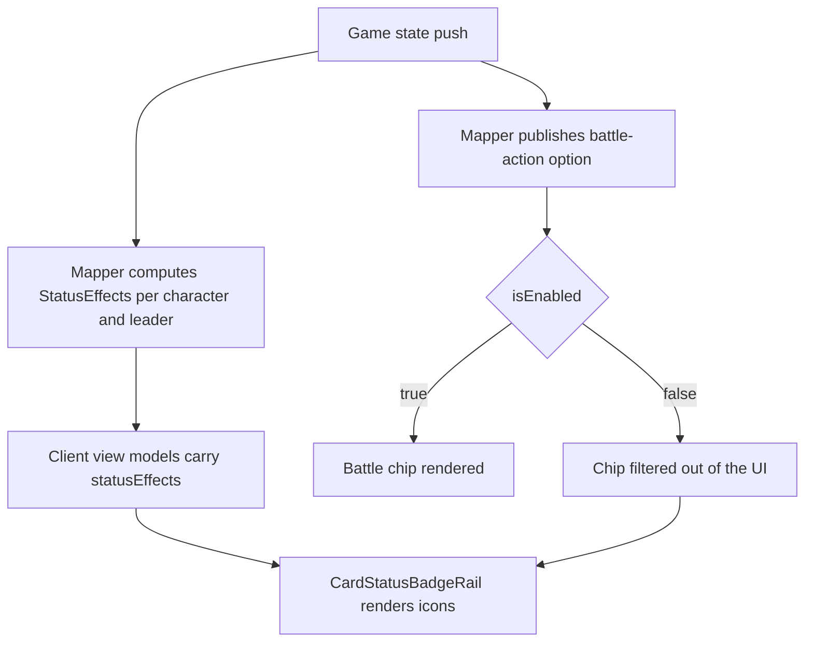

# Card status badges and Battle chip cleanup

## Goal

Make a card's live restrictions readable at a glance and stop offering an unusable Battle chip.

- Status badges at the bottom of battlefield cards (both sides) and both leaders: `Rush`, `Cannot Attack`, effect-immunity, effects-negated.
- `Cannot Attack` gets a tooltip that states the reason.
- The Battle chip is hidden whenever it cannot be used instead of rendering it greyed out.

## Why the server owns the status list

Statuses cannot be derived reliably on the client:

- `Rush` exists as a printed card condition, as a runtime keyword, and as a temporary keyword grant.
- Printed `Rush` must be ignored when the card's effects are suppressed on the field (N-003 shape).
- `Cannot Attack` and effect-immunity arrive as keyword modifications inside `AppliedCardEffects`.

Today only the server can answer "what is true for this card right now", through
[`CardRuntimeEffectStateService.ResolveEffectiveKeywords()`](server/Api/Services/Games/Effects/Support/CardRuntimeEffectStateService.cs:38) and
[`BattleActionRules`](server/Api/Services/Games/BattleActionRules.cs:19). The client would have to re-implement
suppression and duration rules to match, so the mapper publishes the answer instead.

## Server changes

1. New constants module (same folder as `EffectConditionKeywords`):

   | Code | Meaning |
   | --- | --- |
   | `Rush` | Card may attack the turn it entered the field |
   | `CannotAttack` | Card carries the `Cannot Attack` keyword |
   | `ImmuneToOpponentSupportEffects` | Card carries `Not Affected By Opponent Support Effects` |
   | `EffectsSuppressed` | Card's own effects are negated while it stays on the field |

2. `CardInstanceResponse` gains `StatusEffects` (`IReadOnlyList<string>`, default empty). `EnrichedCardInstanceResponse`
   and `LeaderCardInstanceResponse` inherit it, so one field serves characters and leaders.

3. Effective-keyword resolution gains a leader overload. `BattleActionRules.HasCannotAttackEffect()` becomes
   `internal` so the mapper reuses the exact same rule the Battle chip uses; `Rush` stays battlefield-only because
   it is meaningless for leaders.

4. `StatusEffects` carries objects (`{ kind, reasonCode, reason }`), not bare codes. The reason is only filled for
   `CannotAttack`, and it has to ride on the card: the mapper publishes card actions only to a card's owner, so the
   opponent's client has no disabled Battle option to read a reason from. The code is the same
   `BattleActionRules.ResolveRestrictionCode()` value the chip uses, so both screens explain a restriction the
   same way, and the client localises it.

5. New `GameStateResponseMapper.StatusEffects` partial builds the list for one card:

   - `Rush` from `BattleActionRules.HasRushKeyword(state, card)`.
   - `CannotAttack` when the card carries the keyword **or** when `BattleActionRules.ResolveRestriction()`
     reports any live restriction (first turn, rested, summoned this turn). The live check only runs for the card
     of the player who is actually acting: the opponent's board is not the acting side, and badging every opposing
     card would be noise. This is what replaces the greyed-out Battle chip - the card is never silent about why it
     cannot attack.
   - `ImmuneToOpponentSupportEffects` from the effective keyword set.
   - `EffectsSuppressed` from `SourceCardEffectSuppression.IsSuppressedWhileOnField(state, card)`.

6. Population scope: `CharacterField` for both players (the opponent's board is public information) and both leaders.
   Deck, hand, trash and support stay empty so hidden information is never leaked and payloads stay small.

## Client changes

1. Types: `statusEffects?: string[]` on [`IGameCardInstanceResponse`](client/src/services/api/types/game.ts:31) and
   [`IGameLeaderCardInstanceResponse`](client/src/services/api/types/game.ts:53), plus a `TCardStatusEffect` union.

2. View models: `statusEffects` on `INonLeaderCardViewModel` and `ILeaderCardViewModel`, filled in
   [`resolveNonLeaderCards()`](client/src/views/game/utils/functions/cards/index.ts:99) and
   [`resolveLeaderCard()`](client/src/views/game/utils/functions/cards/index.ts:54).

3. New `CardStatusBadgeRail` component: a bottom-anchored row of small icon chips using `lucide-react` (`Zap` for Rush,
   `Ban` for Cannot Attack, `ShieldCheck` for immunity, `CircleSlash` for effects negated). Each chip carries an
   `aria-label`, `data-testid="card-status-badges"` on the rail and `data-status-effect` per chip.

   Hovering or keyboard-focusing a chip opens a tooltip that names the status and explains it (the cannot-attack
   entry shows the server's own reason). The tooltip is portalled to `document.body` with fixed positioning because
   the card is `overflow-hidden` and the hover overlay sits above the rail, so an in-card tooltip would be clipped.
   Chips are `pointer-events-auto` and the rail sits at `z-30` so the pointer actually reaches them.

   Statuses appear and disappear on state pushes, which used to pop. Each chip is a `motion.span` inside an
   `AnimatePresence` (fade + slight scale, 180 ms in / 140 ms out, disabled under `prefers-reduced-motion`), and the
   rail itself stays mounted so the last chip can animate out instead of vanishing with its container. Each chip
   owns its tooltip, so a status removed mid-hover takes its explanation with it.

   A status that *replaces* another (the summon-turn lock turning into Rush on one push) is sequenced rather than
   cross-faded. The rail keeps an `admittedKey` beside the statuses the payload asks for: a departing kind drops out
   of the rendered list immediately so its exit starts, but an arriving kind is only admitted from the
   `AnimatePresence`'s `onExitComplete`, once the outgoing chip is really gone. Before that the arriving chip
   mounted alongside the half-faded one and then slid into its final slot when the other unmounted. Arrivals with
   no departure are admitted on the next tick, so ordinary appearances are unaffected. The order is pinned by
   [`conditional-rush`](e2e/gameview.multiplayer.conditional-rush.spec.ts:45), which records the rail's DOM
   mutations and asserts the `CannotAttack` removal precedes the `Rush` addition.

4. i18n: new `game.zone.status.*` keys for short labels, descriptions and aria text, following the existing
   [`game.zone`](client/src/i18n/en.json:317) block.

5. Rendering:

   - [`NonLeaderCardOverlay`](client/src/views/game/components/NonLeaderCardOverlay.tsx:14) renders the rail for
     battlefield cards, sitting above the `mixed` visibility strip and shifting up while the tribute requirement
     label is shown.
   - [`LeaderCard`](client/src/components/ui/cards/LeaderCard.tsx:37) renders it with a bottom offset that clears the
     Recovery flame button.

6. The chakra pool is responsive: it was the one card on the board pinned to a fixed rem width
   (`w-[2.22rem]` / `w-[2.32rem]`), so it ignored the viewport while every other card scaled. Its height now comes
   from the row, capped by a third of the row width through container query units
   (`h-[min(100cqh,calc((33cqw-1px)*277/200))]`), and the width follows from `PlayCard`'s aspect ratio. The pool
   scales with the board, keeps its card shape, and can never spill out of the fixed-width resource rail.

7. Position stability while picking targets. The real cause was in the stylesheet, not the rail:
   [`index.css`](client/src/index.css:435) forces every direct child of a target card to `position: relative`
   (`.battle-target-top > *, .battle-target-bottom > *`), and because that rule is emitted after the Tailwind
   utilities it beats the rail's `absolute`. The moment a card became a target - N-001's Activate Main pick paints
   its candidates as battle targets - the rail dropped into normal flow: measured 79px wide (the whole card) and
   14px *below* the card's bottom edge. `.card-status-badges` (and `.card-overlay-requirement-label`, which can hit
   the same rule) are now in the stylesheet's existing "stay absolute inside a target card" list.

   Two smaller stabilisers stayed: the rail is pinned to `bottom-0.5` with the requirement label moving above it
   (`bottom-6`) instead of shoving the badges up, and the effect-target chips have a fixed width (`w-[4.25rem]`) so
   "Select" → "Selected" no longer resizes them.

8. "No actions" is gone: a card with nothing to do renders an empty action list instead of a disabled placeholder
   chip. That retired the `card-no-actions-chip` element, the `showEmptyActionMessage` / `suppressActionFallback`
   overlay props, the hand row's `showNoActionsMessage` and the `game.zone.noActions` string. The status rail is
   what explains a card that has nothing to offer.

7. Battle chip removal: export the existing battle predicate from
   [`helpers.ts`](client/src/views/game/utils/functions/gameState/helpers.ts:88) and add a filter that drops
   `battle-action:` options whose `isEnabled` is false. Apply it to the rendered lists in `NonLeaderCardOverlay` and
   `LeaderCard`, and recompute `hasActions` and the action-count strip from the filtered list. The API payload keeps
   publishing the disabled option, because multiple e2e specs assert its `disabledReason`
   ([`conditional-rush`](e2e/gameview.multiplayer.conditional-rush.spec.ts:79),
   [`reveal-presentation`](e2e/gameview.multiplayer.reveal-presentation.spec.ts:450)) and the engine's
   "any legal action" probe must not change.

## Data drift found behind "conditional Rush stopped working"

The engine contract was never broken - the *stored* N-007 definition was. The dev database's
`card_catalog_entries.EffectsJson` for N-007 had its two conditional Rush nodes reading
`ZoneCardProperty.Damage` (stored ordinal 8) instead of `Power` (ordinal 7): `Damage < 10` for the remove variant
and `Damage >= 10` for the gain variant. Minato's damage is 2, so no power boost could ever satisfy the gain
variant, while the remove variant always matched - Rush could not be granted. The shipped seed
[`rawCardCatalogDump.txt`](server/Api/rawCardCatalogDump.txt) and every fresh database read `Power`, which is why
the whole e2e suite stayed green.

The row was corrected in place (`UPDATE 1`), and the catalog API now reports `Power < 10` / `Power >= 10`. Two tests
guard it from now on:

- [`ToGameStateResponse_OffersBattleAndRushStatus_WhenTheBoostCrossesTheThresholdOnTheSummonTurn`](server/tests/ProjectHiddenVillage.Server.Tests/GamePassiveKeywordConditionTests.cs:161)
  pins the engine + payload contract for a summon-sick card.
- [`ConditionalRushRules_AreAuthoredAgainstPower`](server/tests/ProjectHiddenVillage.Server.Tests/SeedManifestAuthoringTests.cs:115)
  pins the seed data: any Rush node whose threshold reads `Damage` fails the suite.

Note for the seeders: they deliberately keep stored cards, so an edited definition survives restarts.

### The same drift hit nine more cards

Auditing every stored row against the dump showed N-007 was not special: every `ZoneCardProperty` predicate
written before commit `3386813` was one ordinal high, because that commit removed `OriginalId` from the middle of
the enum while the members were numbered implicitly. The audit compared all 37 rows field by field (names in the
dump against ordinals in the database) and found 27 drifted predicates on ten cards:

| Card | Drifted predicates |
| --- | --- |
| N-003 | `Name` x2 (target rules), `Power` (summon requirement) |
| N-005 | `Name` (target rule), `Power` (trait requirement) |
| N-006 | `Is Rested` (KO targets) |
| N-007 | `Power` x2 (repaired earlier) |
| N-011 | `Name` x2 + `Name` x4 (Choji/Shikamaru condition and team targets) |
| N-013 | `Trait` x3 (reveal post-condition) |
| N-014 | `Trait` (generic material rule) |
| N-017 | `Is Rested` (KO targets) |
| N-018 | `Type` (target rule) |
| N-019 | `Name`, `Trait`, `Type` (search reveals) |
| N-022 | `Type` x4 (reveal post-condition) |

Every one read as the next-door member: `Trait` where `Name` was authored, `Damage` where `Power` was, `Color`
where `Type` was, `CannotBeNormalSummoned` where `Is Rested` was. N-011 is the clearest symptom: its
`[Activate: Main]` needs a `Choji Akimichi` and a `Shikamaru Nara` on the field, so with `Name` reading as
`Trait` the condition never held and its team was never a legal target - no Rush, no selectable cards.

The rows were repaired from the dump rather than by arithmetic: each predicate's authored name is mapped to the
ordinal the current enum assigns it, so the repair is path-aware and idempotent (a predicate already stored with
the right number is left alone). Re-running the audit reports zero differences across all 37 cards, and
`POST /api/card/catalog/by-ids` now returns `Name`/`Is Rested`/`Type` for the repaired cards.

### Preventing the next silent remap

`ZoneCardProperty` now spells out its ordinals instead of relying on declaration order, and
[`StoredEffectEnumContractTests`](server/tests/ProjectHiddenVillage.Server.Tests/StoredEffectEnumContractTests.cs:1)
pins both it and the hand-maintained `RuntimeEffects` gap (6/7 are retired and must stay empty). Adding a member
can no longer renumber the values stored rows already use; it now needs an unused number and a deliberate test
update. Storing enum *names* in `EffectsJson` (the reader already accepts both) remains the long-term cleanup.

A game keeps the cards it resolved when it was created
([`ToRuntimeCard`](server/Api/Services/Games/GameRuntimeDeckService.cs:20)), so a board started before the repair
still shows the old definitions until a new game is started.

## Regression guard: conditional Rush on the summon turn

N-007's conditional Rush is the one rule the status work can plausibly be blamed for, so it is pinned at the API
boundary: [`ToGameStateResponse_OffersBattleAndRushStatus_WhenTheBoostCrossesTheThresholdOnTheSummonTurn`](server/tests/ProjectHiddenVillage.Server.Tests/GamePassiveKeywordConditionTests.cs:161)
runs the real passive pipeline on a card that entered the field this turn, boosts its power over the threshold and
asserts the published payload: power 10, the `battle-action` enabled, the `Rush` status present and `CannotAttack`
gone. The e2e counterpart is [`conditional-rush`](e2e/gameview.multiplayer.conditional-rush.spec.ts:45), which
does the same through N-001's Activate Main and then actually declares the attack.

## Behaviour after the change

## Verification

- `CardStatusEffectsMappingTests` covers every status code: printed Rush, Rush voided by suppression, temporary
  Rush grant, frozen character, frozen leader, immunity keyword, the suppression flag, summoned-this-turn,
  opponent cards staying clean, and hand/support/trash carrying nothing.
- Existing specs were extended instead of duplicating their fixtures:
  [`conditional-rush`](e2e/gameview.multiplayer.conditional-rush.spec.ts:79) asserts the summon-sick card shows
  `CannotAttack` with no Battle chip, the opponent's board shows the same badge, and the granted Rush badge replaces
  it once the card can attack; [`reveal-presentation`](e2e/gameview.multiplayer.reveal-presentation.spec.ts:450)
  asserts the frozen leader badge with the Battle chip gone while the payload keeps publishing the reason.
- Suites re-run green: `conditional-rush`, `reveal-presentation`, `leader-battle`, `character-ability`,
  `quick-support`, `actions`, `battle-visuals`, `attack-sequence`, `support`, `gameview`, plus the full server suite.

## Related fix: the hub now survives a RESTART instead of wedging the board

While this change was being applied the running API restarted under a live session (`dotnet watch`) and the
game board came up with the starting-player prompt permanently disabled. The cause was independent of the badges:
[`useGameHubState`](client/src/views/game/hooks/GameHub/useGameHubState.ts:157) only tried the hub handshake three
times, 600 ms apart, and then gave up forever. A rebuild or a deploy outlasts that, and nothing retried afterwards,
so every control that depends on `isConnected` stayed inert until a manual reload.

The connect loop now retries with a capped backoff (500 ms doubling to 10 s) until it succeeds or the view
unmounts, `onclose` restarts the loop after `withAutomaticReconnect` gives up, and the event handlers are
registered once per connection instead of once per attempt. [`GamePromptOverlay`](client/src/views/game/components/GamePromptOverlay.tsx:99)
also explains the transient state instead of leaving unexplained disabled buttons.

[`gameview.multiplayer.hub-recovery.spec.ts`](e2e/gameview.multiplayer.hub-recovery.spec.ts:19) fails the prompt
owner's first three negotiate requests - one more than the old attempt budget - and asserts the options unlock
without a reload.

A board that is merely cut off now also says so: the connected-but-unloadable case (an API restart drops the
in-memory game) raises the real reason in the action-error banner instead of retrying forever.

## Related fix: the e2e stack must not build into the dev stack's output

Diagnosing the above turned up the reason the dev API kept dying: `scripts/e2e-start-server.sh` used `dotnet ef`
and `dotnet run` with the default configuration, i.e. it built into `server/bin/Debug/net10.0` - the exact output
a live `dotnet watch` dev server is executing from. Every Playwright run therefore restarted or killed the
developer's game server, and any in-memory game with it. The script now restores, migrates and runs in **Release**,
so the two stacks never share build output. Verified end to end: the dev API answered `/api/health` with the same
PID before and after a full spec run.
