# Deck win/loss records

## Goal

A player should be able to see how a deck has done for them before picking it: wins, losses, draws and a win rate, shown
where the deck is selected and kept per player rather than per deck.

- A saved deck that was never played simply has no record (0/0/0), not a missing feature.
- The metrics belong to the player, not to the deck row. Public decks are played by many players, so the same deck can
  have a different record for each of them.
- No record is kept for a guest identity, and nothing is kept for an imported list used ad hoc (that path creates an
  ordinary user deck, so it gets records like any other saved deck).

## Why a separate table, not a column on `decks`

`decks` already holds both saved and public decks ([`Deck.cs`](../server/Data/Entities/Decks/Deck.cs:9)). A
`Wins`/`Losses` column there would answer "how many times was this deck played" globally, which is the opposite of what
is wanted: one public deck's games come from different players. Keying the record on `(DeckId, UserId)` gives each
player their own row for the same deck and makes "never played" simply the absence of a row.

## Where the result is recorded

Not in the hub or the phase service: a game can end with no client call at all. The action-clock watchdog resolves the
forfeit in [`OnClockDeadline()`](../server/Engine/Services/InMemoryGameInstanceRegistry.cs:3400), so anything wired to
the transport would silently miss every timeout ending. The single first observation of an outcome is the registry
boundary, which is also where [`GameEndRules.EnsureGameEndLogged()`](../server/Api/Services/Games/GameEndRules.cs:119)
already records the end in the action log.

```mermaid
flowchart LR
    A[Player picks deck] --> B[Game created or joined]
    B --> C[Seat remembers its deck id]
    C --> D[Game ends: leader defeat, deck out, forfeit, clock]
    D --> E[EnsureGameEndLogged]
    E --> F[RecordDeckResultsIfNeeded]
    F --> G[One upsert per seated player]
    G --> H[deck_records wins losses draws]
    H --> I[Deck listing carries the viewer record]
    I --> J[Picker option and summary line]
```

## Server changes

1. **Table.** [`DeckRecord`](../server/Data/Entities/Decks/DeckRecord.cs:12) with `DeckId`, `UserId`, `Wins`,
   `Losses`, `Draws` and `UpdatedAtUtc`; [`DeckRecordConfiguration`](../server/Data/Configurations/Decks/DeckRecordConfiguration.cs:7)
   makes `(DeckId, UserId)` the primary key, cascades from both `decks` and `users`, and checks the counters are never
   negative. Migration: `AddDeckRecords`.

2. **Deck identity on the seat.** [`Player.DeckId`](../server/Models/Player/Player.cs:22) is filled by
   [`ResolvePlayerDeckData()`](../server/Api/Services/Games/GameReadService.cs:161), which is the one place every
   seating path goes through (host, join, rematch claim, quickmatch). The registry copies it onto
   [`GameInstance.PlayerDeckIds`](../server/Models/Game/GameInstance.cs:75) at creation and join. It is instance
   metadata like `Ruleset`, deliberately not part of `GameState`, so redo snapshots and the state fingerprint are
   untouched.

3. **Recorder.** [`IGameResultRecorder`](../server/Api/Interfaces/Deck/IGameResultRecorder.cs:13) is implemented by
   [`GameResultRecorder`](../server/Api/Services/Deck/GameResultRecorder.cs:23): one atomic PostgreSQL upsert per player
   (`INSERT ... SELECT ... FROM users WHERE NOT users."IsGuest" ON CONFLICT ("DeckId", "UserId") DO UPDATE ...`).
   A read-modify-write would drop one of two games on the same deck finishing at the same instant. The upsert also
   carries the eligibility rules: a guest has no row, a missing user has no row, and a deleted deck fails the foreign
   key, which is a no-op rather than an error. Failures are logged and swallowed - the match is already over.

4. **Once per game.** `GameInstance.IsResultRecorded` is set before the write is started, and the registry calls
   [`RecordDeckResultsIfNeeded()`](../server/Engine/Services/InMemoryGameInstanceRegistry.cs:3614) at every ending:
   resignation, pool exhaustion, the deadline forfeit, and the mutation-boundary evaluation. Rematches are new
   instances, so they count again; observations of the same finished game do not.

5. **Response.** [`DeckResponse.Record`](../server/Models/Api/DeckRequests.cs:19) is nullable; `GetDecks` takes the
   viewer id and joins `deck_records` for that player only
   ([`LoadViewerRecordsAsync()`](../server/Api/Services/Deck/DeckService.cs:457)). The controller resolves the viewer
   from the token ([`DeckController`](../server/Api/Controllers/DeckController.cs:108)): the listing stays anonymous, but
   a record is only ever returned when the caller is the player it belongs to. Without that, `?userId=` would let
   anyone read anyone's record.

6. **Reset when the leader changes.** [`UpdateDeckAsync()`](../server/Api/Services/Deck/DeckService.cs:241) compares
   the set of leader card ids the deck has with the set the save brings. Only a different leader deletes every record
   for that deck, in the same `SaveChangesAsync` as the card reconciliation. Ratios, tech cards and the name are
   deliberately outside the comparison: a player tuning a list they have already played should not lose what it earned
   on the way, and being stingy here made the record misleading. The delete is by deck, not by owner: a public deck's
   leader change is a new identity for everyone who played the old one. [`DeckResponse.LeaderCardId`](../server/Models/Api/DeckRequests.cs:19)
   exposes the stored leader so the client can warn before saving.

## Client changes

- [`IDeckResponse.record`](../client/src/types/deck.ts:23) mirrors the server shape.
- The picker option carries the record as a **trailing badge** rather than as part of the name, built by
  [`toDeckChoices()`](../client/src/views/login/LoginView.tsx:1864) and
  [`formatDeckRecordSuffix()`](../client/src/views/login/LoginView.tsx:1910). A long name truncates without eating the
  numbers, and because `FormSelect` renders `trailing` in the collapsed control as well, the record stays visible while
  the list is open and after a deck is chosen.
- A saved deck always shows its counters - a deck nobody has played reads `0W–0L`, because "no games yet" is part of
  what the player is choosing between. The public list passes `showEmptyRecord: false`, so untouched public decks stay
  plain and only played ones carry the badge.
- A deck that only ever drew shows `2D`, because `0%` next to one draw would read as a losing streak.
- The selected deck's summary line shows the spelled-out form
  ([`describeDeckRecord()`](../client/src/views/login/LoginView.tsx:1935)) as `login-deck-record`. A deck that was
  never played reads `No games yet`, not `0%`.
- The win rate is `wins / (wins + losses)`: a draw is not a defeat, so it never lowers the percentage.

## Editing a saved deck (overwrite through the import flow)

A player can rewrite one of their own decks without the admin deck manager: the pencil on the picker row opens the
import dialog with the deck's list loaded and turns Save into an overwrite.

- **Same code path as importing.** The import tab is the editor: its parser, its ruleset evaluation, its card metadata
  query and its dialog are reused unchanged, so an overwrite is judged by exactly the rules a new deck would be.
  [`DeckImportDialog`](../client/src/views/login/components/DeckImportDialog.tsx:10) gained `editDeckName` and
  `leaderWillResetRecord`: the title and primary button say "overwrite", Use is hidden, and the old name hint is gone.
- **The draft is the player's.** Opening the editor snapshots `deckOptionsByMode.import`; saving or cancelling writes it
  back (and back to the `phv-imported-deck` cache). Switching tabs by hand while editing is a cancel, so no orphan
  editor state survives.
- **The warning is honest.** The client compares the deck's `leaderCardId` with the leader in the edited list (read from
  the same catalog metadata the ruleset evaluation uses) and shows an inline warning only when they differ, waiting for
  the metadata so it cannot flash while the cards resolve. The success toast names the reset only when the returned
  record shows it actually happened.
- **Authorization.** `PUT /api/deck/{deckId}` was admin-only too; it is now authentication-only with the ownership
  decision in the service, the same shape as delete. The name length limit is enforced now that players can rename.
- **Response.** `GetDeck` takes the viewer id, so `UpdateDeckAsync` answers with the caller's own record - a leader swap
  shows its reset immediately, a ratio tweak keeps the badge.

## Deleting a saved deck from the picker

A player can remove one of their own decks from the list they pick it from: an X on the row, a confirmation, then the
removal. The pieces:

- **Authorization was the real gap.** `DELETE /api/deck/{deckId}` was admin-only, so a player could not remove their
  own deck at all. The endpoint is now authentication-only and the ownership decision moved into
  [`DeleteDeck()`](../server/Api/Services/Deck/DeckService.cs:291): the owner may delete their deck, an administrator
  may delete any, and a public deck (which belongs to nobody) needs the administrator. The refusal is a real
  `Error.Forbidden`, mapped to a 403 in [`ApiControllerBase`](../server/Api/Controllers/ApiControllerBase.cs:12) rather
  than collapsed into a 400.
- **The record goes with the deck.** `deck_records` cascades from `decks`, so deleting a deck removes its record. That
  is deliberate: a record without the list it describes is meaningless.
- **A deck still used by a stored game is refused.** The existing `Deck.Delete.InUse` conflict stays; the client keeps
  the deck and reports it, because silently dropping a deck the player can still see would be worse than the error.
- **The actions need a component change.** [`FormSelect`](../client/src/components/forms/FormSelect.tsx:98) used to
  render each option as a single button, so an X inside it would have been a nested button (invalid markup) and would
  have selected the row on its way to the action. Options may now carry `actions` (edit and delete), each rendered as a
  sibling button inside the row, and only the saved-deck list supplies them - a public deck is nobody's to rewrite or
  remove.
- **Only the id is held while confirming.** [`LoginView`](../client/src/views/login/LoginView.tsx:176) keeps
  `deckPendingDeletionId` and reads the deck from the list that is on screen, so the dialog can never act on a stale
  copy. On success the deck leaves the list, the choices and the preloaded card caches, and the selection is cleared if
  it pointed at the deleted deck; on failure the dialog stays open so the player can retry or cancel.

## Decisions that did not follow from the request

- **Draws.** A game can end with no winner (both leaders fall at once and every tiebreak ties), which is neither a win
  nor a loss. Stored as a third counter and shown separately.
- **Every mode counts.** Host/invite, quickmatch and rematch all end through the same path, and a forfeit or a clock
  ending is a real result. There is no mode filter.
- **Abandoned tables count nothing.** No outcome, no record; the reaper retires the table silently.
- **Guests are skipped**, matching the documented rule that a guest owns nothing durable
  ([`User.IsGuest`](../server/Data/Entities/Users/User.cs:18)). Their rows could not survive the retention sweeper
  anyway.
- **Imported lists.** The import tab already creates an unnamed user deck row, so it accumulates a record and later
  shows up in the saved list. Accepted; naming or flagging those rows is a follow-up.

## Known follow-ups

- Two accounts can trade forfeits to inflate a deck's record. A unique-opponent rule or a per-day cap is the fix.
- Game codes are reused after retirement, so idempotency lives on the live instance and not on a game-id ledger. A
  future match-history table would need its own instance id.
- The overwrite path has no e2e that actually saves: a save needs a deck that is legal in an active format, which the
  mocked picker cannot provide without also mocking the ruleset and catalog endpoints. The server tests cover the
  overwrite and the reset; the client spec covers entering the editor, the loaded list and the draft restore.

## Tests

- `GameResultRecorderTests`: win/loss, accumulation, draw, guest skip, no outcome, seat without a stored deck.
- `GameDeckResultRecordingTests`: deck ids remembered on create and join, forfeit hands the game over once, a running
  game is never handed over, legacy deck-less seats stay uncredited.
- `DeckRecordTests`: the record travels only to its owner, a public deck keeps one row per player, unplayed decks have
  no record, the reset fires when the leader changes but not on a rename, an unchanged list or a ratio tweak, and an
  edit from another player is refused.
- Server deletion tests: the owner's deck and its record are removed, another player is refused, an admin can remove a
  public deck, and a deck assigned to a game still returns the conflict.
- `e2e/login.deck-records.spec.ts`: picker option badges (played, draws-only and never-played) plus the collapsed
  control and summary rendering, against a mocked deck listing.
- `e2e/login.deck-delete.spec.ts`: the X exists only on saved decks, never moves the selection, asks for confirmation,
  and removes the deck on confirm while the other deck stays selected.
- `e2e/login.deck-edit.spec.ts`: the pencil opens the import tab loaded with the deck's list and name, offers no Use,
  and gives the player's import draft back on cancel while keeping the deck selected.
