# Deck win/loss records

## Goal

A player should be able to see how a deck has done for them before picking it: wins, losses, draws and a win rate, shown
where the deck is selected and kept per player rather than per deck.

- A saved deck that was never played simply has no record (0/0/0), not a missing feature.
- The metrics belong to the player, not to the deck row. Public decks are played by many players, so the same deck can
  have a different record for each of them.
- No record is kept for a guest identity, and nothing is kept for an imported list used ad hoc (that path creates an
  ordinary user deck, so it gets records like any other saved deck).

## Why a separate table, not a column on `decks`

`decks` already holds both saved and public decks ([`Deck.cs`](../server/Data/Entities/Decks/Deck.cs:9)). A
`Wins`/`Losses` column there would answer "how many times was this deck played" globally, which is the opposite of what
is wanted: one public deck's games come from different players. Keying the record on `(DeckId, UserId)` gives each
player their own row for the same deck and makes "never played" simply the absence of a row.

## Where the result is recorded

Not in the hub or the phase service: a game can end with no client call at all. The action-clock watchdog resolves the
forfeit in [`OnClockDeadline()`](../server/Engine/Services/InMemoryGameInstanceRegistry.cs:3400), so anything wired to
the transport would silently miss every timeout ending. The single first observation of an outcome is the registry
boundary, which is also where [`GameEndRules.EnsureGameEndLogged()`](../server/Api/Services/Games/GameEndRules.cs:119)
already records the end in the action log.

```mermaid
flowchart LR
    A[Player picks deck] --> B[Game created or joined]
    B --> C[Seat remembers its deck id]
    C --> D[Game ends: leader defeat, deck out, forfeit, clock]
    D --> E[EnsureGameEndLogged]
    E --> F[RecordDeckResultsIfNeeded]
    F --> G[One upsert per seated player]
    G --> H[deck_records wins losses draws]
    H --> I[Deck listing carries the viewer record]
    I --> J[Picker option and summary line]
```

## Server changes

1. **Table.** [`DeckRecord`](../server/Data/Entities/Decks/DeckRecord.cs:12) with `DeckId`, `UserId`, `Wins`,
   `Losses`, `Draws` and `UpdatedAtUtc`; [`DeckRecordConfiguration`](../server/Data/Configurations/Decks/DeckRecordConfiguration.cs:7)
   makes `(DeckId, UserId)` the primary key, cascades from both `decks` and `users`, and checks the counters are never
   negative. Migration: `AddDeckRecords`.

2. **Deck identity on the seat.** [`Player.DeckId`](../server/Models/Player/Player.cs:22) is filled by
   [`ResolvePlayerDeckData()`](../server/Api/Services/Games/GameReadService.cs:161), which is the one place every
   seating path goes through (host, join, rematch claim, quickmatch). The registry copies it onto
   [`GameInstance.PlayerDeckIds`](../server/Models/Game/GameInstance.cs:75) at creation and join. It is instance
   metadata like `Ruleset`, deliberately not part of `GameState`, so redo snapshots and the state fingerprint are
   untouched.

3. **Recorder.** [`IGameResultRecorder`](../server/Api/Interfaces/Deck/IGameResultRecorder.cs:13) is implemented by
   [`GameResultRecorder`](../server/Api/Services/Deck/GameResultRecorder.cs:23): one atomic PostgreSQL upsert per player
   (`INSERT ... SELECT ... FROM users WHERE NOT users."IsGuest" ON CONFLICT ("DeckId", "UserId") DO UPDATE ...`).
   A read-modify-write would drop one of two games on the same deck finishing at the same instant. The upsert also
   carries the eligibility rules: a guest has no row, a missing user has no row, and a deleted deck fails the foreign
   key, which is a no-op rather than an error. Failures are logged and swallowed - the match is already over.

4. **Once per game.** `GameInstance.IsResultRecorded` is set before the write is started, and the registry calls
   [`RecordDeckResultsIfNeeded()`](../server/Engine/Services/InMemoryGameInstanceRegistry.cs:3614) at every ending:
   resignation, pool exhaustion, the deadline forfeit, and the mutation-boundary evaluation. Rematches are new
   instances, so they count again; observations of the same finished game do not.

5. **Response.** [`DeckResponse.Record`](../server/Models/Api/DeckRequests.cs:19) is nullable; `GetDecks` takes the
   viewer id and joins `deck_records` for that player only
   ([`LoadViewerRecordsAsync()`](../server/Api/Services/Deck/DeckService.cs:457)). The controller resolves the viewer
   from the token ([`DeckController`](../server/Api/Controllers/DeckController.cs:108)): the listing stays anonymous, but
   a record is only ever returned when the caller is the player it belongs to. Without that, `?userId=` would let
   anyone read anyone's record.

6. **Reset on a changed list.** [`UpdateDeckAsync()`](../server/Api/Services/Deck/DeckService.cs:241) compares the
   requested cards with the stored ones. When they differ it deletes every record for that deck in the same
   `SaveChangesAsync` as the card reconciliation, so a record always describes the list that earned it. A pure rename,
   or a save that sends the same list back, keeps the record. The delete is by deck, not by owner: editing a public deck
   changes its identity for everyone who played it.

## Client changes

- [`IDeckResponse.record`](../client/src/types/deck.ts:23) mirrors the server shape.
- The picker option carries a compact line (`Deck name · 7W–3L (70%)`), built by
  [`formatDeckRecordSuffix()`](../client/src/views/login/LoginView.tsx:1811). A deck with no record keeps its plain
  name; a deck that only ever drew shows `2D` because `0%` next to one draw would read as a losing streak.
- The selected deck's summary line shows the spelled-out form
  ([`describeDeckRecord()`](../client/src/views/login/LoginView.tsx:1837)) as `login-deck-record`. A deck that was
  never played reads `No games yet`, not `0%`.
- The win rate is `wins / (wins + losses)`: a draw is not a defeat, so it never lowers the percentage.

## Decisions that did not follow from the request

- **Draws.** A game can end with no winner (both leaders fall at once and every tiebreak ties), which is neither a win
  nor a loss. Stored as a third counter and shown separately.
- **Every mode counts.** Host/invite, quickmatch and rematch all end through the same path, and a forfeit or a clock
  ending is a real result. There is no mode filter.
- **Abandoned tables count nothing.** No outcome, no record; the reaper retires the table silently.
- **Guests are skipped**, matching the documented rule that a guest owns nothing durable
  ([`User.IsGuest`](../server/Data/Entities/Users/User.cs:18)). Their rows could not survive the retention sweeper
  anyway.
- **Imported lists.** The import tab already creates an unnamed user deck row, so it accumulates a record and later
  shows up in the saved list. Accepted; naming or flagging those rows is a follow-up.

## Known follow-ups

- Two accounts can trade forfeits to inflate a deck's record. A unique-opponent rule or a per-day cap is the fix.
- Game codes are reused after retirement, so idempotency lives on the live instance and not on a game-id ledger. A
  future match-history table would need its own instance id.
- The deck editor is admin-only today, so in practice the reset fires there; if players ever edit saved decks, the same
  path already does the right thing.

## Tests

- `GameResultRecorderTests`: win/loss, accumulation, draw, guest skip, no outcome, seat without a stored deck.
- `GameDeckResultRecordingTests`: deck ids remembered on create and join, forfeit hands the game over once, a running
  game is never handed over, legacy deck-less seats stay uncredited.
- `DeckRecordTests`: the record travels only to its owner, a public deck keeps one row per player, unplayed decks have
  no record, and the reset fires on a card change but not on a rename or an unchanged list.
- `e2e/login.deck-records.spec.ts`: picker option and summary rendering against a mocked deck listing.
