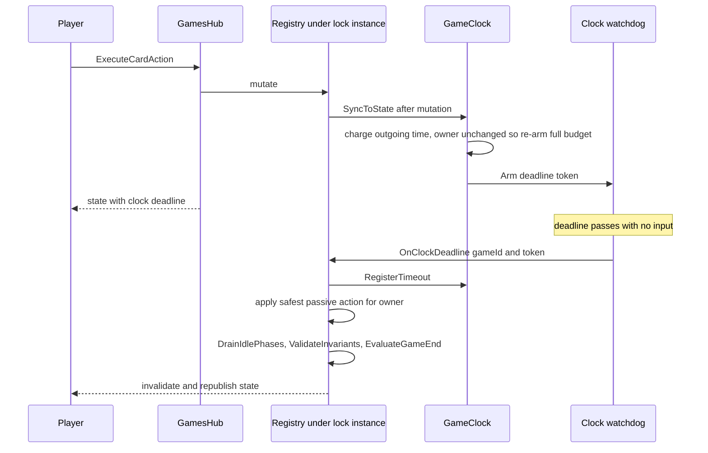

# Game action clocks: per-phase timeouts, per-player pools, stall forfeiture

## Goal

Every interactive stop in a game is timed, so a player cannot hold the table by walking away. The engine
owns the clock, exactly as it already owns the non-interactive phases (see
[`plans/server-owned-phase-transitions.md`](plans/server-owned-phase-transitions.md:1)), and the client
only renders a countdown it is told about.

Settled requirements:

| Rule | Value (defaults, all ruleset-configurable) |
|---|---|
| Per-player clock pool for the whole game | 30 minutes each; exhausting a pool loses the game |
| Main phase budget | 60 seconds per stop |
| Every other interactive stop (prompt, optional On-Attack choice, ActionStep / support reaction window) | 30 seconds per stop |
| System-driven steps (drain-owned phases, phase presentation acks) | no budget at all |
| Any accepted action by the clock owner | refreshes the stop to its full budget |
| Consecutive timeouts with no input | 3, then the opponent wins regardless of board state |

## Decisions taken

1. **The 30-minute cap is a per-player pool**, not a shared wall clock. A player whose pool reaches zero
   loses immediately with a new end reason, so a game can never outlive 60 minutes of table time and a
   stall costs the staller their own pool first.
2. **A timeout only ever yields or declines on the player's behalf.** The engine will never spend a
   resource, move a card, declare an attack, activate a support or pick a target for a stalled player; the
   complete set of things a timeout may do is end the main phase, pass the cut-in, pass the support window,
   decline the optional On-Attack choice, or answer a setup prompt with its no-op option. A stop whose only
   answers change the board is not auto-answered at all: it counts a strike and re-arms, so a present player
   loses only time while an absent one forfeits. Anything the player submits resets their strike count to zero.
3. **The clock follows whoever the engine is currently waiting on.** During the attack cut-in and the
   MainPhase support reaction window that is the priority player, so the clock hands over to the player
   being asked and hands back when they answer.
4. **The values live on the existing deck/game ruleset** the host already selects when creating a game
   ([`DeckRuleset.cs`](server/Data/Entities/Decks/DeckRuleset.cs:3)). A seeded `Time Relaxed` ruleset turns
   the clock off; a future `Ranked` ruleset can tighten it. Games created without a ruleset fall back to a
   server-wide default policy from configuration.

## Clock model

### Policy snapshot

```csharp
public sealed record GameClockPolicy(
    bool Enabled,
    TimeSpan MainPhaseBudget,        // 60s
    TimeSpan OtherPhaseBudget,       // 30s
    TimeSpan PlayerPoolBudget,       // 30 min per player
    int TimeoutsBeforeForfeit,       // 3
    bool RefreshOnAction);           // true: an owner action re-arms the full budget
```

The policy is **snapshotted onto the instance** when the game is created, so editing a ruleset never
retroactively changes a running game. It travels in
[`GameRulesetBinding`](server/Models/Game/GameInstance.cs:7) (which becomes
`GameRulesetBinding(Id, Key, Name, GameClockPolicy Clock)`), and a game with no ruleset binding gets the
policy from `GameClockOptions`.

### State

New [`server/Models/Game/GameClock.cs`](server/Models/Game/GameClock.cs:1), owned by the instance and only
mutated under `lock (instance)`:

- `remainingPoolByPlayerId` — the 30-minute pools, charged as the owner's clock runs.
- `consecutiveTimeoutsByPlayerId` — the strike counters, reset by that player's own input.
- `OwningPlayerId` + `ClockStopKind` (`MainPhase`, `OtherStep`, `None`).
- `DeadlineUtc` + `DeadlineToken` — the token is bumped on every re-arm, and the watchdog refuses to fire
  for a stale token (the same discipline the presentation watchdog uses).

### Owner resolution

One helper resolves all of it from live state, so the clock can never disagree with the board:

| State | Clock owner | Kind |
|---|---|---|
| `PendingPhasePresentation` outstanding | none | `None` |
| No prompt, phase is `ShouldAutoAdvance` (engine is draining) | none | `None` |
| Game over (`state.Outcome` set) | none | `None` |
| Pending prompt of any type | `prompt.RequestedPlayerId` | `OtherStep` |
| Open support reaction window | `PriorityPlayerId` | `OtherStep` |
| `ActionStep` | `PriorityPlayerId` | `OtherStep` |
| `AttackDeclaration` with the optional On-Attack choice | `ActivePlayerId` | `OtherStep` |
| `MainPhase` | `ActivePlayerId` | `MainPhase` |

On an owner or kind change the deadline is re-armed to the full budget, and the outgoing owner is charged
for the time they actually used.

### Lifecycle



`SyncToState` runs at **every mutation boundary**, next to the existing
`ValidateInvariants`/`EvaluateGameEnd` bookkeeping in
[`InMemoryGameInstanceRegistry.cs`](server/Engine/Services/InMemoryGameInstanceRegistry.cs:2626), on create,
join, prompt resolution, every card action, pass/action declaration, end step, phase acknowledgement and
the presentation-timeout resume. The clock is armed when the game actually starts (the second player
joins), never while the drain is walking system phases.

### Timeouts

On deadline:

1. Verify the token and that the owner is still owed input; otherwise re-sync and stop.
2. Record `phase_timed_out` in the action log (owner, phase, remaining pool, strike count).
3. Increment the owner's strike count. At `TimeoutsBeforeForfeit` resolve the game through
   [`GameEndRules.cs`](server/Api/Services/Games/GameEndRules.cs:15) with the new
   `GameEndReason.ForfeitByTimeout`, winner = the other player.
4. Otherwise apply the **yield-only** timeout matrix for the owner, then continue the normal drain:

   | Stop | What a timeout does | What it must never do |
   |---|---|---|
   | `MainPhase` | `DeclareEndStep`, then drain | play, set, summon, activate or attack |
   | Open support reaction window | `DeclarePassInSupportWindow` | activate a support or answer the chain |
   | `ActionStep` | `DeclarePassInActionStep`, drain if the window closed | declare an action, rest the attacker, pick a target |
   | Optional On-Attack choice | the existing `resolve-optional-attack-effect:<card>:decline` path | accept the effect or choose its target |
   | `Mulligan` prompt | `noMulligan` | redraw |
   | `ChooseStartingPlayer` prompt | `goSecond`, the zero-advantage option | anything that gains tempo |
   | Effect selection prompt | nothing, by design | choose cards the player never chose |

5. A stop that has no yield answer is not auto-resolved: the strike is recorded, the same stop re-arms with
   a full budget for the same owner, and the next two expiries forfeit the game. This is what keeps a live
   but slow player from being punished with a random board change while still removing an absent one.
6. If the owner's pool is exhausted by that charge, resolve with `GameEndReason.ClockExpired` (winner =
   the other player) instead of continuing.
7. Re-`SyncToState`, validate invariants, evaluate game end, notify the group through
   [`IGameStateBroadcaster`](server/Api/Interfaces/Game/IGameStateBroadcaster.cs:1).

`GameEndRules` gains `ResolveForfeit(state, losingPlayerId, reason)` (reusing `ClearPendingInteraction`),
two new `GameEndReason` members, and wording in `DescribeOutcome`.

## Publishing to the client

New payload member on [`GameStateResponse`](server/Models/Api/GameStateResponses.cs:3):

```csharp
public sealed record GameClockResponse(
    bool IsEnabled,
    string? OwningPlayerId,
    string StopKind,                 // MainPhase | OtherStep | None
    string? DeadlineUtc,             // null while the clock is stopped
    string ServerNowUtc,             // lets the client correct for clock skew
    int? SecondsRemainingInStop,
    IReadOnlyList<GameClockPlayerResponse> Players);  // playerId, pool seconds left, strikes, forfeitAt
```

`Clock` is `null` (or `IsEnabled = false`) for an untimed ruleset and after the game ends, so the client
never renders a countdown it cannot trust. A new partial
`GameStateResponseMapper.Clock.cs` projects it, mirroring the existing partials.

## Client

- [`client/src/services/api/types/game.ts`](client/src/services/api/types/game.ts:194): add
  `IGameClockResponse` / `IGameClockPlayerResponse` and `clock?: IGameClockResponse | null`.
- New pure helper `client/src/views/game/utils/functions/gameState/gameClock.ts`: remaining-time math from
  `(deadlineUtc, serverNowUtc, receivedAt, now)`, formatting, and the "under 10 seconds" warning flag.
- New `useGameClockCountdown` hook (250 ms tick, stops when no deadline) feeding the badge.
- New `GameClockBadge` component rendered next to the phase chip in
  [`GamePhaseIndicator.tsx`](client/src/views/game/components/GamePhaseIndicator.tsx:6) so it stays visible
  while acting: local countdown, both players' pools, strike pips, and a warning state for the last strike.
  Hidden when the clock is disabled or the game is over. All strings go through `react-i18next`.
- Admin ruleset editor: add the five clock fields to
  [`useDeckRulesetAdminModel.ts`](client/src/views/admin/model/useDeckRulesetAdminModel.ts:260) and its
  editor component, plus the `IDeckRuleset` / create / update request types.

## Ruleset plumbing

- [`DeckRuleset.cs`](server/Data/Entities/Decks/DeckRuleset.cs:3): `ClockEnabled`, `MainPhaseSeconds`,
  `OtherPhaseSeconds`, `PlayerPoolSeconds`, `TimeoutsBeforeForfeit`.
- [`DeckRulesetDefinition`](server/Api/Services/Deck/DeckRulesetRules.cs:7): carry `GameClockPolicy Clock`.
- [`DeckRulesetService.cs`](server/Api/Services/Deck/DeckRulesetService.cs:61): map the columns, validate the
  ranges on create/update (positive budgets, forfeit count at least 1), and publish them in
  `DeckRulesetResponse`.
- [`DeckRulesetConfiguration.cs`](server/Data/Configurations/Decks/DeckRulesetConfiguration.cs:41): seed
  Standard and Pre-Release with 60/30/1800/3, and seed a new `time-relaxed` ruleset with the clock
  disabled; one migration adds the columns and the seed rows.
- [`GameInstanceService.cs`](server/Api/Services/Games/GameInstanceService.cs:136): build the binding with the
  resolved policy, or the `GameClockOptions` default when no ruleset was requested.

## Testing

- **Clock unit tests**: owner matrix above, full-budget re-arm on action, strike reset on input, strike
  increment on timeout, forfeit on the third, pool charging and expiry, kind selection per phase, disabled
  policy, frozen clock while a presentation is outstanding, ruleset snapshot isolation.
- **Registry tests with `FakeTimeProvider`**: `TimeProvider` is injected into the registry and the clock so
  timeouts need no real waits, and the clock watchdog uses `TimeProvider.CreateTimer`.
- **Ruleset tests**: definition mapping, range validation, seeds, admin round-trip.
- **Mapper tests**: payload shape, disabled and game-over suppression, server-now skew field.
- **e2e**: a Time Relaxed game shows no clock; a short-clock test ruleset (created through the existing
  test endpoint gate) shows a countdown and times a main phase out into the next turn; forfeiture stays a
  server test because it needs three real timeouts.

## Risks

| Risk | Handling |
|---|---|
| Clock disagrees with the board | One owner-resolution helper reading live state, re-run at every mutation boundary |
| Client stalls its presentation acks to freeze the clock | The presentation watchdog resumes the drain; the first interactive stop after it starts a fresh clock |
| Reload or reconnect | Server-side state with an absolute deadline in the payload; nothing is lost |
| Effect chains charged to a player | Only interactive stops carry a clock; drain steps carry none |
| Reaction window charged to the wrong player | The owner switches to priority, and the outgoing owner is charged only for their own elapsed time |
| A timeout playing the game for a stalled player | The matrix holds yield and decline moves only; a stop with no yield answer is left standing with a strike instead |
| A ruleset edit changing a running game | The policy is snapshotted on the instance at creation |
| Untimed games leaking a timer | Disabled policy arms no watchdog and publishes no deadline |
| Server restart | Out of scope, the registry is already in-memory |

## Progress

Landed (server suite: 856 passed; client `typecheck` and `lint` clean):

- Ruleset plumbing: the clock columns on `DeckRuleset` with a positive-range check constraint, a seeded
  `Time Relaxed` ruleset (clock off), the columns on `DeckRulesetDefinition` / `DeckRulesetResponse` / the
  create+update requests, range validation in `DeckRulesetService` and `DeckRulesetShapeRules`, and migration
  `20261027121335_AddGameClockToDeckRulesets`. Existing ruleset rows are backfilled with the standard 60/30/1800/3
  so the constraint applies cleanly to rows that predate the feature.
- `GameClockPolicy` (with `Standard` and `TimeRelaxed` presets) and `GameClockOptions` (the `GameClock` config
  section, the deployment kill switch, and the defaults an unbound game uses), registered with `TimeProvider` in
  `Program.cs`.
- `GameClock` (pools, strikes, incremental charging clamped to the stop budget, deadline tokens) and
  `GameClockStopResolver` (the owner matrix, stopping on presentations, system steps, pre-join and game over).
- `GameRulesetBinding.Clock` snapshots the ruleset policy; `GameInstance.StartClock` creates or replaces the clock
  and seeds pools; `InMemoryGameInstanceRegistry.SyncClock` runs at every mutation boundary, arms the token-checked
  deadline timer and ends the game on pool exhaustion.
- `GameEndRules.ResolveForfeit` plus `GameEndReason.ForfeitByTimeout` / `ClockExpired`, with the outcome wording.
- The timeout path: `OnClockDeadline` records the strike, forfeits at the limit, and otherwise applies
  `ApplyTimeoutYield` (yield/decline only) and re-drains. The presentation watchdog runs on `TimeProvider` too.
- Payload: `GameClockResponse` / `GameClockPlayerResponse` on `GameStateResponse`, projected by
  `GameStateResponseMapper.Clock` (server-now read from the clock's own provider, so a fake clock and the payload
  cannot disagree), suppressed once the game is over.
- Tests (29 new, 856 total): `GameClockTests` (budgets, refresh, strikes, charging, pool exhaustion, disabled),
  `GameClockRegistryTests` with `TestClockProvider` (owner follows the prompt, the clock stops on a presentation, a
  main-phase timeout ends the turn without playing anything, a cut-in timeout passes, forfeit on the third strike,
  pool expiry, an untimed ruleset never arms, an action refreshes the stop), `GameStateResponseMapperClockTests`,
  and the ruleset service/validator cases.
- Client: the `clock` payload types, the `gameClock.ts` math, `useGameClockCountdown` (a shared
  `useSyncExternalStore` ticker), `GameClockBadge` in the phase row, the `game.clock.*` strings, and the admin
  editor's Action clock section with its own validation messages.
- **Result overlay reason text**, worded per standing (`game.outcome.reason.*`): the winner reads why the opponent
  lost ("Won by deck out.", "Opponent has left the game."), the loser reads their own defeat ("Lost by deck out.",
  "You stopped playing."), and a draw gets a neutral line - so a stall forfeit is never described as a board result.
  The `gameview.multiplayer.game-over` spec asserts both sides' wording against these strings.

**Local setup note:** the server applies pending migrations at startup in Development (see `Program.cs`), which is
what stops a schema change from surfacing as a runtime `column ... does not exist` on the first ruleset query. Set
`Database:MigrateOnStartup=false` to keep the schema manual; production still owns it through `npm run db:migrate`.

- **Manual forfeit (added after the clock landed).** `GameEndReason.Resigned` resolved through the same
  `GameEndRules.ResolveForfeit`, a `ForfeitGame` hub method on its own path (the presentation gate refuses every
  other mutation, and a player must be able to resign mid-transition or off-turn), a sidebar button with a
  confirmation dialog, and a per-standing resignation line in the result overlay. Tests: `GameForfeitTests`
  (instant end, opponent wins, clock stopped, presentation cleared, finished game untouched, unknown player
  rejected) plus the hub case that a resignation is accepted while a presentation is outstanding.

Still open:

- **e2e**: a Time Relaxed game renders no clock, and a short-clock ruleset visibly times a main phase out. It needs
  the seeded e2e stack (`npm run e2e:preflight`), so it was not run here. The badge adds an element to the phase
  row, so the geometry-sensitive specs must be re-run with the clock on.
- Direct tests for two yield branches that are hard to stage in a unit test: the MainPhase support-window pass and
  the optional On-Attack decline. Both share the pass/decline paths the cut-in test already covers, and the existing
  attack e2e specs will exercise them once they run with the clock on.
- A registry-level "two timeouts, then an action resets the count" test (the reset itself is unit-tested).

## Superseded: "Time Relaxed" is a modifier, not a ruleset

The seeded `time-relaxed` ruleset is gone (migration `AddQuickMatchAvailabilityAndDropTimeRelaxedRuleset`). It made an
untimed game look like a format, so quick match offered it and paired players on it. An untimed table is now a
**host-only modifier** on the created game:

- `GameModifierKeys.TimeRelaxed` travels in `CreateGameForUserRequest.Modifiers` and is stamped on the
  [`GameInstance`](server/Models/Game/GameInstance.cs:12); the enqueue request has no modifier field at all, so quick
  match cannot ask for it.
- [`ResolveClockPolicy()`](server/Engine/Services/InMemoryGameInstanceRegistry.cs:3046) applies it last
  (`basePolicy.WithoutClock()`), so it wins over whatever policy the ruleset binds while the snapshot rule survives.
- `GameClockPolicy.TimeRelaxed` was renamed `Untimed` because no ruleset binds it any more.
- The ruleset clock columns and `ClockEnabled` stay: a format can still tighten its timings, and the admin decides
  whether that format is quick-matchable at all (`AvailableInQuickMatch`).

## Implementation decisions (deltas from the plan above)

- `GameClock.Start` **seeds missing pools only**. It runs at every boundary, so it must never reset an armed
  deadline; an early draft did, which silently stopped charging players until their stop timed out.
- The clock carries the `TimeProvider` it was armed from, and the mapper reads `clock.UtcNow`, so the payload's
  `serverNowUtc` and `secondsRemainingInStop` always agree with the clock in tests as well as in production.
- `GameClockPolicy.RefreshOnAction` was added as a policy bit (default true) so a stricter format can stop
  rewarding an action with a fresh stop without touching the strike-reset rule.
