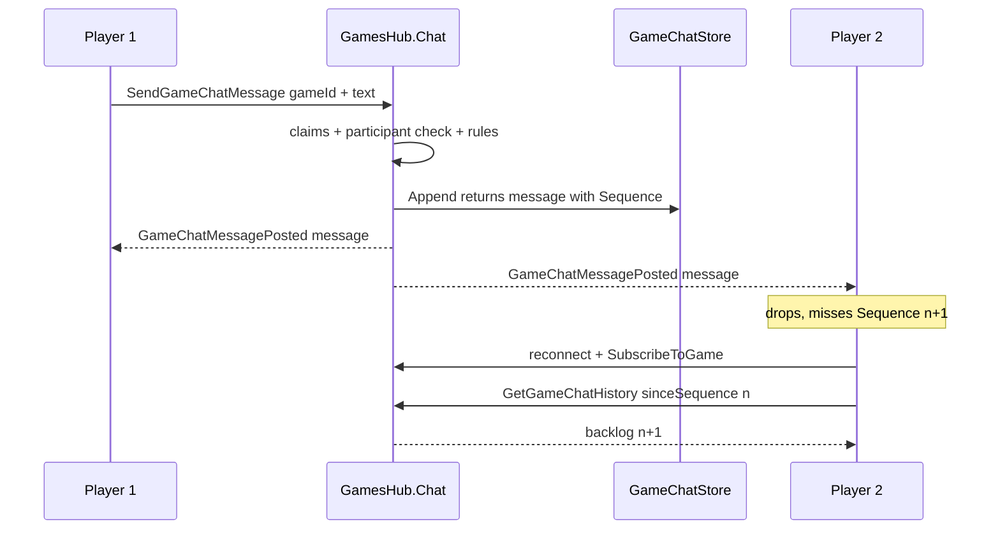

# Game chat (two players, live)

Live text chat between the two players of a game instance, on the existing `GamesHub`
connection, surfaced in the game view HUD.

## Decisions

| # | Decision | Why |
|---|---|---|
| D1 | Same `GamesHub` connection, no new hub | Auth, per-game group and reconnect are already there |
| D2 | Chat is **not** a game mutation: own hub partial, no `ExecuteAuthorizedGameMutation` | That path pushes `GameStateInvalidated` (full state refetch on both clients) and is refused while a phase presentation or a redo is pending |
| D3 | Chat state lives in a new `GameChatStore` singleton, never `GameInstance.State` and never the action log | Keeps chat off `lock (instance)` and out of the log's allow-listed information boundary |
| D4 | Server-authoritative envelope: `Sequence`, `MessageId`, sender from claims, `SentAtUtc` from `TimeProvider` | The request body carries text only, so neither player can spoof identity or order |
| D5 | Store-and-push with a bounded ring buffer plus `sinceSequence` catch-up | SignalR group membership dies with the connection id; a reconnect would otherwise lose everything said during the gap |
| D6 | Client data in its own `gameChatStore`; transport stays in `useGameHubState` | `initializeGameSession` wipes `gameHubStore` wholesale on game change, and `resetConnectionState` owns only connection flags |
| D7 | No database, no migration | Games are in-memory and die with the process; chat matching that is consistent, not a regression |
| D8 | Post-game chat allowed until the room is evicted | Rematch talk is normal; there is no `Game.Chat.Closed` |

## Contract

Hub methods (new partial `GamesHub.Chat.cs`):

- `SendGameChatMessage(string gameId, GameChatSendRequest request)` → `HubOperationResult<GameChatMessageResponse>`
- `GetGameChatHistory(string gameId, long sinceSequence)` → `HubOperationResult<GameChatHistoryResponse>`

Event (server → game group): `GameChatMessagePosted(string gameId, GameChatMessageResponse message)`
carries the whole message, so clients append and never refetch.

Both methods reuse the existing guards: `GetRequestingPlayerId()` then
`GetAuthorizedGameInstance(normalizedGameId, requesterId)`. Only the two players can post or read.

Error codes: `Game.Hub.Unauthorized` / `Game.Hub.Forbidden` (existing), plus `Game.Chat.MissingGameId`,
`Game.Chat.Disabled`, `Game.Chat.Empty`, `Game.Chat.TooLong`, `Game.Chat.RateLimited`.
Never truncate silently — reject so the client can say why.



## New files

Server

- `server/Api/Services/Chat/GameChatOptions.cs` — `MaxTextLength` 500, `MaxMessagesPerGame` 200,
  `SendBudgetPerMinute` 30, `RoomIdleTtl` 2h, `MaxRooms` 2000. Bound from a `GameChat` config section.
- `server/Api/Services/Chat/GameChatRules.cs` — pure validation + token-bucket helpers, the
  `BattleActionRules` / `GameEndRules` convention, so they are testable without a hub harness.
- `server/Api/Services/Chat/IGameChatStore.cs` / `GameChatStore.cs` — `ConcurrentDictionary<string, Room>`,
  `lock (room)` for sequence assignment and ring append, opportunistic sweep of idle rooms rate-limited by a
  process-wide timestamp (the `CardArtOrphanSweeper` idiom). No hosted service.
- `server/Models/Api/GameChatResponses.cs` — `GameChatSendRequest(string Text)`,
  `GameChatMessageResponse(long Sequence, string MessageId, string SenderPlayerId, DateTimeOffset SentAtUtc, string Text)`,
  `GameChatHistoryResponse(string GameId, IReadOnlyList<GameChatMessageResponse> Messages, long LatestSequence)`.
- `server/Api/Hubs/GamesHub.Chat.cs` — the two methods. `SendGameChatMessage` adds the caller to the group
  before broadcasting (mirrors `NotifyGameStateInvalidatedAsync`), then `Clients.Group(...)`. No state
  notification, no presence registration, no engine call.
- `server/tests/ProjectHiddenVillage.Server.Tests/GameChatStoreTests.cs` (validation and budget included: the rules
  are internal, so they are asserted through the store's public surface)

Client

- `client/src/services/api/types/gameChat.ts` — `IGameChatMessage`, `IGameChatHistoryResponse`,
  `IGameChatMessagePostedHandler`.
- `client/src/state/types/gameChatStore.ts` + `client/src/state/gameChatStore.ts` —
  `messages`, `lastKnownSequence`, `isSending`, `error`, `isOpen`, `unreadCount`;
  `appendMessage` dedupes by `messageId`.
- `client/src/views/game/components/GameChatPanel.tsx`
- `e2e/gameview.multiplayer.chat.spec.ts`

## Modified files

- `server/Api/Hubs/GamesHub.cs` — constructor takes `IGameChatStore` (the clock stays inside the store).
- `server/Program.cs` — `AddSingleton<IGameChatStore, GameChatStore>()` + options binding next to the
  presence tracker registration (`Program.cs:58`).
- `server/appsettings.json` — `GameChat` section.
- `client/src/services/api/gameHubApi.ts` — `EVENT_GAME_CHAT_MESSAGE_POSTED`, `onGameChatMessagePosted`,
  `sendGameChatMessage`, `getGameChatHistory`, beside the two existing handler registrations.
- `client/src/services/api/types/gameHub.ts` — re-export the posted handler type.
- `client/src/views/game/hooks/GameHub/useGameHubState.ts` — register the handler next to the existing
  `onGameStateInvalidated` / `onGameParticipantJoined` registrations; run chat catch-up after
  `subscribeToGame` in both `connectAndSubscribe` and `handleReconnected`; expose `sendChatMessage`.
- `client/src/views/game/types/hub/hub.ts` — `sendChatMessage: (text: string) => Promise<boolean>` on
  `IUseGameHubStateResult`.
- `client/src/state/gameUIStore.ts` + `client/src/state/types/gameUIStore.ts` —
  `isGameChatOpen`, `toggleGameChat`, `closeGameChat` (same shape as the action-log flags).
- `client/src/views/game/components/SidebarButtons.tsx` — `MessageSquare` button with unread dot,
  `data-testid="game-chat-toggle"`, next to the log button.
- `client/src/views/game/components/index.ts` — barrel export.
- `client/src/views/game/GameView.tsx` — render `<GameChatPanel />` beside `<ActionLog />`.
- `client/src/i18n/en.json` — `game.chat.*` block plus `game.sidebar.openChatAria` / `toggleChatTooltip`.
- `e2e/helpers/multiplayer/hub.ts` — no-op `connection.on('GameChatMessagePosted', ...)` where the other
  no-op handlers are registered, so helper connections cannot emit unhandled-method warnings.

## Panel behaviour

- Compact column only, no expanded mode in v1: an overlay that buries a waiting prompt is the documented
  hazard the action log already had to solve.
- Follow the newest message only while the reader is already at the bottom (same threshold idea as the log).
- Composer: Enter sends, Shift+Enter newline, `maxLength` = cap, disabled while `!isConnected || isSending`;
  character counter appears past 80% of the cap.
- Own messages right with the orange actor colour, opponent left with cyan — reuse the log's chip colours.
- Timestamp from `SentAtUtc` rendered locally; never from a client clock.
- Render text only. No `dangerouslySetInnerHTML`, no HTML in `title`/`aria-label`.
- No global key handlers: the composer must not steal keys from board shortcuts or targeting.
- Unread badge while the panel is closed.

## Limits and abuse

- Author and timestamp are server-derived; the request body is text only.
- Only game participants can read or write (existing `GetAuthorizedGameInstance`).
- Length cap enforced server-side; client `maxLength` is UX only.
- Token bucket per `(gameId, playerId)`; `Game.Chat.RateLimited` re-enables the composer.
- Log rejections as gameId + playerId + length. Never log message bodies.
- Guests can chat: guests are first-class users here, so state that deliberately.

## Memory

Ring buffer of `MaxMessagesPerGame` per game; idle rooms dropped after `RoomIdleTtl`; total rooms capped at
`MaxRooms`. Sweep is lazy and rate-limited from a write, mirroring the art orphan sweeper — no new hosted service.

## Tests

Unit (`GameChatStoreTests`)

- Sequence is monotonic under concurrent appends; ring buffer drops the oldest at the cap.
- `ReadHistory(0)` returns the backlog, `ReadHistory(n)` returns `n+1..`; an unknown game is empty.
- Text is trimmed; blank and over-length are refused with their codes; the kill switch is refused with its code.
- The send budget refuses the third message and refills; it is per player, so the opponent is unaffected.
- Idle rooms are dropped and `MaxRooms` evicts the quietest room, both driven by `TestClockProvider`.

Hub (`GamesHubNormalizationTests` additions)

- A send publishes `GameChatMessagePosted` only - never `GameStateInvalidated`.
- A send is accepted while a phase presentation is outstanding.
- A sender who is not a player in the game is refused with `Game.Hub.Forbidden` and nothing is published.

e2e (`gameview.multiplayer.chat.spec.ts`)

- A message from one page reaches the other, badges as unread while the panel is closed, and shows the right
  ownership on both sides.
- Chat stays out of the action log, and opening the log closes the chat panel.
- A reload keeps the backlog; over-length and blank sends are refused by the server; helper connections can read
  the history.

## Verification

```
npm run typecheck      # clean
npm run lint           # clean
npm run test:server    # 910 passed
npx playwright test gameview.multiplayer.chat.spec.ts               # 2 passed
npx playwright test gameview.spec.ts gameview.multiplayer.action-log.spec.ts   # 7 passed
```

Do not run the build/test commands while `npm run dev` is live (the watch process holds the server output DLL).
