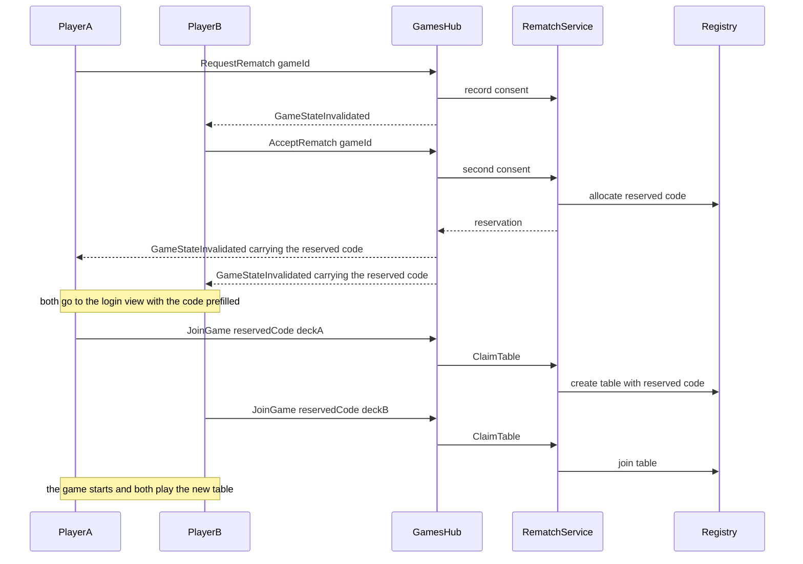

# Game codes and rematch between matches

Two coupled features:

1. **Game codes** are unique among tables that are in use, and free to be handed out again once a table has gone
   out of use.
2. **Rematch**: at the end of a match the two opponents can agree to play again. The rematch gets a fresh table,
   bound to the *same* ruleset, and both players pass through the login view on the way so they can change decks
   before they sit back down.

The second feature needs the first: a rematch table is a **reserved code** that exists before anybody is seated in
it, so the allocator has to know about reservations as well as live tables.

## Current state

- Live games only exist in memory: `InMemoryGameInstanceRegistry` keeps a `ConcurrentDictionary` keyed by the game
  code (`GameInstance.Id` is `State.GameId`), see `server/Engine/Services/InMemoryGameInstanceRegistry.cs:51`.
  Two *live* tables therefore can never share a code - the dictionary is the uniqueness guarantee.
- Generated codes come from `GenerateGameCode` in `server/Engine/Services/InMemoryGameInstanceRegistry.cs:921`, with
  128 retries on collision. `preferredGameCode` throws `Game.Code.InUse` when taken.
- **Nothing is ever removed from that dictionary.** Watchdogs are disposed, games are not. A finished table keeps
  its code until the process restarts, so "a table that has gone out of use may release its code" is not possible
  today, and memory grows with every game ever hosted.
- Codes are checked against the in-memory dictionary only. `game_instances` rows (dev seeding and tests) carry a
  unique `JoinCode` index, `server/Data/Configurations/Game/Core/GameInstanceConfiguration.cs:83`, and are used as
  the fallback for `GET /api/games/{code}/cards` in `server/Api/Services/Games/GameReadService.cs:43`. Runtime
  games are never persisted, so that index only constrains seeding.
- The closest existing two-player consent flow is redo: `pendingRedo` on the game state, a hub path of its own, a
  watchdog for the unanswered request (`server/Api/Hubs/GamesHub.RedoActions.cs:13`,
  `server/Api/Services/Games/GameRedoHandlingService.cs`). A rematch is the same shape, but it outlives the table.
- Joining by code already resolves the deck's format before the join from the login view
  (`GET /api/games/{code}/ruleset`, `server/Api/Controllers/GamesController.cs:155`) and then the server re-judges
  the deck against the binding in `GameInstanceService.JoinGameForUser`
  (`server/Api/Services/Games/GameInstanceService.cs:117`).

## Decisions

| # | Decision | Rationale |
|---|----------|-----------|
| D1 | Rematch requires mutual consent on the finished board | One player must not be able to open a table in the other's name |
| D2 | Consent mints a **reserved table code** - the lobby - which is not a game instance yet | The engine only starts a game with two players, so a lobby cannot be a `GameInstance` |
| D3 | Both players are **taken** back to the login view as soon as the table is reserved, with the code prefilled; they pick a deck there and press Join | Reuses the existing deck selection, import and join validation instead of building a second deck picker, and leaves nobody waiting on a click |
| D4 | The first claim creates the table with the reserved code and the seat; the second starts the game | Exactly the create-then-join path the engine already supports |
| D5 | The reservation carries the source table's `GameRulesetBinding` including `Clock`, plus `Modifiers` | The format cannot change between matches; time-relaxed stays time-relaxed |
| D6 | Deck legality is judged against the **live definition** of that same ruleset | A ruleset edited between matches must still bind the new decks; a deactivated ruleset refuses the rematch |
| D7 | A code is reusable once its table is retired: game over, no connected watcher, grace elapsed | Keeps a finished board and its log reachable for the players while still releasing the code |
| D8 | Retired codes are quarantined briefly before they can be handed out again | A stale client holding the old code must not land in a stranger's new table |
| D9 | No database migration | Runtime tables are in-memory; `game_instances` rows exist only through seeding |

## Flow

## Code allocation and retirement

**Allocator** (`IGameCodeAllocator`, `server/Api/Services/Games/GameCodeAllocator.cs`)

- One method, `TryReserve(preferred, out code)`, checked under a single lock against:
  live registry instances, active rematch reservations, and the retired-code quarantine.
- `InMemoryGameInstanceRegistry.Create` stops generating codes itself and asks the allocator, keeping the
  128-attempt retry loop and the existing `preferredGameCode` error behaviour.
- Quarantine is a bounded FIFO of recently retired codes, `Games:Retirement:CodeQuarantineSize`, default 256.

**Retirement** (`GameRetirementOptions`, `Games:Retirement` section, `GameTableReaper : BackgroundService`)

| Setting | Default | Meaning |
|---------|---------|---------|
| `SweepIntervalSeconds` | 60 | How often the reaper looks |
| `FinishedGraceSeconds` | 600 | Keep a finished table after the last watcher leaves |
| `AbandonedGraceSeconds` | 1800 | Keep a table that never reached two players |
| `CodeQuarantineSize` | 256 | Retired codes that cannot be reallocated yet |

- A table is retirable when `GameEndRules.IsGameOver` is true and `IGamePresenceTracker.GetConnectedPlayerIds`
  returns nobody, plus the finished grace; or when it has fewer than two players and has been idle for the
  abandoned grace.
- Retirement calls the new `InMemoryGameInstanceRegistry.Remove`, which drops the instance and disposes its
  presentation, clock and redo watchdogs. Chat needs no hook: `GameChatStore` already evicts idle rooms, and the
  reaper only retires tables nobody is watching.
- The reaper is a `BackgroundService` on the injected `TimeProvider`, so tests advance a fake clock instead of
  sleeping, the same way the clock watchdogs are tested.

## Rematch

**Store** (`RematchStore`, `server/Api/Services/Rematch/`, locked like `MatchmakingQueue`)

- `RematchConsent`: `{ GameId, RequestedByPlayerId, AcceptedByPlayerId?, DeclinedByPlayerId?, ExpiresAtUtc }`,
  one entry per source game, pruned lazily on every read and write.
- `RematchReservation`: `{ Code, SourceGameId, RulesetBinding, Modifiers, PlayerIds[2], PlayerNames[2],
  CreatedAtUtc, ExpiresAtUtc, ClaimedPlayerIds, StartedGameId? }`, keyed by the reserved code and pruned on expiry
  so the code returns to the allocator.

**Service** (`IRematchService`, `server/Api/Services/Rematch/RematchService.cs`)

| Call | Rule |
|------|------|
| `RequestRematch(gameId, playerId)` | Game must be over, caller must be seated. Idempotent while the same player's consent is live |
| `AcceptRematch(gameId, playerId)` | The consent must name the caller as the other seat. Both consents mint the reservation |
| `DeclineRematch(gameId, playerId)` | Drops the pair's consent and publishes the refusal to both |
| `ClaimTable(code, playerId, deckId)` | Reserved and unexpired, caller one of the two seats. First claim creates, second joins |

Error codes: `Game.Rematch.NotFinished`, `Game.Rematch.NotFound`, `Game.Rematch.Forbidden`,
`Game.Rematch.Expired`, `Game.Rematch.DeckIllegal`, `Game.Rematch.RulesetUnavailable`.

- Reservations are minted under the store lock, and so is the decision to allocate a code; the allocator is called
  while holding it so a code cannot be handed to a table and a reservation at the same time.
- The claim runs under the reservation's own `SemaphoreSlim` (`RematchReservation.ClaimLock`), held across the
  create. The first claim opens the table with `InMemoryGameInstanceRegistry.CreateWithReservedCode`, which adopts
  the claim the reservation already holds (and refuses a code no reservation claims), stamps the binding and
  modifiers, and seeds the opening support card exactly as the hosted path does. The second claim re-checks the
  registry under the same lock and joins through `JoinGameForUser`'s ordinary path, so the existing admission check
  applies. Whichever claim fills the second seat calls `CompleteReservation`, which drops the reservation and
  leaves the code owned by the live table.
- `JoinGameForUser` learns one thing: an unknown code is looked up in the reservation store before answering
  `Game.JoinForUser.NotFound`, and a match claims the table. The client keeps calling Join.
- Seating: the first claimer is seat one. Both start with the deck they claimed with; nothing is inherited from the
  previous board.

**Published state**

- `GameStateResponse` gains `Rematch` next to `PendingRedo` (`server/Models/Api/GameStateResponses.cs:54`):
  `{ RequestedByPlayerId, RequestedAtUtc, ExpiresAtUtc, CanRequest, CanRespond, ReservationCode, RulesetName }`,
  and only non-null once the game is over. A player who reloads the finished board still sees the offer.
- `GameStateResponseMapper` fills it from the rematch store the same way it fills `PendingRedo`.

**Hub** (`server/Api/Hubs/GamesHub.RematchActions.cs`)

- `RequestRematch(gameId)`, `AcceptRematch(gameId)`, `DeclineRematch(gameId)` - each returns the refreshed
  `GameStateResponse` and invalidates the game group, through the shared `ExecuteParticipantOperation` the redo
  handshake also uses (neither is a board action, so neither can go through the mutation gate).
- **No dedicated event.** The reserved code rides on the state both players already refetch from that invalidation,
  so there is one source of truth and nothing to keep in sync. The source table stays in the registry and stays
  watchable: leaving the board does not retire it, only the reaper does that.

**Login view**

- The view is reached without a click: `GameView` navigates as soon as the reserved code is on the state.
- `GET /api/games/{code}/ruleset` answers a reserved code from its reservation, so
  `useGameRulesetByCodeQuery` can judge the deck before the claim - the same pre-check any join gets today.
- The login store keeps `pendingRematch: { code, rulesetName }` (`client/src/state/pendingRematch.ts`), persisted in
  `sessionStorage` next to the deck selection, so the reservation survives a reload. The join field is prefilled,
  and a banner names the opponent and the format.
- Clearing rules: claim succeeds, reservation expires, user switches entry mode, or the user dismisses the banner.

**Client board**

- `GameOverOverlay` (`client/src/views/game/components/GameOverOverlay.tsx:17`) gains the rematch states: idle
  `Rematch`, waiting for the opponent, opponent asked you with `Accept` and `Decline`, and a note when the opponent
  declined. Withdrawing one's own offer is the same call as declining.
- **Agreeing is the whole interaction.** `GameView` watches `pendingRematch.reservedCode` and, the moment it appears,
  records the code and navigates to the login view - for the player who accepted and for the one who offered alike,
  whether or not the overlay was still on screen. There is no "rejoin" button: the reserved code is the answer, and
  the login view is where the deck for the next match is chosen. A ref keyed by the code keeps a re-render from
  navigating twice.
- **The hand-off only fires for its own board.** `gameState.gameId` must equal the route's code, and the game must
  have an outcome. Without that, claiming the reserved table bounced straight back to the login view: the hub store
  outlives a route change and is only reset by an effect, so the first render of the *new* table was painted with
  the previous game's finished state - which still carried the reserved code - and the hand-off replayed. The same
  guard was put where the stale read came from: `useGameHubState` now ignores a store state whose `gameId` is not
  this route's game and falls back to the loader's snapshot.
- Guests may rematch: their decks are normal transient rows, and the claim path validates them like any join.

**Expiry and the abandoned rematch**

- Consent: `Rematch:ConsentLifetimeSeconds`, default 120.
- Reservation: `Rematch:ReservationLifetimeSeconds`, default 900. Expiry releases the code and tells both players.
- If only one player claims, they sit alone on the new table exactly like a host waiting for an invite; the
  abandoned grace retires that table and its code comes back.

## Coverage

- Allocator: preferred-code collision, generated collision, reservation collision, quarantine of a retired code.
- Reaper: finished table with no watchers retires after the grace and its code is allocatable again; a watched
  table never retires; a never-started table retires after the abandoned grace. Fake `TimeProvider`.
- Rematch service: consent by the same player twice, decline, expiry, non-player refusal, rematch of a running
  game refused, claim before expiry, claim after expiry, two simultaneous claims produce one table, illegal deck
  refused for the rematched format, deactivated ruleset refused.
- Controller: `GET /api/games/{code}/ruleset` answers a reserved code and answers `null` for an unbound table.
- e2e: `e2e/gameview.multiplayer.rematch.spec.ts` walks request, accept, login detour, deck swap, claim and the new
  board; a reuse spec runs the e2e server with a one-second retirement grace and asserts a retired code is
  allocatable while a live one is not.

## Deliberate limits

- One process. Both the registry and the reservations are in memory, so the uniqueness guarantee is per instance;
  a scale-out deployment would need the allocator to be authoritative externally.
- The reservation is not persisted. A server restart loses pending rematches, exactly as it loses the tables.
- A rematch always starts from a fresh board: nothing about the previous match, not even seat order beyond the
  claim order, carries over.
- The quarantine is a size, not a duration: the last `CodeQuarantineSize` retired codes are held back, and the
  oldest one becomes allocatable as soon as a newer code is retired. A cooldown clock would be the alternative, but
  it needs a timer for something a bounded queue already answers.

## Where it lives

| Concern | File |
|---------|------|
| Code uniqueness, adoption and quarantine | `server/Api/Services/Games/GameCodeAllocator.cs` |
| Retirement sweep and its windows | `server/Api/Services/Games/GameTableReaper.cs`, `server/Api/Services/Games/GameRetirementOptions.cs` |
| Table removal and code release | `server/Engine/Services/InMemoryGameInstanceRegistry.cs` (`TryRetire`, `Snapshot`, `CreateWithReservedCode`) |
| Offer state on the finished board | `server/Models/Game/GameRematch.cs`, `server/Models/Game/GameInstance.Rematch.cs` |
| Reservation + its sweep | `server/Api/Services/Rematch/RematchReservation.cs`, `RematchReservationStore.cs`, `RematchReservationSweeper.cs` |
| Consent handshake | `server/Api/Services/Rematch/RematchHandlingService.cs`, `server/Api/Interfaces/Game/IRematchHandlingService.cs` |
| Claim (create-or-join) | `server/Api/Services/Games/GameInstanceService.cs` (`ClaimReservedRematchTableAsync`) |
| Published state | `server/Models/Api/GameStateResponses.cs` (`PendingRematch`), `GameStateResponseMapper.ToRematchResponse` |
| Hub path | `server/Api/Hubs/GamesHub.RematchActions.cs`, `GamesHub.RedoActions.cs` (`ExecuteParticipantOperation`) |
| Join-form pre-check for a reserved code | `server/Api/Controllers/GamesController.cs` (`GetGameRuleset`) |
| Board UI | `client/src/views/game/components/GameOverOverlay.tsx`, `client/src/views/game/GameView.tsx` |
| Login detour | `client/src/state/pendingRematch.ts`, `client/src/views/login/LoginView.tsx` |

## Tests

- `server/tests/ProjectHiddenVillage.Server.Tests/GameCodeAndRematchTests.cs`: the allocator (preferred,
  generated, quarantine, adoption), the reaper (finished-and-unwatched, watched, running, never-started) and the
  rematch handshake (mutual consent carrying binding and modifiers, unfinished game, outsider, self-accept, decline,
  lapsed consent, expired reservation, completed reservation).
- `server/tests/ProjectHiddenVillage.Server.Tests/GamesControllerGameRulesetTests.cs`: the reserved code answering
  the join form's format pre-check, the unbound reservation answering `null`, and the expired one answering 404.
- `e2e/gameview.multiplayer.rematch.spec.ts`: the offer on both finished boards, the acceptance, the reserved code on
  both state payloads, both players landing on the login view with the code in the form, and - the regression that
  followed the automatic hand-off - claiming the table and staying on the new board instead of bouncing back.

## Abandonment

What happens when the agreement stops being true - a player leaves and does not come back, or neither of them starts
the next game within the half hour - is a follow-up with its own lifecycle:
[`plans/rematch-abandonment.md`](plans/rematch-abandonment.md:1). It raises the reservation ceiling to 30 minutes,
adds a deferred release so a refresh is not mistaken for a departure, and retires a one-player table whose opponent
walked away.
