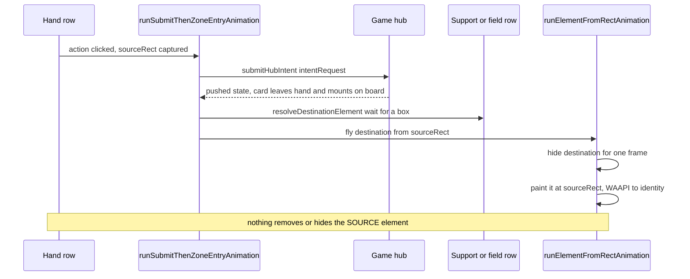
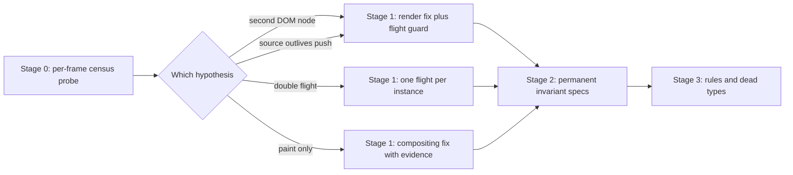

# Hand to zone double card: diagnosis and fix plan

Symptom (screen recording, ~00:02): a card is played from the hand into the support row. While the arrival
flight is in the air, the **same card is still painted in the hand row**. Two visuals of one card exist for the
duration of the flight, and the hand one disappears only when the movement settles.

The recording frame shows exactly that: the hand card at its resting slot, and the smaller support-sized card
mid-flight above the support row.

## What the architecture says should happen

There is no overlay copy layer and no `layoutId` projection any more - the previous pass deleted both
(see [`plans/board-position-fixes.md`](plans/board-position-fixes.md:417)). A play is an **entity flight on the
arriving card**:

Two visuals therefore mean one of:

1. **a second DOM node carrying the same instance id** (the hand element was not unmounted, or the card is
   rendered twice), or
2. **one DOM node plus a stale paint** (a compositor artifact, the report's third hypothesis).

The engine only guarantees "the card that lands is the card that flew"; nothing enforces "only one visual per
instance exists at a time". That is the missing invariant.

## Why the suite is green

The only duplicate assertion in the suite scans `[data-hand-instance-id]` **after the board settles**
([`e2e/gameview.multiplayer.board-animation.spec.ts`](e2e/gameview.multiplayer.board-animation.spec.ts:77)).
A hand+support or hand+field duplicate, which exists only during the flight, is invisible to it. The flight
counter records that *something* travelled, and the travel record names the instance, but neither asserts the
absence of a second painted copy.

## Hypotheses, ranked, with the code that would produce each

| # | Hypothesis | Where it would live | How the probe decides |
|---|---|---|---|
| H1 | The source hand element outlives the state push (a retained render or a render duplicate), so both nodes are live | [`GameHandRow.tsx`](client/src/views/game/components/GameHandRow.tsx:39), [`HandCardItem.tsx`](client/src/views/game/components/HandCardItem.tsx:92), [`useHandRowReorder.ts`](client/src/views/game/hooks/useHandRowReorder.ts:29) | Two elements with the same `data-hand-instance-id` in one frame, both `visibility: visible`, `opacity: 1` |
| H2 | The source is still painted because it is the only element and its removal is merely later than the first flight frame (state commit and flight start are not ordered) | [`runSubmitThenZoneEntryAnimation.ts`](client/src/views/game/utils/functions/gameState/runSubmitThenZoneEntryAnimation.ts:4), [`flights.ts`](client/src/views/game/animation/flights.ts:45) | One hand element present and visible on the frames whose animated element is the destination |
| H3 | Two flights run for one instance; the second cancels the first and the cancelled cleanup restores a stale transform or visibility, leaving the origin painted | [`flightRegistry.ts`](client/src/views/game/animation/flightRegistry.ts:17), [`flights.ts`](client/src/views/game/animation/flights.ts:100) | Two WAAPI animations whose element carries the same instance id; a `cancel` immediately followed by a new offset |
| H4 | The painted duplicate is not in the DOM at all - a GPU/compositing residue of the 3D flip layer while the wrapper is transformed | [`FlippableCard.tsx`](client/src/components/ui/cards/FlippableCard.tsx:17) and the WAAPI transform on its wrapper | Only one element for the id in the DOM, yet two rectangles are visible in the recording; `elementFromPoint` over the hand area resolves to nothing or the row |
| H5 | The flight targets a *different* element than the card the player is looking at (fallback query), so the played card sits at its slot while another card flies from the hand | fallback branches in [`submitSetSupport.ts`](client/src/views/game/utils/functions/gameState/submitSetSupport.ts:38) and [`submitMappedAction.ts`](client/src/views/game/utils/functions/gameState/submitMappedAction.ts:261) | The flying element's `data-card-instance-id` is not the played instance |

H4 is the least likely - everything on this board is a real DOM node and the recording shows a full card face
with correct art, not a smear - but it is the only hypothesis that would make a compositing change correct, so
the probe must be able to exclude it explicitly rather than by assumption.

## Rejected proposals from the report, so they are not revisited

- **`layoutId` / shared element transitions.** Not used on this board and previously rejected with reasons: the
  deck pile has no instance identity to share, and a second transform owner is the class of bug the entity
  migration removed.
- **Key uniqueness.** Already correct everywhere: `getCardKey` is `card.instanceId`, and the Reorder values are
  instance ids.
- **Removing hand state at drag start.** A hand reorder is a local display-order change; it does not move cards
  between zones, so it has nothing to remove. The play path is the only one that moves a card.

## Stage 0 - measure first, with a temporary probe

**Goal:** know which hypothesis is true before touching application code.

- New temporary spec under `e2e/`, driving the multiplayer fixture and the same play the support spec uses
  (set support from hand, then a summon from hand).
- Install with `addInitScript` so the sampler exists before the action:
  - hook `Element.prototype.animate` and tag the element it is called on, recording
    `{ time, instanceId, rect, mechanismTag }`; a second record for the same id is H3.
  - once per animation frame, census every element matching
    `[data-hand-instance-id], [data-card-instance-id], [data-departing-instance-id]` and record tag, instance id,
    `getBoundingClientRect()`, computed `visibility`/`opacity`, `data-card-traveling`, `data-card-departed` and
    whether it is the element currently animated.
  - also record the current hand / field / support instance ids from the state at the same frames, so a
    duplicate copy of the same *card definition* (two different instances) is distinguishable from a duplicate
    render of one instance.
- Report raw JSON plus the list of frames where any instance id had more than one visible element.

**Verdict rules**

- H1 confirmed if any frame has two elements with the same instance id, both with a box and
  `visibility: visible`.
- H2 confirmed if one hand element exists and stays visible on frames where the animated element belongs to a
  different zone and carries the same id.
- H3 confirmed if two `animate` calls are recorded for one instance id within one movement.
- H4 confirmed only if the census never shows a second element while the recording clearly shows two cards;
  then the second card is a paint, and the compositing path is the target.
- H5 confirmed if the animated element's instance id differs from the played instance id.

**Exit:** one verdict per hypothesis, the temporary spec deleted, no application code changed while probing.

## Stage 1 - the invariant becomes code: one visual per instance

**Goal:** a card instance is never painted twice, whatever produced the second element.

- Add the guard to the flight primitive, not to each caller:
  [`runElementFromRectAnimation()`](client/src/views/game/animation/flights.ts:45) and
  [`runElementToRectAnimation()`](client/src/views/game/animation/flights.ts:122) resolve the instance key they
  already compute, then hide **every other element in the document that carries that same instance id**
  (`[data-hand-instance-id="id"]`, `[data-card-instance-id="id"]`, `[data-departing-instance-id="id"]`), keeping
  each element's previous inline `visibility` and restoring all of them in the existing `cleanup`.
- The flying element is never in that set: it is the element being animated, which is the only visual allowed.
- The guard runs in the same task that paints the first offset frame, so there is no frame in which the origin
  is still visible after the flight starts. No pre-submit hiding gap is introduced, so the movement keeps its
  current feel.
- Release is owned by the flight that took the visuals: settle, cancel, timeout and reduced-motion all go
  through the existing `cleanup`, and the registry already guarantees one flight per key. Extend the
  `suppressedExitGhostInstanceIds` claim to the submit-arrival paths so no other effect animates the same
  instance in the same movement.
- If the probe confirms H1 (a second element genuinely rendered in the hand), fix the render as well - the guard
  hides it but would leave an empty slot - and keep the guard as defence in depth.
- If the probe confirms H4, do **not** ship the guard as the fix: use the probe's paint evidence to decide
  between removing the persistent 3D layer promotion and forcing a single compositing layer for the flight
  duration, and record the measurement that justified it.

**Exit:** every frame of a play has exactly one visible element for the played instance id, and the hand slot is
either gone or empty - never painted with a second card.

## Stage 2 - the invariant becomes a permanent regression spec

- New spec in [`e2e/gameview.multiplayer.board-animation.spec.ts`](e2e/gameview.multiplayer.board-animation.spec.ts:48):
  `one visual per card instance for the whole movement`, on both clients, for hand to support and hand to
  field. Assertions, sampled every frame:
  - at most one element with a box and `visibility: visible` per instance id;
  - while a flight is active, the visible element is the one carrying `data-card-traveling`;
  - after settle, no `data-card-traveling`, no held marker, and exactly one element per instance id in the
    document;
  - the sampler's own frame count is greater than zero and it recorded no errors, so green cannot be vacuous
    (the same guard the deal sampler has).
- Extend the existing rest-state duplicate check from `[data-hand-instance-id]` only to the whole document, so a
  hand+field duplicate at rest can never pass again.
- Write both before Stage 1 and confirm they fail for the recorded reason.

**Exit:** the new specs fail on the pre-fix code and pass after it; the existing animation specs are unchanged.

## Stage 3 - write the rule down and drop the dead types

- Add to [`.clinerules/02-board-ui-hud.md`](.clinerules/02-board-ui-hud.md:222): **one visual per card instance
  id at any moment**; the flight that carries the card is the only element allowed to be painted for that id,
  and every other element for it is hidden for the flight's duration. State the corollary already learned in the
  deal fix: a card is never painted at rest before its own flight.
- Delete the dead animation arg types left over from the copy layer:
  `ICardImageGhostToElementAnimationArgs` and `IRectToElementAnimationArgs` in
  [`types/targeting/animations.ts`](client/src/views/game/types/targeting/animations.ts:24).

**Exit:** the invariant is written where the next person hits it, and no unused copy-era type remains.

## Dependency overview

## Verification gates

1. `npm run typecheck:client` clean.
2. `npm run lint:client` clean.
3. The new invariant spec passes on both pages for hand to support and hand to field.
4. `board-animation`, `support`, `actions`, `battle-visuals`, `reveal-presentation` and `quick-support` are
   green with `--workers=2`; a flake is re-run in isolation before being accepted as load-related.
5. Visual check from the same interaction as the recording: exactly one card visible per instance at every
   moment of the play, no empty hand slot left behind, no card stranded invisible.

## Risks

| Risk | Mitigation |
|---|---|
| The guard hides an element that legitimately must stay visible (a second, different card that happens to share an id) | Ids are per-instance and unique per card; the probe records instance ids, not card definitions, so a same-definition second copy is never hidden |
| Restoring visibility races the state push that unmounts the element | Restoration writes to a detached node harmlessly, the same pattern the departure flights already rely on |
| A cancelled flight leaves an element hidden | Cleanup is shared by finish and cancel; the setted-state spec asserts no marker and no hidden hand card after settle |
| The probe cannot reproduce the race deterministically | Drive the play through the client resolver, not the hub, so the client-side flight runs; repeat the interaction and report the hit rate rather than a single pass |

---

# Results: probe measurements

Temporary spec (deleted after the run) censused every element carrying `data-hand-instance-id`,
`data-card-instance-id` or `data-departing-instance-id` once per animation frame, and hooked
`Element.prototype.animate` to record which element each flight was applied to.

## Verdicts

| Hypothesis | Verdict | Deciding measurement |
|---|---|---|
| H1 - a second DOM node for the same instance | **CONFIRMED** | On both pages of the summon run, exactly one frame had two elements for the played instance: `hand:top-hand-row@406,-64` and `board:character-field-card@346,174`. The support run showed the same shape from the bottom hand row. |
| H2 - the source stays painted while the flight is in the air | **Not observed in this run** | `orphanFrames: 0`: on the sampled frames the destination was still in its one-frame pre-flight hide while the source existed, so only one card was painted. The two-node window is real, but its translation into two painted cards depends on how late the extra commit lands. |
| H3 - two flights for one instance | **REFUTED** | `animationCountByInstanceId` is `1` for the played instance. The other recorded animation belongs to a draw in a hand row. |
| H4 - paint-only artefact, no second element | **REFUTED** | The duplicate was found in the DOM, with both elements connected and laid out. |
| H5 - the flight targets another card | **REFUTED** | The animated element carries `data-card-instance-id` equal to the played instance. |

## Root cause

`AnimatePresence` was still wrapping the hand rows, with no `exit` prop anywhere in a hand card. It renders a
removed child for one extra commit before dropping it, so the state push that moved the card mounted the
destination while the source was still mounted. The arrival flight hides the destination for one frame; the
extra commit lands inside (or after) that window, which is exactly the frame the recording captured as a card in
the hand and a card in the air.

The suite could not see it because the only duplicate assertion scanned `[data-hand-instance-id]` after the
board settled.

# As built

- [`GameHandRow.tsx`](client/src/views/game/components/GameHandRow.tsx:26) renders its cards directly in both
  branches. `AnimatePresence` is gone with the import; `Reorder.Group` and `layout="position"` are unchanged, so
  the drag and the reorder projection keep Motion as their single writer. No exit animation existed to lose.
- [`flights.ts`](client/src/views/game/animation/flights.ts:20) owns the invariant: both primitives resolve the
  element's instance id and call `suppressOtherInstanceVisuals`, which hides every other element carrying that id
  for the flight and restores the previous inline `visibility` in the existing `cleanup` (finish, cancel,
  reduced-motion and the element-has-no-box early return all bypass or restore it). The flying element and its
  ancestors/descendants are exempt, so a flight can never hide itself. Suppression is **reference-counted** per
  element, so a superseded flight's cleanup cannot reveal an element the newer flight is still hiding.
- [`board-animation.spec.ts`](e2e/gameview.multiplayer.board-animation.spec.ts:418) has the two permanent
  invariant specs, one per movement shape, censusing both pages every frame. The pre-fix run failed with
  `hand:top-hand-row@406,-64` beside `board:character-field-card@346,174`; the post-fix run is green. The
  rest-state duplicate check now scans `[data-hand-instance-id]` **and** `[data-card-instance-id]`, so a card
  left in two zones at rest can never pass again.
- [`.clinerules/02-board-ui-hud.md`](.clinerules/02-board-ui-hud.md:228) records the rule and the
  `AnimatePresence` caveat; the dead copy-era arg types (`ICardImageGhostToElementAnimationArgs`,
  `IRectToElementAnimationArgs`) are deleted.

## Verified

- `npm run typecheck:client` and `npm run lint:client`: clean.
- `board-animation` 5/5, and the animation-sensitive set (`board-animation`, `gameview`, `support`, `actions`,
  `battle-visuals`, `reveal-presentation`) 29/29 at `--workers=2`; `quick-support` 2/2 separately.
- Full suite: **55 passed, 2 failed by the 300 s timeout** (`character-ability`, `quick-support`) while running
  with two workers and the two scratch specs in the tree. Both pass in isolation in 11.5 s / 7.2 s, so they are
  the documented load hang, not a regression from this change.
