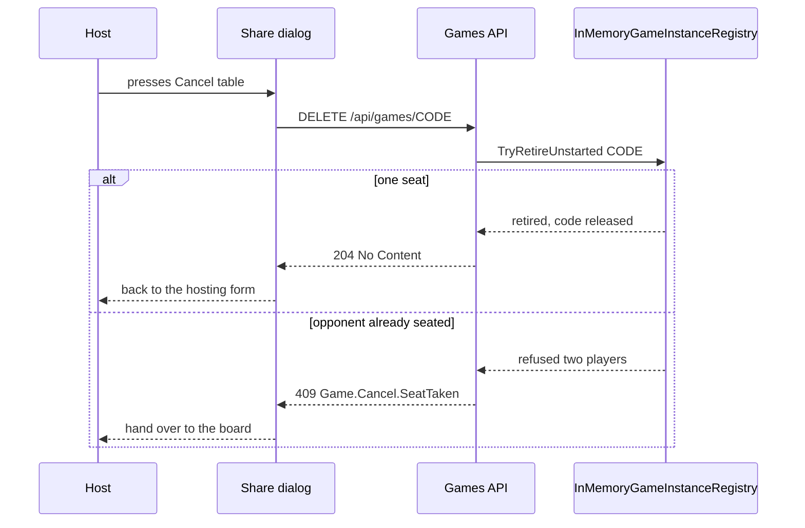

# Hosting: back out and undo the created table

## What shipped

- Server: `DELETE /api/games/{gameId}` on `GamesController` → `GameInstanceService.CancelUnstartedGameForUser` →
  `InMemoryGameInstanceRegistry.TryRetireUnstarted` (the seat check and the removal happen under the instance lock,
  and `Join` verifies the table is still registered before seating anybody). Answers `204`, `403`, `404` and `409`;
  the conflict carries `Game.Cancel.SeatTaken`.
- Client: `cancelUnstartedGame` in `gameApi.ts`, `isApiConflictError` beside `isApiBadRequestError`.
- Share dialog: `onCancel`, `isCancelling`, an always-present `create-game-back` icon button pinned to the panel's
  top-right corner (`aria-label`/`title` `auth.createGame.cancelTable`), and the hand-over effect ignores the poll
  while a cancel is in flight. The cached game-state entry is dropped after the dialog leaves the tree.
- Board: the sidebar swaps the forfeit flag for `close-table-button` while `players.length < 2`, confirmed through
  `CloseTableConfirmDialog`, and `GameView.closeUnstartedTable` cancels and navigates to `/`.
- E2E: `e2e/create-game.share-link.spec.ts` covers the mocked cancel (success, 409 hand-over, broken watch) and a
  real-server board close that asserts the code answers 404 afterwards.

## Problem

Hosting mints a real, already-joinable table (`POST /api/games`) and then holds the creator on
`CreateGameShareDialog` until somebody takes the second seat or they press `Enter Game`. The only way out of that
dialog today is the `Back` button, and it is rendered **only when the opponent poll has broken**
(`isWatchingGame === false` in [`CreateGameShareDialog.tsx`](../client/src/views/login/components/CreateGameShareDialog.tsx)).
A host who changes their mind - wrong format, wrong deck, a friend who cannot play after all - is parked on a code
nobody is going to use.

Closing the dialog locally would not undo anything either. There is no delete/abandon endpoint: the table keeps its
code, stays joinable, and only `GameTableReaper` removes it after `GameRetirementOptions.AbandonedGraceSeconds`
(default 30 minutes, nobody watching). A friend who joins that dead table sits alone at a board nobody is hosting,
and the code cannot be handed out again until the sweep runs.

The board has no exit for the same situation: once `Enter Game` is pressed a lone host sees `Waiting for player`, and
the sidebar only offers forfeit - which would hand a win to an opponent who does not exist.

## Scope

- **Share dialog**: an always-visible Cancel action that deletes the one-seat table and returns to the hosting form.
- **Board while waiting for a player**: the same cancel, behind a confirmation, returning to the login view.
- **Not in scope**: cancelling after an opponent sat down (that is resign/forfeit), auto-abandon when the tab is
  closed or reloaded (the reaper already covers it), and persisted lobbies.

## Decisions

1. **Undo means delete.** `DELETE /api/games/{code}` retires the table in the registry: watchdogs disposed, clock
   stopped, code released to the allocator (subject to its quarantine window). This reuses the teardown path the
   reaper and the rematch store already use.
2. **Refused once the table is live.** Two players seated answers `409 Game.Cancel.SeatTaken`, and the client hands
   the host over to the board instead - the game they were about to abandon is now real and has an opponent in it.
3. **Only the seated host may cancel** (`403 Game.Cancel.Forbidden`). An unknown or already-retired code answers
   `404 Game.Cancel.NotFound`, which the client treats as "already undone".
4. **REST only, no hub method.** Client and server ship together, and a `404`/`405` from an older server already
   reads as "nothing to undo" in the client, so a hub fallback would add a second code path for no gain.
5. **The dialog cancels in one click; the board asks first.** Nothing has started in the dialog and hosting again is
   one click, so friction there is pure cost. On the board a misclick breaks a code that may already be in a friend's
   clipboard, so it gets the `ForfeitConfirmDialog` treatment.
6. **A failed cancel never traps the host.** Any unexpected failure still closes the dialog or leaves the board on the
   host's terms, with copy saying the table will be released automatically.

## Flow

## Server

### Registry: an atomic retire

- Factor the teardown half of [`TryRetire`](../server/Engine/Services/InMemoryGameInstanceRegistry.cs:228) into a
  private helper, so both retirement paths share it (watchdogs, `StopClock`, `codeAllocator.Release`).
- Add `bool TryRetireUnstarted(string gameId)`: take the instance lock, refuse when `State.Players.Count >= 2`,
  otherwise remove it from `instances` and tear it down. The lock is what makes "check the seat count" and "remove the
  table" one step.
- Close the join race in `Join` ([`InMemoryGameInstanceRegistry.cs`](../server/Engine/Services/InMemoryGameInstanceRegistry.cs:256)):
  inside the instance lock, verify the dictionary still maps `gameId` to this instance (`ReferenceEquals`) and throw
  `KeyNotFoundException` otherwise. Without it, a join that fetched the instance just before a cancel could seat a
  player at a table nobody can reach any more. The service already maps that exception to `Game.JoinForUser.NotFound`.

### Service

- `IGameInstanceService.CancelUnstartedGameForUser(string gameCode, string requestingPlayerId)` → `ErrorOr<Success>`.
  - Blank code → `Validation Game.Cancel.MissingCode`.
  - No table → `NotFound Game.Cancel.NotFound`.
  - Requester is not one of the seated players → `Forbidden Game.Cancel.Forbidden`.
  - `TryRetireUnstarted` refuses → re-read the table: two players → `Conflict Game.Cancel.SeatTaken`; gone in the
    meantime → `NotFound Game.Cancel.NotFound`.
- Update the interface stubs in `GamesControllerStateVisibilityTests` and `GamesHubNormalizationTests`; the
  composition-built service needs no new dependency.

### Controller

- `[HttpDelete("{gameId}")]`, `[Authorize]` on
  [`GamesController`](../server/Api/Controllers/GamesController.cs:16), requester id from the same claims helper
  `CreateGame` uses. `204 No Content` on success, `ProblemFromErrors` otherwise - `Conflict` already maps to 409 and
  `Forbidden` to 403 in [`ApiControllerBase`](../server/Api/Controllers/ApiControllerBase.cs:9).
- After a successful cancel, best effort `GameStateInvalidated` to the game group (same wrapper `JoinGame` uses), so
  a page still watching that code stops trusting it.

## Client

### API

- `cancelUnstartedGame(gameCode: string): Promise<void>` in [`gameApi.ts`](../client/src/services/api/gameApi.ts:47):
  `api.delete('/api/games/{code}')`; a `404` resolves (already gone), everything else throws.
- `isApiConflictError(error)` next to [`isApiBadRequestError`](../client/src/views/utils/getApiErrorMessage.ts:28), so
  the callers key off the status rather than the server's wording.

### Share dialog

- `onCancel` replaces `onLeave`; the dialog owns `isCancelling` and disables copy/enter while a cancel is in flight.
- The action is always rendered (keep `data-testid="create-game-back"`, label `auth.createGame.cancelTable` with
  `auth.createGame.cancelling` while pending), so the broken-watch case keeps working through the same handler.
- Outcomes:
  - success → toast `auth.createGame.tableClosed`, call `onCancel()`;
  - `409` → toast `auth.createGame.seatTaken`, call `onEnterGame()` (the poll's hand-over is what this replaces);
  - `404` → `onCancel()` without a toast;
  - anything else → toast `auth.createGame.cancelFailed`, `onCancel()` anyway.
- The hand-over effect must ignore the poll while `isCancelling`: a seat that appears mid-cancel is handled by the
  409 branch, not by navigating underneath the request.

### Login view

- `handleCancelCreatedGame`: clear `createdGameShare`, clear the react-query entry for that code
  (`queryClient.removeQueries({ queryKey: gameStateQueryKeys.byCode(gameId) })`) so a released code can never answer
  from a stale cache, and leave the form's deck/format selections untouched - hosting again is one click.

### Board

- While `gameState.players.length < 2` and there is no outcome, the sidebar offers **Close table** in place of the
  forfeit flag (forfeit with one seat would declare a winner who is not there).
- It opens a small confirm dialog in the `ForfeitConfirmDialog` style, then calls `cancelUnstartedGame(joinCode)`.
  - success → `navigate('/')`; the unmount unsubscribes and disconnects the hub
    ([`useGameHubState`](../client/src/views/game/hooks/GameHub/useGameHubState.ts:625)), so presence stops counting
    a retired table.
  - `409` → stay on the board with the `seatTaken` toast (the opponent is seated, play on).
  - other failures → stay with an error toast so the host can retry; leaving without retiring is still covered by
    the reaper.

### Copy

New `auth.createGame` keys: `cancelTable`, `cancelling`, `tableClosed`, `seatTaken`, `cancelFailed`; new
`game.sidebar.closeTable*` keys for the board action and its confirm dialog. `auth.createGame.back` and `watchFailed`
stay as they are for the broken-watch note.

## Edge cases

| Situation | Server answer | Client behaviour |
| --- | --- | --- |
| One seat, nobody joined | 204 | Dialog closes, or board returns to `/` |
| Opponent seated already | 409 `SeatTaken` | Hand over to the board / stay on it |
| Code unknown or already retired | 404 `NotFound` | Treat as undone, no error copy |
| Not this player's table | 403 `Forbidden` | Close anyway, `cancelFailed` toast |
| Server/network failure | 5xx or timeout | Close anyway, `cancelFailed` toast; the reaper still retires it |
| Join racing the cancel | 204 for the cancel, `NotFound` for the join | The joiner sees the ordinary "game not found" refusal |

## Tests

- **Server** (`GamesServiceUserDeckFlowTests`, or a focused `GameCancellationTests`): cancelling a hosted one-seat
  table retires it and the code is no longer found; a non-player is refused and the table survives; a two-seat table
  is refused with `SeatTaken` and survives; an unknown code is `NotFound`; a second cancel is `NotFound`; and
  `Join` against a retired instance throws `KeyNotFoundException` instead of seating the player.
- **E2E** [`create-game.share-link.spec.ts`](../e2e/create-game.share-link.spec.ts): the mock records
  `DELETE /api/games/{code}`. Cover (a) cancel with one seat: dialog closes, the Host form is back, exactly one
  DELETE for the exact code, no navigation; (b) cancel answered 409: the creator ends up on `/game/{code}`; (c) the
  existing broken-watch case still offers `Back`, which now also sends a DELETE answered 404 and returns to the form.
- **E2E** board case: navigate straight to `/game/{code}` with a mocked one-player state, assert the close-table
  action, confirm, assert the DELETE and the return to `/`.

## Documentation

- Update the "Deliberate limits" note in [`create-game-share-link.md`](create-game-share-link.md): the dialog is no
  longer deliberately dismiss-proof, it now carries the undo.
- Keep this file in sync with what actually ships.
