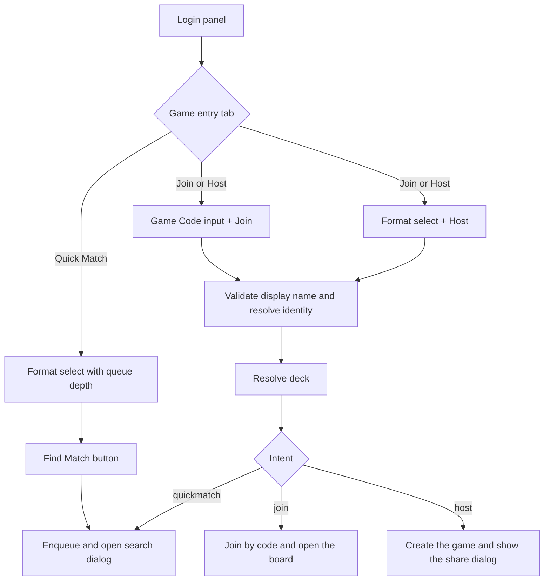

# Login view: unify Join and Create into one Join or Host panel

## Problem

The login form asks the player to pick between three modes (`Quick Match | Join | Create`) even though Join and
Create are not alternatives: a player either has a code in hand or they want to open a table. Choosing between them
is a click that carries no information, and it costs a mode-dependent re-render of the same panel. Create's action is
also labelled `Enter Game`, the same label Join used before, so the button never says what it will do.

## Target shape

The mode toggle keeps two tabs: `Quick Match` and `Join or Host`, and the panel keeps its original two-column
skeleton: the tab toggle sits inside the left column above the game-entry fields, and the deck options stay in the
right column. Nothing gains a row of its own, so the panel stays as compact as it was.

```
DISPLAY NAME  [..................................................]   PLAYER ONLINE  (lamp)
[ Quick Match | Join or Host ]                     [ Import | Saved Decks | Starter Decks ]
[ Paste your code ]   [ Standard            v ]    [ deck field ................................ ]
[      Join       ]   [       Host        ]
```

The field labels are deliberately gone, so each column's first control is its toggle and both columns start on the same
line. The deck column's retry hint renders below its toggle for the same reason: an empty header row there used to
push the whole deck column 8px down. Without a visible label the controls would also have lost their accessible names,
so `AdaptiveFormField` grew an `ariaLabel` prop (forwarded to `FormInput`, `FormSelect` and `FormTextarea`) and the
login panel names the code, both format selects and the deck field through it.

- Quick match shows its format select where the two fields are, with `Find Match` under it.
- Join or host shows the code field and the format select side by side within that same half, each with its own
  button directly beneath it.
- Every action button sits under the field it acts on, and the old full-width `Enter Game` row is gone.

- `Join` submits the code exactly as today's join mode does: deck optional, and the deck is only checked against
  "legal in some active format" when one is supplied. The game's own ruleset binding stays the server's job.
- `Host` triggers today's create behaviour unchanged: deck required, judged only against the selected format, game
  minted on the click, then `CreateGameShareDialog` holds the creator on the code and invite link.
- The two format selections are kept apart per action (`quickmatch` and `host`), so a format picked for hosting does
  not move the quick-match queue target, and vice versa.
- Queue depth badges stay on the quick-match format list only. It counts players waiting to be paired, which says
  nothing about a table the player opens themselves.



## Work

### 1. State model

- `client/src/types/login.ts`: `IGameCodeEntryMode` becomes `IGameEntryMode = 'quickmatch' | 'join_or_host'`, plus
  `IRulesetMode = 'quickmatch' | 'host'` and `IGameIntent = 'quickmatch' | 'join' | 'host'`.
- `client/src/state/loginViewStore.ts` replaces `gameCodeByMode` with three plain fields, because the Join or Host tab
  shows both values at once and they can no longer be stored per toggle position:
  - `joinGameCode: string`
  - `rulesetIdByMode: Record<IRulesetMode, string>` (seeded empty, auto-filled from the active rulesets)
  - default tab stays `quickmatch`, so a first visit behaves exactly as it does now
  - `reset()` resets all three (the reset action has no caller today, but its keys change)
- `client/src/views/login/model/useLoginViewModel.ts` exposes `gameEntryMode`, `joinGameCode`,
  `quickmatchRulesetId`, `hostRulesetId` and the matching setters.

### 2. Config

`client/src/views/login/configs/LoginView.tsx`:

- `gameCodeModeOptions` becomes `gameEntryModeOptions` with two entries: `auth.config.modeQuickMatch` and
  `auth.config.modeJoinOrHost`.
- `isRulesetSelectionMode(mode)` is retired. The question it answered was about the submitted action, not the tab, so
  it becomes `isRulesetIntent(intent): intent is 'quickmatch' | 'host'`.
- `joinGameCodeFieldConfig` stays, and is now only used by the Join column.

### 3. View

`client/src/views/login/LoginView.tsx`:

- Two option builders instead of one: `quickmatchRulesetOptions` (with `QueuedPlayersBadge` trailing) and
  `hostRulesetOptions` (plain). Both derive from `useActiveDeckRulesetsQuery`.
- Two auto-select effects, one per mode, so each keeps its own first-active-format default.
- `selectedRuleset` splits into `selectedQuickmatchRuleset` and `selectedHostRuleset`.
- `rulesetDeckEvaluation` judges the deck against the format of the action about to run: quick-match format while the
  quick-match tab is open, host format while the Join or Host tab is open.
- `importDialogRulesets`: the quick-match tab keeps passing just its selected format (unchanged rationale, one pill).
  The Join or Host tab passes all active formats, because a deck imported there may be used to join a table of any
  format; hosting still refuses an unfit deck with the existing single-line toast.
- `handleSubmit` becomes `submitGameIntent(intent)`; the bodies of today's three branches move across almost
  verbatim, with `gameCodeMode` comparisons replaced by the intent:
  - `selectsRuleset = intent !== 'join'`, `requiresDeck = selectsRuleset`
  - `quickmatch` → `startQuickmatch`, `host` → `createGameForUser` + `setCreatedGameShare`, `join` →
    `joinGameAsPlayer(joinGameCode)`
  - the "already part of this game instance" recovery keys off `intent === 'join'`
- The form keeps one `onSubmit`. Every action button is a submit button carrying `name="intent"` and its value, and
  `onSubmit` reads the pressed one from `event.nativeEvent.submitter`, falling back to the visible tab's primary
  action (Enter key): `quickmatch` on the Quick Match tab, `join` on the Join or Host tab.
- A `pendingIntent` guard disables both action buttons while a submit is in flight. Host mints a real game, so a
  double click on it must not mint two tables.
- Layout: one left `FormField` (`col-span-1`) holds the tab toggle and, beneath it, either the quick-match format
  select with `Find Match` or a two-cell grid with `Game Code` + `Join` and `Format` + `Host`. The deck options keep
  the right `col-span-1`, exactly as before. The single `Enter Game` button and the bottom action row both go away;
  `FormActions` is no longer used by the game entry form.

### 4. Strings (`client/src/i18n/en.json`)

Added: `auth.join`, `auth.host`, `auth.format`, `auth.findMatch`, `auth.config.modeJoinOrHost`. Removed:
`auth.config.modeJoin`, `auth.config.modeCreate`. `auth.gameCodeModeAria` becomes `auth.gameEntryModeAria`.
The resource types in `client/src/i18n/i18next.d.ts` are derived from `en.json`, so a missed key fails typecheck.

### 5. e2e updates

- `e2e/create-game.share-link.spec.ts`: drop the `Create` radio click, open the `Join or Host` tab, target the host
  format combobox (name changes from `Game Code` to `Format`), click `Host` instead of `Enter Game`, and assert the
  host format list still carries no `queued-players-count` badge.
- `e2e/matchmaking.quickmatch.spec.ts`: the submit button is `Find Match`; the format combobox is named `Format`.
- `e2e/login.deck-import.spec.ts` needs no change if the default tab stays Quick Match; verify it after the layout
  move.
- The share dialog's own `Enter Game` button and its failure copy keep their wording: that button still enters the
  already-created game.

### 6. Verification

- `npm run typecheck:client` and `npm run lint:client`.
- `npm run test:e2e -- e2e/create-game.share-link.spec.ts e2e/matchmaking.quickmatch.spec.ts e2e/login.deck-import.spec.ts`
- Manual pass on `/`: quick match still queues under its own format; a code plus `Join` still enters an existing game;
  `Host` still mints a game, shows the share dialog and hands over on an opponent or on `Enter Game`; the two format
  selections do not leak into each other across tab switches.

## Coverage

- `e2e/create-game.share-link.spec.ts` now drives the Join or Host tab for hosting, and gained a case for the other
  half of the tab: `Join` posts the typed five-character code with the resolved deck to
  `POST /api/games/{code}/join`, navigates to `/game/{code}`, and leaves the create endpoint untouched.
- `e2e/matchmaking.quickmatch.spec.ts` covers the quick-match tab unchanged apart from the `Format` label and the
  `Find Match` button, including the queue-depth badge staying on that list.
- `e2e/login.deck-import.spec.ts` is unaffected: the default tab is still Quick Match, so the import dialog still
  narrows to the quick-match format.

## Deliberate limits

- Join stays deck-optional. A ruleset-bound game refuses an unfit deck server side, and the toast already names that
  refusal; the login view does not know the code's format before the join request.
- The code and host fields share the left half, so each is narrower than the old single game-entry field. The trade is
  deliberate: it keeps the panel at its original height, which is what the compact footprint asks for.
- This change is layout and intent plumbing only: no server, API or query changes.
