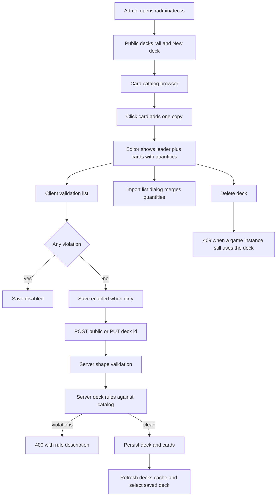

# Public deck builder (admin)

## Goal

Give the card-catalogue admins a screen at `/admin/decks` (plus `/admin/decks/:deckId`) that builds **public**
decks by clicking cards out of the existing admin card browser, and lets them create, load, update and delete
those decks. A deck gains a required `Name` that is used wherever decks are referred to, including the login
screen's deck pickers.

Deck legality is checked when a deck is saved, not while it is edited:

- no more than 4 copies of any non-leader card,
- exactly one leader card per deck,
- every card in the deck shares the leader card's colour.

Card-type and existence rules that already exist on the text-import path (no Chakra or Summon cards, no unknown
card ids) keep applying.

## Behaviour decisions

- **Editing is never blocked.** Clicking a card always adds a copy, so the editor can sit in an invalid state
  while the admin works. The editor shows a live validation list; **Save is disabled while any violation
  exists** (also while saving, and for an unmodified existing deck). Server-side validation is the authority and
  re-runs on save, so a stale client (a card deleted by another author) still fails loudly with a toast.
- **The leader is a slot, not a card line.** A leader click sets the leader slot and *replaces* any leader
  already there; leaders are excluded from the deck's card list, and the slot has its own clear control. Loading
  a deck normalises the stored leaders to one at quantity one, and an imported leader line fills or replaces the
  slot instead of becoming a card line. Two leaders - or two copies of one - therefore cannot be drafted at all,
  which leaves the leader rule as a safety net rather than a correction the author has to make.
- **Import is an option, not the workflow.** A secondary `Import list` button opens a dialog with a textarea in
  the existing `"3x N-001"` line format. Importing **merges quantities into the current selection** (it never
  replaces the deck or the name); the result is validated like any other edit.
- **Name** is required, trimmed, 1–128 characters, and not required to be unique.
- The legacy text endpoint `POST /api/deck` (used by player imports on the login screen) is **untouched**: it
  keeps its parser and behaviour, and it stores an empty name. The new rules apply to the admin endpoints.

## Flow

## Server

### Data model

- [`Deck`](server/Data/Entities/Decks/Deck.cs:9) gains `string Name`.
- [`DeckConfiguration`](server/Data/Configurations/Decks/DeckConfiguration.cs:7) gives `Name` `IsRequired()`
  plus `HasMaxLength(128)` (matching [`SavedDeck`](server/Data/Configurations/Decks/SavedDeckConfiguration.cs:14))
  and an index on `(Type, Name)` for the public-deck rail.
- New EF migration `AddNameToDecks` with `defaultValue: ""` so existing rows stay valid; the login screen keeps
  its old label as the fallback for the nameless rows a fresh legacy import creates.
- [`DevelopmentDeckSeeder`](server/Data/Seeding/Development/DevelopmentDeckSeeder.cs:50) writes a deterministic
  name for seeded decks when it creates or refreshes them, so development and e2e lists are readable.

### Wire contracts

Added to [`DeckRequests.cs`](server/Models/Api/DeckRequests.cs:5):

- `DeckCardRequest(string CardId, int Quantity)`
- `CreatePublicDeckRequest(string Name, IReadOnlyList<DeckCardRequest> Cards)`
- `UpdateDeckRequest(string Name, IReadOnlyList<DeckCardRequest> Cards)`
- `DeckResponse` gains `string Name` (populated by both the projection and the populated path in
  [`DeckService`](server/Api/Services/Deck/DeckService.cs:267)).

### Validation, in two layers

1. **Shape** — new FluentValidation validators in `server/Api/Validation/DeckRequestValidators.cs`, registered by
   the existing `AddValidatorsFromAssembly` in [`Program.cs`](server/Program.cs:124): name required and at most
   128 characters, cards non-empty, each card id non-empty and a safe token, each quantity 1–99, no duplicate
   card ids. These run automatically before the action body executes.
2. **Deck rules** — a pure policy `server/Api/Services/Deck/PublicDeckRules.cs` (same shape as
   [`CardArtOrphanPolicy`](server/Api/Services/CardArt/CardArtOrphanPolicy.cs)) takes the requested cards plus
   the catalogue metadata for them and returns violations. Rules: unknown card id, Chakra or Summon present,
   leader count not exactly 1, leader quantity not 1, a non-leader quantity above 4, and a non-leader whose
   colour differs from the leader's. Because it is pure it is unit-tested without a database, and the same
   function serves create and update.

`DeckService` gains `CreatePublicDeckAsync` and `UpdateDeckAsync`, both sharing one private
catalogue-lookup-and-evaluate helper that maps policy violations to `Error.Validation` codes
(`Deck.Public.*`). Update replaces the deck's card rows inside a transaction and leaves `Type` and `UserId`
untouched. The existing `DeleteDeck` conflict guard for decks referenced by a game instance is unchanged.

### Endpoints on [`DeckController`](server/Api/Controllers/DeckController.cs:9)

| Method | Route | Auth | Notes |
| --- | --- | --- | --- |
| POST | `/api/deck/public` | `CardCatalogAdmin` | Structured `{ name, cards }`, returns `201` + `DeckResponse` |
| PUT | `/api/deck/{deckId}` | `CardCatalogAdmin` | Same body, returns `200` + `DeckResponse` |
| DELETE | `/api/deck/{deckId}` | `CardCatalogAdmin` | Existing behaviour, now behind the admin claim |
| GET | `/api/deck?type=Public` | anonymous | Optional `type` filter added for the rail and the login picker |
| POST | `/api/deck` | anonymous | Unchanged legacy text import |

The e2e fixture reaper in [`fixtures.ts`](e2e/helpers/multiplayer/fixtures.ts:374) starts sending the
`X-Dev-User-Id` header (the development handler always grants `card_catalog_admin`) so the protected delete keeps
working there.

## Client

### Reused catalogue browser

The admin catalogue pieces stay the single implementation:

- [`CardAdminFilterPanel`](client/src/views/admin/components/catalog/CardAdminFilterPanel.tsx:10) — used as-is.
- [`CardAdminCatalogPane`](client/src/views/admin/components/catalog/CardAdminCatalogPane.tsx:10),
  [`CardAdminCardGrid`](client/src/views/admin/components/catalog/CardAdminCardGrid.tsx:4) and
  [`CardAdminCardTile`](client/src/views/admin/components/catalog/CardAdminCardTile.tsx:9) gain **optional**
  selection props (`selectedCountByCardId`, `onAddCard`, `onRemoveCard`). Defaults preserve the current
  single-selection behaviour, so `/admin/cards` is unchanged; in quantity mode the tile shows a count chip and a
  small remove control, and never refuses a click — a fifth copy is allowed and turns the chip and the validation
  list invalid.
- Props are declared in [`cardAdminViewTypes.ts`](client/src/views/admin/types/cardAdminViewTypes.ts:156).

### New files

- `client/src/views/admin/DeckAdminView.tsx` — three-column screen: decks rail, catalogue browser, editor pane.
- `client/src/views/admin/components/deck/` — `DeckAdminListRail.tsx`, `DeckAdminEditorPane.tsx`,
  `DeckAdminSelectedCardRow.tsx`, `DeckAdminValidationList.tsx`, `DeckAdminImportDialog.tsx`,
  `DeckAdminDeleteDialog.tsx`, `index.ts` (wired through [`components/index.ts`](client/src/views/admin/components/index.ts:1)).
- `client/src/views/admin/model/useDeckAdminModel.ts` — draft (`name`, `quantities` map), dirty tracking, load of
  an existing deck, add/remove/import mutations of the draft, validation memo, save and delete handlers.
- `client/src/views/admin/utils/deckDraftValidation.ts` — pure mirror of the server rules, returning i18n keys
  rather than server text.
- `client/src/views/admin/utils/deckImport.ts` — `parseDeckImportPayload` (same line regex as
  [`validateDeckCardsPayload`](client/src/views/login/utils/validateDeckCardsPayload.ts:4)) plus a quantity merge.
- `client/src/views/admin/types/deckAdminTypes.ts` — draft, violation and props types.
- `client/src/state/deckAdminViewStore.ts` + `client/src/state/types/deckAdminViewStore.ts` — catalogue filters
  that persist while moving between decks (mirrors
  [`cardAdminViewStore`](client/src/state/cardAdminViewStore.ts:14)).

### Services and routes

- [`deckApi.ts`](client/src/services/api/deckApi.ts:1): `createPublicDeck`, `updateDeck`, `deleteDeck`,
  `fetchDecks({ type, populate })`.
- New `client/src/services/queries/deckQueries.ts`: `useDecksQuery`, `useDeckQuery(deckId, populate)` and the
  create/update/delete mutations, with a `['decks']` key root and invalidation on every write.
- [`types/deck.ts`](client/src/types/deck.ts:6): `IDeckResponse.name`, plus the card-input type.
- [`routes.tsx`](client/src/app/routes.tsx:64): lazy `/admin/decks` and `/admin/decks/:deckId` routes, matching
  the `/admin/cards` and `/admin/cards/new` pattern. The cards screen gets a link to the deck screen.
- [`LoginView.tsx`](client/src/views/login/LoginView.tsx:789) builds deck labels from `deck.name` and falls back
  to the existing `Deck #n (short id)` label when a legacy deck has no name; a new
  `auth.deckChoice.namedDeckLabel` key carries the name plus card count.

### Editor pane contents

Name input, leader slot (the first leader card, or an empty state), the selected cards list with quantity
steppers, deck totals, the validation list, and the actions Save (disabled until valid and dirty), Import list and
Delete. Loading an existing deck uses `GET /api/deck/{id}?populate=true` to seed quantities and card metadata;
cards added by clicking are hydrated through [`useCardCatalogByIdsQuery`](client/src/services/queries/cardQueries.ts:118)
so validation always has type and colour for every selected card.

## Tests and verification

- Server unit tests: `PublicDeckRulesTests.cs` (each rule individually and combined), `DeckRequestValidatorTests.cs`
  (shape rules), and additions to [`DeckServiceTests.cs`](server/tests/ProjectHiddenVillage.Server.Tests/DeckServiceTests.cs:11)
  covering name persistence, card-row replacement on update, and the new rule codes.
- e2e: `e2e/helpers/deckAdminMocks.ts` mocking the catalogue pages, deck list and deck read, and
  `e2e/admin.deck-builder.spec.ts` covering create with Save disabled states (no leader, five copies, wrong
  colour), successful create, load and update, import merge and delete.
- `npm run typecheck`, `npm run lint`, `npm run test:server`, targeted `npm run test:e2e -- e2e/admin.deck-builder.spec.ts`,
  and `npm run db:migrate` against the development database. Do not run `dotnet build` or the e2e suite while the
  dev stack is live (see the tooling rules).

## Out of scope / assumptions

- `SavedDeck` stays as it is; only `Deck` learns about names.
- The legacy text import keeps its own parser and its current validation, so player-created decks are not
  suddenly subject to leader/colour rules.
- No deck-size minimum or maximum beyond the three stated rules; the validator only caps absurd per-card
  quantities.
- Names are not unique; two public decks may share a name.

## Implementation notes (as built)

- **The draft is derived, not mirrored.** `useDeckAdminModel` keeps `editedDraft: IDeckAdminDraft | null`; while it
  is null the editor shows the loaded deck, and the first edit materialises a copy. Nothing writes state from a
  query result, which is what keeps the React hooks lint rule (`set-state-in-effect`) happy and removes a whole
  class of "the refetch overwrote my typing" bugs. `DeckAdminView` keys the screen by deck id, so moving between
  decks or to the create route remounts the draft.
- **The tile's identity lives on its wrapper.** A button cannot nest another button, so the remove-copy control is
  a sibling of the card button. `data-testid="catalog-card-tile"`, `data-card-id` and `data-copy-count` therefore
  sit on the wrapping `div`; the card editor's existing `li button` selectors are unaffected.
- **`DeleteDeck` is now an admin write** (`[Authorize(Policy = CardCatalogAdmin)]`), matching the new POST and PUT.
  The e2e fixture reaper sends the development admin header so its cleanup still works in the Development
  environment the suite runs in.
- **The rail and the login pickers ask for `type=Public`** through the new query parameter instead of filtering a
  full deck list in the browser. The login screen keeps fetching everything, because it needs the signed-in user's
  own decks too.
- **Seeded decks get a name only when they have none** (`<profile> deck one/two`). Renaming a seeded deck in the
  builder survives the next server start, following the same "seeding never overwrites authored work" rule the
  catalogue entries use.
- **The status/error surfaces are the existing ones**: `getApiErrorMessage` turns the server's message (400 rule
  violations, 404, 409 for an in-use deck) into a toast, and the validation list mirrors the rule codes the server
  would answer with.
- **Leader normalisation lives in the draft, not in the rules.** `addCopy`, `importCards` and the load path all
  funnel leaders into `withoutLeaderEntries` + one entry at quantity one, so the forbidden states are never
  representable; `buildSelectedDeckCards` filters leaders out of the card rows and `buildDeckLeaderCard` feeds the
  slot. The client validation still checks the leader count because a stale or hand-built draft must not be
  saveable, but the builder cannot produce that state by clicking.
- **The builder's catalogue hides Chakra and Summon by default.** The catalogue endpoint filters by what it
  returns, so "hide" is expressed as an include-list: `resolveDeckCatalogTypeFilter` turns an empty type
  selection into the deckable types (`leader`, `character`, `ex character`). The toggle sits beside the Sort
  control, rendered by the shared filter panel only when the deck screen passes its two optional props
  (`includeNonDeckableTypes` in the deck filter store, off by default); it switches the request back to the
  author's own selection, and turning it off again drops any Chakra/Summon chip that was selected. The cards can
  still be shown and picked, and the `unsupportedCardType` rule then blocks the save - the toggle is for
  inspection, not for making an illegal deck legal.
- **Deck outlines carry the card's colour - and only the outlines.** `resolveDeckCardColorStyling` maps the
  readable colour ("Red", "Blue", "Green", everything else neutral) to a border class; the leader slot, every card
  row and their thumbnails use it, and `data-color-tone` makes it assertable. The deck rail does the same with the
  deck's leader colour, which the lean list now carries as `DeckResponse.LeaderColor` (computed as an `Any` +
  `FirstOrDefault` subquery in [`ToDeckProjectionExpression`](server/Api/Services/Deck/DeckService.cs:396), so the
  rail does not need a populated read). Selection is marked by a tint behind the element only - a second ring in
  the primary colour competed with the colour the outline exists to show. Quantity controls keep fixed tones so
  their meaning never depends on the card: the number is neutral (it only takes the error tone for an over-limit
  count), the minus is red and the plus is green.
- **Catalogue tiles and deck rail items take the card colour as a surface.** [`CardAdminCardTile`](client/src/views/admin/components/catalog/CardAdminCardTile.tsx:28)
  paints its background with the card's colour from the listing row and switches its text to the matching
  contrast tone, so the card admin's rail and the deck builder's catalogue change together - there is one tile
  component, not two. The deck rail reuses the same tones with the deck's leader colour, so a deck is highlighted
  in the colour it is built around. The tones are muted theme tokens (`--card-tone-<colour>-bg|border|text`,
  declared for both themes in [`index.css`](client/src/index.css:53)) rather than saturated palette colours,
  because a wall of tiles at full strength was hard on the eyes. A selected tile brings back the primary-colour
  outline (plus a 1px ring) as the selection signal, since a background tint no longer reads against a coloured
  surface; a selected rail item instead gets a thicker inner left edge in its own tone, which keeps the primary
  colour out of a list that is read entirely by card colour.

## Verification (run after implementation)

- `npm --prefix client run typecheck` - clean.
- `npm --prefix client run lint` - clean.
- `npm run test:server` - all tests passing, including the new `PublicDeckRulesTests`, `DeckRequestValidatorTests`
  and the deck-service create/update tests (the update path also has a regression test proving a retained card row
  is updated in place rather than deleted and re-inserted).
- `npx playwright test e2e/admin.deck-builder.spec.ts e2e/admin.card-editor.spec.ts e2e/admin.card-create.spec.ts`
  - 7 passed (the builder spec covers: save gated by each rule, create, load, import merge, update, 409 delete and
  a successful delete).
- `npm run db:migrate` - `20261020174622_AddNameToDecks` applied to the development database.
