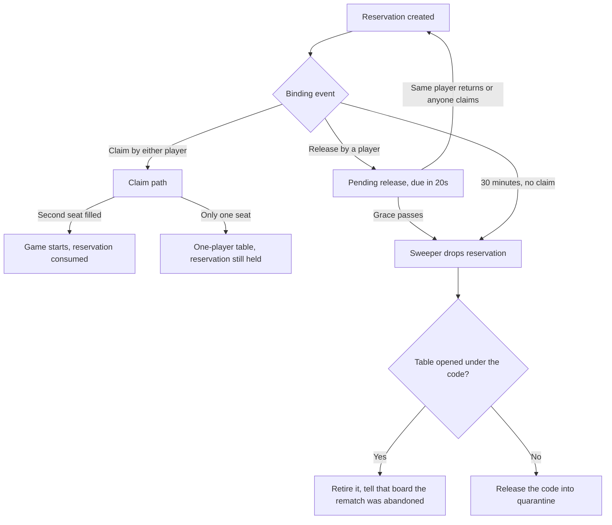

# Rematch abandonment: releasing a reserved table nobody is coming back for

Follow-up to [`plans/game-codes-and-rematch.md`](plans/game-codes-and-rematch.md:1). A rematch is agreed on a
finished board, both players are handed to the login view with a reserved code, and each chooses the deck they bring
to the next match. This plan covers what happens when that agreement stops being true: one of them leaves and does
not come back, neither of them starts the next game, or one of them moves on to something else.

The intent is two-fold: a player must never be shown a rematch for a game that no longer exists (a tab restored the
next day), and the system must not hold a reserved game code for a window somebody left open and forgot.

## What is already bounded

- The offer on the finished board lapses after `Rematch:ConsentLifetimeSeconds` (120s), and the finished table itself
  is retired by [`GameTableReaper`](../server/Api/Services/Games/GameTableReaper.cs:26) once nobody is watching.
- The reservation lapses after `Rematch:ReservationLifetimeSeconds`, swept by
  [`RematchReservationSweeper`](../server/Api/Services/Rematch/RematchReservationSweeper.cs:12), which gives the code
  back to the allocator's quarantine.
- A table opened by one claim and never joined is retired after `GameRetirement:AbandonedGraceSeconds`.

So a code is already released eventually. What is missing is the *agreement* dying when one of the two players walks
away, and the client being told.

## Decisions

| # | Decision | Why |
|---|----------|-----|
| D1 | `Rematch:ReservationLifetimeSeconds` becomes **1800** (30 minutes) | The agreed ceiling: nobody starts the next game and the reservation dies |
| D2 | Leaving the login view without claiming **releases** the reservation | "Either player leaves and doesn't return" is the case a TTL alone cannot serve quickly |
| D3 | The release is **deferred** by `Rematch:ReleaseGraceSeconds` (20s) rather than applied on arrival | A refresh unmounts the view exactly like a departure; the grace is what tells them apart |
| D4 | A claim, or the releasing player's own return, **cancels** the pending release | Both are proof the player is still in the flow |
| D5 | The opponent's probe does **not** cancel it | Watching a banner is not a commitment; only the player who left can change their mind |
| D6 | A release drops the reservation, retires a table opened under that code, and releases the code | One rule for the whole agreement, whether nobody claimed or one player did |
| D7 | The opponent is told by an **event on a connection they already have**, never by a poll | No periodic checks on the login view |
| D8 | Dismissing the banner is a release, not just a local `sessionStorage` delete | Otherwise the opponent waits on a rematch nobody is coming back to |
| D9 | The stored banner carries its **expiry** and is treated as absent afterwards | A restored tab cannot show yesterday's rematch, whatever the server did in the meantime |

## Lifecycle

## Server

### Reservation

[`RematchReservation`](../server/Api/Services/Rematch/RematchReservation.cs:13) gains a deferred release, written only
under the store lock: `PendingReleasePlayerId` and `PendingReleaseDueAtUtc`. Two members carry the rules:

- `RequestRelease(playerId, now, grace)` records the release. Idempotent: a second call from the same seat only
  refreshes the deadline, never reports an error, so a page that fires the release twice (unmount and `pagehide`)
  cannot fail.
- `CancelPendingRelease(playerId)` clears it when that same player proves they are still there.

### Store and sweep

[`RematchReservationStore.PruneExpired`](../server/Api/Services/Rematch/RematchReservationStore.cs:60) becomes
`Prune`, returning what it dropped and why: `expired`, `released` (with the player who released). For each drop it:
retires a table that exists under that code through
[`InMemoryGameInstanceRegistry.TryRetire`](../server/Engine/Services/InMemoryGameInstanceRegistry.cs:186), otherwise
releases the code through the allocator (quarantine, as today).

[`RematchReservationSweeper`](../server/Api/Services/Rematch/RematchReservationSweeper.cs:12) ticks every **10s** so the
20s grace lands within a bounded, short window, and it is what sends the event below.

### Service and endpoint

- `IRematchHandlingService.ReleaseReservation(code, playerId)`: seat-checked (`Game.Rematch.Forbidden`), unknown or
  already-dropped code is `Game.Rematch.NotFound`. A release by the player who already claimed a one-seat table is a
  release like any other: the grace runs out, the table is retired with it, and the code comes back. Leaving a table
  of your own to wait for an opponent who is not coming is not an agreement worth keeping.
- `GetActiveReservation(code, playerId)` becomes player-aware so it can cancel a pending release for the returning
  player.
- `POST /api/games/{code}/rematch/release` on [`GamesController`](../server/Api/Controllers/GamesController.cs:155),
  authorized like the rest, so a release survives the page going away (`fetch` with `keepalive`).

### Telling the opponent (D7)

Two events, both on connections that already exist:

- **On the board**: when the sweep retires a one-player table because the rematch died, it publishes
  `RematchReleased { code }` to that table's SignalR group before retiring, so the player who claimed is told their
  opponent left instead of watching a board that no longer accepts anything. `useGameHubState` handles it by clearing
  the stored rematch and returning to the login view with a notice.
- **On the login view**: no subscription exists (the reserved table is not a game, and opening a second hub
  connection for one event is not worth it), so the banner is cleared by the three moments the opponent is
  *already* sending a request: the one-shot probe on mount, the probe when the window is focused or becomes
  visible again, and a refused claim. A refused claim answers `Game.Rematch.Released` - a distinct code from
  `Expired`, so the copy can say "your opponent left" rather than "this table expired".

That is the whole notification story: no polling, no timers on the client, and nothing to keep alive while the tab
sits open.

## Client

- [`pendingRematch.ts`](../client/src/state/pendingRematch.ts:1) stores `expiresAtUtc` from
  `pendingRematch.expiresAtUtc` and returns `null` (clearing the record) once it has passed.
- [`LoginView`](../client/src/views/login/LoginView.tsx:196):
  - **On mount** with a stored rematch, one probe: clear the banner silently when the reservation is gone, keep it
    when the reservation is alive (and use the answer to name the format, which removes the second lookup).
  - **On `focus` / `visibilitychange → visible`**, one probe. Not a loop: it fires when a human comes back to the tab.
  - **On unmount, and on `pagehide`**, `POST .../rematch/release` with `keepalive` - skipped when the player just
    claimed (a ref set by the successful join) or when the banner was dismissed after the release already went out.
  - **On a refused claim** carrying `Game.Rematch.Released` / `Expired` / `NotFound`, clear the banner and say why.
  - **The X** clears the record and releases (D8). The toast is the same "rematch lapsed" copy.
- Moving on cancels too: hosting, joining by code, or queueing clears the stored rematch, and the server drops the
  reservation for that player (see the cases below).

## The other cases, folded into the same rules

1. **A player moves on** - hosts another table, joins one by code, or queues for quick match while holding a
   reservation: drop their reservation. This release is **immediate, never deferred** - the player has just told us
   where they went, so there is no refresh to protect against. `IRematchHandlingService` gains
   `ReleaseReservationsForPlayer(userId)`, called from three existing entry points:
   [`MatchmakingService.EnqueueAsync`](../server/Api/Services/Matchmaking/MatchmakingService.cs:127) (which already
   evicts that player's tickets), [`GameInstanceService.CreateGameForUser`](../server/Api/Services/Games/GameInstanceService.cs:20)
   (host) and the join path in the same file. The client clears its stored rematch on those same submits. The rematch
   claim itself is untouched: it creates the table through `CreateWithReservedCode`, not through the host path.
2. **The format was deactivated between matches** - this one changes the probe. Answering a reserved code from its
   snapshot (as [`GetGameRuleset`](../server/Api/Controllers/GamesController.cs:155) does today) hides a deactivated
   format until the player presses Join and is refused with `Game.Rematch.RulesetUnavailable`. The probe therefore
   becomes authoritative: for a *reserved* code it answers only while the bound ruleset still exists and is active,
   and otherwise answers `Game.Rematch.RulesetUnavailable`. The banner then disappears at mount with the "this format
   is no longer available" copy instead of waiting for a click. The claim keeps its own check as the authority.
3. **A player is already seated** - they reloaded into the login view instead of the board. The claim path answers
   with the existing-game branch (`JoinExistingGameAsync` returns the game for a player who has a stored deck), and
   the login submit already hands them over on "already part of this game instance" rather than seating them twice.
   The probe cannot express that on its own - it answers a format, not a table - so the navigation happens on the
   claim; what matters is that no second seat exists, which the claim path guarantees.
4. **A newer reservation for the same pair exists** - the client keeps one record and the newest wins
   (`storePendingRematch` overwrites), and the release deferred on the old one is void once that reservation is gone,
   so an older banner can never be claimed.
5. **Identity gone** - guest retention (7 days) is far longer than the 30-minute ceiling, so the TTL always wins
   first; no special case.
6. **The source table retired** - harmless by design, and nothing to do. The reservation snapshots the ruleset
   binding, its clock policy and the modifiers at agreement time, so the rematch outlives the board it came from; the
   reaper may collect the finished table while both players are still deciding on their decks.

## Configuration

| Setting | Default | Meaning |
|---------|---------|---------|
| `Rematch:ReservationLifetimeSeconds` | 1800 | The agreed 30-minute ceiling |
| `Rematch:ReleaseGraceSeconds` | 20 | How long a release waits, so a refresh is not a departure |
| `RematchReservationSweeper` tick | 10s | Bounds how late a due release lands |

## Coverage

- Unit (`GameCodeAndRematchTests`): a release then a sweep drops the reservation and releases the code; a claim inside
  the grace cancels it; the releasing player's probe cancels it; the opponent's probe does not; a release while a
  one-player table exists retires that table; a non-seat release is refused; releasing twice is idempotent; expiry
  still works.
- Controller: `POST /api/games/{code}/rematch/release` - seat accepted, non-seat unauthorized, unknown code not found.
- Controller: the reserved-code ruleset probe answers `Game.Rematch.RulesetUnavailable` once the bound format is
  deactivated, and answers the game (not the reservation) once the caller is already seated.
- Service: `ReleaseReservationsForPlayer` drops an outstanding reservation on enqueue, on host and on join, and leaves
  the rematch claim path alone.
- e2e (`gameview.multiplayer.rematch.spec.ts`): the loser navigates away after the hand-off; the winner's Join is
  refused with the "opponent left" answer, the banner disappears, and the reserved code stops answering the ruleset
  probe once the grace has elapsed.
- Client: a stored rematch with a past `expiresAtUtc` never renders a banner (seeded `sessionStorage`, no server
  timing involved).

## Where it lives

| Concern | File |
|---------|------|
| The 30-minute ceiling and the release grace | `server/Api/Services/Rematch/RematchOptions.cs` |
| Deferred release state on a reservation | `server/Api/Services/Rematch/RematchReservation.cs` |
| Applying an ending, retiring a one-seat table, releasing the code | `server/Api/Services/Rematch/RematchReservationStore.cs` (`Prune`, `Finalize`) |
| Sweeping every 10s and announcing a retired table | `server/Api/Services/Rematch/RematchReservationSweeper.cs` |
| Release, return-cancels-release, move-on releases | `server/Api/Services/Rematch/RematchHandlingService.cs` |
| Seat check on claim, and the released answer | `server/Api/Services/Games/GameInstanceService.cs` (`ClaimReservedRematchTableAsync`) |
| Release endpoint and the authoritative probe | `server/Api/Controllers/GamesController.cs` |
| Expiry-aware stored banner and the release call | `client/src/state/pendingRematch.ts`, `client/src/services/api/gameApi.ts` |
| Probe on mount and on return, release on unmount/pagehide, dismissal | `client/src/views/login/LoginView.tsx` |
| The board being told its table was abandoned | `client/src/views/game/hooks/GameHub/useGameHubState.ts` (`RematchReleased`) |

## Verification

- Unit (`GameCodeAndRematchTests`): a release is deferred and only the sweep applies it; a claim inside the grace
  cancels it; the releasing player's own probe cancels it; the opponent's probe does not; a release with a one-seat
  table retires that table and releases the code; a non-seat release is refused; releasing twice is idempotent;
  `ReleaseReservationsForPlayer` drops only that player's reservations and spares the code being claimed.
- Controller (`GamesControllerGameRulesetTests`): the probe answers a reserved code, `Game.Rematch.Released` when the
  other player left, `Game.Rematch.RulesetUnavailable` when the format was deactivated, and the release endpoint's
  seat / non-seat / unknown-code answers.
- e2e (`gameview.multiplayer.rematch.spec.ts`): the agreement and the claim, and - the case this plan exists for - a
  loser who navigates away releases the rematch, so the winner's banner is cleared when they come back to the tab and
  the code stops answering the probe.

## Deliberate limits

- A tab killed without firing `pagehide` (crash, sleeping machine) cannot release; the 30-minute ceiling and the sweep
  are the net.
- The opponent on the *login* view is not pushed to; they learn on their next interaction with the page. A user-scoped
  games-hub event is the upgrade path if sub-second delivery is ever wanted.
- Everything stays per-process, like the games and the reservations themselves.
