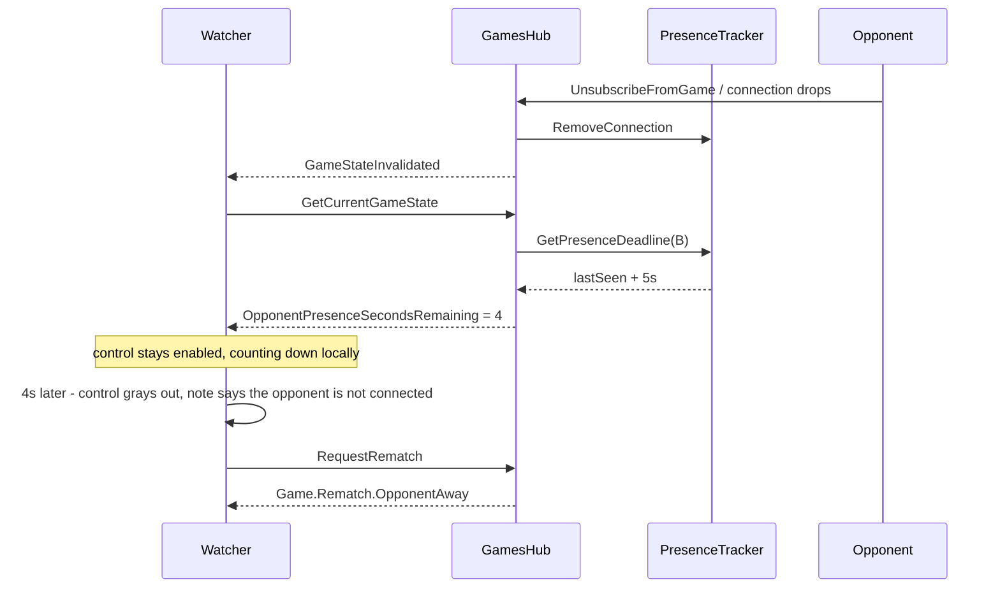

# Rematch presence: an offer only goes out while the other seat is there

Follow-up to [`plans/game-codes-and-rematch.md`](plans/game-codes-and-rematch.md:1) and
[`plans/rematch-abandonment.md`](plans/rematch-abandonment.md:1). The finished board offers `Rematch` to whoever is
looking at it, but nothing today asks whether the *other* seat is still looking. A player whose opponent closed the tab
can offer into an empty chair, and the offer sits there until it lapses - the same waiting the abandonment plan spends
its whole length removing.

The intent is one rule: **the offer is only made while the opposing player is watching this board.** When they are not,
the control is grayed out and says why, and the hub refuses the call so a stale client cannot get around it.

## What is already there

- [`GamePresenceTracker`](../server/Api/Services/Games/GamePresenceTracker.cs:13) already knows who is watching each
  game, because the phase-presentation contract needs it. A connection counts from `SubscribeToGame` - that is, from a
  board actually watching - not from the socket being open (see
  [`GamesHub.Subscription.cs`](../server/Api/Hubs/GamesHub.Subscription.cs:7)). A player with several tabs counts once.
- The finished board already publishes the whole rematch offer in the game state
  (`GameStateResponse.PendingRematch`), and the hub invalidates the game group on every mutation, so both clients
  refetch. The hand-off to the login view rides on exactly that, with no dedicated event.
- The completion of a match is not a retirement: the source table stays watchable, so presence keeps being tracked
  after the result overlay appears.

## Decisions

| # | Decision | Why |
|---|----------|-----|
| D1 | Presence for the rematch rides the **game state**, and the hub invalidates on subscribe / unsubscribe / disconnect | One source of truth, the same rule the reserved code already follows; no second event type to keep in sync |
| D2 | A player who just stopped watching still counts as present for `Rematch:OpponentPresenceGraceSeconds` (**5s**) | A page refresh unmounts and re-subscribes exactly like a departure; the grace is what tells them apart |
| D3 | The grace is measured from **when their last connection went away**, not from when the offer is asked for | Otherwise a player who left an hour ago would look present again on every state read |
| D4 | The published value is the **seconds left in that grace**, not a deadline | The client counts down locally with no clock-skew dependency, exactly as the action clock does |
| D5 | `null` means "present, or not observed at all" | A fresh process has seen nobody yet; graying out every board after a restart would be wrong |
| D6 | The hub refuses an offer (and an acceptance) once the grace has elapsed, with `Game.Rematch.OpponentAway` | The grayed control is a hint; the seat check is the authority |
| D7 | Declining is **not** gated | A player left alone must always be able to clear the offer that is sitting on their board |

## Flow

## Server

### Presence tracker

[`GamePresenceTracker`](../server/Api/Services/Games/GamePresenceTracker.cs:13) records, per game and player, the
instant their **last** connection went away and the player had none left. Registering drops that record, so a returning
player is present again with no grace involved. One method carries the rule:

- `GetPresenceDeadline(gameId, playerId, grace)` answers `null` while the player is watching right now, and `null` when
  they were never seen. Otherwise it answers `lastSeen + grace`, which may already be in the past.

The tracker takes an optional `TimeProvider` like every other deadline in the engine, so tests advance a fake clock
instead of sleeping. Entries older than `Rematch`'s reservation window are pruned on write: the record only exists to
describe a departure, and a departure nobody has come back to stops mattering.

### Service

[`RematchHandlingService`](../server/Api/Services/Rematch/RematchHandlingService.cs:18) takes the tracker and gains
one method:

- `GetOpponentPresenceSecondsRemaining(gameId, requestingPlayerId)` - the other seat's grace counted down against
  `TimeProvider`, `null` while they are present (or unknown), `0` once it has run out. This is what the state payload
  publishes, so the board and the refusal read the same number.

`RequestRematch` and `AcceptRematch` both start with the seat check: an offer, or an answer to one, whose *other* seat
is gone is `Game.Rematch.OpponentAway`. `RequestRematch` covers the "this request IS the acceptance" path too, because
the other seat in that case is the player who offered.

### Published state and the invalidation

- [`GameStateResponse`](../server/Models/Api/GameStateResponses.cs:3) gains
  `int? OpponentPresenceSecondsRemaining`, filled by `GameStateResponseMapper` from the rematch service.
- Every hub path that answers with a state maps it through one private `MapGameState` helper, and
  [`GamesController.GetGameState`](../server/Api/Controllers/GamesController.cs:180) passes the same value, so a
  reloaded board opens on the right answer instead of waiting for the socket.
- [`GamesHub.Subscription.cs`](../server/Api/Hubs/GamesHub.Subscription.cs:7) sends `GameStateInvalidated` to the game
  group after a subscribe, an unsubscribe and a disconnect: presence changed, so the payload did.

## Client

- [`useRematchOpponentPresence`](../client/src/views/game/hooks/GameView/memos/useRematchOpponentPresence.ts:1) turns
  the published countdown into a boolean: present while the value is `null`, absent immediately when it is `0`, and
  otherwise present until the countdown runs out - one local timer, no polling.
- [`GameOverOverlay`](../client/src/views/game/components/GameOverOverlay.tsx:22) grays out `Rematch` and
  `Accept rematch` while the opponent is away, and shows `game.rematch.opponentAway` under the offer notes. `Decline`,
  `Withdraw request`, the corner dismiss and `Return to main page` stay live.
- A refused offer still surfaces through the existing action error, from the `Game.Rematch.OpponentAway` description.

## Coverage

- `GamePresenceTrackerTests`: a player is present while connected, gets a deadline `grace` after their last connection
  goes away, is present again on re-register, and answers `null` when never seen.
- `GameCodeAndRematchTests`: an offer is refused with `Game.Rematch.OpponentAway` once the other seat's grace has run
  out and allowed inside it; accepting a lapsed offerer's offer is refused; declining still settles the offer;
  `GetOpponentPresenceSecondsRemaining` counts down and is `null` while the opponent watches.
- `GamesHubNormalizationTests`: `SubscribeToGame` and `UnsubscribeFromGame` invalidate the group, and
  `GetCurrentGameState` publishes the countdown from the tracker.
- `GameControllerGameRulesetTests` (or the state-visibility suite): the REST snapshot carries the field.
- e2e (`gameview.multiplayer.rematch.spec.ts`): the loser walks off the finished board, the offer grays out and names
  the reason once the grace has passed, a hub-issued offer is refused with the error code, and the control comes back
  when the loser rejoins the board.

## Configuration

| Setting | Default | Meaning |
|---------|---------|---------|
| `Rematch:OpponentPresenceGraceSeconds` | 5 | How long a departure still counts as a refresh |

## Deliberate limits

- Presence is per process, like the games and the reservations themselves. A restart resets everybody to "never
  seen", which D5 treats as present; the hub refusal then relies on the new tracker's own records.
- A client whose clock is badly wrong only draws the gray-out early or late; the refusal is the server's, so no offer
  can be made into an empty seat either way.
- The board watches presence through invalidations, not a stream: the countdown is local, and the next state read
  re-syncs it.
