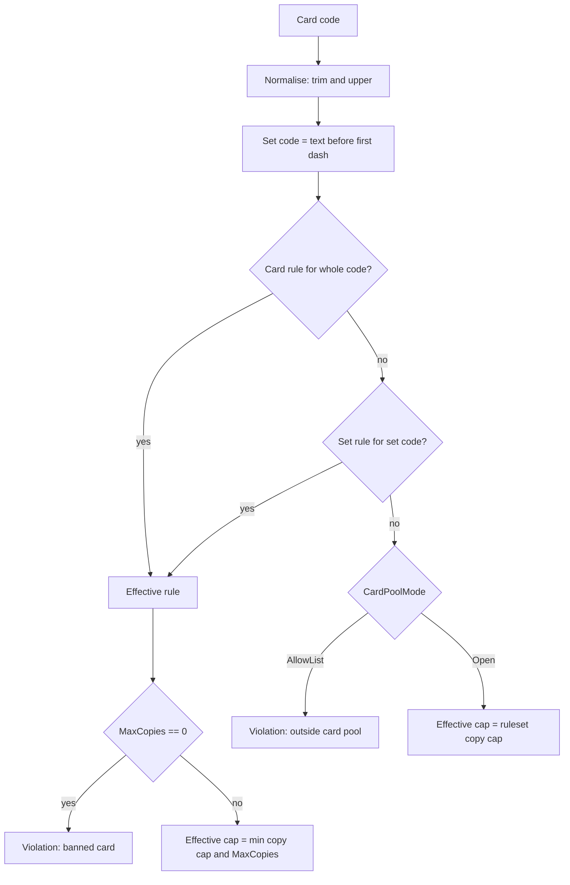

# Ruleset card pools: code-based allow, ban and limit rules

## Goal

A ruleset decides which cards may be played, expressed as data the admin screen owns. Rules are **not**
attached to catalogue rows: a rule names a card code or a set code, so it exists independently of the
catalogue, applies to whatever card carries that code, and only affects the ruleset that owns it. Two new
formats ship with it:

- **Unrestricted** - open pool, no rules, so every real and placeholder card is usable.
- **Pre-Release** - allow-list of the revealed sets, so placeholder `SAMPLE` cards are excluded, including
  placeholder cards added to the catalogue later.

The admin CRUD for rulesets already exists ([`DeckRulesetAdminView.tsx`](../client/src/views/admin/DeckRulesetAdminView.tsx:15),
[`DeckRulesetController.cs`](../server/Api/Controllers/DeckRulesetController.cs:9),
[`DeckRulesetService.cs`](../server/Api/Services/Deck/DeckRulesetService.cs:81)). This work changes what a
ruleset can say, not who may edit it.

## Agreed decisions

1. `DeckRuleset.CardPoolMode` is `Open` (default) or `AllowList`.
2. A rule row carries a matcher, not a foreign key: `MatchType` = `Set` | `Card`, a `Code` string, and
   `MaxCopies`.
3. Matching is segment-exact. The set code is the text before the **first** `-`, upper-cased; the card code is
   the whole normalised string. `S` never matches `SAMPLE-3`, and `SAMPLE` matches `SAMPLE-1` through
   `SAMPLE-12` but not `N-001`.
4. `MaxCopies` keeps one meaning everywhere: `0` bans the matched cards, `N` caps them at N copies. In an
   allow-list format a rule with `MaxCopies >= 1` is what puts those cards **in** the pool.
5. Precedence: a card rule beats a set rule. Set `SAMPLE` allowed at 4 plus card `SAMPLE-3` at 0 bans
   `SAMPLE-3`. A card that matches nothing in an allow-list format is outside the pool and is reported with
   its own violation code, not the generic banned-card message.
6. ~~The type flags stay independent: `AllowChakraCards` and `AllowSummonCards` are checked before the pool.~~
   Superseded: Chakra and Summon cards are fundamental to the game, so both flags are gone end to end
   ([migration `RemoveCardTypeGatesFromDeckRulesets`](../server/Migrations/20261101214705_RemoveCardTypeGatesFromDeckRulesets.cs:12))
   and no format can gate them. They are bound only by size, copy and pool rules, and the colour check skips them
   because they carry no colour of their own.
7. Formats seeded with fixed GUIDs through `HasData`, so a fresh database and a migrated database agree:

| Key | CardPoolMode | Leader | Non-leader | Copies | Colour match | Chakra/Summon | Quick match | Rules |
| --- | --- | --- | --- | --- | --- | --- | --- | --- |
| `standard` | Open | 1 | 50 | 4 | on | off | yes | none |
| `pre-release` | AllowList | 1 | 30 | 3 | on | off | yes | sets `N`, `C`, `CP`, `S` at 3 |
| `unrestricted` | Open | 1 | 50 | 4 | on | on | no | none |

## Data model

[`DeckRuleset`](../server/Data/Entities/Decks/DeckRuleset.cs:3) gains `CardPoolMode CardPoolMode`
(`server/Models/Decks/RulesetEnums.cs`, ordered and serialised as its name like `CardType`).

[`DeckRulesetCardRestriction`](../server/Data/Entities/Decks/DeckRulesetCardRestriction.cs:3) becomes:

| Column | Notes |
| --- | --- |
| `Id` | unchanged |
| `DeckRulesetId` | unchanged, cascade delete |
| `MatchType` | `Set` or `Card`, stored as int |
| `Code` | upper-cased, trimmed, max 32, required |
| `MaxCopies` | `>= 0`, unchanged check constraint |

- `CardCatalogEntryId` and its navigation are deleted; the catalogue is no longer part of this shape.
- Unique index `(DeckRulesetId, MatchType, Code)` replaces `(DeckRulesetId, CardCatalogEntryId)`.
- [`DeckRulesetCardRestrictionConfiguration.cs`](../server/Data/Configurations/Decks/DeckRulesetCardRestrictionConfiguration.cs:7)
  drops the catalogue relation and seeds the four Pre-Release allow rules with fixed GUIDs.

Reasons for code rules over catalogue rows:

- A placeholder set can be excluded before its cards exist, and a future placeholder prefix can be excluded
  with one row instead of a sweep over the catalogue.
- A rule survives a catalogue edit or re-seed; nothing has to be re-pointed.
- The same rule list is what the client evaluates, so no id translation is needed.

## Evaluation

[`DeckRulesetRules.cs`](../server/Api/Services/Deck/DeckRulesetRules.cs:7) changes:

- `DeckRulesetDefinition` replaces `MaxCopiesByCardId` with `CardPoolMode` and
  `IReadOnlyList<DeckRulesetCardRule>` where `DeckRulesetCardRule` is `(MatchType, Code, MaxCopies)`.
- New constant `NotInCardPoolCode = "Deck.Ruleset.NotInCardPool"`; `BannedCardCode` and `LimitedCardCode`
  keep their meaning.
- `GetSetCode(string cardId)` is the single place the segment rule lives; it is reused by the service and
  the client mirror.
- The colour-match rule ignores cards with no colour (`N/A`), so an open format that enables Chakra and
  Summon cards is not immediately illegal for using them. Behaviour-neutral for every format that keeps
  those flags off.

[`DeckService.LoadActiveRulesetDefinitionsAsync`](../server/Api/Services/Deck/DeckService.cs:1217) and both
projections in [`DeckRulesetService`](../server/Api/Services/Deck/DeckRulesetService.cs:61) drop the
`CardCatalogEntry` include and project the rule list instead.

## API

[`DeckRulesetRequests.cs`](../server/Models/Api/DeckRulesetRequests.cs:3):

- `DeckRulesetResponse` adds `CardPoolMode` (before the clock defaults so existing call sites keep working).
- `DeckRulesetCardRestrictionResponse(string MatchType, string Code, int MaxCopies)`.
- `DeckRulesetCardRestrictionRequest(string MatchType, string Code, int MaxCopies)`.

[`DeckRulesetService`](../server/Api/Services/Deck/DeckRulesetService.cs:326):

- Normalise every rule: trim, upper-case, parse `MatchType`, drop blank codes, de-duplicate on
  `(MatchType, Code)`.
- A `Card` rule must name a card that exists in the catalogue (`Deck.Rulesets.UnknownCards`), because a typo
  would otherwise do nothing. A `Set` rule may name a set that does not exist yet.
- An `AllowList` ruleset must keep at least one rule with `MaxCopies >= 1` (`Deck.Rulesets.EmptyAllowList`),
  otherwise every deck fails the format silently.

New admin-only route on [`DeckRulesetController`](../server/Api/Controllers/DeckRulesetController.cs:9):

| Method | Route | Returns |
| --- | --- | --- |
| GET | `/api/deck-rulesets/card-pool/set-codes` | `[{ code, cardCount }]` for every set code in the catalogue |

Grouping is done in memory over `CardId` because the segment rule is not translatable SQL and the catalogue
is small; the query selects only `CardId`.

[`DeckRulesetRequestValidators.cs`](../server/Api/Validation/DeckRulesetRequestValidators.cs:5): `CardPoolMode`
must be a defined value, `Code` must match `^[A-Za-z0-9]+(?:-[A-Za-z0-9]+)*$` with max 32, `MatchType` must
be a defined value, rules must be distinct on `(MatchType, Code)`, and the allow-list-non-empty rule is
enforced here as well as in the service.

## Client

- [`types/deckRuleset.ts`](../client/src/types/deckRuleset.ts:1): add `cardPoolMode`; a restriction becomes
  `{ matchType, code, maxCopies }`.
- [`domain/deck/types.ts`](../client/src/domain/deck/types.ts:25) and
  [`evaluateDeckRulesets.ts`](../client/src/domain/deck/evaluateDeckRulesets.ts:136) mirror the server
  exactly: same segment rule, same precedence, same allow-list behaviour, new `notInCardPool` violation with
  message key `deckRules.validation.notInCardPool`.
- [`useDeckRulesetAdminModel.ts`](../client/src/views/admin/model/useDeckRulesetAdminModel.ts:243) and
  [`deckRulesetAdminTypes.ts`](../client/src/views/admin/types/deckRulesetAdminTypes.ts:1): draft carries
  `cardPoolMode`; add, patch and remove are keyed by `matchType` + `code`; the draft signature includes both
  so dirty tracking stays correct; validation adds code format, duplicate matcher, and "an allow list needs
  at least one allowing rule".
- [`DeckRulesetEditorPane.tsx`](../client/src/views/admin/components/ruleset/DeckRulesetEditorPane.tsx:314)
  gains a pool-mode selector and a rule editor: match type toggle, code input with datalist populated from
  the set-code query, resolved card name for card rules, an inline "not in the catalogue" warning, the max
  copies field with the `0 = banned` hint, and remove. [`DeckRulesetAdminView.tsx`](../client/src/views/admin/DeckRulesetAdminView.tsx:19)
  keeps fetching card metadata for display but only for `matchType === 'card'` rows.
- New query hook beside [`deckRulesetQueries.ts`](../client/src/services/queries/deckRulesetQueries.ts:16)
  for the set codes, invalidated with the ruleset keys.
- [`i18n/en.json`](../client/src/i18n/en.json:880): pool-mode labels, match-type labels, new hint text for
  the rule list, the new player-facing violation, and the admin validation messages.

## Tests

- `DeckRulesetRulesTests`: set-rule matching, `S` versus `SAMPLE` isolation, card rule beating set rule,
  allow-list rejection with the new code, `MaxCopies` 0 vs limit, colourless cards skipped by the colour rule.
- `DeckRulesetServiceTests`: normalisation, unknown card code rejected, unknown set code accepted, duplicate
  matcher rejected, allow-list without an allowing rule rejected, update diffing keyed by matcher.
- `DeckRulesetRequestValidatorTests`: the new validation rules.
- `e2e/helpers/deckAdminMocks.ts` `MOCK_RULESETS` gain `cardPoolMode` and matcher-shaped rules;
  `e2e/admin.deck-ruleset-editor.spec.ts` covers creating an allow-list ruleset with a set rule and saving a
  banned-card rule.

## Consequences and open items

- With Pre-Release at 30 cards and Unrestricted at 50, a 30-card deck that contains `SAMPLE` cards is legal
  in no active format. That is the direct result of the chosen shapes; say the word if Unrestricted should
  match Pre-Release's size instead.
- `MaxCopies` both marks pool membership and caps copies in an allow-list format. The alternative is an
  explicit `Allow`/`Ban`/`Limit` effect column with an optional cap; it reads better but rewrites the
  established `0 = banned` contract on the server, the client and the translations.
- Existing restriction rows are migrated by resolving their catalogue id to a `Card` rule, so no format loses
  its bans.

## As implemented

- `CardPoolMode` and `CardRestrictionMatchType` live in `server/Models/Decks/RulesetEnums.cs`; the rule row is
  `(MatchType, Code, MaxCopies)` with a unique index on `(DeckRulesetId, MatchType, Code)`.
- [Migration `AddCardPoolRulesToDeckRulesets`](../server/Migrations/20261101195154_AddCardPoolRulesToDeckRulesets.cs)
  adds the columns, copies every existing restriction from its catalogue row to its card code (dropping rows whose
  card no longer exists), re-points both rulesets, seeds Unrestricted and the four Pre-Release allow rules, then
  drops `CardCatalogEntryId` and its indexes. `Down` drops rules the old shape cannot express.
