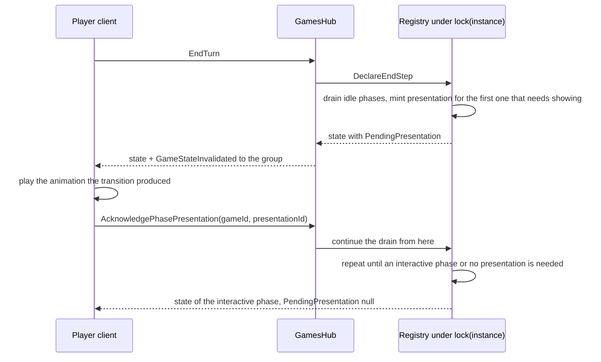

# Design C: the server owns the non-interactive phases, the client acknowledges the presentation

## Goal

The engine — not a browser tab — decides when a non-interactive phase ends. The client stops being a
driver and becomes a presenter: it plays the animation the transition produced and tells the server it
is done, and the server then takes the next step.

Today the roles are inverted: [`useAutoAdvancePhaseEffect`](client/src/views/game/hooks/GameView/effects/useGameViewEffects.ts:820)
submits `advance-phase` for the phases the server publishes it for, waits for
[`drawAnimationEndsAt`](client/src/views/game/hooks/GameView/effects/useGameViewEffects.ts:911) so the
deck→hand flight is not cut, and re-checks forever if a dispatch is dropped. The engine already knows
which phases those are ([`PhaseAdvanceMode.AutoAdvanceImmediately`](server/Engine/Services/GamePhaseStateService.cs:13)),
it just never acts on it.

## Contract

### State: a phase presentation

New payload member next to `PendingPrompt` in
[`GameStateResponse`](server/Models/Api/GameStateResponses.cs:3):

```csharp
public sealed record PhasePresentationResponse(
    string PresentationId,                // minted per presented transition; an ack must quote it
    string Phase,                         // the phase that was just entered (DrawPhase, EndStep, ...)
    string Kind,                          // what to present: InitialDeal | Ready | Draw | Damage | BattleEnd | TurnEnd
    int TurnNumber,
    IReadOnlyList<string> RequiredAckPlayerIds,   // every connected participant; their clients must ack
    IReadOnlyList<string> AcknowledgedPlayerIds); // who is already done (the client can show a hint)
```

`PendingPresentation = null` means "no presentation outstanding": the client is free to act, and the
drain may continue.

**Every connected participant acks** (settled): the engine waits until the presentation has been
acknowledged by each player the server saw as connected when it was minted, so both boards have finished
animating before the next step. The client therefore acks whenever it is listed in
`RequiredAckPlayerIds`, not only when it is the active player.

### Flow



### Server rules

1. **Drain at the mutation boundary.** Every mutation ends with a drain loop (a sibling of
   [`AutoAdvanceMainPhaseIfNoLegalActions`](server/Engine/Services/InMemoryGameInstanceRegistry.cs:2583)):
   while the current phase is `AutoAdvanceImmediately`, has no player interaction, and nothing is
   blocking, call `phaseService.AdvancePhase` again.
2. **Stop conditions** (checked before every step): a pending prompt of any kind, an unacknowledged
   presentation, `GameEndRules.IsGameOver`, `SupportTimingRules.HasPendingSupportActivation`, a pending
   optional On-Attack choice, any published global action for the active player, and a defensive step
   budget (`MaxDrainSteps`, e.g. 16) that turns a bug into a log line instead of an infinite loop.
3. **Mint a presentation only when the step has something to show** (`PhasePresentationKind != None`):
   an empty deck draws nothing, nothing rested means nothing stands up, so the drain continues without
   stopping. `PhaseAdvanceMode.AutoAdvanceImmediately` + `HasPlayerInteraction` + the new
   `PhasePresentationKind` all live on the same metadata row in
   [`GamePhaseStateService`](server/Engine/Services/GamePhaseStateService.cs:12), so the client stops
   re-declaring `SYSTEM_ADVANCED_PHASES`.
4. **Ack contract, all connected clients.** `AcknowledgePhasePresentation(gameId, presentationId)` is
   accepted from any participant listed in `RequiredAckPlayerIds` and only for the *current* id. It is
   idempotent per player (a repeat is a no-op), and an ack for a superseded/expired id is ignored, never
   an error the client must show. The drain resumes only when every required player has acked.
5. **Presence decides the required set.** The required players are the participants with a live hub
   connection when the presentation is minted (new `IGamePresenceTracker`, fed by the hub's
   connect/subscribe/unsubscribe/disconnect — see the server work below). A participant who disconnects
   mid-presentation is removed from the requirement, so a closed tab can never hold the table; if nobody
   is connected the drain continues immediately.
6. **Bounded wait.** `PresentationAckTimeoutMs` (server config, a few seconds) resumes the drain even
   without all acks, so a hung client, a reload mid-presentation, an API-only e2e run or a bot can never
   strand a game. An ack that arrives after the timeout is ignored (see rule 4).
7. **Every other mutation is rejected while a presentation is outstanding**, with a clear
   `Cannot act while a phase presentation is pending` state error — the same shape as the existing
   `Cannot advance phase while a prompt is pending` guard.
8. `advance-phase` stops being published and the hub method is retired; `AdvancePhase` stays an internal
   registry step, since that is what the drain calls.

### Metadata correction the plan depends on

Implementing the metadata exposed a latent mismatch: `AttackDeclaration` was marked
`AutoAdvanceImmediately` and `BlockerDeclaration` was marked interactive, which is the opposite of how the
engine actually uses them. `AttackDeclaration` is entered *only* when the attacker owes an optional On Attack
choice (`TryPrepareOptionalWhenAttackingChoice`), so a drain reading that flag would have skipped the question;
`BlockerDeclaration` is a pass-through stage nothing publishes an action for, so a drain stopping on it would
have stranded the table. Both are corrected
([`GamePhaseStateService.cs`](server/Engine/Services/GamePhaseStateService.cs:26)): the attack window is
`ManualOnly` + interaction, the blocker stage is `AutoAdvanceImmediately` + no interaction and presents nothing.

### Presentation kinds

| Phase | Kind | What the client presents |
|---|---|---|
| `DrawInitialHand` | `InitialDeal` | the 5-card deck→hand deal |
| `StartOfMainPhase` | `None` | nothing |
| `DrawPhase` | `Draw` | the per-turn deck→hand draw (the one gate the client has today) |
| `RefreshPhase` | `Ready` | rested→standing transitions + summon card ready |
| `AttackResolution` | `Damage` | damage application, K.O. flights to the trash, attack visuals |
| `BattleEndStep` | `BattleEnd` | attack state/arrow clearing |
| `EndStep` | `TurnEnd` | damage reset, active player swap, turn number bump |

## Server work

- [`GamePhaseStateService.cs`](server/Engine/Services/GamePhaseStateService.cs:9): add
  `PhasePresentationKind` to `PhaseMetadataTemplate`/`GamePhaseData`, expose
  `ShouldAutoAdvance(phase)` and `GetPresentationKind(phase)`.
- **Presence tracking (new, required by the all-clients ack).** Nothing on the server knows who is
  connected today: the hub only adds/removes SignalR group membership in
  [`GamesHub.Subscription.cs`](server/Api/Hubs/GamesHub.Subscription.cs:5) and there is no
  `OnConnectedAsync`/`OnDisconnectedAsync` override. Add a singleton `IGamePresenceTracker`
  (`gameId -> playerId -> connection count`) fed by connect, subscribe, unsubscribe and a new
  disconnect override, so a presentation can be minted with the connected participants as its required
  ack set and can drop a participant who leaves mid-presentation.
- `GameState`/`GameInstance`: hold `PendingPresentation` (id + kind + phase + turn + required players +
  acked players) with `Mint`/`Acknowledge`/`Clear` helpers; include it in `ValidateInvariants`; clear it
  when the game ends.
- [`InMemoryGameInstanceRegistry.cs`](server/Engine/Services/InMemoryGameInstanceRegistry.cs:275): add
  `DrainIdlePhases(instance)` called at the end of every mutation (prompt resolve, card action, pass,
  declare end step, complete end step, ack) and
  `AcknowledgePhasePresentation(gameId, playerId, presentationId, presence)` which records the ack and
  continues the drain once every required player has acked. Keep the existing per-step calls
  (`SweepContinuousPassives`, `ApplyPendingAttackResolutionIfNeeded`, `ValidateInvariants`,
  `EvaluateGameEnd`) per drained step.
- [`GamePhaseHandlingService.cs`](server/Api/Services/Games/GamePhaseHandlingService.cs:31) +
  `IGamePhaseHandlingService`: add the ack operation; keep `AdvancePhase` for internal/rollback use.
- [`GameStateResponseMapper.PhaseActions.cs`](server/Api/Services/Games/GameStateResponseMapper.PhaseActions.cs:126):
  delete `AddDefaultAdvancePhaseAction`; publish `PendingPresentation` in
  [`GameStateResponseMapper`](server/Api/Services/Games/GameStateResponseMapper.cs:7).
- [`GamesHub.PhaseActions.cs`](server/Api/Hubs/GamesHub.PhaseActions.cs:13): add
  `AcknowledgePhasePresentation`; keep `AdvancePhase` behind `GamePhaseAutomation:Enabled` for one
  release, then delete it. Reject every other mutation while a presentation is outstanding, including
  the ack itself once the id has expired.
- Options: `GamePhaseAutomationOptions { Enabled, PresentationAckTimeoutMs, MaxDrainSteps }` — the whole
  feature is one config switch away from the current behaviour.
- [`IGameStateBroadcaster`](server/Api/Interfaces/Game/IGameStateBroadcaster.cs:1) +
  [`GamesHubStateBroadcaster`](server/Api/Services/Games/GamesHubStateBroadcaster.cs:1): the "state changed"
  notification as a service, so the automation can push a change made with no inbound call (the presentation
  timeout) without the engine depending on SignalR.
- Tests: drain reaches the next interactive phase from each auto phase, stops on prompt/presentation/
  game-over/support window, mints no presentation when nothing changed, `EndStep` swaps the turn exactly
  once, the ack matrix (one ack of two does not resume; the second does; a repeat is a no-op; a
  superseded id is ignored; a non-participant ack is refused), a disconnect mid-presentation releases the
  requirement, the timeout resumes, and the step-budget guard fires.

## Client work

### Add

- `usePhasePresentationEffect`: reads `gameState.pendingPresentation`, waits for the client's animation
  queue to go idle for that kind, then calls the ack. Re-arms while the same `presentationId` is still
  pending (the pattern of
  [`useRevealPresentationAckEffect`](client/src/views/game/hooks/GameView/effects/useGameViewSideEffects.ts:241)),
  and swallows the "already cleared" rejection so a server-side timeout never shows an error banner.
- A completion registry on `animController` (`registerPresentationAnimation(deadlineMs, tag)` /
  `isPresentationIdle()`), so the queue knows about every animation, not just the draw: the draw stamps
  `drawAnimationEndsAt` today, while ghosts (`useCardMoveGhostAnimationEffect`,
  `useRevealedCardSummonFlightEffect`, `useTrashRecallSummonFlightEffect`), the ready transition and the
  attack visuals are currently fire-and-forget. A per-kind minimum (`PRESENTATION_MIN_MS`) covers the CSS
  transitions, and a hard cap (`PRESENTATION_MAX_MS`) guarantees the ack.
- `acknowledgePhasePresentation` in [`gameHubApi.ts`](client/src/services/api/gameHubApi.ts:113) on a
  path that does **not** set `isActionPending`: the ack happens between player actions, and flipping the
  pending flag would dim the HUD and block submits.

### Repoint

- `isAutoAdvancing` in [`gameUIStore`](client/src/state/gameUIStore.ts:55) becomes
  `isPresentingPhaseTransition = Boolean(gameState.pendingPresentation)` — the row/sidebar freeze keeps
  working for exactly the right window, with a server-provided trigger instead of client timing. The
  chip latch and its hooks ([`useRetainedInteractiveActions.ts`](client/src/views/game/hooks/GameView/memos/useRetainedInteractiveActions.ts:1))
  stay; the `advance-phase` filter in
  [`resolvePhaseActionChips`](client/src/views/game/utils/functions/gameState/phaseActionChips.ts:36)
  stays as a safety net even though the action no longer exists.

### Delete

- [`useAutoAdvancePhaseEffect`](client/src/views/game/hooks/GameView/effects/useGameViewEffects.ts:820),
  `IUseAutoAdvancePhaseEffectArgs`, `AUTO_ADVANCE_*` constants, `advanceSignalKeyRef`,
  `lastAutoSignalKey`, and the `drawAnimationEndsAt` gating that only exists to feed it (the draw
  deadline stays, but as a presentation input).
- [`autoAdvanceOwnership.ts`](client/src/views/game/utils/functions/gameState/autoAdvanceOwnership.ts:1)
  and every import of `SYSTEM_ADVANCED_PHASES` / `isAutoAdvanceOwnedSnapshot`.
- `advance-phase` everywhere: [`useSubmitHubIntent`](client/src/views/game/hooks/GameHub/useSubmitHubIntent.ts:66)
  branch and prompt-pending suppression, [`gameHubApi.advancePhase`](client/src/services/api/gameHubApi.ts:113),
  [`usePassLikeAction`](client/src/views/game/hooks/GameView/memos/usePassLikeAction.ts:8) entry,
  `mapActionToHubIntent`, [`gameRouteHandlers`](client/src/views/game/handlers/gameRouteHandlers.ts:83),
  and the `advance-phase` intent in the hub types.

## Sequencing (each step shippable, flag-guarded)

1. **Plumbing, no behaviour change.** Payload field (never minted), ack hub method, client ack effect,
   the animation-completion registry, and the freeze keyed on `pendingPresentation` instead of the client
   predicate. Nothing moves yet; the old driver still runs.
2. **Ack-driven steps.** The server mints a presentation for the auto phases and advances *only* when the
   ack arrives; the client driver is muted for snapshots that carry a presentation. The transition now
   runs server-side, with the driver still available as a fallback for phases that present nothing.
3. **Full drain.** The server also walks the presentation-less phases itself, so it no longer needs the
   client at all; delete the driver, the ownership predicate and the `advance-phase` branch chain.
4. **Retire the old action.** Remove `AddDefaultAdvancePhaseAction`, the hub `AdvancePhase` method, the
   API wrapper and the client types.
5. **Docs and tests** (below), then remove the flag in a follow-up release.

Rollback at any point is `GamePhaseAutomation:Enabled = false` plus the step-4 revert; steps 1 and 2 are
inert with the flag off.

## Risks and how the plan handles them

| Risk | Handling |
|---|---|
| Stranded game when no client acks | Server-side ack timeout (rule 5) + late-ack tolerance |
| A phase hidden by a drained jump | A presentation is minted for every step that changed something animatable, so nothing is silently skipped |
| Animation cut | The ack waits for the completion registry, per-kind minimums cover the CSS transitions, and the cap keeps a broken queue from stalling the table |
| Ack/Action collision | The ack is a separate submit that never sets `isActionPending`; every other mutation is rejected while a presentation is pending |
| API-only e2e or bots stalling | The timeout resumes; e2e helpers can also ack explicitly through the hub |
| Reconnect mid-presentation | The payload carries the outstanding presentation, so a re-joining client resumes presenting and acks |
| Turn-boundary jump | `TurnEnd` is its own presentation kind, so the swap and damage reset are always shown as one step before the next turn's `Ready`/`Draw` |
| Drain loop bug | `MaxDrainSteps` guard + per-step engine validation, exactly like every other mutation |

## Tests

- **Server**: drain matrix per phase, stop conditions, no-presentation path, `TurnEnd` single swap,
  ack ownership/idempotency/timeout, step budget, mapped payload (`PendingPresentation` present/absent,
  `advance-phase` never published again).
- **Client**: the ack effect waits for the registry (unit-able as pure deadline math), re-arms, swallows
  the timeout rejection, and never sets `isActionPending`.
- **e2e**: extended and green. [`gameview.multiplayer.phase-transition.spec.ts`](e2e/gameview.multiplayer.phase-transition.spec.ts:78)
  now also asserts the engine is *not* left parked on a receipt once the chain settles (which only holds if
  both pages really acked), while the chips stayed held and no system chip was ever drawn. The API-driven
  helpers wait the gate out instead of advancing
  ([`waitForNoPendingPresentation`](e2e/helpers/multiplayer/hub.ts:66)) and absorb the rejection if it closes
  again ([`progressToNextDecisionWindow`](e2e/helpers/multiplayer/flow.ts:119),
  [`advanceToMulliganPromptIfNeeded`](e2e/helpers/multiplayer/prompts.ts:100)).
- The "unacked client cannot stall the table" case stays a **server** test
  (`Drain_...watchdog resumes and notifies`) rather than an e2e one: forcing a page to refuse its
  acknowledgement would need production code that only exists for the test, and the watchdog path has no
  client involvement to exercise.

## Docs

[`04-state-phase-effects.md`](.clinerules/04-state-phase-effects.md:54) (ownership moves to the engine;
the presentation contract and its stop conditions),
[`02-board-ui-hud.md`](.clinerules/02-board-ui-hud.md:112) (the freeze is triggered by
`pendingPresentation`), [`03-targeting-contract.md`](.clinerules/03-targeting-contract.md:20)
(`advance-phase` is gone from the action vocabulary).

## Progress

Landed and green so far (server suite: 589 passed):

- [`IGamePresenceTracker`](server/Api/Interfaces/Game/IGamePresenceTracker.cs:1) /
  [`GamePresenceTracker`](server/Api/Services/Games/GamePresenceTracker.cs:1), wired into the hub's
  subscribe/unsubscribe/disconnect and create/join, with 6 tests.
- `PhasePresentationKind` on the phase metadata, `GamePhaseData.PresentationKind` and
  `GamePhaseData.ShouldAutoAdvance`, with the two corrections above, pinned by 4 tests.
- [`PendingPhasePresentation`](server/Models/Game/PendingPhasePresentation.cs:1) with the all-clients ack
  matrix, `GameInstance` mint/acknowledge/clear helpers, the matching `ValidateInvariants` checks and the
  action-log entries, pinned by 11 tests.
- [`GamePhaseAutomationOptions`](server/Engine/GamePhaseAutomationOptions.cs:1) (off by default) and the
  broadcaster seam, both registered in [`Program.cs`](server/Program.cs:47).

- The drain itself: `DrainIdlePhases` in [`InMemoryGameInstanceRegistry.cs`](server/Engine/Services/InMemoryGameInstanceRegistry.cs:2610)
  with its stop conditions, the per-step engine bookkeeping, the presentation mint, the acknowledgement
  watchdog and `AcknowledgePhasePresentation` / `ReleasePhasePresentationRequirement`, called at the end of
  every mutation through `GamePhaseService.GetPhaseData`; 7 tests cover the deal stop and the two-ack
  resume, the walk to the main phase (Draw and Ready presentations), the turn boundary (the swap happens
  only once the `TurnEnd` presentation is acknowledged), the watchdog resuming and notifying, the
  disconnect release, the nobody-connected walk-through and the automation-off behaviour.

Landed after that (server suite: 595 passed):

- The acknowledgement through the hub: `IGamePhaseHandlingService.AcknowledgePhasePresentation` /
  `ReleasePhasePresentationRequirement`, the `GamesHub` hub method (on its own path, because
  `ExecuteAuthorizedGameMutation` now **rejects every other mutation** while a presentation is outstanding -
  `Game.PhasePresentation.Pending`), and the disconnect release driven by
  `IGamePresenceTracker.RemoveConnection` returning the `GamePresenceAddress` list. Pinned by
  `GamesHubPhasePresentationTests`-style cases inside [`GamesHubNormalizationTests`](server/tests/ProjectHiddenVillage.Server.Tests/GamesHubNormalizationTests.cs:96)
  (the ack path notifies the group; `DeclareEndStep` is refused *before* the engine is asked).
- Publishing the receipt: `PhasePresentationResponse` on `GameStateResponse`, `AddDefaultAdvancePhaseAction`
  returning early for an automation-owned game, and the game-over suppression, pinned by
  [`GameStateResponseMapperPhasePresentationTests`](server/tests/ProjectHiddenVillage.Server.Tests/GameStateResponseMapperPhasePresentationTests.cs:1).
- `GamePhaseAutomation:Enabled` in [`appsettings.json`](server/appsettings.json:21) - the switch that makes
  the client's new behaviour the shipped behaviour.

Landed on the client:

- The animation registry on the anim controller (`animationEndsAtByKey` + `noteAnimation`; the draw, the
  hand→pile discard and every ghost flight register their end timestamp) and the pure deadline math in
  [`phasePresentation.ts`](client/src/views/game/utils/functions/gameState/phasePresentation.ts:1).
- `acknowledgePhasePresentation` on the hub state hook (its own path: never `submitHubIntent`, never
  `isActionPending`) and [`usePhasePresentationAckEffect`](client/src/views/game/hooks/GameView/effects/useGameViewEffects.ts:809),
  which acks only for a receipt it still owes, waits for the board to settle, and re-arms while the same
  receipt is pending.
- The HUD freeze repointed to `pendingPresentation` (`isPhasePresentationPending` on `gameUIStore`), with
  the chip latch, the inert held chips and the sidebar hold kept as they were.
- `useAutoAdvancePhaseEffect`, the `AUTO_ADVANCE_*` constants, `advanceSignalKeyRef` and
  `autoAdvanceOwnership.ts` were **deleted**; `advance-phase` left the client vocabulary entirely (the
  `declare-attack` chip now has its own intent, which is the only remaining player-facing use of the hub's
  `AdvancePhase`).
- The transition regression spec now also asserts the engine is not left parked on a receipt once the chain
  settles, and it passes against the automation-enabled server.

## Decisions

- **Who acks — settled: every connected participant.** Both boards must be finished animating before the
  engine takes the next step, so the drain waits for all required acks, a participant who disconnects is
  dropped from the requirement, and an unacked presentation never outlives `PresentationAckTimeoutMs`.
- **Ack transport — a dedicated presentation state, not the prompt machinery.** Reusing prompts would leak
  presentation "prompts" into the prompt overlay, the `resolve-prompt:` chips, the phase text, the pruner
  and the prompt e2e helpers, and it would break the invariant that a pending prompt means a decision is
  waiting. The reveal presentation stays a prompt because it suspends an effect chain with a resume node;
  a phase has no such continuation, `AdvancePhase` is always the next step.
- **Timeout — a few seconds, then resume silently and ignore late acks.** A timed-out presentation is not
  replayed for a late client: the state it belongs to is already on screen and replaying it would show a
  transition that has been superseded. The exact value of `PresentationAckTimeoutMs` is the one remaining
  number to settle, once the client queue's worst case (draw + ghosts + attack visuals) is measured.
