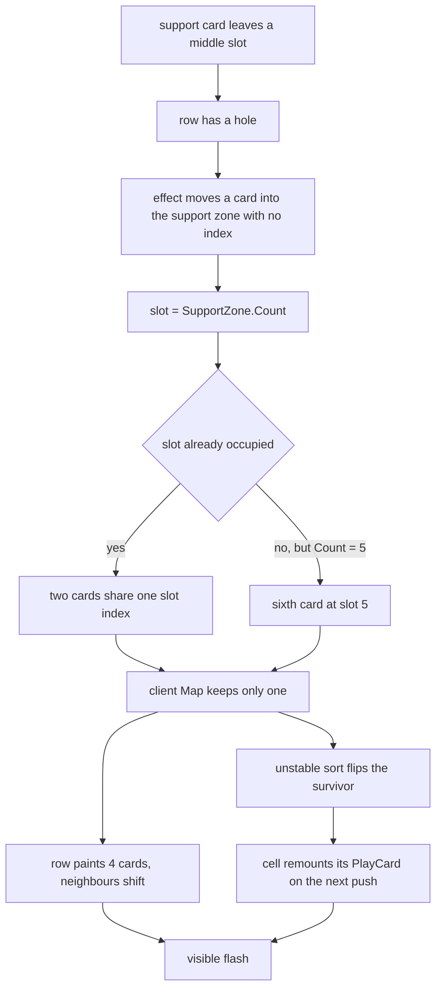

# Opponent support card flashes the card beneath it

Report: an opponent support card occasionally flashes the card that is *beneath* it. It happened live after
several turns, it looked tied to screen refreshes, and the reporter's guess was "a second support card hit the
same slot".

That guess is right, but the slot collision is only half of it. The engine can put two support cards in one
slot; the client then silently drops one of them, and whichever one survives decides what that grid cell paints
- and a change of survivor remounts the cell's card element. Two defects, one symptom.

## D1 - the engine assigns slot indices from a list length

[`GameRuntimeDeckService.MoveCardToZone()`](server/Api/Services/Games/GameRuntimeDeckService.cs:231):

```csharp
if (destinationZone == PlayerZone.SupportZone)
{
    var supportSlotIndex = destinationIndex ?? destinationList.Count;
    movedCard.SupportSlotIndex = supportSlotIndex;
```

`destinationList.Count` is a **length**, not a free slot. The row is only left-packed at the start of a game.
The moment a support card leaves the row (used, summoned, bounced), its slot is reset to `null`
([line 206](server/Api/Services/Games/GameRuntimeDeckService.cs:206)) and a hole is left behind. After that,
`Count` points at a slot that is already occupied whenever the hole is not the last one:

| occupied slots | Count | slot written | result |
| --- | --- | --- | --- |
| 0, 1, 2 | 3 | 3 | fine |
| 0, 2 (slot 1 used) | 2 | 2 | **collides with the card in slot 2** |
| 1, 2 | 2 | 2 | **collides** |
| 0, 1, 2, 3, 4 (full) | 5 | 5 | **out of range, invisible sixth card** |

Nothing checks uniqueness, nothing checks `MaxSupportSlots`, and this branch is reached by every zone move that
is not a Set Support:

- [`MoveCardEffect.ExecuteMoveMode()`](server/Api/Services/Games/Effects/CardEffects/Control/MoveCardEffect.cs:238) - any `moveCardDestinationZone = SupportZone` with no destination index
  ([`ResolveDestinationIndex()`](server/Api/Services/Games/Effects/CardEffects/Control/MoveCardEffect.cs:289) returns `action.DestinationIndex`, which is `null` unless authored).
- [`SearchCardEffect`](server/Api/Services/Games/Effects/CardEffects/Search/SearchCardEffect.cs:118) - deck to
  support, same `null` index.
- Every wrapper that forwards `destinationIndex: null`
  ([`MoveCardFromHandToSupportZone()`](server/Api/Services/Games/GameRuntimeDeckService.cs:348) included).

The one path that *is* guarded is Set Support, through
[`TryResolveSupportSlotIndex()`](server/Engine/Services/InMemoryGameInstanceRegistry.cs:3893): it knows about
`MaxSupportSlots`, refuses an occupied slot and falls back to the leftmost free one. So the engine already has
the correct rule - it is simply not the rule the other paths use. Two slot allocators exist; only one is right.

## D2 - the client picks one card per slot and hides the rest

[`RenderZoneCardSlots()`](client/src/views/game/components/ZoneCardSlots.tsx:29):

```tsx
cardsBySlot.set(resolvedSlotIndex, card)   // last write wins, no collision handling
...
if (resolvedSlotIndex >= 0 && resolvedSlotIndex < 5) { ... }   // everything else is dropped
```

Three consequences, and together they are the flash:

1. **A card disappears.** Two cards on one slot index render once; the row shows four cards for five slots.
2. **Every card after the dropped one shifts a cell.** The grid is filled by DOM order, not by an explicit
   grid column, so a hidden card moves its neighbours one cell left - reading as cards jumping during a refresh.
3. **Which card survives is not stable.** It is the last entry in the array the server published, and that array
   is ordered by an **unstable** [`List.Sort`](server/Api/Services/Games/GameRuntimeDeckService.cs:236) whose
   comparator returns 0 for the duplicate pair. Equal keys have no guaranteed relative order, and a later
   insert re-sorts the whole list. When the survivor changes, the cell's `PlayCard` is keyed by
   `support-${card.instanceId}` ([line 131](client/src/views/game/components/ZoneCardSlots.tsx:131)), so the old
   element unmounts and the new one mounts with a fresh ``: one blank frame on the elevated surface before
   the art paints. Occupant change + blank frame + shifting neighbours is exactly "the card underneath flashes".

Same frame, same cause, for a slot index of 5 or more: the card is dropped outright and no client ever sees it.



## Hypotheses checked and ruled out

- **Reveal flags oscillating on refresh.** Every writer of `IsRevealedToBothPlayers` was inspected
  ([summon](server/Api/Services/Games/Effects/CardEffects/Summoning/SummonCardEffect.cs:128),
  [destroy](server/Api/Services/Games/Effects/CardEffects/Control/DestroyCardEffect.cs:86),
  [reveal](server/Api/Services/Games/Effects/CardEffects/Control/RevealCardEffect.cs:84),
  [support activation](server/Engine/Services/InMemoryGameInstanceRegistry.cs:2071),
  [zone change](server/Api/Services/Games/GameRuntimeDeckService.cs:211)). Each is a one-way transition on a
  move, not a per-push toggle, so it cannot flash on a revalidation.
- **An optimistic support card.** There is none: [`submitSetSupport()`](client/src/views/game/utils/functions/gameState/submitSetSupport.ts:7)
  only animates the card the server returns, and
  [`mapActionToHubIntent()`](client/src/views/game/utils/functions/gameState/helpers.ts:144) forwards a slot
  index only when the caller already had one, so the client never guesses a slot.
- **A second rendering path for the row.** [`SupportCardZone.tsx`](client/src/components/ui/game/SupportCardZone.tsx:5)
  is an unused skeleton; [`RenderZoneCardSlots`](client/src/views/game/components/ZoneCardSlots.tsx:21) is the
  only renderer of a support row.
- **Missing/double flights.** The support row is a pure render path; no flight primitive touches it
  ([`useSupportSummonFlightEffect()`](client/src/views/game/hooks/GameView/effects/useGameViewEffects.ts:1079)
  only reads support elements as flight origins).

## Fix

### Stage 1 - one slot allocator, server side

- Extract the rule that already lives in `TryResolveSupportSlotIndex` into a single helper next to
  `MaxSupportSlots`:
  - `TryResolveFreeSlot(row, requestedIndex, out slot)`: a requested index must be in `0..MaxSupportSlots-1`
    and free (same messages the current helpers throw, so existing tests and client error copy keep working);
    otherwise the leftmost free slot; a full row returns `false` so the caller fails cleanly instead of
    stacking or overflowing.
  - `NormalizeSlots(row)`: heals a row that is already broken (duplicate, null or out-of-range indices) by
    keeping the first claimant of each valid slot in a deterministic order (slot, then instance id) and
    moving the rest into the leftmost free slots. Called before a row is published, so a game that is already
    corrupted in memory stops flashing on its next state push without needing a restart.
- [`MoveCardToZone`](server/Api/Services/Games/GameRuntimeDeckService.cs:231): replace
  `destinationIndex ?? destinationList.Count` with the allocator; throw `InvalidOperationException` when the
  row is full. Replace the unstable `List.Sort` with a stable order by `(SupportSlotIndex, InstanceId)`.
- [`TryResolveSupportSlotIndex`](server/Engine/Services/InMemoryGameInstanceRegistry.cs:3893) delegates to the
  same helper, so Set Support and every effect path are one rule, not two.
- Publish-time guard in
  [`ToPlayerZonesResponse()`](server/Api/Services/Games/GameStateResponseMapper.Zones.cs:39): the support row
  the mapper emits must have unique indices in `0..4`. Normalize, and keep a debug assertion so a future path
  that bypasses the allocator fails in tests rather than in a live game.

### Stage 2 - render every instance exactly once, client side

- Move the slot layout out of the component into a pure helper (next to
  [`resolveNonLeaderCards()`](client/src/views/game/utils/functions/cards/index.ts:101)) that returns a fixed
  five-entry `Array<card | null>`:
  - order the input by `(supportSlotIndex ?? Infinity, instanceId)`, then place each card in its own slot;
  - a card whose slot is taken, or which has no/invalid index, goes to the leftmost free slot instead of being
    dropped - a broken server row shows up as a card in the wrong place, never as a vanished card and never as
    a shifted row;
  - when more than five cards are present, keep all five slots filled and log once per push in dev.
- In [`RenderZoneCardSlots()`](client/src/views/game/components/ZoneCardSlots.tsx:61) render that array by slot
  index, keeping the existing `support-${instanceId}` key so a card that changes slot moves instead of
  remounting, and keeping `data-slot-index` as the authoritative hook for the e2e suite.
- Dev-only `console.warn` naming the duplicated slot and the instance ids competing for it: the next engine
  regression becomes a log line instead of a mystery flash.

### Stage 3 - regression coverage and the written rule

- Server unit tests ([`GameRuntimeDeckServiceTests.cs`](server/tests/ProjectHiddenVillage.Server.Tests/GameRuntimeDeckServiceTests.cs:1),
  [`InMemoryGameInstanceRegistryTests.cs`](server/tests/ProjectHiddenVillage.Server.Tests/InMemoryGameInstanceRegistryTests.cs:1835)):
  - row with a hole (0 and 2 occupied) + a move into the support zone lands in slot 1, not slot 2;
  - a full row rejects the move and stays at five cards;
  - duplicate/null/out-of-range indices normalize deterministically, and normalizing twice is idempotent;
  - the mapper never emits two cards on one slot index.
- Client unit test for the new layout helper: duplicate slot, out-of-range slot and a null index all produce
  five distinct rendered cards with a deterministic order.
- e2e in [`gameview.multiplayer.support.spec.ts`](e2e/gameview.multiplayer.support.spec.ts:67) using the
  existing [`getBottomSupportCardsBySlot()`](e2e/helpers/gameviewMultiplayerHelpers.ts:1) helper: use a middle
  support card, let another support enter through an effect, then sample the support row across a forced
  revalidation - every `supportZone` instance appears exactly once, no slot index carries two cards, and the
  per-slot instance id does not change between frames when the state did not change.
- Note the invariant in [`.clinerules/02-board-ui-hud.md`](.clinerules/02-board-ui-hud.md:222): **a support slot
  index is assigned by the engine only, is unique in the row, and lives in `0..MaxSupportSlots-1`; the client
  renders every instance it is given exactly once.**

## Verification gates

1. `dotnet test` on the server test project.
2. `npm --prefix client run typecheck` and `npm --prefix client run lint` clean.
3. Playwright: `gameview.multiplayer.support`, `quick-support`, `support-target-visuals`,
   `board-animation`, `reveal-presentation`.

## Risks

| Risk | Mitigation |
| --- | --- |
| A full support row now rejects an effect that previously "succeeded" by writing a sixth card | That sixth card was invisible to both players; failing loudly is the correct behaviour, and the existing Set Support path already rejects a full row the same way |
| Normalizing on publish hides a future allocator bug | The mapper keeps a debug assertion and the client logs duplicates in dev; only a live game gets the silent repair |
| Effect target ids already published use `support:{index}` | The allocator never renumbers a card that already holds a valid slot, so `support:2` keeps pointing at slot 2 |
| A healed row still shifts once on the push that repairs it | One shift with no remount is acceptable; the alternative is a permanently invisible card |

# Results

## What shipped

- [`SupportSlotRules`](server/Api/Services/Games/SupportSlotRules.cs): one allocator (`TryResolveSlot`) and one repair
  pass (`NormalizeSlots`) for the five-slot row. `SlotCount = 5` now lives here instead of the registry's private
  constant, so the allocator and the Set Support path cannot disagree again.
- [`MoveCardToZone`](server/Api/Services/Games/GameRuntimeDeckService.cs:231) resolves the slot through the
  allocator and orders the row with a stable `OrderBy((slot, instanceId))`. The length-based assignment is gone.
- A second defect surfaced while writing the tests: the move removed the card from its source zone **before**
  resolving the destination slot, so a refused move (full row, occupied requested slot, out-of-range index)
  silently swallowed the card. The slot is now resolved before the removal; the unit test pins
  `Hand.Count == 1` after a refused move.
- [`TryResolveSupportSlotIndex`](server/Engine/Services/InMemoryGameInstanceRegistry.cs:3893) delegates to the
  allocator, and [`ToPlayerZonesResponse`](server/Api/Services/Games/GameStateResponseMapper.Zones.cs:20) repairs a
  row that is already corrupted in memory before publishing it.
- [`buildSupportSlotLayout`](client/src/views/game/utils/functions/cards/supportSlotLayout.ts) replaces the
  last-wins `Map` in [`RenderZoneCardSlots`](client/src/views/game/components/ZoneCardSlots.tsx:29): deterministic
  order, no dropped instance, surplus reported instead of vanishing, plus a dev-only `console.warn` naming the
  contested slots. The `support-${instanceId}` key is unchanged, so a card that changes slot still moves instead of
  remounting.
- Invariant written into [`.clinerules/02-board-ui-hud.md`](.clinerules/02-board-ui-hud.md:233).

## Guards

- [`SupportSlotAssignmentTests`](server/tests/ProjectHiddenVillage.Server.Tests/SupportSlotAssignmentTests.cs) - 7
  tests: the hole case lands in the leftmost free slot, a full row refuses without consuming the card, a duplicate
  pair is healed deterministically, an occupied/out-of-range requested slot is rejected, the row stays ordered, and
  the mapper publishes unique in-range slots twice in a row.
- [`gameview.multiplayer.support.spec.ts`](e2e/gameview.multiplayer.support.spec.ts:382) - "the support row paints
  every card once, on its own slot, across a refresh": every published instance is painted exactly once on the slot
  the server reports, and a full page reload reproduces the same per-slot mapping.

The planned *client unit test* was dropped: the client has no test runner (no vitest/jest in
[`client/package.json`](client/package.json:6)), so the deterministic layout is covered by the e2e sampling instead.

## Verified

- `dotnet test` - 1113 passed, 0 failed.
- `npm --prefix client run typecheck` and `npm --prefix client run lint` - clean.
- Playwright (`--workers=2`): support (7), quick-support (2), support-target-visuals (1), board-animation (6),
  reveal-presentation (3) - 19/19 passed.

## Found while investigating, out of scope

- [`ToSupportCardInstanceResponse()`](server/Api/Services/Games/GameStateResponseMapper.Zones.cs:60) sends the
  real `CardDefinitionId` even for a concealed opponent support card, so the identity of a face-down support is
  in the payload the opponent receives.
- The support row renders no departure copy, so support to trash and support to battlefield have no exit flight
  ([documented](plans/support-summon-arrival-flight.md:87)).
- [`SupportCardZone.tsx`](client/src/components/ui/game/SupportCardZone.tsx:5) is dead code carrying a second,
  unused copy of the five-slot constant.
