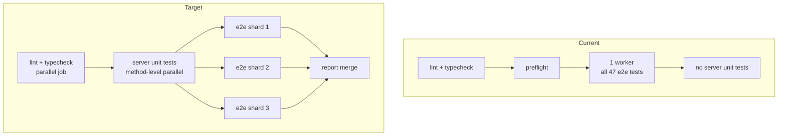

# Test Suite Speedup Plan

Goal: cut total test wall time substantially **without** deleting tests, skipping specs, loosening assertions, or raising retries/timeouts to mask flakiness.

Two suites are in scope:

- **E2E** — Playwright, 19 spec files / 47 tests (`e2e/`), driven against `dotnet run` + Vite.
- **Server unit tests** — MSTest, ~78 files (`server/tests/ProjectHiddenVillage.Server.Tests/`), currently not wired into CI at all.

---

## 1. Measured causes (evidence)

| # | Cause | Evidence | Cost |
|---|---|---|---|
| C1 | Every hub call opens, starts and stops its own SignalR connection | [`invokeGameHubMethod()`](../../e2e/helpers/multiplayer/hub.ts:34), [`start()`](../../e2e/helpers/multiplayer/hub.ts:42), [`stop()`](../../e2e/helpers/multiplayer/hub.ts:45) | Dozens–hundreds of handshakes per test |
| C2 | `waitForNoPendingPresentation` spins 150 ms polls, each re-handshaking | [`hub.ts:72`](../../e2e/helpers/multiplayer/hub.ts:72), [`hub.ts:94`](../../e2e/helpers/multiplayer/hub.ts:94) | Up to 10 s per wait |
| C3 | Setup creates games repeatedly to obtain an all-uppercase join code | loop at [`setup.ts:67`](../../e2e/helpers/multiplayer/setup.ts:67), [`isUppercaseGameCode()`](../../e2e/helpers/multiplayer/setup.ts:9) | `(36/62)^5 ≈ 10.5%` hit rate ⇒ **~9.5 creates/test ≈ 450 games** |
| C4 | Retry-with-sleep loops exist only to absorb server warm-up | [`login()`](../../e2e/helpers/multiplayer/api.ts:54) 20 × 1 s, [`createOrResetFixtureCard()`](../../e2e/helpers/multiplayer/fixtures.ts:82) 20 × 1 s, [`openReadyGameView()`](../../e2e/helpers/multiplayer/setup.ts:13) 8 reloads | 10–20 s per helper, per cold start |
| C5 | 3 s sleeps inside 20-iteration loops | [`admin.card-editor.spec.ts:34`](../../e2e/admin.card-editor.spec.ts:34), [`admin.card-create.spec.ts:63`](../../e2e/admin.card-create.spec.ts:63) | Up to **60 s dead time each** |
| C6 | E2E serves the client from `vite dev` (on-demand transform) | [`e2e:start:client`](../../package.json:9) | Large cold-boot × 2 contexts/test |
| C7 | CI is fully serial (`workers: 1`); local is file-serial (`fullyParallel: false`) | [`playwright.config.ts:7`](../../playwright.config.ts:7), [`playwright.config.ts:5`](../../playwright.config.ts:5) | No parallelism in CI |
| C8 | Video recorded for every test, discarded on pass | [`playwright.config.ts:17`](../../playwright.config.ts:17) | Fixed per-test overhead |
| C9 | Server/client restarted even when already running | [`reuseExistingServer: false`](../../playwright.config.ts:22) | 30–60 s per run |
| C10 | MSTest fully sequential — no `[assembly: Parallelize]` | [`ProjectHiddenVillage.Server.Tests.csproj`](../../server/tests/ProjectHiddenVillage.Server.Tests/ProjectHiddenVillage.Server.Tests.csproj:1) | 1× |

### Root cause behind C3 — a real product bug

- Generated codes use a **mixed-case** alphabet: [`InMemoryGameInstanceRegistry.cs:13`](../../server/Engine/Services/InMemoryGameInstanceRegistry.cs:13).
- The instance dictionary is **`StringComparer.Ordinal`**: [`InMemoryGameInstanceRegistry.cs:48`](../../server/Engine/Services/InMemoryGameInstanceRegistry.cs:48).
- The hub normalises every game id to **upper case**: [`GamesHub.Auth.cs:134`](../../server/Api/Hubs/GamesHub.Auth.cs:134).

Consequence: a game created with a lowercase character in its code **cannot be reached through the hub at all** — i.e. it is unplayable in the client. The E2E uppercase-retry loop was masking that defect. Fixing the alphabet removes both the bug and ~90% of game creations in the suite.

---

## 2. Why parallelism is safe (verified, not assumed)

- **Presence is per connection, registered only on an explicit subscribe**: [`GamesHub.Subscription.cs:25`](../../server/Api/Hubs/GamesHub.Subscription.cs:25) calls `gamePresenceTracker.RegisterConnection(...)` only inside `SubscribeToGame`. The E2E helpers only invoke mutations and never subscribe, so they never join the phase-presentation ack set ([`hub.ts:58`](../../e2e/helpers/multiplayer/hub.ts:58)).
- **Presence is keyed by connection id**, not by user: [`GamePresenceTracker.cs:18`](../../server/Api/Services/Games/GamePresenceTracker.cs:18).
- **Each test owns its game**: [`setupMultiplayerGame()`](../../e2e/helpers/multiplayer/setup.ts:44) creates a fresh game per call; no spec shares a game code across tests.
- **Shared seeded users are read-only**: [`SEEDED_PLAYER_PROFILES`](../../e2e/helpers/multiplayer/api.ts:52) logs in the same two users but only reads decks.

The one thing to prove empirically is seeded-user concurrency under repetition (see §7 verification).

---

## 3. Phase 1 — Deterministic join codes

**Server**

1. Change `GameCodeAlphabet` to uppercase + digits only at [`InMemoryGameInstanceRegistry.cs:13`](../../server/Engine/Services/InMemoryGameInstanceRegistry.cs:13).
2. Tighten the assertion in [`Create_AssignsFiveCharacterAlphanumericGameCode`](../../server/tests/ProjectHiddenVillage.Server.Tests/InMemoryGameInstanceRegistryTests.cs:1505) from `^[A-Za-z0-9]{5}$` to `^[A-Z0-9]{5}$` so the contract is pinned.
3. Leave `preferredGameCode` semantics alone (seeders use explicit codes); optionally normalise it to upper case in a follow-up.

**E2E**

4. Delete `isUppercaseGameCode()` and the 250-iteration retry loop in [`setupMultiplayerGame()`](../../e2e/helpers/multiplayer/setup.ts:44); create once, assert `/^[A-Z0-9]{5}$/` on the returned code.

Expected: ~9.5 game creations → **1** per test (≈450 → 47). Also stops the e2e database growing by hundreds of game rows per run.

---

## 4. Phase 2 — Persistent helper hub connections

1. In [`hub.ts`](../../e2e/helpers/multiplayer/hub.ts:34), add a module-level cache `Map<string, HubConnection>` keyed by `${userId}:${accessToken}`.
2. `invokeGameHubMethod` becomes: get-or-create → `start()` only when `state === Disconnected` → invoke. On `invoke` failure due to a closed connection, rebuild once and retry.
3. Reuse the same cached connection inside [`waitForNoPendingPresentation`](../../e2e/helpers/multiplayer/hub.ts:72), [`executeBattleActionViaHub`](../../e2e/helpers/multiplayer/hub.ts:187) and [`getCardActionTargetsViaHub`](../../e2e/helpers/multiplayer/hub.ts:245) instead of building new ones.
4. Export `closeHelperConnections()`; call it from a `test.afterAll` inserted via a tiny shared fixture (`e2e/baseTest.ts` re-exporting `test`/`expect` with an `afterAll` hook), or from the Playwright `globalTeardown`.

Why this is safe: a cached connection is per-worker process and never subscribes, so it is invisible to presence and to the presentation gate. At most 2 connections per worker instead of hundreds per test.

---

## 5. Phase 3 — Readiness gate, remove fixed sleeps

1. Add `e2e/global-setup.ts`: poll `GET /api/health` (exists at [`HealthController.cs:9`](../../server/Api/Controllers/HealthController.cs:9)) until 200, with a hard deadline; then warm one game once.
2. Register `globalSetup` in [`playwright.config.ts`](../../playwright.config.ts:3).
3. Reduce warm-up retries to fail-fast semantics:
   - [`login()`](../../e2e/helpers/multiplayer/api.ts:54): 2 attempts, no 1 s sleeps.
   - [`createOrResetFixtureCard()`](../../e2e/helpers/multiplayer/fixtures.ts:82): keep the 409/`PATCH` reset path, drop the sleep loop.
   - [`openReadyGameView()`](../../e2e/helpers/multiplayer/setup.ts:13): single `goto` + `expect(getByTestId('game-board')).toBeVisible()`. Playwright's auto-retrying assertions already handle transient loading; reload loops are not needed.
4. Admin specs: replace `for` + `waitForTimeout(3000)` with `await expect.poll(() => page.locator('li button').count(), { timeout: 30_000 }).toBeGreaterThan(0)`.

**Keep** the `InvalidState` read-then-act resilience in [`hub.ts:53`](../../e2e/helpers/multiplayer/hub.ts:53) — that is correctness, not warm-up.

---

## 6. Phase 4–6 — Config, client build, server tests

**Playwright config**

- `reuseExistingServer: !process.env.CI` ([line 22](../../playwright.config.ts:22)).
- `video: 'off'`; keep `trace: 'on-first-retry'` + `screenshot: 'only-on-failure'` ([lines 15–17](../../playwright.config.ts:15)).
- `fullyParallel: false` (file-level parallelism) and `workers: process.env.CI ? 1 : undefined`.
  **Why not intra-file:** a spec's `beforeAll`/`afterAll` owns a catalogue-level fixture lifecycle
  (`ensureFixtureCards` in `gameview.multiplayer.actions.spec.ts`), so two workers running tests from that
  file race the create against the delete. Measured with `fullyParallel: true` at 4 workers: 7 failures /
  94 runs, every Gamabunta scenario resolving against a catalogue whose fixture cards had just been deleted.
- Keep `reducedMotion: 'no-preference'` ([line 14](../../playwright.config.ts:14)) — animation assertions depend on it.
- Note on `openReadyGameView`: the 5 s per-attempt timeout becomes one 30 s assertion, replacing a budget of
  8 × (5 s + 1 s sleep) ≈ 48 s with 30 s. The total allowance goes **down**, not up.

**Production client build for e2e**

- `e2e:build:client`: `VITE_API_BASE_URL=http://127.0.0.1:3101 npm --prefix client run build`.
- `e2e:start:client`: `npm --prefix client exec vite preview -- --host 127.0.0.1 --port 4173 --strictPort`.
- `e2e:start` runs the build first. `vite preview` keeps the SPA history fallback, so `/game/:code` routes still resolve. Bonus: e2e now exercises the real bundle, catching build-only breakage.

**Server unit tests**

- Add `server/tests/ProjectHiddenVillage.Server.Tests/AssemblyInfo.cs` with
  `[assembly: Parallelize(Workers = 0, Scope = ExecutionScope.MethodLevel)]`.
- Run the full suite; add `[DoNotParallelize]` only to classes that prove shared-state collisions (EF-InMemory fixtures such as [`GamesServiceGetCardsForGameTests`](../../server/tests/ProjectHiddenVillage.Server.Tests/GamesServiceGetCardsForGameTests.cs:128)).
- Add `test:server` script: `dotnet test server/tests/ProjectHiddenVillage.Server.Tests/ProjectHiddenVillage.Server.Tests.csproj -c Release --no-build` after an explicit build.

---

## 7. Phase 7 — CI topology and verification

**Verification (must pass before merging parallelism)**

```sh
npx playwright test --workers=1 --repeat-each=2   # the shipped CI profile
dotnet test server/tests/ProjectHiddenVillage.Server.Tests/ProjectHiddenVillage.Server.Tests.csproj -c Release
```

Measured results:

| Run | Result |
|---|---|
| `--workers=1 --repeat-each=2` (shipped CI profile) | **94/94 passed in 12.0 m** |
| `--workers=3 --repeat-each=2` | 93/94 — one pre-existing load-sensitive helper budget |
| `--workers=4 --repeat-each=2`, `fullyParallel: true` | 87/94 — fixture-lifecycle race, see §6 |
| `--workers=4 --repeat-each=2`, `fullyParallel: false` | 93/94 — one transient `phase-indicator` assertion |
| `gameview.multiplayer.actions.spec.ts --workers=1` | 8/8 passed in 46 s |

The residual intermittent failures at higher concurrency are pre-existing: the original local config already
ran `workers: undefined` (6 on a 12-core machine), so per-machine load was at least as high. They come from
iteration-based retry budgets in `e2e/helpers/multiplayer/flow.ts` and from one assertion on a transient
"Your turn" label that the 4 s `PresentationAckTimeoutMs` watchdog can outrun on a loaded machine. Making
those budgets deadline-based is a separate change, and is why CI keeps its original per-machine concurrency.

**CI** ([`e2e.yml`](../../.github/workflows/e2e.yml:96))

- Matrix `shard: [1, 2, 3]`, each job with its own Postgres service, running `npx playwright test --shard=${{ matrix.shard }}/3`.
- Separate `server-tests` job (`dotnet test -c Release`), so the unit suite finally gates PRs.
- Keep lint/typecheck in their own fast job so they fail early.



---

## 8. Optional — local DB hygiene

Game rows are never deleted, so a developer's e2e database grows across runs, slowing game-state queries. Add an opt-in reset (`PHV_E2E_RESET_DB=1`) to [`e2e-start-server.sh`](../../scripts/e2e-start-server.sh:25) that drops and re-applies the e2e database only. Low priority; never touches dev/CI databases by default.

---

## 9. Guardrails (do not violate)

- No `test.skip`, no deleted specs, no weakened assertions.
- No timeout/retry increases used to hide flakiness.
- Do not remove the `InvalidState`-tolerant helpers; they encode known server races.
- Keep `reducedMotion: 'no-preference'` and `trace: 'on-first-retry'`.
- Never replace a real assertion with a sleep — C5 becomes `expect.poll`, not a shorter sleep.
- Parallelism is enabled only after the repetition runs in §7 are green.

## 10. Expected outcome

| Change | Expected effect on e2e time | Risk |
|---|---|---|
| Phase 1 join codes | −10–20% | Low (fixes a product bug) |
| Phase 2 hub connections | −20–40% | Low (presentation gate verified unaffected) |
| Phase 3 readiness + sleeps | −5–15%, removes worst-case 60 s stalls | Low |
| Phase 4 config | −5–10% (video off, warm-stack reuse) | Low |
| Phase 5 production build | measured 379 ms client build; removes on-demand dev transforms | Medium (dev-only behaviour assumptions) |
| Phase 7 sharding | ~3× on CI (three independent runners, unchanged per-machine load) | Low |
| Server `Parallelize` | **726 tests in 1 s**, no `[DoNotParallelize]` needed | Low (verified) |

Phases 1–4 are independent and individually revertible; 5–7 build on them.

---

## 11. Follow-ups (implemented)

### 11.1 Deadline-based retry budgets

New [`deadline.ts`](../../e2e/helpers/multiplayer/deadline.ts:1) provides a wall-clock budget. The six
"advance until the state offers what I need" resolvers in [`flow.ts`](../../e2e/helpers/multiplayer/flow.ts:1)
and the mulligan-progress loop in [`prompts.ts`](../../e2e/helpers/multiplayer/prompts.ts:101) previously
counted cycles. A cycle can be a pure no-op (engine parked behind an unacknowledged phase presentation, or
behind a prompt the caller still owns), so an attempt count conflates *progress* with *waiting*.

- Resolvers: `maxCycles = 180` → `createDeadline(75_000)`; the 240-cycle main-phase search → `createDeadline(100_000)`.
  Both match the old nominal worst case, so this is not a budget increase.
- Mulligan progress: 20 attempts ≈ 15 s → `createDeadline(15_000)`.
- Failure messages now state the budget and the time actually spent, instead of "within retry limit", so a
  future failure says whether the engine never offered the action or the loop gave up early.

### 11.2 Hand-settle helper promoted, one more race removed

`getBottomHandInstanceOrder` / `waitForBottomHandToSettle` moved from
[`gameview.spec.ts`](../../e2e/gameview.spec.ts:1) into the shared helpers and are now used by the mulligan
card-details check as well: the row can still be re-laying out after the prompt appears, and hovering a card
measured against a stale rect silently drops the hover, so the revealed button is gone by click time.

### 11.3 Transient assertion replaced

[`actions.spec.ts:495`](../../e2e/gameview.multiplayer.actions.spec.ts:495) asserted the literal `'Your turn'`.
That label only exists until the phase drain moves on (the engine auto-ends an empty MainPhase), so it was a
transient window that a busy machine could close first. It now asserts the settled turn label
(`Your turn | Opponent's turn`): the board recovered from the tribute state, without asserting which side
holds a turn the test never controls (the starting player is random).

### 11.4 Measured after the follow-ups

| Run | Result |
|---|---|
| `--workers=1 --repeat-each=2` (shipped CI profile) | **94/94 passed in 11.6 m** |
| `--workers=4 --repeat-each=2` (after the fix in §11.5) | **94/94 passed in 3.5 m** |
| `battle-visuals.spec.ts --repeat-each=5 --workers=1` | **10/10, ~5 s per run** |
| `battle-visuals.spec.ts --repeat-each=5 --workers=2` | **10/10** |

**Decision: CI stays at one worker per shard.** The 3× comes from sharding, not per-machine concurrency.

### 11.5 The shuffle-dependent battle scenario — fixed

[`battle-visuals.spec.ts`](../../e2e/gameview.multiplayer.battle-visuals.spec.ts:1) summoned *whatever card
`resolveActorWithBottomHandAction` found first in hand*, then required a **Battle** action from that same card.
Whether the first summonable card can attack is decided by the shuffle: a summon-sick character without [Rush]
has no Battle action until its controller's next MainPhase. No seeded card can attack on the turn it is played —
`N-007` only gains [Rush] at 10+ power (it prints 8) and `N-011` needs two specific allies on the field.

**Fix:** a third fixture card, `E2E-RUSH-10`, minted through the admin endpoint exactly like the existing ones.
It is a normally summonable 10-power Character carrying `N-007`'s own `gain-rush` passive verbatim (continuous,
self-targeted, `Power >= 10`, controller's turn). Both tests in the file now play a 25-card fixture deck that is
24 copies of it — so a Rush card in the opening hand is a certainty, not a bet — and summon it by
`cardDefinitionId`. The attack happens on the summon turn, which is what the scenarios always assumed.

Two supporting changes fell out of it:

- `ensureFixtureCards` / `deleteFixtureCards` take the ids a spec uses. Files run in parallel, so the old
  helpers' "clean up every fixture" teardown could delete a card another file was mid-scenario with.
- Fixture provisioning retries its create-or-reset a bounded three times. That is the only retry left in the
  helpers and it is safe because the write is idempotent (a fixed shape); a *game* mutation is still never
  retried, because that could apply twice.

Result: 10/10 under repetition at one and two workers, ~5 s per run instead of burning a 75 s budget.

### 11.6 Observed, not fixed: another shuffle-dependent scenario

Under a 4-worker `--repeat-each=2` stress run,
[`attack-sequence.spec.ts:106`](../../e2e/gameview.multiplayer.attack-sequence.spec.ts:106) failed twice, then
passed on the immediately following identical run (94/94). It summons with an arbitrary hand card too (it
deliberately summons one turn ahead so the attacker is not summon-sick, which is sound), and it uses a fixed
`wait(1_200)` after the summon click rather than polling the card onto the field. It is not the shipped CI
profile (one worker per shard) and it did not reproduce, so it was left alone rather than guessed at.

If it recurs, the same two techniques close it: poll the state for the card's arrival instead of sleeping, and
pin the summoned card by `cardDefinitionId` where the scenario asserts *which* card attacks.

A durable alternative for the whole suite: let the e2e create-game path accept a fixed shuffle seed
(`GameInstanceFactory` currently always draws its own via `RandomNumberGenerator`), which would make every
scenario reproducible instead of shuffle-dependent.
