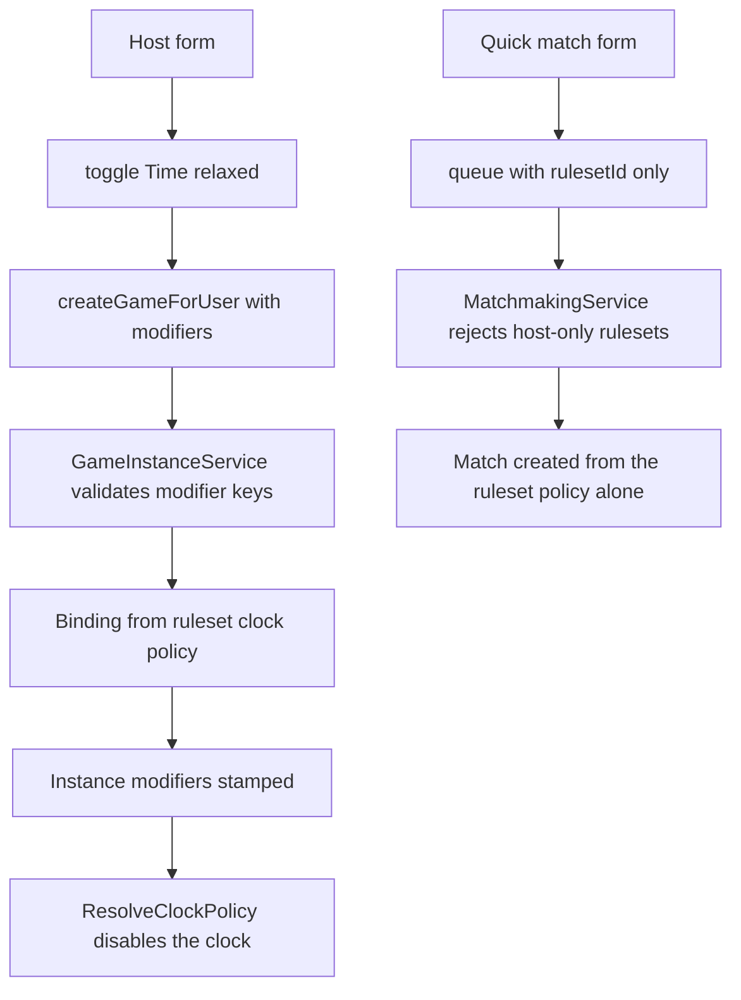

# Time Relaxed as a host-only game modifier, and a per-ruleset quick-match availability flag

## Problem

`time-relaxed` is currently a seeded ruleset row whose only distinguishing column is `ClockEnabled = false`
([`DeckRulesetConfiguration.cs`](server/Data/Configurations/Decks/DeckRulesetConfiguration.cs:93)). Because it is a
ruleset, it behaves like a format everywhere a format is listed:

- the quick-match select offers it, so an untimed game can be queued for and paired on
  ([`LoginView.tsx`](client/src/views/login/LoginView.tsx:418));
- the queue endpoint accepts any active ruleset id
  ([`MatchmakingService.cs`](server/Api/Services/Matchmaking/MatchmakingService.cs:66));
- hosting has to express "let us take our time" by picking a different format instead of adjusting the one they want.

Two changes fix that:

1. **Time Relaxed becomes a per-game modifier** a host toggles when opening a table, and it is not a ruleset at all.
2. **A ruleset gains a quick-match availability flag**, so a format can exist for invites only. `time-relaxed`
   disappears, but the mechanism stays for the next host-only format.

## Decisions

| # | Decision |
|---|---|
| 1 | "Time Relaxed" is a modifier of a hosted game instance, never a ruleset row. |
| 2 | The modifier switches the action clock off outright for that game; it does not scale the budgets. |
| 3 | Quick match cannot carry modifiers: the enqueue request has no modifier field, so it is unreachable there by construction rather than by UI alone. |
| 4 | Rulesets keep their clock columns. A format can still tighten timings, and `ClockEnabled` stays as an admin switch; the availability flag is what governs quick-match exposure. |
| 5 | `AvailableInQuickMatch` defaults to true, is edited through the admin ruleset editor, and is honoured by the quick-match select **and** the queue endpoint. The host select, the join-format lookup and the import dialog ignore it. |
| 6 | The effective clock policy is snapshotted on the instance at creation, so a later ruleset edit or a different modifier list can never retune a running game. |
| 7 | The modifier is instance-level, so it also applies to an unbound hosted game (created without a ruleset), which falls back to the deployment default policy plus the modifier. |

## Model

### Server

| Type | Change |
|---|---|
| [`DeckRuleset`](server/Data/Entities/Decks/DeckRuleset.cs:3) | New `bool AvailableInQuickMatch { get; set; } = true`. |
| [`DeckRulesetDefinition`](server/Api/Services/Deck/DeckRulesetRules.cs:7) | New `bool AvailableInQuickMatch` so the queue can refuse a host-only format without a second read. |
| `DeckRulesetResponse` / `CreateDeckRulesetRequest` / `UpdateDeckRulesetRequest` ([`DeckRulesetRequests.cs`](server/Models/Api/DeckRulesetRequests.cs:5)) | New `bool AvailableInQuickMatch = true` (trailing optional parameter, so existing callers keep compiling). |
| New `server/Models/Game/GameModifiers.cs` | `GameModifierKeys.TimeRelaxed = "time-relaxed"`, the known-key set, and a normaliser that rejects unknown keys. |
| [`CreateGameForUserRequest`](server/Models/Api/GameInstanceRequests.cs:3) | New `IReadOnlyList<string>? Modifiers = null`, host path only. |
| [`GameInstance`](server/Models/Game/GameInstance.cs:12) | New `IReadOnlyList<string> Modifiers`, stamped at creation next to `Ruleset`. |
| [`GameStateResponse`](server/Models/Api/GameStateResponses.cs:3) | New `IReadOnlyList<string> Modifiers` so both clients can label the table. |

### Client

| Type | Change |
|---|---|
| [`types/deckRuleset.ts`](client/src/types/deckRuleset.ts:6) | New `availableInQuickMatch: boolean`; the derive types pick it up automatically. |
| [`types/game.ts`](client/src/services/api/types/game.ts:1) | `ICreateGameForUserRequest` gains `modifiers?: string[]`. |
| game state payload types | `modifiers?: string[]`. |
| [`deckRulesetAdminTypes.ts`](client/src/views/admin/types/deckRulesetAdminTypes.ts:16) | Draft gains `availableInQuickMatch`. |

## Request flow



## Server changes

- **Modifier catalog.** New `server/Models/Game/GameModifiers.cs` with the known keys, `Normalize` returning the
  canonical keys or the first unknown one, and doc comments tying it to this plan.
- **Create path.** [`GameInstanceService.CreateGameForUser()`](server/Api/Services/Games/GameInstanceService.cs:20)
  normalises `request.Modifiers`, returns a validation error listing the allowed keys for an unknown one, and passes
  the result into game creation. `registry.Create` gains an optional `modifiers` parameter placed **after**
  `random`, so every existing positional call still compiles, and the instance is born with the modifier instead of
  being patched one boundary later.
- **Policy resolution.** [`ResolveClockPolicy()`](server/Engine/Services/InMemoryGameInstanceRegistry.cs:3046)
  becomes the single place the modifier is applied:

  ```csharp
  var basePolicy = instance.Ruleset is { } binding
      ? clockOptions.Apply(binding.Clock)
      : clockOptions.DefaultPolicy;

  return instance.Modifiers.Contains(GameModifierKeys.TimeRelaxed)
      ? basePolicy with { Enabled = false }
      : basePolicy;
  ```

  `GameClock.Start` already replaces the clock when the policy differs, so a modifier stamped on a game whose
  binding arrives a moment later still ends with exactly one clock and one armed-or-unarmed watchdog.
- **Rename the preset.** `GameClockPolicy.TimeRelaxed` becomes `GameClockPolicy.Untimed` (same value:
  `Standard with { Enabled = false }`) and loses its "a time relaxed ruleset binds this" wording, since the
  modifier is now what binds it.
- **Queue guard.** [`MatchmakingService.EnqueueAsync()`](server/Api/Services/Matchmaking/MatchmakingService.cs:45)
  returns `Matchmaking.Enqueue.RulesetNotQuickMatch` when `ruleset.AvailableInQuickMatch` is false, before the deck is
  resolved, so a host-only format never takes a queue slot.
- **Payload.** [`GameStateResponseMapper`](server/Api/Services/Games/GameStateResponseMapper.cs:113) publishes
  `Modifiers`; the clock block keeps publishing `IsEnabled = false` for an untimed game (not `null`), so the client
  can tell "untimed by design" apart from "no clock object yet".
- **Ruleset plumbing.** `DeckRulesetService` maps the new column in `ToResponse`, `GetActiveRulesetDefinition`,
  create and update; `DeckRulesetShapeRules` needs no change beyond the boolean being carried through.

## Client changes

- **Host column only.** A checkbox/switch labelled from `auth.hostTimeRelaxed` renders under the Host button
  ([`LoginView.tsx`](client/src/views/login/LoginView.tsx:1218)), outside the quick-match branch entirely; its state
  lives in the login view store next to `rulesetIdByMode` so it survives tab switches but is never sent by the
  quick-match intent. Sitting below the button keeps the format select and Host level with the code field and Join on
  the other half of the shared tab.
- **Create call.** The host branch builds `createdModifiers` (`['time-relaxed']` when the toggle is on) and spreads
  them into the request only when non-empty, so a plain table sends no `modifiers` field at all.
- **Share dialog.** [`CreateGameShareDialog`](client/src/views/login/components/CreateGameShareDialog.tsx:28) receives
  the modifier labels and shows "No action clock" under the format name, so the host sees what they shared.
- **Quick-match list.** `quickmatchRulesetChoices`, the default-selection effect and `selectedQuickmatchRuleset`
  filter on `ruleset.availableInQuickMatch !== false` (undefined counts as available, which keeps the e2e network
  mocks working unchanged). When nothing is quick-matchable, the select shows the existing "no rulesets" label and
  Find Match is disabled with the same toast the missing-ruleset path uses.
- **Host list / join / import.** Unfiltered by design: an invite must be able to play a host-only format, and the
  import dialog always shows every active format.
- **Modifier badge.** The format name and the join code stay exactly where they were: the vertical labels in the side
  rail ([`SidebarButtons`](client/src/views/game/components/SidebarButtons.tsx:32)). Only the modifier is new UI, so
  only the modifier moves: [`MatchModifierBadge`](client/src/views/game/components/MatchModifierBadge.tsx:1) renders it
  as a solid pill (`bg-[var(--surface-elevated)]`, shadow and ring) fixed to the top-right of the viewport at
  `z-[300]` - above the board, whose attack links reach `z-[240]` - with `pointer-events-none` so it cannot swallow a
  click. Two earlier attempts failed: the rail forced the label into vertical type, and a gutter-anchored variant only
  appeared above `xl`, so narrower windows silently kept the unreadable rail version.
- **Admin editor.** The `availableInQuickMatch` checkbox sits beside the Active checkbox in
  [`DeckRulesetEditorPane.tsx`](client/src/views/admin/components/ruleset/DeckRulesetEditorPane.tsx:183), wired through
  the draft and both payload builders in
  [`useDeckRulesetAdminModel.ts`](client/src/views/admin/model/useDeckRulesetAdminModel.ts:25), with a hint that a
  host-only format still appears in invite and join flows.

## Data and migration

One migration:

- adds `AvailableInQuickMatch boolean NOT NULL DEFAULT true` to `deck_rulesets` (existing rows are quick-matchable,
  so no format silently disappears from the queue);
- deletes the seeded `time-relaxed` row by its fixed id, which is the pair `HasData` removal in
  [`DeckRulesetConfiguration`](server/Data/Configurations/Decks/DeckRulesetConfiguration.cs:48) produces;
- removes `TimeRelaxedRulesetId` and its seed block, leaving Standard and Pre-Release as the only seeds.

No game data moves: games live in memory, and decks do not reference rulesets.

## Operational notes

- **Development migrates itself.** `npm run dev` used to leave an existing dev database behind the model, so the new
  column surfaced as `column d.AvailableInQuickMatch does not exist` on the first ruleset query. The Development
  startup path now calls `Database.MigrateAsync()` before the seeders, matching what the e2e stack already did;
  `Database:MigrateOnStartup=false` restores the manual flow. Production is unchanged and still uses
  `npm run db:migrate`.
- **Deleting the seeded `time-relaxed` row is intentional.** A development database that had admins pointing decks or
  notes at that id loses the format; Standard and Pre-Release remain, and the migration's `Down` restores the row.
- One migration applies both changes, so an existing deployment gets the column (backfilled true) and the row removal
  in one step, with no window where a format is missing but the flag is not yet readable.

## Tests

- **Ruleset service**: availability round-trips through create/update/response; a pre-existing row reads true.
- **Create game**: `time-relaxed` produces an instance whose modifiers contain the key; an unknown key is a
  validation error; no modifier leaves the modifier list empty; a modifier on an unbound game still disables the
  clock.
- **Registry** with `FakeTimeProvider`: a time-relaxed game never arms a watchdog, publishes
  `clock.isEnabled = false`, and does not forfeit when a main-phase budget would have expired; the same game with the
  modifier removed but the same ruleset times out normally.
- **Matchmaking**: enqueue against a host-only ruleset is refused with the new code and leaves no ticket; the
  existing pairing tests keep passing with the flag defaulted on.
- **Mapper**: `modifiers` is published, empty for a plain hosted game; untimed game publishes a clock block with
  `isEnabled = false`.
- **Existing tests to update**: the two suites that build a `GameClockRegistryTests`/`GameStateResponseMapperClockTests`
  binding from `Guid 20000000-...-0003` switch to a locally named untimed binding driven by the modifier, and
  `DeckRulesetServiceTests` stops using the string `time-relaxed` as its sample key.
- **e2e**: the quick-match select omits a host-only format and shows it in the host select; a queue call for a
  host-only format surfaces the server refusal; hosting with the toggle yields a board with no clock badge and the
  modifier label; the admin editor round-trips the flag. The existing `MOCKED_RULESET` fixtures need no change
  because an absent flag is treated as available.

## Risks

| Risk | Handling |
|---|---|
| A host-only format still reachable through a stale client | The queue endpoint refuses it server-side; the select filter is only the good path |
| Modifier leaking into quick match | The enqueue request has no modifier field, so there is nothing to send |
| A running game changing timings | The policy is resolved from the instance snapshot, never re-read from the ruleset |
| Transient default clock before the binding/modifier lands | Creation passes modifiers up front; `GameClock.Start` replaces the clock on a policy change and the stale token is refused by the watchdog |
| A deployment with only host-only formats | Find Match is disabled client-side and the endpoint refuses server-side with a readable message |
| Untimed games returning through the back door | `ClockEnabled` stays an admin-only switch; the seeded formats keep the clock on and the availability flag governs exposure |

## Out of scope

- Additional modifiers. The catalog exists so the next one is a key, a policy effect and a label, not a new field on
  the create request.
- Per-modifier permissions (guests may use the modifier exactly like anyone else).
- Weighted or ranked matchmaking, which would need its own ruleset attributes beyond availability.

## Cross-references

- [`plans/game-action-clocks.md`](plans/game-action-clocks.md:1): the clock, the policy snapshot and the seeded
  Time Relaxed ruleset this plan replaces.
- [`plans/quickmatch-ruleset-matchmaking.md`](plans/quickmatch-ruleset-matchmaking.md:1): the queue, the ruleset
  select and the guest prerequisite this plan extends.
